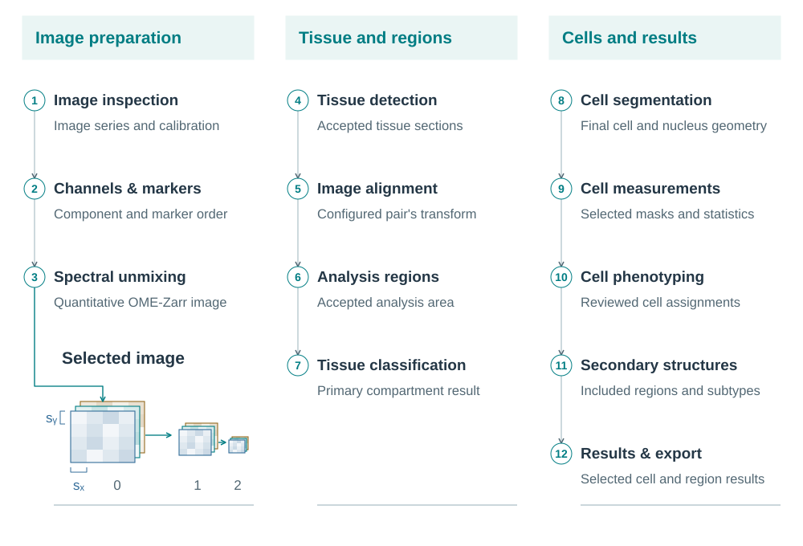

# MIFflow

MIFflow is a platform for multiplex immunofluorescence (mIF) that integrates and extends methods for image processing, quantitative analysis and reviewing within a semi-automated workflow.

[Browse the analysis guides](https://04-zain.github.io/MIFflow/#analysis-stages)

## Download the desktop application

For help choosing and installing the desktop application, see [Software setup](docs/stages/installation-and-build/software.md#open-a-portable-application). Download the archive for **Windows 11** or **Ubuntu 24.04** (x86-64) from [MIFflow releases](https://github.com/04-zain/MIFflow/releases).

## Preparing an analysis

Create an analysis on **Home**. Add the images and their subject IDs on **Samples**, then review the planned stages on **Plan**.

| Guide | Purpose |
|---|---|
| [Create an analysis and add samples](docs/stages/setup/analysis.md) | Create an analysis folder, add the images, identify which samples belong to each subject and choose which images to process together. |
| [Local and cluster computing](docs/stages/setup/computing.md) | Run the desktop on your computer or on a cluster, or keep the desktop on your computer and send processing jobs to the cluster. |
| [Run, review and continue](docs/stages/run/index.md) | Follow progress, inspect completed stages and reopen a saved analysis to continue work or revise a decision. |

## Analysis stages

Follow the stages on **Run** to prepare the images, identify tissue and cells, and review their measurements and phenotypes.

| Stage | Analysis |
|---|---|
| [1 · Image inspection](docs/stages/images/processing.md#inspect-the-image-and-prepare-ome-metadata) | Inspect the image, channel metadata and physical pixel sizes. |
| [2 · Channels and markers](docs/stages/images/index.md) | Identify the fluorophores and their biological markers, then select the nuclear stain. |
| [3 · Spectral unmixing](docs/stages/unmixing/index.md) | Separate overlapping fluorescence signals using imported spectra or [a library prepared from reference images](docs/stages/unmixing/library-from-images.md). |
| [4 · Tissue detection](docs/stages/tissue/index.md) | Separate tissue from background using an intensity threshold or a trained detector. |
| [5 · Image alignment](docs/stages/alignment/index.md) | Align a paired image, such as H&E, to the mIF image for display and transferring annotations. |
| [6 · Analysis regions](docs/stages/tissue/index.md#selecting-analysis-regions) | Use whole tissue sections or select smaller regions within them for analysis. |
| [7 · Tissue classification](docs/stages/tissue-classification/index.md) | Annotate examples of each tissue class, fit a classifier using image features or [KRONOS](docs/stages/tissue-classification/kronos.md), and inspect its predictions. |
| [8 · Cell segmentation](docs/stages/cells/index.md) | Segment cells or nuclei with InstanSeg, Cellpose-SAM or StarDist. Inspect the outlines and edit them where needed. |
| [9 · Cell measurements](docs/stages/cell-measurements/index.md) | Measure marker intensity in the selected cell compartment and calculate shape measurements from the cell and nuclear outlines. |
| [10 · Cell phenotyping](docs/stages/phenotyping/index.md) | Assign phenotypes using [marker rules](docs/stages/phenotyping/marker-rules.md), [supervised classification](docs/stages/phenotyping/supervised.md) or [unsupervised clustering](docs/stages/phenotyping/unsupervised.md). Marker rules can use cell intensities or [Nimbus marker scores](docs/stages/phenotyping/nimbus.md). |
| [11 · Secondary structures](docs/stages/secondary-structures/index.md) | Define and detect structures within tissue, review their cell populations and regional measurements, and assign subtypes where relevant. |
| [12 · Results and export](docs/stages/results/index.md) | Export measurements, phenotypes and regional summaries, or create [figures from a completed stage](docs/stages/results/figures.md). |

## Architecture and data flow

We use Python, Java and Groovy to run the desktop and perform image and cell analyses. QuPath provides the image viewer, annotation tools and prediction overlays used during review. The [processing guide](docs/stages/run/program-execution.md) explains how our scripts and compiled methods carry out each stage and how they interact.

| Topic | Technical guides |
|---|---|
| Images and spectral references | [Reading source images](docs/stages/images/processing.md), [spectral fitting and intensity correction](docs/stages/unmixing/index.md), and [storing and reading OME-Zarr image regions](docs/stages/images/storage.md) |
| Fitting and applying classifiers | [RF, SVM and logistic regression](docs/stages/classifier-methods/index.md) and [tissue-model features and fitted parameters](docs/stages/tissue-classification/model-execution.md) |
| Cells and annotations | [Assembling outlines across segmentation tiles](docs/stages/cells/processing.md) and [loading and editing regions in an image](docs/stages/run/interactive-viewing.md) |
| Saved results | [Image, model and table formats](docs/reference/data-formats.md) and [reading cell geometry, measurements and phenotype assignments](docs/reference/cell-storage.md) |
| Computing and recovery | [Memory and simultaneous calculations](docs/stages/setup/memory-and-threads.md), [scheduling and reuse of results](docs/stages/run/execution.md), and [resuming interrupted work](docs/stages/run/saving-and-recovery.md) |

## Building and integration

To install MIFflow from source, first [build the QuPath extension](docs/stages/installation-and-build/native-extension.md), then [install the Python application](docs/stages/installation-and-build/software.md#install-the-python-application). To distribute MIFflow, follow the [build and release guide](docs/stages/installation-and-build/building-and-releasing.md) to create a wheel for an existing Python environment or a portable desktop archive for Windows or Ubuntu.

Use the [command-line programs](docs/stages/setup/command-line.md) to run a prepared analysis on a processing host. The [Python interfaces](docs/stages/setup/python-api.md) let another program read saved results or call individual analysis methods.

## Licence

MIFflow is distributed under [GPL-3.0](LICENSE). Distributed dependencies and model assets retain their respective licences and notices.
