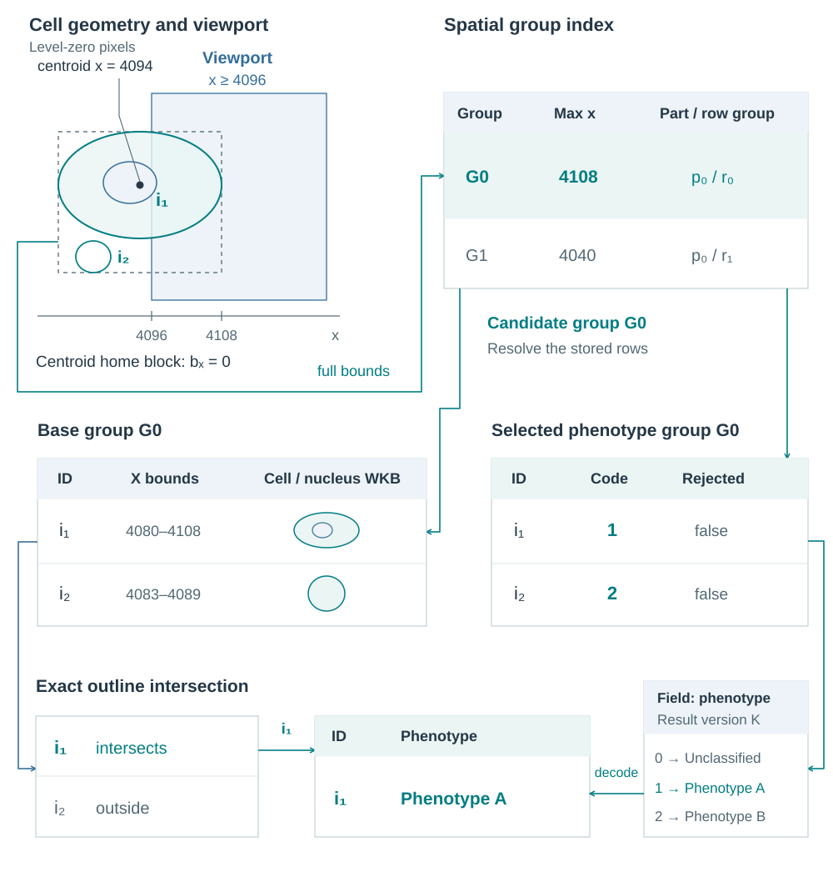

# Cell datasets and spatial queries

[Results and export](../stages/results/index.md) · [Saved data formats](data-formats.md) · [Additional figures](../stages/results/figures.md)

We use the cell ID to link each segmented outline to its measurements and phenotype throughout the analysis. The **base dataset** contains the cell IDs and outlines. Separate **result tables** hold measurements and classifications. When combining tables, we use the cell IDs and their recorded row positions to match the results to the correct outlines.

The sections below explain how we store these tables and retrieve cells within a field. To open an exported result, see [Saved data formats](data-formats.md#input-files-for-spatial-analysis).

**On this page:** [Files and cell identity](#i-dataset-structure-and-keys) · [Row layout](#ii-physical-row-layout) · [Indexes](#iii-layout-and-cell-id-indexes) · [Regional reads](#iv-spatial-query-sequence) · [Joining results](#v-matching-new-results-to-the-same-cells) · [Category codes](#vi-category-dictionaries) · [Edited outlines](#vii-geometry-edits-and-derived-layout).

<a id="i-dataset-structure-and-keys"></a>
## Files and cell identity

A base cell dataset contains:

```text
dataset.json
layout.parquet
id-index.parquet
base/
    part-*.parquet
```

The base `dataset.json` uses the format identifier `mif-cell-dataset/v1` and lists the Parquet files containing the cells, together with the layout and ID indexes used to locate their rows. A measurement or classification result has its own description, identified by `mif-cell-component/v1`, which lists its value tables and records how their rows correspond to the base cells.

An exported collection, identified by `mif-cell-dataset-collection/v1`, selects the base datasets for the included tissue sections, the measurement and classification results to read, and any accepted outline edits. Opening it reads the descriptions, layouts and category dictionaries and indexes any accepted outline edits. Subsequent queries load the requested columns from the base and result tables.

Each JSON description identifies the sample, image, segmentation population, coordinate system and selected outline revision. Information shared by every cell can appear once in the dataset’s `scope` metadata. Consequently, a table row may contain `cell_id` while its sample and image identities come from the surrounding dataset description. The collection’s `schema` lists the columns available when requesting measurements or classifications.

Across samples and segmentations, retain `(sample_id, image_entry_id, population_id, cell_id)` as the complete cell identity. `population_id` identifies the segmentation population; `cell_id` identifies a cell within it. The selected section and domain records supply the population context. A row offset locates that cell in one saved layout and can change if a population is rewritten. The layout and ID indexes below connect the stable cell ID to its stored row.

### Base and region fields

| Field or record | Representation | Interpretation |
|---|---|---|
| `cell_id` | String | Identifies the segmented cell within its population |
| `section_id`, `analysis_domain_id`, `tissue_roi_id` | Strings | Associate the cell with its tissue section and analysis domain |
| `x_level0`, `y_level0` | Float64 | Full-resolution centroid coordinates in image pixels; used for spatial ordering |
| `x_um`, `y_um` | Float64 | Calibrated centroid coordinates in µm |
| `cell_geometry` | Binary WKB (Well-Known Binary) | Cell outline, retaining holes and multipart geometry where present |
| `nucleus_geometry` | Nullable binary WKB | Associated nucleus; null records its absence |
| `min_x`, `min_y`, `max_x`, `max_y` | Float64 | Complete cell-outline bounds in full-resolution pixels |
| Geometry revision and edit selection | Dataset/component metadata and edits keyed by cell ID | Identify which outlines apply to a measurement or membership result |

The geometry columns carry GeoParquet metadata. [1] [Coordinate conventions](data-formats.md#coordinates-units-and-selected-populations) defines their image frame, calibration and null CRS.

Cell rows also refer to tissue sections and analysis regions. Secondary-structure membership associates a cell ID with each structure containing it, allowing several memberships for overlapping structures. [Region tables](data-formats.md#classified-region-tables) retain the corresponding outlines, classes and review decisions.

### Result-component fields

Result tables store measurements, reference labels, predictions or accepted classifications for the base population. Their descriptions retain the field definitions, source population and relevant model or review identities.

| Component | Per-cell values | Definition stored with the component |
|---|---|---|
| Measurements | Selected cell shape and intensity values | Measurement name, channel, cellular region, measure, units and storage type |
| Reference labels | The class assigned to each labelled cell | Reference set, class dictionary and subject allocation for fitting or evaluation |
| Model predictions | Predicted class code and model score | Fitted model, input features, score definition and model class order |
| Accepted classifications | Reviewed class code and confidence-rejection flag | Prediction or marker-rule result, accepted cutoff or label mapping, and class dictionary |

Numerical measurement fields use Float64; categorical fields use Int32 codes and the dictionaries described below. Textual notes and external identifiers remain strings. When reading measurement or marker-state columns, a corresponding `present:<field>` Boolean column can also be returned. It records whether that field was supplied for the cell, allowing a missing field to be distinguished from one explicitly supplied with a null value.

<a id="ii-physical-row-layout"></a>
## How cells are arranged on disk

To keep nearby cells close together on disk, the writer assigns each finalized centroid `(x,y)` to a 4096-by-4096-pixel block:

\[
b_x=\left\lfloor x/4096\right\rfloor,\qquad
b_y=\left\lfloor y/4096\right\rfloor.
\]

To keep nearby tissue regions close together on disk, we order the blocks by **Morton code**. We form this code by interleaving the binary digits of the horizontal and vertical block indices. Sorting by the resulting numbers follows a repeating Z-shaped path across the grid.

Within a block, we use the same ordering for the integer-pixel positions of cell centroids and break ties by `cell_id`. This rounding is only used to order rows. Each cell retains its original Float64 coordinates and its outline vertices in WKB.

A block containing many cells can occupy several row groups, and smaller groups can share a file. The Python base writer packs these sorted cells into independently readable Parquet row groups with at most **8,192 cells** and an **8 MiB target for the uncompressed Arrow table in memory**. It estimates row size while assembling a group, then checks the Arrow table size and splits a multi-cell group if necessary. WKB and other variable-length fields contribute to that size. Groups are packed toward **64 MiB decoded data per part file** and compressed with Zstd level 1. These are decoded sizes; compressed file sizes vary with the data.

The Python writer can isolate an oversized individual cell under its separate record allowance, which defaults to 64 MiB. Native readers and result writers enforce their own row-group allocation limits, including 8 MiB limits on result groups. A Python-written oversized cell therefore requires checking the intended reader's limits.

<a id="iii-layout-and-cell-id-indexes"></a>
## Locate a region or a known cell

`layout.parquet` contains one row per indexed data group:

| Field | Contents |
|---|---|
| `group_id` | Logical group used to associate base cells and result columns |
| `file`, `row_group` | Relative Parquet part path and physical row-group number |
| `row_count`, `decoded_bytes` | Number of cells and decoded Arrow table bytes recorded by the base writer |
| `min_x`, `min_y`, `max_x`, `max_y` | Bounds enclosing every complete cell outline in the group |

When QuPath opens a cell dataset, we read the layout in the background and build a **JTS STRtree**, a spatial index that searches the groups' bounding rectangles. We retain this index while the dataset is open, subject to the configured metadata-memory limit. The Python reader stores the same rectangles in numerical arrays and compares them with each requested region. Both readers can therefore identify which groups may contain relevant cells before loading their outlines. [2]

`id-index.parquet` maps sorted cell IDs to logical groups and row offsets. Known-ID queries read the corresponding sorted ranges and return locations in the saved table layout. The mapping is built once for that population/layout and reused by reference, edit and result-join operations.

The block assignment uses the centroid; the index bounds enclose complete outlines. A query can therefore find a cell whose outline crosses into the requested region even when its centroid belongs to a neighbouring block.

<a id="iv-spatial-query-sequence"></a>
## Read cells within a region

A regional read starts with a rectangle in full-resolution mIF coordinates and the selected cell result. We first identify saved groups whose bounding rectangles overlap or touch this region, then examine individual cells within those groups. The final inclusion rule depends on the task: a detailed image view needs outlines intersecting the rectangle, including cells crossing its edge, whereas a centre-based membership calculation selects cells whose centres fall inside it.

### Python table reads

For a regional read, call the exported collection's `query((min_x, min_y, max_x, max_y), columns=..., predicate=...)` with a rectangle in full-resolution image pixels and the columns needed for your calculation. We compare that rectangle with the saved group bounds to select candidate row groups.

Within each candidate group, we read the requested base columns and the corresponding measurement or phenotype columns. The result descriptions locate these values by base-group and row range; we verify that their cell-ID sequence matches the base rows before joining them. We also read the coordinates or outlines needed for the selected `predicate`, apply its cell-inclusion test, and restrict the collection to its included analysis regions. Iterating over the query yields Arrow `RecordBatch` objects containing the requested columns for those cells.

| Predicate | Final inclusion test | Additional data read |
|---|---|---|
| `intersects` (default) | Cell outline intersects the rectangle, including its boundary | Per-cell bounds and cell WKB |
| `bounds` | Cell bounding rectangle overlaps or touches the query rectangle | Per-cell bounds |
| `centroid` | Stored centroid lies within the inclusive query rectangle | Per-cell bounds and `x_level0`/`y_level0` |

A bounding rectangle can overlap the requested region even when the enclosed cell outline does not, so `bounds` is useful for finding possible matches and `intersects` for confirming outline overlap. An intersecting cell may have its centre outside the region.

To read the complete selected population, use `iter_batches(columns=...)`. It visits every base row group in order and uses the same result joining and analysis-region filtering, yielding batches of at most 8,192 cells. To retrieve known cells, use `lookup_ids(ids, columns=...)`; this operation uses the sorted ID index to locate their saved rows. Collection reads translate category codes using the [combined dictionaries](#vi-category-dictionaries).

Parquet stores columns separately within each row group, so reads using cell IDs, centroids and marker values can leave the outline columns unread. [3] During iteration, memory holds the selected base batch, the result group being joined and arrays needed for filtering or calculation. For a histogram or running summary, process each yielded batch before requesting the next; retaining every batch keeps the selected population in memory.

### QuPath viewport reads

The native provider first estimates the number and decoded size of candidate groups. A wide view with more than 20,000 candidate cells, or estimated geometry cost beyond its display allowance, uses a 64 × 64 density grid. This view reads cell IDs, centroids and bounds, then counts centroids within the requested rectangle.

At a detailed scale, the provider reads the candidate groups' display columns and joins the selected classification fields. Per-row bounds remove cells that cannot intersect the viewport before their outlines are decoded. The final outline-intersection test retains complete cells crossing the viewport boundary. Current edited outlines are checked separately, so a moved cell can appear outside its original group's bounds.

### Scientific native traversals

Calculations that use QuPath cell objects read one saved group at a time and pass each matching cell to the calculation. `forEachInBounds` finds possible groups through the spatial index, constructs their cell objects and checks each outline against the requested rectangle. The corresponding centre-based operation checks the centroid of the QuPath outline, including centres on the rectangle's boundary. In both cases, the cell receives the selected measurement and classification fields before it is passed to the calculation. A whole-population operation follows the same sequence across all groups. These calculations visit individual cells regardless of whether the image viewer is displaying a density overview.

Point-reference import groups nearby annotation points into batches, allowing several cell-matching searches to share the same file reads and outline decoding.

Cells deleted during editing are excluded, and cells with moved outlines are checked at their updated positions. If an outline changes while a calculation is reading cells, the reader reports an error so that the calculation can restart using one outline revision throughout.

<a href="../assets/figures/cell-access.svg"></a>

*Cell `i₁` has its centre in the first 4096-pixel block, but its outline extends to `x=4108`. A view beginning at `x=4096` therefore needs group `G0`. Checking the complete outlines includes this cell and removes the second cell, which lies outside the view. Dictionary `K` supplies the phenotype label for each stored code.*

<a id="v-matching-new-results-to-the-same-cells"></a>
<a id="assemble-selected-results"></a>
## Join measurements and classifications

A result table records its segmentation population (`population_id`), base-row arrangement (`layout_version`), outline revision (`geometry_revision`) and applicable image or region selection (`scope_key`). Its `groups` entries identify the base group and starting row, then the result file, Parquet row group and number of corresponding rows. A result can divide one base group into several smaller groups; its physical files need not have the same boundaries as the geometry files.

The reader uses those recorded row ranges to join each result to its base cells, checking the population, row layout, selection and outline revision. Within a range, the result’s `cell_id` sequence must match the base sequence. The Boolean `applied` field distinguishes rows receiving that result from rows present only to preserve alignment. This prevents a measurement or phenotype from being attached to another cell when files have different group boundaries.

The Java writer reads cells in groups and adds the selected input fields as required. Intensity measurements use the outlines to sample the image; shape calculations use geometry and saved shape measurements. Reviewed phenotype assignments read the selected classification fields. Each operation writes its own result component and reuses the base geometry.

Imported references and other external values are first matched by cell ID. A reference-label table can contain only the annotated cells. A completed result for a whole population must account for every expected cell; an unavailable value and a row outside a result's scope remain distinguishable through the saved field validity and applicability records.

<a id="vi-category-dictionaries"></a>
## Interpret category codes

Repeated categories use nonnegative **Int32 codes** and a dictionary associated with the field and result version. Java and Python can therefore read the same 32-bit integers for counting, filtering and colour selection, while the dictionary stores each class name once.

| Dictionary field | Meaning |
|---|---|
| `dictionary_id` | Identifies the result's saved category dictionary |
| `field` | The category described, such as phenotype or primary compartment |
| `entries[].code` | Unique nonnegative integer in this dictionary |
| `entries[].label_id` | Stable identity of the label within the analysis |
| `entries[].name` | Name shown to the researcher |
| `entries[].color` | Display colour for this category in the saved dictionary |

Use the selected result's dictionary to translate every phenotype code, including zero, into its label. Null represents unavailable or unassigned data, while a separate flag records whether a prediction was rejected by the confidence cutoff. A marker-negative call is a recorded state in its marker-state field and must remain distinguishable from missing data.

When Python combines results from several tissue sections or result tables, we construct one dictionary for each categorical field. Entries with the same `label_id` receive the same code in the combined table, even if their source tables used different integers. Decode the returned values with the opened dataset's `dictionaries`, which record these combined codes. If the same label identity has conflicting names or colours in the selected results, the reader reports the conflicting definitions and cannot combine those results.

The native adapter creates a reusable name and QuPath `PathClass` for each dictionary entry it needs. Exports that present readable labels look up each code in its dictionary.

The returned Arrow columns retain these Int32 category values and their validity masks. Parquet may additionally compress repeated stored values with its own dictionary encoding. Those compression indexes can differ between column chunks; the decoded category values always refer to the explicit result dictionary. [4,5]

### Reusing predictions after label review

Accepting a confidence cutoff or revised class assignment saves the selected phenotype codes and rejection flags with references to the original prediction. Renaming a label updates its dictionary entry while retaining the label's identity. Merging labels records which previous classes become the combined class. These changes reuse the cell and nucleus outlines; earlier results retain the dictionaries needed to interpret their original codes.

### Selecting cells for export

A collection selects section datasets, measurement and phenotype components, accepted cell edits and active analysis domains. Its reader excludes deleted cells and filters batches to those domains. It retains both the source-population summaries and selected-population summaries so their counts can be reconciled. [Saved data formats](data-formats.md#input-files-for-spatial-analysis) describes the handoff that opens this selection.

<a id="vii-geometry-edits-and-derived-layout"></a>
## Read accepted outline edits

Reshaping an existing cell retains its ID and saves the revised outline separately from the base dataset. Splitting or merging cells creates new cell IDs and removes the source cells from the selected population; drawing a missing cell also creates a new ID. The reader applies these accepted additions, changes and deletions when assembling the selected cells. [Outline correction](../stages/cells/index.md#review-and-accept-the-changes) explains their review and acceptance.

View queries check edited bounds as well as the original spatial index, so a cell remains findable after its outline moves outside its original indexed group.

For cells retaining their IDs, the geometry revision determines which derived values remain applicable. With accepted edits, the component reader can retain an earlier result for unchanged cells. For a changed cell, it clears measurement and marker-state values, their presence flags, membership and selected-result fields before joining components. A component row applies only when its `applied` flag is true and its recorded geometry revision is at least that cell’s edit revision. Replacement measurements and classifications can therefore reuse the original IDs while supplying values for the revised outlines.

**References:** [1. GeoParquet 1.1](https://geoparquet.org/releases/v1.1.0/); [2. JTS STRtree](https://locationtech.github.io/jts/javadoc/org/locationtech/jts/index/strtree/STRtree.html); [3. Parquet file layout](https://parquet.apache.org/docs/file-format/); [4. Arrow columnar format](https://arrow.apache.org/docs/format/Columnar.html); [5. Parquet encodings](https://parquet.apache.org/docs/file-format/data-pages/encodings/).

---

**Continue:** [Results and export](../stages/results/index.md).
