# Paired-image alignment

[Analysis stages](../../../README.md#analysis-stages)

**In this stage:** [1. Check the pair](#prepare-the-image-pair) · [2. Manual registration](#manual-registration) · [3. Automatic registration](#automatic-registration) · [4. Review and save](#review-and-save) · [Use the accepted alignment](#use-the-accepted-alignment)

Open **Run → Image alignment → Open review**. To add or replace the paired image in an existing run, use [Change paired image or alignment…](../run/index.md#add-or-replace-a-paired-image).

The mIF image is the **fixed image**. Its full-resolution pixel grid defines the coordinates for analysis. We align the **moving image**, such as a paired H&E section, to this grid so that its staining can guide annotation in QuPath. We can also [transfer outlines drawn on the paired image](#coordinates-for-image-display-and-annotation-transfer) into mIF coordinates.

We first fit a **global affine transformation** to account for translation, rotation, scale and shear across the section. If corresponding structures remain displaced in part of the tissue, we can refine the alignment locally using landmark pairs or image intensities.

## 1. Check the image pair

On **Samples**, select the paired image and identify the section that corresponds to the mIF tissue. When the paired file contains several sections or shows only a crop, compare both its outer boundary and recognizable features within it. These same features will help you judge the fit.

Check the physical pixel width and height for each image. We use these values to compare positions in micrometres even when the two images have different resolutions. After selecting the registration software in [Software setup](../installation-and-build/software.md), choose the **Registration method** that suits the pair.

- With **Manual registration**, position the paired image to give the global fit a starting alignment. If individual structures remain displaced, mark corresponding landmarks in the two images. We fit a thin-plate spline to those pairs.
- With **Automatic registration**, we test four starting orientations and fit the global alignment using the selected image signals. You can then use the same signals to fit a local B-spline deformation.

Both methods allow you to keep the global affine alone. For local processing, select **Open registration editor** and follow its **Global alignment**, **Local refinement** and **Review** steps. For cluster processing, see [Return alignment work to the cluster](#return-alignment-work-to-the-cluster).

<a href="../../assets/screenshots/alignment-method-controls-current.png">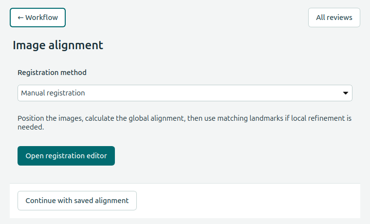</a>

_Manual registration selected in the application. Select **Open registration editor** to fit the pair, then return its saved result with **Continue with saved alignment** for application review._

### Choose channels for the fit

On **Global alignment**, choose an **mIF signal** and a **Paired signal** that show corresponding tissue structures. For example, nuclear fluorescence and H&E nuclear staining provide patterns distributed across much of the tissue. A marker restricted to a small cell subset may provide too few shared structures to guide the fit.

Select a named channel, or use **RGB stain contrast** for combined H&E colour channels and **Combined fluorescence** for the mean of fluorescence channels. We convert each selection into an intensity image and fit the transformation by comparing intensities at corresponding positions. The [fitting-view calculations](#reference-registration--ii-prepare-image-views-for-automatic-fitting) explain this preparation. **Appearance** controls the displayed channels, colours and contrast separately from these fitting signals.

### Navigate the registration window

Use **Overlay** to compare the tissue boundaries and internal landmarks in the two images. Adjust **Opacity** to see how closely the H&E structures coincide with the mIF staining. Switching between **mIF** and **H&E** preserves the position and physical scale so you can inspect the same structure in each section.

Select **1:1** to inspect the staining at the original image resolution. In **mIF** and **Overlay**, each screen pixel corresponds to one mIF pixel. In **H&E**, it corresponds to one paired-image pixel, which can cover a different physical area.

Both registration methods follow three steps.

1. **Global alignment.** Fit the affine transformation across the section and inspect the overlay for structures that still appear displaced. Select **Continue to local refinement** to review those areas.
2. **Local refinement.** If the affine aligns the structures of interest, select **Continue with global alignment**. For a local correction, mark corresponding landmarks for the manual method or choose the B-spline settings for the automatic method, then select **Calculate refinement**.
3. **Review.** Compare the tissue structures in the overlay and inspect the coverage and deformation checks. Select **Save candidate for review** to submit the fit for acceptance, or return to the earlier step to revise it.

If a calculation fails, the editor retains the settings so you can correct the indicated input and recalculate.

Pixel calibration and global affine coordinates

### Pixel coordinates and micrometres

We record points in each image's original full-resolution pixel coordinates `(x, y)`. To compare positions physically, we multiply X by that image's pixel width and Y by its pixel height. Let `D_f` and `D_m` be diagonal matrices containing these X/Y pixel sizes for the fixed and moving images. We use the same calibrations when fitting the alignment and when [applying it to images or annotations](#use-the-accepted-alignment).

### Global affine alignment

Elastix fits a map from fixed to moving positions so that each sampled mIF position identifies where to read the paired-image intensity. Let `u` be the fixed position in micrometres, `M` a 2-by-2 matrix of linear coefficients and `b` a translation vector in micrometres. The global affine `A` gives the corresponding moving position as

$$
A(u)=Mu+b,
$$

Its six parameters account for translation, rotation, unequal scale and shear. For an affine-only result, the complete physical map is `E = A`.

For landmark refinement, we need the position of each paired-image landmark on the mIF grid. We invert the affine and convert between each image’s pixel coordinates and physical distances. The resulting map `G` takes a full-resolution moving-image pixel position `m` to fixed-image pixels:

$$
G(m)=D_f^{-1}A^{-1}(D_m m).
$$

Here, `D_m` converts it to moving-image micrometres, `A⁻¹` maps it to fixed-image micrometres, and `D_f⁻¹` converts it to fixed-image pixels. We retain `G` as the global alignment used before local landmark refinement.

## 2. Manual registration

### Position and fit the global alignment

1. **Position the paired image.** Enter horizontal and vertical shifts in micrometres, rotation in degrees and a uniform scale to bring the sections into a similar starting position. Hold **Shift** while dragging to move the paired overlay; releasing the drag updates the horizontal and vertical shifts. After changing numeric values, select **Preview starting position** at the bottom right of the image. Ordinary dragging pans the view.

2. **Choose the fitting start.** Leave **Use this position to start fitting** selected to initialize Elastix with the position you just reviewed. To use the four-orientation search, clear it and select **Search image orientations** under **Fit settings**.

3. **Fit and inspect the global alignment.** Select **Calculate global alignment**. Elastix fits the global affine from the selected image channels, including unequal scale and shear. Inspect the fitted overlay before choosing whether local correction is needed.

In cluster streaming, select **Save for affine fitting** to send the chosen starting position and settings to the cluster. Follow the [return sequence](#return-alignment-work-to-the-cluster) to reopen and review its result.

<a href="../../assets/screenshots/alignment-marlin-manual.png">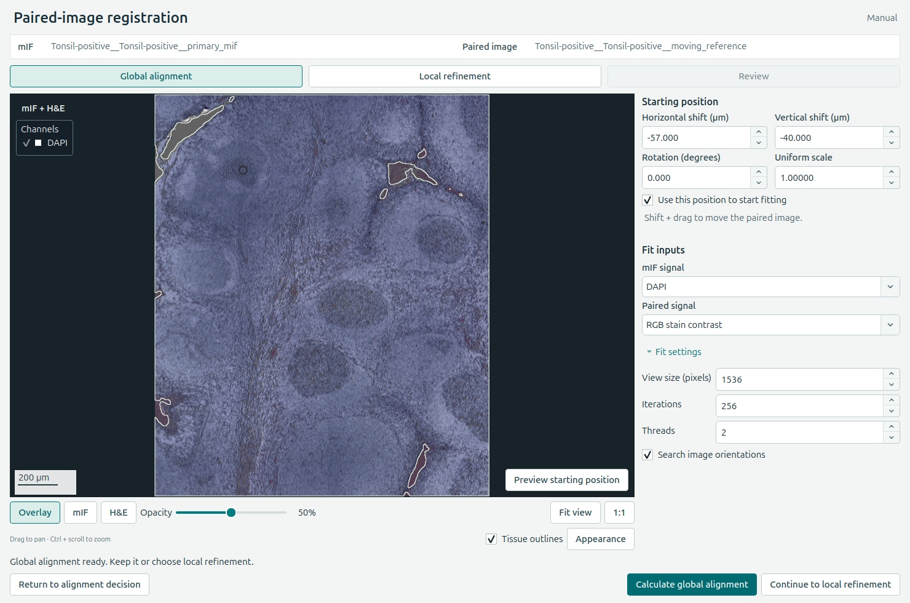</a>

_Manual global alignment of Marlin and colleagues’ same-section tonsil fluorescence/H&E pair after fitting, released under CC BY 4.0. The independently framed fields contain 5,000 × 6,000 fluorescence pixels at 0.344107 µm/pixel and 11,000 × 14,000 H&E pixels at 0.172054 µm/pixel. The fluorescence channels are CD4, vimentin, CD45 and DAPI. This fit uses DAPI and RGB stain contrast, with starting horizontal and vertical shifts of −57 and −40 µm for the 1536-pixel global fit. [Original images and field preparation](../../data/public-image-sources.md#same-section-tonsil-fluorescence-and-he)._

<a href="../../assets/figures/alignment-manual.svg">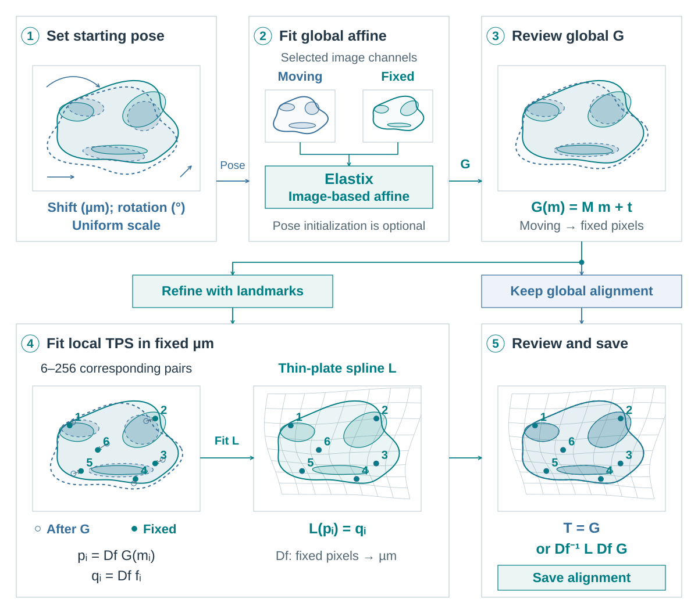</a>

_Schematic of manual initialization, image-based affine fitting and optional landmark refinement. The six hollow blue points are moving landmarks after the global affine; filled teal points are their fixed matches. The TPS deforms the grid to bring these pairs together. The two right-hand panels show the outcomes retained for review: the fitted affine or the affine followed by the local spline._

### Refine with corresponding landmarks

On **Local refinement**, identify anatomical features that correspond in both images and remain displaced after global alignment. Place six to 256 pairs around and within the structures needing correction. We first apply the global affine to the moving landmarks, then fit a thin-plate spline through their fixed-image matches. The spline also deforms the tissue between landmarks, so the distribution and accuracy of the pairs determine the correction throughout that area.

The two panes show the original images. To see where the current fit places the H&E landmarks on mIF, turn on **H&E overlay** in the mIF pane. **Align view centers** in the H&E pane brings the original H&E field to the corresponding location and physical zoom. Pan each image until the same feature sits under its yellow crosshair, then select **Add pair** to record the original pixel coordinates shown in the table.

If a match looks misplaced, select its table row to centre both images on the saved points. Pan to the correct feature and select **Replace**, or select **Remove** to discard the pair. Inspect tissue features between the pairs as well. A spline can pass through every supplied point and still distort the tissue around a misplaced landmark.

Set **Maximum local shift** to the largest additional correction you will allow beyond the global affine; it starts at **250 µm**. Select **Calculate refinement** to fit the spline and check its sampled displacement, area change and inverse mapping. A fit that passes these [local refinement checks](#review-the-additional-local-refinement) opens **Review**. To retain the affine alone, select **Continue with global alignment**. For cluster streaming, follow the [cluster return sequence](#return-alignment-work-to-the-cluster) after reviewing the local preview.

<a href="../../assets/screenshots/alignment-marlin-manual-local.png">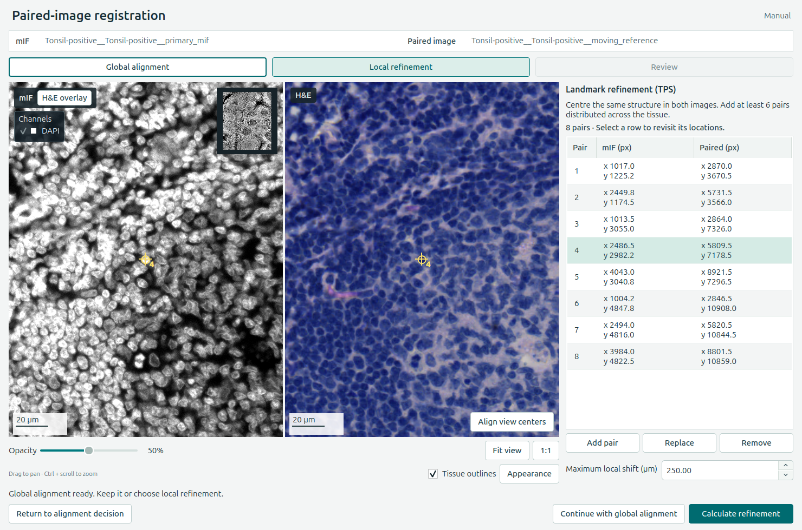</a>

_Corresponding nuclei in the original Marlin mIF and H&E fields after global fitting. Pair 4 is selected from eight matches distributed across the tissue; the table records each image's original pixel coordinates. The TPS fit added a maximum sampled correction of 1.17 µm._

### Transform the local landmarks

For each landmark pair, we know the original moving-image pixel position `m_i` and the corresponding fixed-image pixel position `f_i`. To measure the displacement still present after the affine fit, we first place both landmarks on the mIF grid. The global map `G` gives the moving landmark’s position on that grid, and the mIF calibration `D_f` converts both positions to micrometres. This gives the globally aligned landmark `p_i` and its target `q_i`,

$$
p_i=D_fG(m_i),\qquad q_i=D_ff_i.
$$

We fit the local thin-plate spline `L` from `p_i` to `q_i`. The complete moving-to-fixed pixel transformation is

$$
T(m)=D_f^{-1}L(D_fG(m)).
$$

After the spline moves the point in physical space, dividing by the mIF pixel sizes returns its corrected position on the analysis grid. If you keep the global fit alone, the pixel map reduces to `T=G`. We save the original landmark pairs with the affine and refinement settings so you can reopen the fit and inspect its inputs.

TPS interpolation coefficients and fitting residual

#### Thin-plate-spline coefficients

Let `a_0k`, `a_1k` and `a_2k` be affine coefficients, `w_jk` be radial weights and `U` the radial basis with distance `r`. For local source positions `p_j` and a query position `u = (u_x, u_y)` in fixed-image micrometres, TPS output coordinate `k` (X or Y) has the form

$$
L_k(u)=a_{0k}+a_{1k}u_x+a_{2k}u_y+\sum_jw_{jk}U(\lVert u-p_j\rVert),
\qquad U(r)=r^2\log r,
$$

with `U(0)=0`. Let `K_ij=U(||p_i-p_j||)`, let each row of `P` be `[1,p_ix,p_iy]`, and let `Q` contain the target positions. We solve the interpolation equations and affine moment constraints together:

$$
\begin{pmatrix}K&P\\P^T&0\end{pmatrix}
\begin{pmatrix}W\\C_{\mathrm{aff}}\end{pmatrix}
=
\begin{pmatrix}Q\\0\end{pmatrix}.
$$

The upper block fits the target positions. For each output coordinate, it combines the constant, X and Y terms in `C_aff` with the radial weights in `W`, one weight per landmark. The lower block imposes the moment constraints `PᵀW=0` on those weights. Warpy uses ImgLib2/JITK to solve both blocks together. Among the splines that pass through the supplied matches, this solution minimizes thin-plate bending energy. Its shape between landmarks therefore depends on where the pairs were placed. [ThinplateSplineTransform](https://github.com/imglib/imglib2-realtransform/blob/master/src/main/java/net/imglib2/realtransform/ThinplateSplineTransform.java)

We report the root-mean-square distance between the transformed and target landmarks in micrometres as **Fitted landmark RMS**. This describes how closely the spline satisfies the supplied pairs. Because TPS interpolates those pairs, visual review of additional tissue features establishes whether the deformation also aligns structures between them.

## 3. Automatic registration

### Fit the global alignment

Choose the fitting signals on **Global alignment**, review **Fit settings**, then select **Calculate global alignment**. With **Search image orientations** selected, we fit an affine from each of four starting orientations and retain the successful fit with the lowest image-comparison metric. Inspect the overlay to confirm that this fit brings the intended tissue sections together, especially when a slide contains several sections with similar structure.

### Global fitting settings

Open **Fit settings** to choose how much detail Elastix will use. **View size (pixels)** limits the longer side of each fitting image to 1536 pixels by default. Increasing it preserves finer features at the cost of memory and fitting time. Within that view, Elastix starts with a smoothed image and carries each fit forward to a finer level.

**Iterations** limits the number of adjustments at each of the three levels (256 by default). **Threads** limits how many CPU threads Elastix can use for the fit and Transformix can use for coordinate checks (two by default).

With **Search image orientations** selected, Elastix starts a fit at each quarter turn (0°, 90°, 180° and 270°). In manual registration, clear **Use this position to start fitting** to enable this search. For either method, the fit runs with the installation chosen in **Software setup** on the processing computer. [Returning a cluster fit](#return-alignment-work-to-the-cluster)

<a href="../../assets/screenshots/alignment-marlin-automatic.png">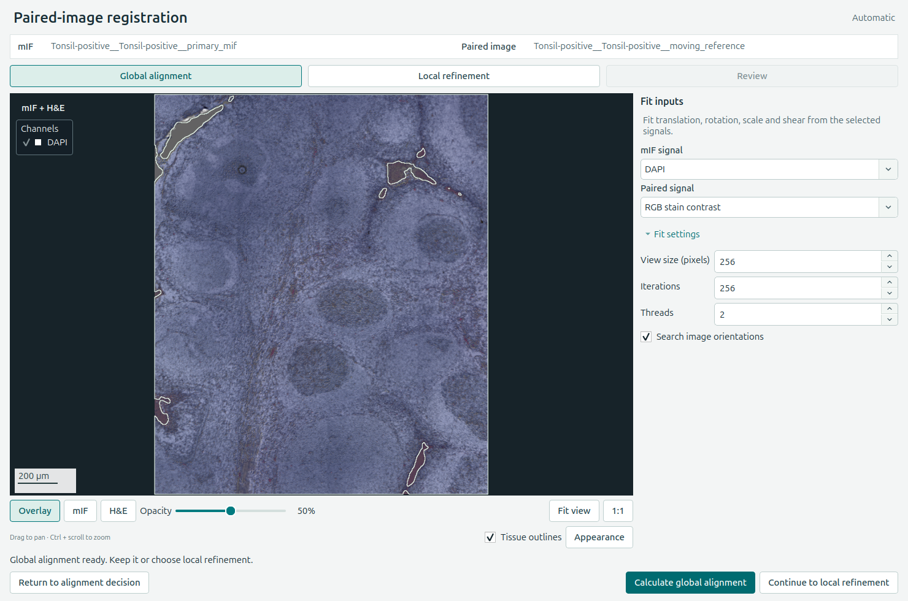</a>

_Automatic global alignment of the Marlin tonsil pair. This fit used a 256-pixel view and the four starting orientations to bring the independently framed images together. The application default remains 1536 pixels._

We keep the physical pixel sizes of the reduced views with the fit. This allows the viewer to apply the same alignment to a full-resolution field when you zoom in.

How fitting views preserve physical coordinates and combine channels

### Prepare image views for automatic fitting

For an image of width `W` and height `H`, we select the reading downsample from the requested maximum view dimension `L`:

$$
d=\max\left(1,\frac{\max(W,H)}{L}\right).
$$

Let `p_x` and `p_y` be the original image pixel width and height in micrometres. We read the full image extent at downsample `d` and record its effective pixel spacing as `(d p_x, d p_y)` µm. The initial maximum dimensions are 1536 pixels for the global affine and 2048 pixels for local B-spline fitting; supported values are 128–4096. The local view is read from the original image, preserving the detail available at its selected resolution.

The fitting algorithm needs one intensity per position in each view. A named channel supplies that value directly. **Combined fluorescence** averages the fluorescence channels, and **RGB stain contrast** assigns larger values to darker H&E staining by taking the negative logarithm of the mean RGB brightness relative to white. For channels $R$, $G$ and $B$, the resulting contrast is

$$
v=-\log\left(\frac{\max(1,\operatorname{mean}(R,G,B))}{255}\right).
$$

We sort these values and obtain the lower limit `v_low` and upper limit `v_high` at positions `floor(0.005(N-1))` and `floor(0.995(N-1))`, where `N` is the number of view pixels. Each intensity is scaled as

$$
v'=\min\left(1,\max\left(0,\frac{v-v_{\mathrm{low}}}{v_{\mathrm{high}}-v_{\mathrm{low}}}\right)\right).
$$

This sets intensities below the lower limit to 0 and those above the upper limit to 1. Nonfinite values or identical limits prevent automatic fitting with that signal.

If the mIF image has accepted tissue sections, we combine their outlines into a mask on the fitting grid. The mask must cover at least 256 view pixels. Elastix then samples positions within that tissue and uses the current transformation to find the intensity to compare in the paired image.

#### Coarse-to-fine image comparison

After reading each reduced image once, Elastix fits the same grid at three levels of Gaussian smoothing (schedule factors 4, 2 and 1). The first level suppresses fine detail so broad tissue structures guide the fit. The next level starts from that alignment and uses finer detail to adjust it. Elastix applies this schedule to both images through its `FixedSmoothingImagePyramid` and `MovingSmoothingImagePyramid`.

At each update, Elastix draws 4,096 new sample positions for the intensity comparison. Increasing the view size therefore preserves more spatial detail and uses more memory to prepare the view, but each update still compares 4,096 positions. [Elastix parameter definitions](https://elastix.dev/doxygen/parameter.html)

Affine coordinates, mutual information and optimizer updates

#### Starting position

For manual positioning, we convert the moving-image coordinates to micrometres, rotate and uniformly scale around its centre, then place that centre at the fixed-image centre plus the entered horizontal and vertical shifts. The editor displays this starting transform before fitting. When **Use this position to start fitting** is selected, the same pose initializes image-based affine optimization in either execution mode.

For automatic orientation search, we compare starts at 0°, 90°, 180° and 270°, with the image centres initially aligned. Each start receives a complete three-level affine fit. We select the successful fit with the lowest final minimized image metric. The returned automatic affine must have a positive, noncollapsed determinant.

#### Intensity metric and parameter updates

An mIF nucleus and its H&E counterpart can differ in brightness even when their boundaries align. To assess the alignment, we ask whether intensities in one image consistently correspond to particular intensities in the other. For each sampled mIF position $u$, we pair its intensity $F(u)$ with the paired-image intensity at the location given by the current transform $E_θ(u)$.

We estimate this relationship using Mattes mutual information. The joint distribution $p_{FM}(a,b)$ describes how often a sample falls into mIF intensity bin $a$ and paired-image bin $b$ together. If the images were unrelated, we would expect that pair with frequency $p_F(a)p_M(b)$, the product of the frequencies in the two images separately. Comparing those frequencies across bin pairs gives

$$
I(F,M_{\mathrm{image}})=\sum_{a,b}p_{FM}(a,b)\log\frac{p_{FM}(a,b)}{p_F(a)p_M(b)}.
$$

Elastix uses 32 bins per image and minimizes the negative of this quantity. At each update, changing the transform changes which paired-image intensities enter the comparison. Elastix estimates how the metric changes with each parameter and uses those derivatives to choose the next adjustment. A lower final metric indicates greater mutual information. [Elastix metric calculation](https://github.com/SuperElastix/elastix/blob/5.3.1/Components/Metrics/AdvancedMattesMutualInformation/itkParzenWindowMutualInformationImageToImageMetric.hxx#L127)

Adaptive stochastic gradient descent updates the six affine parameters. Automatic parameter scaling accounts for the different numerical effects of physical translation and linear matrix terms. The default allows 256 updates at each smoothing level, using two processing threads and random seed 271828. The iteration range is 32–2048 and the thread range is 1–16. Each orientation attempt has a ten-minute process limit.

During the global fit, the moving intensity at an off-grid coordinate is evaluated by a first-order B-spline interpolator. During the local B-spline fit described below, the moving-intensity interpolator is explicitly cubic. These interpolators provide intensity values for the optimizer after a proposed coordinate shift. [parameter definitions](https://elastix.dev/doxygen/parameter.html)

#### Recover the affine in image coordinates

Transformix evaluates the selected physical map at six fixed-image positions. The origin and one point on each axis determine its linear terms and translation. Three additional positions check that the reconstructed affine reproduces the native result within 0.01 moving-image pixels.

We convert the reconstructed physical affine to pixel coordinates using both images' calibration, then invert it for moving-to-fixed annotation coordinates. The automatic pixel-affine determinant must be finite and exceed `1e-8`.

### Refine with an image-based B-spline

On **Local refinement**, inspect the globally aligned overlay for tissue structures that still need a local correction. To retain the affine, select **Continue with global alignment**. Otherwise, adjust the settings below and select **Calculate refinement**. Elastix fits the B-spline once, starting from the global affine you have reviewed. The editor opens **Review** after the local checks pass.

The B-spline represents local displacement with a grid of control points, each carrying an X and a Y coefficient. For a position mapped by the global affine, we combine the surrounding 4 × 4 control points' coefficients using cubic B-spline weights. Their weighted sum supplies the additional shift used to locate the paired-image intensity. Nearby positions share control points, with weights that change smoothly across the grid.

Elastix adjusts the coefficients to bring corresponding intensity patterns into alignment. A bending penalty discourages abrupt spatial changes in the displacement. The settings below determine how finely the deformation can vary and how strongly the fit favours smooth changes.

<a href="../../assets/figures/alignment-automatic.svg">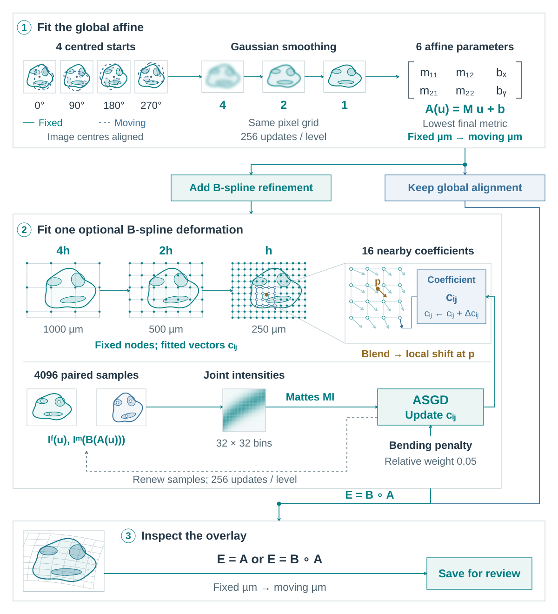</a>

_Schematic of automatic alignment with the four-orientation option. The local control lattice refines from `4h` to `2h` to `h`. The inset highlights the sixteen contributing coefficients and the resulting amber shift arrow. Blue and teal arrows show coefficient vectors, and `Δcᵢⱼ` denotes an optimizer update. The final panel shows the locally refined overlay._

### Local B-spline settings

Choose the **View size (pixels)** according to the detail needed to recognize corresponding structures. The default reads each original image at a maximum dimension of 2048 pixels. For a slide 40,960 pixels across its longer side, that gives one fitting pixel per 20 original pixels. A larger view retains finer detail and uses more memory. **Iterations** allows up to 256 coefficient updates at each of three fitting levels by default.

**Grid spacing (µm)** determines how far apart the control points lie at the finest level (initially 250 µm). Earlier levels use four and two times that spacing. Reducing the spacing lets the deformation follow differences over shorter distances. **Bending weight** controls how strongly the fit resists abrupt changes in displacement. It ranges from 0, which removes the penalty, to 1, and starts at 0.05.

**Maximum local shift (µm)** sets the largest additional displacement you will accept beyond the affine (initially 250 µm). Select **Calculate refinement** to fit the deformation. We then check its displacement at sampled positions. If it exceeds the limit, review the global alignment and local settings before fitting again.

<a href="../../assets/screenshots/alignment-marlin-bspline.png">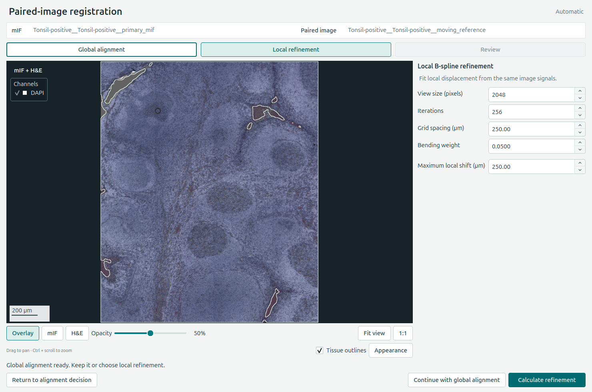</a>

_Automatic Local refinement for the Marlin tonsil pair, using a 2048-pixel view, 250 µm grid spacing and 0.05 bending weight. The fitted local displacement reached 4.38 µm at the sampled positions._

### Automatic cubic B-spline refinement

Let `A` be the fitted global affine, `d` the B-spline displacement and `B` the map that adds this displacement. Following Elastix's `Compose` convention, we apply the global affine first, then evaluate the local displacement at that transformed position. The complete fixed-to-moving physical map `E` is

$$
E(u)=B(A(u)),\qquad B(v)=v+d(v).
$$

We save the affine, control-grid definition and fitted coefficients together so the viewer can reproduce this composition when reading the original paired image. The [display calculation](#reference-registration--vii-display-the-original-paired-image) explains how we use and verify the saved values. [Elastix transform composition](https://github.com/SuperElastix/elastix/blob/5.3.1/Common/Transforms/itkAdvancedCombinationTransform.hxx)

Cubic B-spline weights and fitting updates

#### Control grid and local displacement

The final control-point spacing initially equals 250 µm on both axes. The three fitting levels use factors 4, 2 and 1, introducing finer displacement parameters as the fit proceeds. Grid dimensions, physical origin, spacing, direction and index are read from the fitted Elastix file.

<a href="../../assets/figures/alignment-bspline-basis.svg">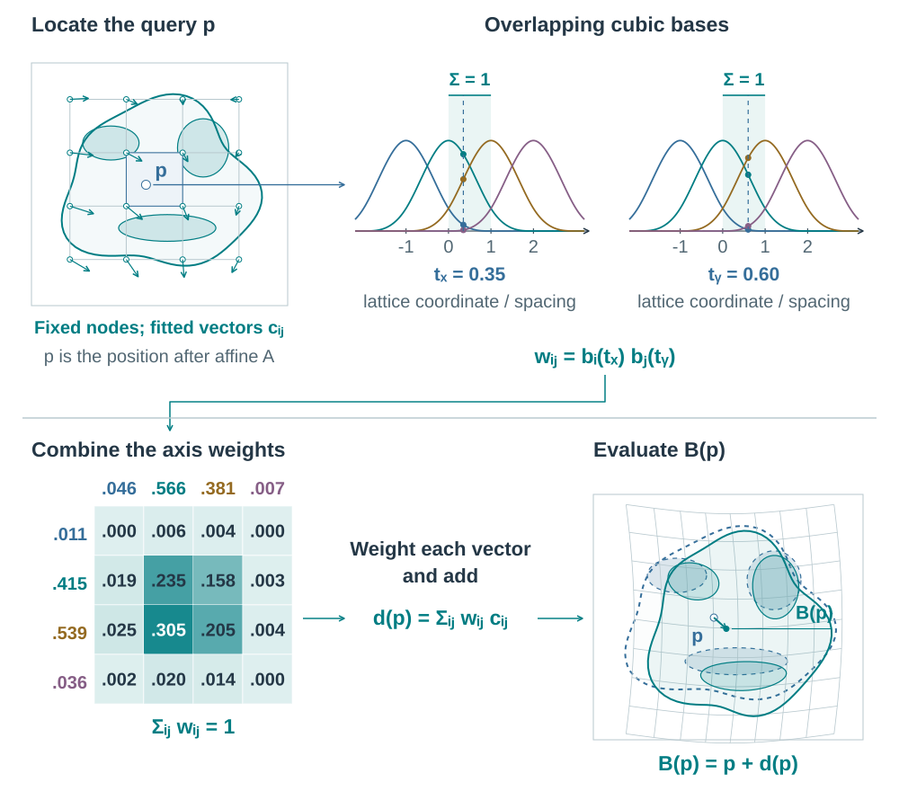</a>

_Schematic of the 4 × 4 B-spline support at fractional grid position `(0.35,0.60)`. The curves provide four weights per axis; their products fill the matrix, with darker entries carrying larger weights. Values are rounded to three decimals for display. The weighted coefficient vectors give the amber displacement of the query point and bend the image grid in the final panel. The control-node positions remain fixed._

For a point with continuous grid position `(u,v)`, the cubic spline uses the four neighbouring control positions along each axis. If `t` is the fractional grid coordinate, the four weights are

$$
\begin{aligned}
\beta_0(t)&=(1-t)^3/6,\\
\beta_1(t)&=(3t^3-6t^2+4)/6,\\
\beta_2(t)&=(-3t^3+3t^2+3t+1)/6,\\
\beta_3(t)&=t^3/6.
\end{aligned}
$$

For fractional position `t ∈ [0,1]`, the four basis weights satisfy `Σᵢ βᵢ(t) = 1`. Their products therefore also sum to one over the complete two-dimensional support:

$$
\sum_{i=0}^{3}\sum_{j=0}^{3}\beta_i(t_x)\beta_j(t_y)
=\left[\sum_{i=0}^{3}\beta_i(t_x)\right]
 \left[\sum_{j=0}^{3}\beta_j(t_y)\right]=1.
$$

If all contributing coefficient vectors specify the same shift, normalization makes their weighted sum return that shift at every supported position. A uniform displacement field is therefore preserved.

Let `k` denote X or Y, and let `c_k,ij` be that coordinate's fitted displacement coefficient at neighbouring control point `(i,j)`. With fractional grid positions `t_x` and `t_y`, each displacement coordinate is the weighted sum of the corresponding 4-by-4 coefficient neighbourhood:

$$
d_k(u,v)=\sum_{i=0}^{3}\sum_{j=0}^{3}\beta_i(t_x)\beta_j(t_y)c_{k,ij}.
$$

Smaller spacing introduces more control points and allows shorter spatial changes. The default limit is 65,536 control points, with two displacement coefficients per point. We check the estimated grid size before fitting and the actual returned grid size afterward. Outside the region with complete cubic support, Elastix assigns zero local displacement, leaving the initial affine as the complete map there. [transform composition](https://github.com/SuperElastix/elastix/blob/5.3.1/Common/Transforms/itkAdvancedCombinationTransform.hxx)

#### Optimization and bending penalty

At each optimizer update, we compare intensities at 4,096 newly sampled positions and estimate Mattes mutual information with 32 bins on each intensity axis. The local fit combines this image metric with a bending-energy penalty based on second spatial derivatives of the displacement. Adaptive stochastic gradient descent (ASGD) uses the gradients of these two terms with respect to the displacement coefficients to calculate an update.

We use relative gradient weighting to set the penalty's contribution in relation to the image metric. For image-metric gradient `g₀`, penalty gradient `g₁` and selected relative bending weight `r`, Elastix scales the penalty contribution according to `r ||g₀|| / ||g₁||`. The initial relative weight is 0.05. [Multiple-metric registration and relative weighting](https://elastix.dev/doxygen/classelastix_1_1MultiMetricMultiResolutionRegistration.html)

The local fit uses the global stage's selected channels and thread count, with a fifteen-minute process limit. Cubic intensity interpolation evaluates the moving image at each proposed sampling position; the control-grid calculation determines that position.

## 4. Review and save

When fitting locally, both registration methods finish on **Review**. Start with **Review region → Whole image** to inspect the extent of the aligned pair. Then choose an accepted tissue section to centre the view on that section and calculate its coverage and area checks within the saved outline. Select a row under **Overall alignment** to display the corresponding check over the image; these rows include the global affine and any local refinement.

Compare **mIF**, **H&E** and **Overlay** at the same position and zoom, adjusting **Opacity** to see whether corresponding tissue boundaries and internal structures coincide. Select **Show accepted tissue outlines** below the image to display the saved mIF contours. Inspect the whole section first, then examine small structures, edges, folds and tears at higher magnification. The checks describe the transformation's coverage and geometry; this visual inspection establishes whether the anatomical structures align.

### Check whole-image and tissue coverage

Select **Image-frame coverage** to see how much of the mIF image has a corresponding position inside the paired-image frame. The teal outline shows the mIF image boundary and the gold outline shows the aligned paired-image boundary. When you select a tissue section under **Review region**, the row becomes **Tissue in paired image** and reports coverage within that section.

We sample a regular grid spaced **128 mIF pixels** apart, starting half an interval inside the image rectangle or the selected section's bounding rectangle. For a section, we omit positions outside its polygon. We map each remaining position into the paired image and check whether it falls inside that image's rectangular bounds. The panel reports the physical sampling spacing and sample count; hover over a coloured square to read its central position in micrometres and its check values.

Let `N` be the number of included mIF positions and `N_in` the number mapped to finite coordinates inside the paired image. The two coverage rows report

$$
\mathrm{coverage}=N_{\mathrm{in}}/N,\qquad
\mathrm{outside\ paired\ image}=1-N_{\mathrm{in}}/N.
$$

Select **Outside paired image** to highlight positions outside the paired-image frame in orange and positions with invalid mapped coordinates in magenta. Inspect these locations to identify which parts of the mIF field lack usable paired-image data. A covered position may still lie on background inside the paired-image rectangle, so also [compare the tissue boundaries](#compare-tissue-boundaries).

For each section, we compare the sampled coverage with both acceptance limits. By default at least **80%** of positions must be inside the paired frame and at most **10%** may be outside. Because the two fractions sum to one, the second limit raises the effective coverage requirement to **90%**. If the grid misses a section entirely, we cannot estimate its coverage. Inspect that section’s outline and alignment. Whole-image coverage also includes the margins around the tissue and is reported for inspection.

<a href="../../assets/screenshots/alignment-marlin-whole-slide.png">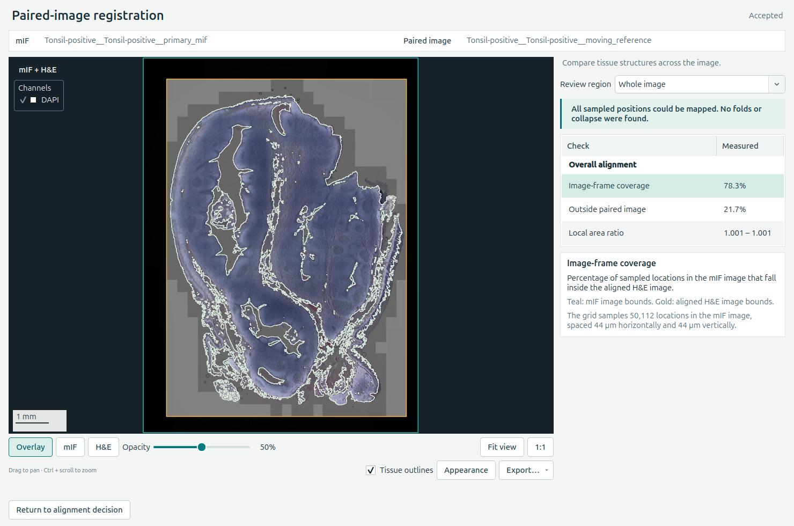</a>

_Marlin whole-slide mIF/H&E alignment. The gold H&E image boundary covers 78.3% of sampled mIF image positions. All four accepted tissue sections lie within it, each with 100% sampled coverage._

### Compare tissue boundaries

Choose a tissue section under **Review region**, then select **Inspect tissue boundary**. The arrows visit 12 locations spaced along the saved contours; the middle button centres the current location again. Switch between **mIF**, **H&E** and **Overlay** to compare the tissue at each position. The teal contour belongs to the accepted mIF section. Compare it with the visible H&E tissue edge and inspect corresponding structures inside the boundary.

Boundary inspection opens a field roughly **400 µm** across or keeps your current zoom if you are already closer. The saved contours include holes within the tissue, so you can follow both the outer and inner edges. Use **Fit view** to see the section in the context of the whole image again.

<a href="../../assets/screenshots/alignment-tissue-boundary-current.png">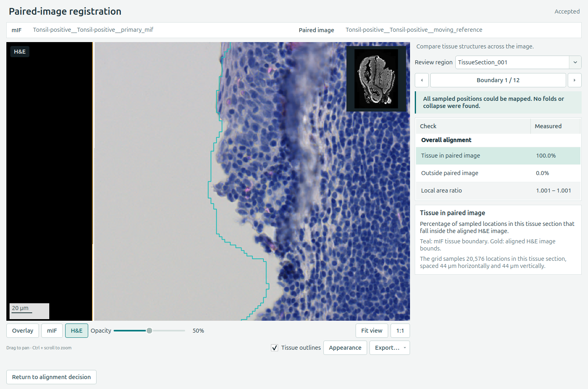</a>

_The first of 12 boundary locations on the selected Marlin tissue section. The teal mIF contour follows the H&E tissue edge. The 100% coverage value indicates that sampled positions within this section fall inside the H&E image boundary._

### Inspect local area changes

Select **Local area ratio** to see where alignment compresses or expands the paired tissue. At each covered grid position we compare the area after alignment with the original area in µm². A ratio of **1** means the area is preserved. Blue shows compression (between 0 and 1) and orange shows expansion (above 1). Magenta marks a collapse (zero) or reversal of orientation (negative). Hover over a position to read its ratio.

To calculate the ratio, we start at a position in the paired image and take two one-pixel steps, one along X and one along Y. We map all three positions into mIF coordinates. The two mapped steps span a parallelogram whose signed area gives the area ratio in pixel units. This is the determinant of the local derivative matrix (the **Jacobian**), estimated from the mapped steps. To express the ratio in physical units, we multiply that determinant $J_{\mathrm{pixel}}$ by the area of one mIF pixel and divide by the area of one paired-image pixel. For mIF pixel dimensions $p_{f,x},p_{f,y}$ and paired-image pixel dimensions $p_{m,x},p_{m,y}$, the result is

$$
J_{\mathrm{physical}}=J_{\mathrm{pixel}}\frac{p_{f,x}p_{f,y}}{p_{m,x}p_{m,y}}.
$$

We record the minimum, median and maximum of the finite ratios calculated at covered positions. The initial accepted interval is **0.1–10**. Acceptance requires finite mapped coordinates and area calculations, with the sampled area ratios inside this interval; positions outside the paired-image frame contribute to the separate coverage check. The geometry summary keeps any detected folds, collapsed areas and invalid coordinates visible when you select another check or region.

<a href="../../assets/screenshots/alignment-local-area-current.png">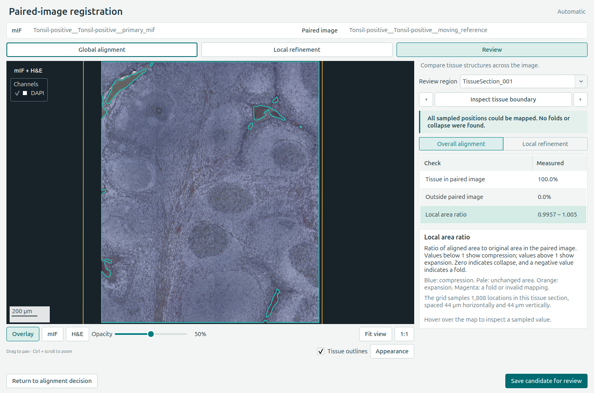</a>

_Local area change after automatic affine and B-spline alignment of the Marlin field. The selected section's sampled area ratios range from **0.9957 to 1.005**, showing small contractions and expansions. The colour key and map describe the same sampled positions; the table reports their minimum and maximum._

### Review the additional local refinement

After fitting a TPS or B-spline, open **Local refinement** in the candidate’s checks table to see how much the local fit changed the global alignment. **Maximum local shift** gives the largest added movement in micrometres. **Area change from local refinement** gives the greatest contraction and expansion relative to the affine. To see the effect of *both* fits over a particular tissue section, choose that section under **Review region** and inspect **Local area ratio**.

Select a row to see its calculation and units. For a landmark fit, compare **Fitted landmark pairs** and **Fitted landmark RMS** with the overlay. Even a misplaced pair can have a small residual because the spline passes through the supplied points. If tissue between landmarks appears distorted, return to their table and check the matches. For a B-spline, **Transformix agreement** reports how closely the displayed transformation reproduces the fitted one.

How we calculate the local refinement checks

We sample a **17 × 17 grid** across mIF. If accepted tissue sections are present, we keep only grid positions inside them. At least six positions must remain. For each position $x$, we reverse the global paired-to-mIF map $G$ to find the paired-image point $m=G^{-1}(x)$. Applying the refined map $T$ to that same point tells us where local fitting moved it.

- **Maximum local shift.** The difference $T(m)-x$ gives the added displacement in mIF pixels. We multiply each coordinate difference by its physical pixel size and calculate the straight-line distance. The largest distance must stay within the shift limit chosen for fitting.
- **Area change from local refinement.** The map $H=T\circ G^{-1}$ takes a position after global alignment to its position after local refinement. We map $x$ and its neighbours one mIF pixel away along X and Y. The two steps from the mapped centre to its mapped neighbours form the columns of a two-by-two matrix. Its determinant gives the local area ratio. A ratio of one preserves area. Smaller positive values indicate contraction and larger values indicate expansion. Every sampled ratio must be finite, greater than 0.05 and at most 20.
- **Inverse round-trip error.** We map each paired-image point $m$ into mIF and back. The distance between $T^{-1}(T(m))$ and $m$ must be at most **0.5 paired-image pixels** at every sampled point.

For **TPS**, we also calculate the root-mean-square distance between the transformed landmarks and their mIF matches, in micrometres. For a **B-spline**, we check the saved coefficients against Transformix at **49 positions** on a separate **7 × 7 grid** over the full mIF fitting view. Both calculations start at the same physical position. We convert their results to paired-image pixels and require them to agree within **0.01 pixels** at every position. This tests the coefficient order, the order of the affine and local transformations, and the conversion between physical and pixel coordinates. [How the viewer evaluates the coefficients](#reference-registration--vii-display-the-original-paired-image)

These checks accompany the candidate. After acceptance you can reopen the saved coverage and area-ratio checks.

<a href="../../assets/screenshots/alignment-local-checks-current.png">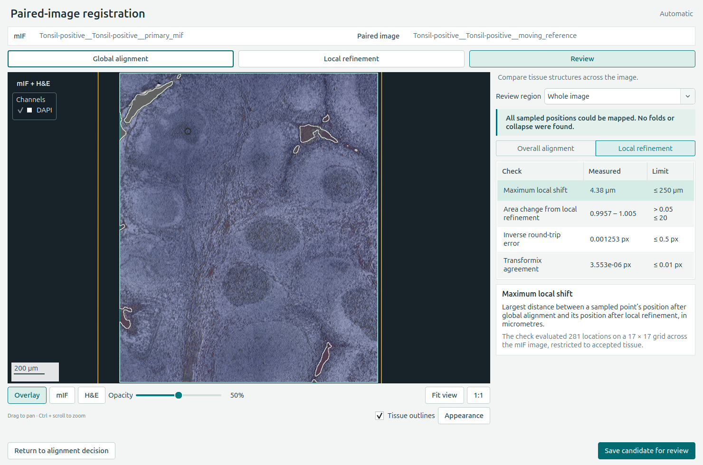</a>

_The Marlin B-spline fit added a maximum sampled shift of **4.38 µm** beyond the global affine. Local area ratios over its fitting samples range from **0.9957 to 1.005**, and the largest forward-and-back mapping error is **0.00125 paired-image pixels**. Selecting Maximum local shift displays the physical-distance calculation beneath the grouped checks._

### Save or revise the alignment

If corresponding structures remain displaced, select **Global alignment** to change the overall fit or **Local refinement** to change the local deformation. Recalculate the result and inspect it again before saving.

Select **Save candidate for review**, then **Continue with saved alignment** on the decision page. We check tissue coverage and area change against the configured limits. **Inspect alignment and checks** reopens the review with those limits beside the measured values. After inspecting the tissue correspondence, select **Accept registration** to use the alignment or **Reject** to revise it.

### Return alignment work to the cluster

With **Cluster streaming**, Elastix uses the cluster installation selected in **Software setup**. For **Automatic registration**, choose the fitting signals, global settings and optional B-spline refinement on the alignment setup page, then select **Run automatic registration**. Review the returned candidate before accepting it.

For **Manual registration**, the registration editor displays the mounted images locally. Save the starting position for affine fitting on the cluster, reopen its result, then review the affine and add landmarks if needed. The sequence below describes these two submissions.

Save and return a manual alignment through the cluster

The following actions transfer fitting requests and reopen their results:

1. After positioning the overlay, select **Save for affine fitting**. The editor closes after retaining the starting position and fitting settings. When automatic return is enabled, the request is submitted after its image readers have stopped; otherwise select **Submit saved alignment**. The cluster calculates the global affine and returns it to the editor for inspection.
2. Select **Continue with global alignment** to keep that affine, or add corresponding landmark pairs and select **Calculate refinement** to produce a local preview for Review.
3. Select **Save alignment request** to return the reviewed choices through the same save-and-return sequence. The cluster reuses the affine just inspected, fits the optional local spline and checks its deformation. Accept or reject the resulting candidate in the application's alignment review.

An unfinished edit retains its saved starting position, fitting settings and landmark pairs. Reopening restores the returned affine when it corresponds to those settings. A saved final request also restores its local preview. [Cluster execution](../run/execution.md) explains the image-folder mapping and processing location.

## Use the accepted alignment

To reopen a saved alignment, choose **Results & export → Image alignment**, select the sample and choose **Inspect aligned images**. The viewer opens the pair with its accepted transformation and saved checks.

If you want to draw on mIF with H&E as a reference, open the annotation stage for that task. During [classifier reference annotation](../tissue-classification/index.md#reference-annotation), for example, **QuPath view → Registered overlay** and **Side-by-side reference** both let you see the H&E as you draw on mIF. Those annotations already have mIF coordinates. For outlines drawn previously on the original H&E, use the [annotation-transfer calculation](#annotation-transfer-calculations) to find their corresponding mIF positions.

### Export the aligned field and checks

Use **Export… → Aligned field figure…** to save the displayed field as SVG, PDF or PNG. The figure includes the selected image appearance, overlay opacity, visible outlines or check map, and a calibrated scale bar. Its image detail follows the current viewing resolution; zoom in before exporting a detailed field.

**Field data…** saves the loaded channel arrays, physical coordinates and display settings as NPZ. The paired-image values have already been sampled onto the mIF grid at the current viewing resolution.

**Check summary…** saves the selected review region's calculated checks as CSV. **Sampled checks…** saves that region's grid positions, mapping status and local area ratios. Both use the selected **Review region**, including when the image view has been zoomed into a smaller field. [Alignment checks](#check-whole-image-and-tissue-coverage) explains their interpretation.

### Coordinates for image display and annotation transfer

Let `D_f` and `D_m` be diagonal matrices containing the fixed and moving X/Y pixel sizes. Elastix evaluates the physical-coordinate map `E` from fixed positions to the moving positions whose intensities are sampled. The transform `T` used to move a paired-image annotation into mIF pixel coordinates is therefore

$$
T=T_{m\rightarrow f}=D_f^{-1}E^{-1}D_m.
$$

To display the image overlay, we calculate the position in the original moving image that corresponds to each fixed-image location. This reverses the direction used to transfer annotations, giving the coordinate map

$$
T_{m\rightarrow f}^{-1}=D_m^{-1}ED_f.
$$

We save the transformation with both image entries, their source files, full-resolution dimensions and pixel calibrations. When the registration is reopened, these records identify the images and supply the pixel sizes needed for both mappings.

<a href="../../assets/figures/alignment-frames.svg">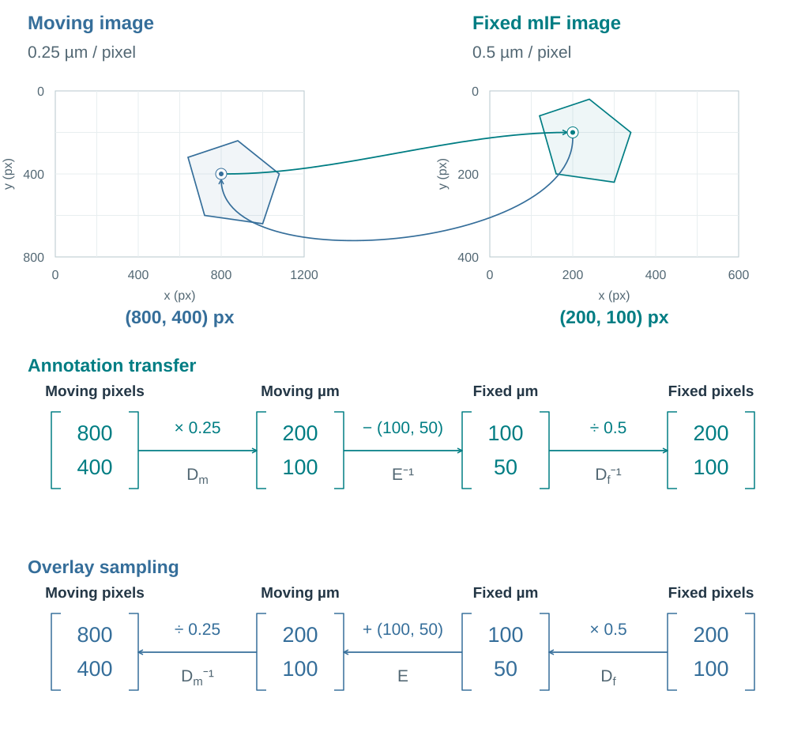</a>

_Schematic of annotation transfer (teal) and overlay sampling (blue). The moving image has 0.25 µm/pixel sampling and mIF has 0.5 µm/pixel; each grid interval spans 50 µm. The example map `E(u)=u+(100,50) µm` takes fixed to moving physical positions. Moving point `(800,400)` pixels becomes `(200,100)` µm, then `(100,50)` µm after inverse translation, and finally fixed point `(200,100)` pixels. The overlay query follows the reverse chain._

### Display the original paired image

Elastix fits the alignment and writes transformation parameters; Transformix can apply those files to images or specified coordinates. For interactive display, we load the fitted transformation into the application's coordinate evaluator and use Warpy to read the requested field from the original paired image. This supplies image tiles as you pan and zoom without repeatedly launching Transformix or generating a full aligned copy of the slide.

For a B-spline alignment, the saved parameters and original image contribute to the display in three steps:

1. **Save the fitted transformation.** We read Elastix's B-spline parameter file and its initial affine file, then store the affine, control-grid dimensions, physical origin, spacing, direction, grid index and displacement coefficients in one JSON record. We also store both images' X/Y pixel sizes. Together these values define the coordinate map independently of the temporary fitting-file paths.
2. **Calculate where to read each paired-image pixel.** The Java evaluator, `MifElastixBSplineTransform`, takes a requested mIF pixel position, converts it to micrometres, applies the affine and adds the B-spline displacement. Dividing by the paired-image pixel sizes gives the source pixel position to sample. This evaluates `E = B ∘ A` with the same coefficients and composition used for fitting. We verify the evaluator against Transformix before presenting the candidate for review.
3. **Read the original image at those positions.** Warpy's transformed-image reader, `RealTransformImageServer`, determines the source region needed for the requested mIF tile and selects an available source resolution. It reads that region and samples its intensities with nearest-neighbour interpolation at the calculated positions. The sampled pixels are returned on the mIF display grid; Qt applies the selected colours and opacity. QuPath's annotation overlay uses the same transformed-image reader. [Warpy interpolation implementation](https://github.com/BIOP/qupath-extension-warpy/blob/0.5.0/src/main/java/qupath/ext/imagecombinerwarpy/gui/RealTransformInterpolation.java)

Zooming in requests more closely spaced mIF positions and finer source-image detail using the saved transformation. To transfer a paired-image annotation into mIF coordinates, we convert its boundary to micrometres, solve the reverse B-spline calculation, apply the inverse affine and divide by the mIF pixel sizes. The details below explain both coefficient evaluation and this reverse calculation.

<a href="../../assets/figures/alignment-fitted-transform-display.svg">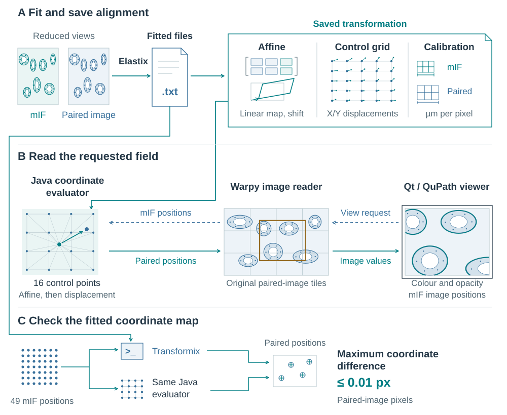</a>

_Schematic of saving, displaying and checking the fitted alignment. **A:** Elastix fits reduced image views; its affine, displacement grid and pixel calibration are stored together. **B:** The viewer requests an mIF field. Warpy passes its positions to the Java evaluator, which uses 16 control points to calculate the corresponding paired-image positions. Warpy samples the original image there and returns the pixels for display. Dashed arrows carry requests; solid arrows carry saved parameters, coordinates or image values. **C:** Transformix reads the original fitted files and maps the same 49 mIF positions as the Java evaluator. Their maximum coordinate difference must be at most 0.01 paired-image pixels._

B-spline coefficient evaluation and reverse-coordinate calculation

#### Evaluate the saved coefficients

`automatic_bspline.groovy` creates the coefficient record, and `paired_geometry.groovy` loads it into `MifElastixBSplineTransform` when the alignment is reopened. Affine and TPS records are loaded with Warpy's transform reader.

To locate a position on the control grid, we first apply the affine, subtract the grid origin and convert to grid coordinates using the saved direction, spacing and index. This identifies the 4 × 4 neighbouring control points. The saved record contains their X coefficients in the first array and their Y coefficients in the second, with X grid indices changing fastest in each. We apply the [cubic weights](#reference-registration--control-grid-and-local-displacement) to each array to calculate the X and Y shifts. Where the full neighbourhood is unavailable, the local displacement is zero and the affine gives the displayed position.

Each supported coordinate query uses 16 control points. The viewer holds the fitted coefficient grid and reads the image region needed for the current field, so the coordinate calculation does not require a displacement array spanning the full slide. Reading and sampling the source image still depend on the requested field and resolution.

#### Calculate the reverse coordinates

For annotation transfer, let `v` be a paired-image position in micrometres. We solve `B(u)=v` for the position `u` after the initial affine, then apply `A⁻¹` and convert to mIF pixels. The displacement is spatially varying, so reversing it requires finding the input position that produces `v`.

Starting with `u=v`, we calculate the residual `r=B(u)−v` and the derivative matrix `DB(u)` from the cubic weights. We solve `DB(u)δ=r` for a Newton step and try `u−δ`. To measure its improvement in paired-image pixels, we divide the residual's X and Y components by the corresponding pixel sizes and take their Euclidean length. If the trial step does not reduce this error, we halve the step length and try again, allowing up to sixteen attempts per update.

The error must reach the saved tolerance, initially **0.005 paired-image pixels**, within **100 updates**. We stop the coordinate query with an error if it cannot reach that tolerance or if an update encounters a derivative matrix with a nonfinite determinant or determinant at most `1e-10`. Such a determinant indicates that the local inverse is unusable at the attempted position.

The [Transformix comparison and inverse round-trip check](#reference-registration--local-change-relative-to-the-global-affine) verify the direct and reverse coordinate calculations before the candidate is presented for review.

Temporary intensity and mask images are removed after fitting. The parameter files, coordinate checks and process logs remain with the candidate.

### Annotation-transfer calculations

When transferring existing annotations, we map each selected paired-image outline into mIF coordinates and check its geometry and tissue assignment. Each source annotation must enclose an area and have no cells or other annotations nested beneath it in QuPath.

Let `R_m` be the original moving-image region and `|R|` a region's area in pixel coordinates. With moving pixel sizes `p_{m,x}`, `p_{m,y}` and fixed pixel sizes `p_{f,x}`, `p_{f,y}` in micrometres, we calculate the source and transformed physical areas as

$$
A_m=|R_m|p_{m,x}p_{m,y},\qquad A_f=|T(R_m)|p_{f,x}p_{f,y}.
$$

The acceptable area ratio `A_f/A_m` initially spans `[0.25,4]`. The mapped outline must contain finite coordinates, enclose a positive area and have valid boundaries without self-intersections. The number of disconnected parts may increase by at most one compared with the original annotation.

For each accepted tissue section `S_j`, we calculate the fraction of transformed annotation area within that section:

$$
r_j=\frac{|T(R_m)\cap S_j|}{|T(R_m)|}.
$$

We assign the annotation to a section only if that section contains at least half of its transformed area ($r_j \ge 0.5$) and no other accepted section overlaps it by a positive area. We also check the mIF image bounds. At most 5% of the transformed annotation may lie outside the image.

Before writing accepted annotations under their target section, we recheck the selected transformation, source annotation and target tissue section. We retain their identifiers with the transferred objects so the result can be traced to its source annotation and registration.

Implementation and scientific sources

## Sources and implementation

[1] Elastix [parameter definitions](https://elastix.dev/doxygen/parameter.html) and the [BSplineInterpolator source for 5.3.1](https://github.com/SuperElastix/elastix/blob/5.3.1/Components/Interpolators/BSplineInterpolator/elxBSplineInterpolator.h).

[2] ImgLib2 [ThinplateSplineTransform](https://github.com/imglib/imglib2-realtransform/blob/master/src/main/java/net/imglib2/realtransform/ThinplateSplineTransform.java) and JITK [ThinPlateR2LogRSplineKernelTransform](https://github.com/saalfeldlab/jitk-tps/blob/master/src/main/java/jitk/spline/ThinPlateR2LogRSplineKernelTransform.java).

[3] Elastix 5.3.1 [transform composition](https://github.com/SuperElastix/elastix/blob/5.3.1/Common/Transforms/itkAdvancedCombinationTransform.hxx) and [B-spline coefficient evaluation](https://github.com/SuperElastix/elastix/blob/5.3.1/Common/Transforms/itkAdvancedBSplineDeformableTransform.hxx).

[4] Elastix [multiple-metric registration and relative weighting](https://elastix.dev/doxygen/classelastix_1_1MultiMetricMultiResolutionRegistration.html).

[5] Warpy 0.5.0 [RealTransformInterpolation](https://github.com/BIOP/qupath-extension-warpy/blob/0.5.0/src/main/java/qupath/ext/imagecombinerwarpy/gui/RealTransformInterpolation.java) and [RealTransformImageServer](https://github.com/BIOP/qupath-extension-warpy/blob/0.5.0/src/main/java/qupath/ext/imagecombinerwarpy/gui/RealTransformImageServer.java).

Java's [RegistrationImageViews](../../../src/java/org/mif/image/RegistrationImageViews.java) constructs the reduced intensity images used for fitting. [PairedGeometryOps](../../../src/java/org/mif/registration/PairedGeometryOps.java) converts between pixel and physical coordinates, fits landmark refinement and checks the resulting deformation. [MifElastixBSplineTransform](../../../src/java/org/mif/registration/MifElastixBSplineTransform.java) evaluates the saved B-spline coefficients when QuPath requests an overlay or transformed annotation.

The Groovy scripts `automatic_elastix.groovy` and `automatic_bspline.groovy` prepare Elastix requests, launch fitting and read its returned transform parameters. `paired_geometry.groovy` loads the selected transform and connects it to Warpy's overlay. The alignment pages provide the fitting controls and display the results for review; `registration_editor_worker.groovy` supplies the native image readers, transform operations and saved manual requests. `landmark_exchange.groovy` runs the requested affine and optional TPS fits on the cluster; Python's `registration/landmarks.py` validates the saved starting settings and landmark pairs. QuPath's paired-image windows remain read-only annotation references. Initial fitting values are stored in [registration.json](../../../src/python/mif_pipeline/config/defaults/registration.json).

---

**Next:** [Select analysis regions](../tissue/index.md#selecting-analysis-regions), then proceed to [Tissue classification](../tissue-classification/index.md).
