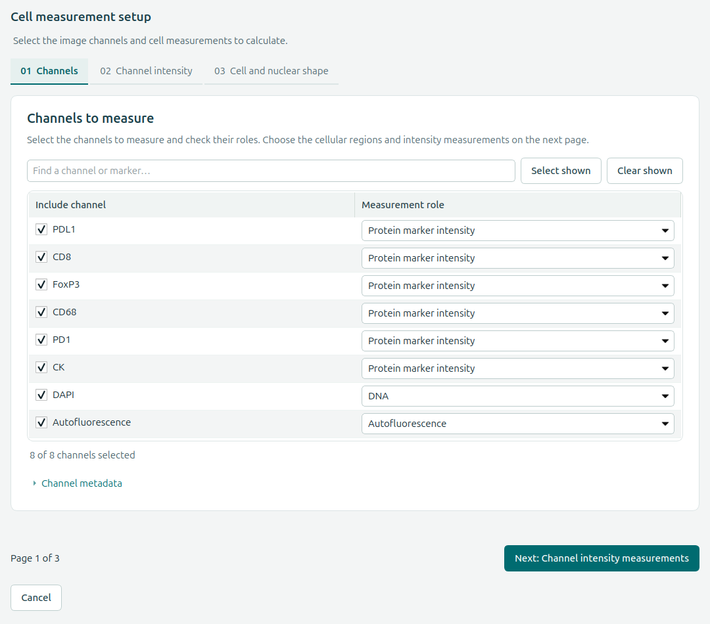
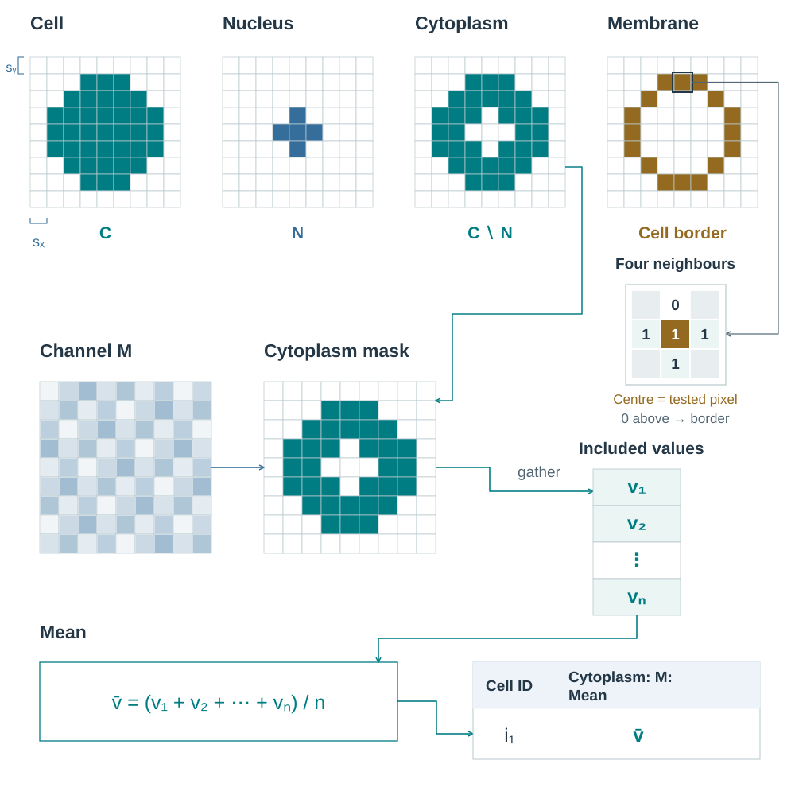
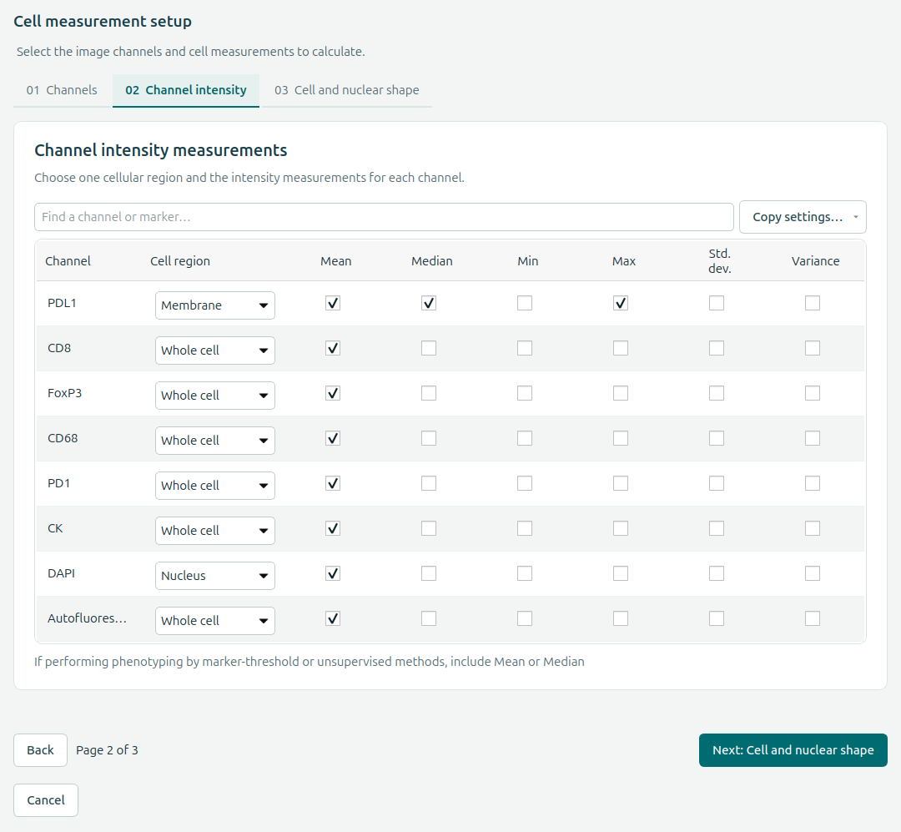
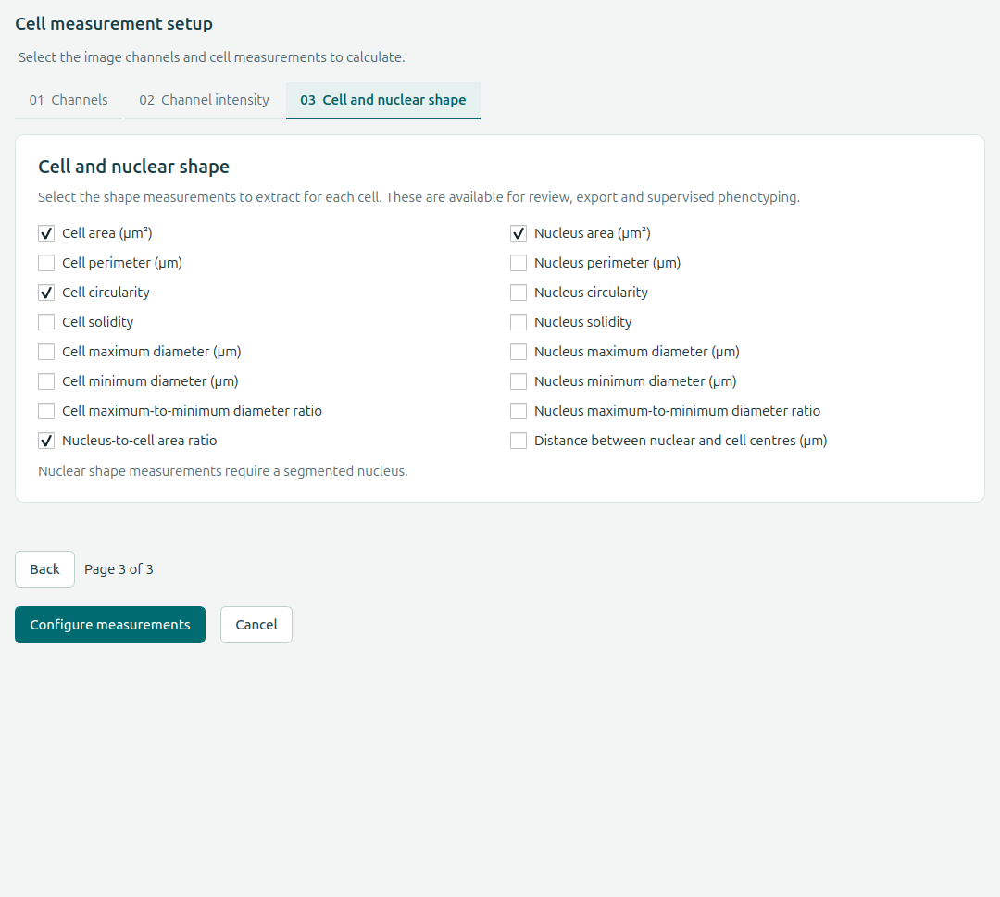
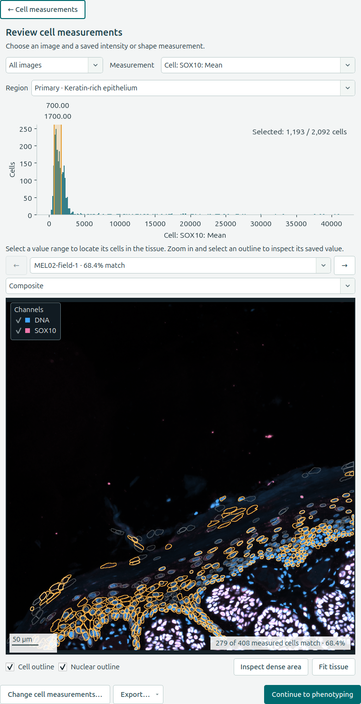
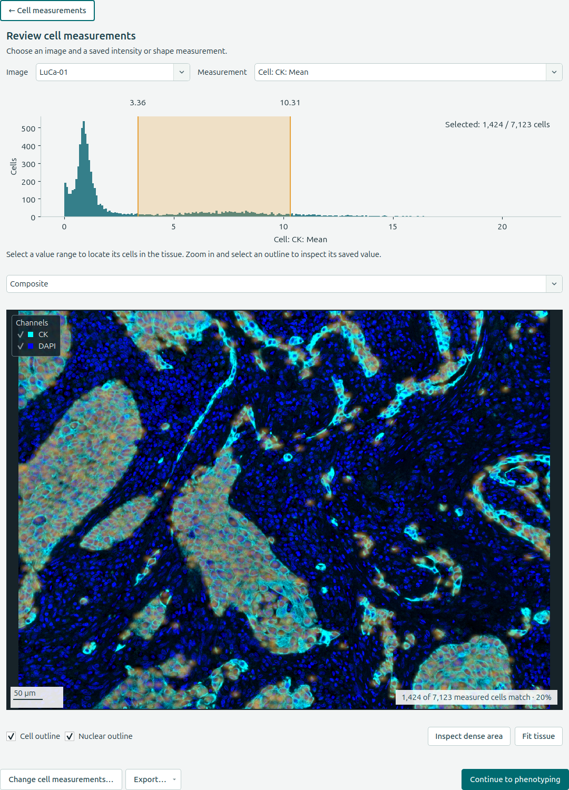
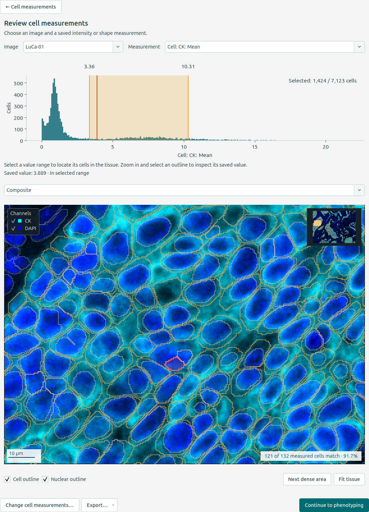

# Cell measurements

[Analysis stages](../../../README.md#analysis-stages)

**Open:** **Run → Cell measurements**, after reviewing the [segmentation outlines](../cells/index.md#review-cell-and-nucleus-outlines).

**On this page:** [Channels](#include-channels-and-assign-their-roles) · [Intensity measurements](#set-each-channels-cellular-region-and-intensity-measurements) · [Cell and nuclear shape](#cell-and-nuclear-shape) · [Review the measurements](#inspect-the-saved-results).

We measure marker intensities and the size and shape of segmented cells and nuclei within the [area selected for segmentation](../cells/index.md#choose-the-area-to-segment). These values support phenotyping and regional summaries and can be exported with cell coordinates for spatial analysis in other software.

## Choose cell measurements

### Include channels and assign their roles

On **Channels**, select the channels to measure. Under **Measurement role**, identify each as **Protein marker intensity**, **DNA** or **Autofluorescence**. Marker-threshold rules and unsupervised clustering offer the saved **Mean** or **Median** measurements assigned the **Protein marker intensity** role.

The saved nuclear channel and recognized DNA stains initially use **DNA**; recognized AF channels use **Autofluorescence**. Other channels start as **Protein marker intensity**. Revise these assignments when needed. **Select shown** and **Clear shown** change the channels currently visible in the filtered list.

_The Channels page includes eight LuCa channels and assigns their protein, DNA and autofluorescence roles._

### Set each channel's cellular region and intensity measurements

Select **Next** to open **Channel intensity measurements**, where each included channel has one row. **Cell region** defines which pixels contribute to that channel's intensity measurements. Choose each channel's region according to the marker's expected localization and the [outlines provided by segmentation](../cells/index.md#check-the-model-and-image-sampling), then tick one or more required statistics in the columns beside it.

**Whole cell** includes the pixels inside the cell boundary; **Nucleus** uses its associated nuclear outline; **Cytoplasm** removes the nucleus from the whole-cell region. **Membrane** uses a one-source-pixel band along the inside of the cell boundary. This band's physical width depends on the image's pixel size, so inspect whether it follows the visible membrane staining. All measurements selected for a channel use the same pixels within its chosen region.

The available regions depend on segmentation. Cellpose provides **Whole cell** and **Cell boundary**, using its predicted outer outline. StarDist with zero expansion provides **Nucleus**. With positive expansion, its additional choices are **Estimated cell region**, **Estimated cytoplasm** and **Estimated cell boundary**. InstanSeg provides the four regions from its cell and associated nuclear outlines.

_Schematic of the four measurement masks. The same cell and nuclear outlines define each mask on the source-resolution image._

**Mean**, selected by default, describes the average intensity across the chosen region and responds to every pixel's brightness. **Median** describes the middle of that intensity distribution and is less affected by a small number of very bright pixels. Choose the statistic together with the cell region so that it summarizes the staining you intend to measure.

**Minimum** and **Maximum** record the dimmest and brightest included pixels. **Variance** measures the spread of pixel intensities around their mean, and **Std. dev.** (standard deviation) is its square root. These describe variation within one cell's selected region; later distribution review compares the resulting values across cells. The [calculation details](../cells/processing.md#calculate-intensity-statistics) define the statistics and their behaviour for one-pixel regions.

To give several channels the same measurements, filter the table and choose a source channel under **Copy settings…**. Its region and selected statistics are copied to the shown channels.

_For PDL1, all three intensity summaries use the membrane pixels of each cell. DAPI is measured within its nuclear outline._

A nuclear measurement requires an associated nuclear outline, and every intensity mask needs at least one included source pixel. [Measurement calculations](../cells/processing.md#measure-the-selected-cell-regions) explains pixel inclusion, statistics and units.

### Add cell and nuclear shape measurements

Continue to **Cell and nuclear shape** and select the quantities needed to describe the accepted outlines. **Area** measures their enclosed area in &micro;m&sup2;, with holes removed; **Perimeter** measures boundary length in &micro;m. **Circularity** compares outer area with squared outer perimeter, giving one for a circle and lower values for elongated or irregular outlines. **Solidity** compares area with that of the smallest convex shape enclosing the outline, so indentations and holes lower its value.

**Minimum diameter** measures the narrowest width between parallel lines enclosing the outline. **Maximum diameter** is the diameter of its smallest enclosing circle. Both are in &micro;m; **Maximum-to-minimum diameter ratio** compares their values. Circularity, solidity and the diameter ratio are dimensionless, and their exact [shape calculations](../cells/processing.md#calculate-the-requested-shape-measurements) are shared by cell and nuclear measurements.

**Nucleus-to-cell area ratio** reports the nuclear fraction of cell area. **Distance between nuclear and cell centres** measures the separation of their area-weighted centres in &micro;m, showing how far the nucleus lies from the cell's centre. Nuclear and relative cell/nuclear measurements require an associated nucleus. All selected shape values are available for distribution and image review, export, and use as supervised-classifier inputs.

### Measurements needed for phenotyping

Marker-threshold rules and unsupervised phenotyping use saved marker intensities. Include **Mean** or **Median** for the markers you plan to use, then select the saved measurement when setting up phenotyping. Supervised RF, SVM and LR classifiers can use any of the saved intensity statistics, shape measurements or both.

KRONOS and Nimbus use cell images and outlines to derive embeddings and marker scores, respectively, so their model calculations do not require saved intensity or shape measurements. Nimbus setup also requires a saved **Mean** or **Median** for intensity review and optional [distillation](../phenotyping/marker-rules.md#review-an-intensity-distillation).

### Calculate the selected measurements

Select **Configure measurements** to save the channel and shape choices. If the analysis is paused, use **Continue saved work** on Run.

### If a measurement cannot be calculated

If calculation stops because a requested value is unavailable, open **Details**, locate the reported cell, and inspect the requested region. Check that its outline encloses the intended staining and contains image pixels. Review a replacement segmentation when the outline is incorrect, or revise the measurement selection when the requested compartment is unavailable. 

For local processing, if inspection confirms an unusable fragment, open the stopped **Cell measurements** step’s **Change cell measurements… → Remove cells in QuPath**. Select and delete that cell, save in QuPath, then close it to return the removal. Keep other cells and annotations unchanged in this draft. Back in the options dialog, review the affected results, apply the revision and continue to recalculate measurements. Subsequent measurements and exports omit the removed cell.

## Review cell measurements

When the calculation finishes, Run opens **Review cell measurements**. Choose the saved intensity or shape measurement you want to inspect, then use **Region** to select the cells that will contribute. **All areas** includes the whole analysed population. Selecting a primary tissue class or an individual analysis area restricts both the histogram and the tissue view to that selection. You can reopen this review from the completed **Cell measurements** node or **Results & export**.

### Select a measurement interval

The histogram contains one saved value per measured cell, so large and small cells each contribute one observation. To interpret a high-intensity tail, check which pixels and statistic were used. One bright pixel inside the measured region can give a cell a high **Maximum**. A high **Mean** requires enough signal to raise the average across that region. Use the linked tissue view to inspect the cells behind a tail, peak or gap in the distribution.

To inspect cells within a particular measurement range, drag across the histogram or click a bar to use its bin limits. Hovering over a bar shows its limits and count. As you drag either edge of the interval, the plot reports how many measured cells fall between the two endpoints, including cells exactly on either limit. To use a measurement as a marker threshold for classification, set the gate during [phenotyping](../phenotyping/marker-rules.md#review-the-marker-decision).

With several compatible images, **All images** combines the cells in the chosen region into one histogram. An image with many measured cells can account for much of a peak or tail. Choose **Selected image** to see the distribution for one image.

Use the navigator’s arrows or searchable list to inspect another image. The percentage beside each name is the fraction of its included cells within the selected interval. The tissue view opens on the chosen region and keeps its position and zoom as you adjust the interval.

_The Keratin-rich epithelium selection contains **2,092 measured cells** across MEL02, MEL05 and MEL09. The whole-cell SOX10 Mean interval **700–1,700** selects **1,193 cells**. The tissue view shows the complete MEL02 image. **279 of its 408** included cells match (68.4%)._

### Inspect the selected cells in tissue

The tissue view locates the selected population across the image. At wide views, we count selected cell centres in a spatial grid and smooth those counts to draw an amber overlay; brighter areas show where the selected cells concentrate. Hover to read the unsmoothed count and its fraction of measured cells in the local area. The fraction shows how common the selected measurements are among cells in that area, while the count also depends on how many cells the area contains overall.

Click an area to zoom in, or choose **Inspect dense area** to visit a field containing many selected cells. The button then becomes **Next dense area**, moving through those fields in a repeatable order. Drag to pan and use Ctrl+scroll to zoom. The small overview keeps the current field in context; **Fit tissue** returns to the whole image.

At closer views, amber outlines identify matching cells and subdued outlines retain their neighbours. Click a cell to read its saved measurement and mark its position on the histogram. The bottom-right field summary reports the matching count, total measured count and percentage for cell centres within the visible field; the image navigator's percentage refers to the included population across that image. Use the **Cell outline** and **Nuclear outline** controls below the image to compare the available outlines with the staining.

Use [Image appearance on Run](../run/index.md#adjust-image-appearance) to choose channels, colours and brightness limits. For cells with unexpected values, compare the measured region with the stained structures inside and around its outline. For a membrane measurement, inspect staining along the inside of the cell boundary, where the one-source-pixel measurement band lies.

<table><tr>
<td></td>
<td></td>
</tr></table>

_Left: the interval 3.36–10.31 selects 1,424 of 7,123 LuCa whole-cell CK means; the smoothed amber layer locates these cells across the tissue. Right: **Inspect dense area** opens a field where 121 of 132 measured cells match (91.7%). CK is cyan and DAPI blue. Amber outlines mark matches, grey outlines show neighbours, and coral identifies the inspected cell, whose saved value of 3.889 is marked on the histogram. Scale bar: 10 µm._

### Export or revise the measurements

Use **Export…** to save the measurement distribution, its data, the tissue view or the field data. [Measurement review and exports](../results/figures.md#measurement-distributions) describes those files. Use the separate [Cell gallery](../results/figures.md#cell-gallery) to compare repeatable examples selected by phenotype and measurement ranges.

For an All images review, the distribution-data choices also include **Image counts in selected interval**, with each image's exact matching count, eligible count and percentage.

To revise the measurement selection, open **Cell measurements → Change cell measurements…**. Preview the affected steps, apply the change and continue the saved analysis. Replacing the segmentation requires measurements for the replacement outlines. Before proceeding to phenotyping, inspect representative marker distributions and the cells responsible for unexpected values.

---

**Next:** [Cell phenotyping](../phenotyping/index.md). **Calculation details:** [Measurement calculations](../cells/processing.md#measure-the-selected-cell-regions).
