# Cell segmentation

[Analysis stages](../../../README.md#analysis-stages)

**Open:** **Run → Cell segmentation**.

**On this page:** [Method](#choose-a-segmentation-method) · [Analysis area](#choose-the-area-to-segment) · [Method settings](#check-the-model-and-image-sampling) · [Tile settings](#set-tile-processing) · [Run segmentation](#run-segmentation) · [Outline review and corrections](#review-cell-and-nucleus-outlines)

Segmentation detects the nuclear or whole-cell outlines used to measure marker intensities and cell shapes. Review the outlines against the nuclear and marker staining before using them for measurements or phenotype assignment.

## Choose a segmentation method

On **Method**, choose a segmentation method. Note that **InstanSeg** predicts nuclei and whole cells, **Cellpose-SAM** predicts whole cells, and **StarDist** predicts nuclei with optional expansion to estimate cell regions. Select **Next: Settings** to choose the tissue area and image inputs for the model.

Install the selected model through **Software setup → Cell segmentation**. 

<a href="../../assets/screenshots/segmentation-method-current.png">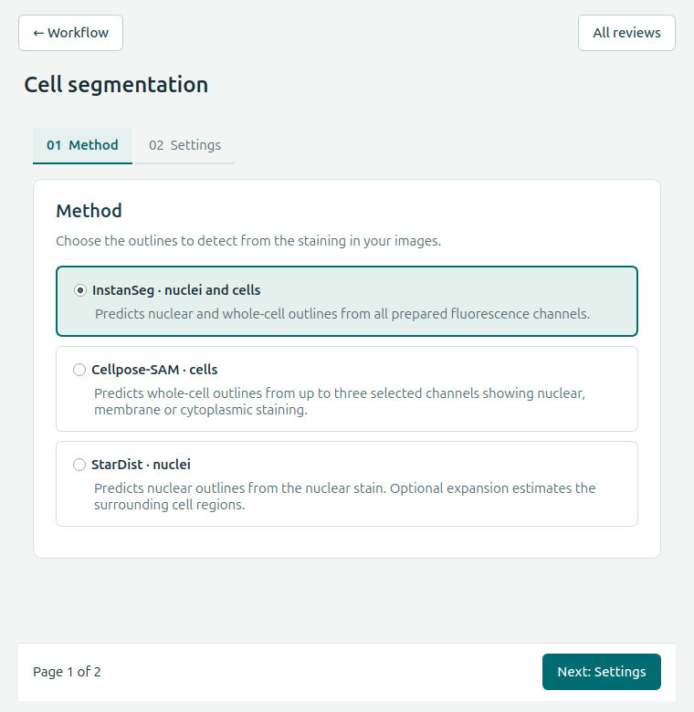</a>

_InstanSeg is selected to predict both whole-cell and nuclear outlines._

## Choose the area to segment

At the top of **Settings**, choose **Area to segment** for any segmentation method. **Selected analysis regions** processes the accepted, included analysis regions within each tissue section. **Included primary tissue regions** restricts those areas to the union of their primary-class regions, excluding **Ignore**. This second choice is available when primary tissue classification has been performed.

We combine the included areas within each tissue section for segmentation, then assign each detected cell to its analysis region using the cell outline's area-weighted centre, or centroid. At a tissue edge, a detector can return an outline whose centre falls outside the included regions. We omit that cell. A centre inside two regions requires a boundary review. The [analysis-region guide](../tissue/index.md#selecting-analysis-regions) explains how to define these areas; [conflicting assignments](#resolve-overlapping-region-assignments) explains how to correct an ambiguous boundary.

## Check the model and image sampling

All methods use the image's recorded pixel width and height to sample the staining at a physical resolution in µm/pixel. Incorrect dimensions change the apparent size of cells supplied to the model, so correct the image calibration before segmentation. We map the predicted outlines back to the original image coordinates.

### InstanSeg: nuclei and cells

InstanSeg uses the **fluorescence_nuclei_and_cells 0.1.1** model through the **InstanSeg 0.1.7** QuPath extension. It resamples every channel in the prepared image at approximately **0.5 µm per pixel**, supplies those channels together to the model, and predicts cell outlines with their associated nuclear outlines.

<a href="../../assets/screenshots/segmentation-instanseg-settings.png">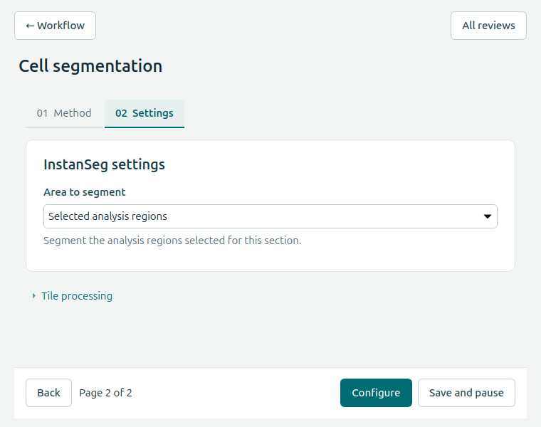</a>

_InstanSeg uses all prepared channels within the selected analysis regions._

### Cellpose-SAM: cell boundaries

Cellpose uses the original **Cellpose-SAM** model through **Cellpose 4.0.9**. Under **Primary cell channel**, select a membrane or cytoplasmic stain that shows the extent of the cells. The optional second and third channels can provide nuclear staining or additional staining of the cell body. The model accepts these inputs in any order, so a nuclear stain can occupy any selected input channel. The model produces cell outlines only; nuclear and cytoplasmic measurements require a method that also produces associated nuclear outlines.

Set **Processing pixel size (µm)** to choose the physical sampling supplied to Cellpose; it starts at **0.5**. From that image, the model predicts a cell score and a direction towards a cell centre at each pixel. **Cell score threshold**, initially **0**, selects the pixels whose scores exceed the threshold. Those pixels follow the predicted directions to form candidate cell outlines. Lowering the score threshold admits more pixels and can recover dim cell regions.

**Flow error threshold**, initially **0.4**, sets the maximum allowed disagreement between two sets of pixel directions, called *flows*:

1. **Flows predicted from the image.** The model predicts a direction towards a cell centre at each pixel. Following these directions groups pixels into candidate cell outlines.
2. **Flows calculated from each candidate outline.** Cellpose uses the enclosed shape to calculate directions towards an interior centre. It compares these directions with the image predictions at the same pixels to check whether they agree with the candidate shape.

An outline is discarded when the mean squared difference exceeds the threshold. Lowering the threshold rejects more candidates; raising it allows greater disagreement between the outline-derived and image-predicted flows. When revising this value after inspecting missed cells or poorly placed outlines, compare the replacement result in the same field. The [flow calculation](processing.md#cellpose-flow-error) explains how the two direction fields are formed and compared. [Cellpose settings](https://cellpose.readthedocs.io/en/latest/settings.html).

<a href="../../assets/screenshots/segmentation-cellpose-settings.png">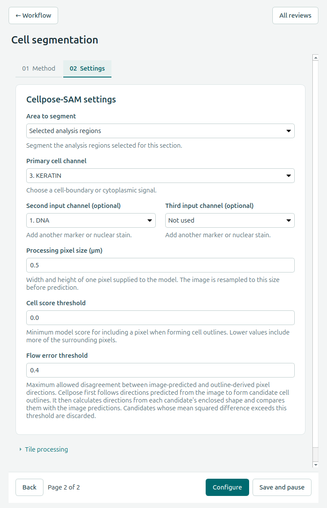</a>

_Cellpose-SAM inputs for MEL02: KERATIN supplies the primary channel and DNA the second channel. The cell-score and flow-error thresholds determine which pixels and model-generated outlines are retained._

### StarDist: nuclear outlines

StarDist uses the **dsb2018_heavy_augment** model through the **StarDist 0.6.0** QuPath extension. Under **Nuclear channel**, the nuclear stain selected in **Channels & markers** is filled in automatically. **Processing pixel size (µm)**, initially **0.5**, sets the sampling at which this stain is supplied to the model. StarDist uses its intensity pattern to predict nuclear outlines.

**Nuclear detection threshold**, initially **0.5**, sets the minimum predicted object probability for considering a candidate nucleus. StarDist forms and selects outlines in two steps:

1. **Predict candidate outlines.** At each candidate location, the model estimates distances to the nuclear boundary in several directions. Joining the endpoints forms a proposed outline. Candidates whose object probabilities meet or exceed the threshold proceed to overlap selection.
2. **Resolve overlapping candidates.** Several locations can propose outlines for the same nucleus. The QuPath extension processes candidates in descending probability order and removes portions overlapping previously retained nuclei. A trimmed candidate is retained when it remains one connected polygon with more than half of its original area.

Lowering the detection threshold admits more candidates, including faint nuclei and possible background detections; raising it removes candidates with lower predicted probabilities. Compare the same field before and after changing the threshold to assess these effects. [Processing and calculations](processing.md#stardist-processing) explains the image preparation and overlap handling.

**Estimated cell expansion (µm)** starts at **0**, which retains nuclear outlines for nuclear measurements. A positive value sets the distance used to expand each nucleus and estimate its surrounding cell region. Where estimates overlap, the boundary between them is adjusted to keep the regions separate. Cell, cytoplasm and boundary measurements then use these estimated regions.

To make the size of each estimated cell depend on its nucleus as well as the expansion distance, enable **Limit expansion relative to nucleus size**. QuPath finds the smallest convex shape enclosing the nucleus (its convex hull) and enlarges it about its centre. **Expansion scale factor** sets the increase in its linear dimensions. The default of **1.5** makes them 50% larger.

QuPath clips the distance-expanded cell to this enlarged hull. A smaller nucleus therefore permits less expansion, and reducing the scale factor holds the estimated cell closer to its nucleus. This additional limit is off initially. [How neighbouring nuclei and both limits determine the boundary](processing.md#retain-nuclei-or-estimate-surrounding-cell-regions)

<a href="../../assets/screenshots/segmentation-stardist-settings.png">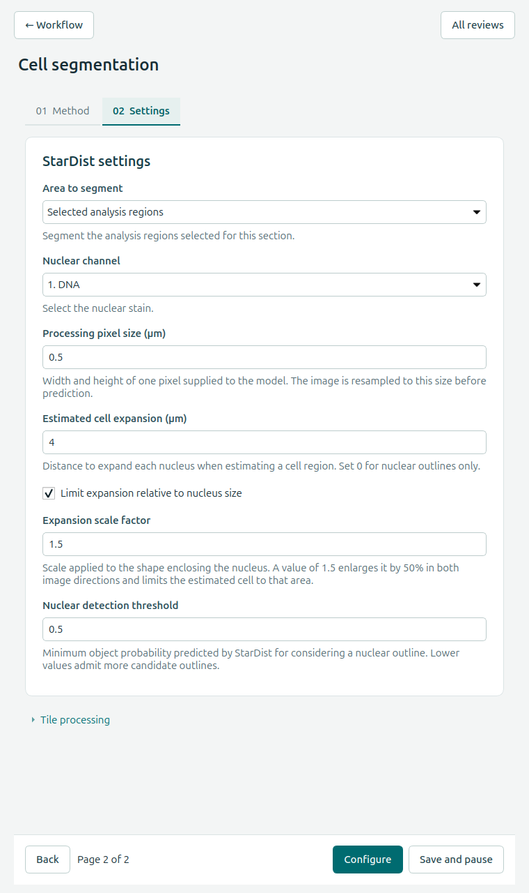</a>

_StarDist inputs for MEL02. DNA supplies the nuclear image. This example uses 4 µm expansion with a scale factor of 1.5 to estimate surrounding cell regions. Setting expansion to 0 retains nuclear outlines only._

[Processing and calculations](processing.md) explains the model inputs, intensity preparation, tiling and saved boundaries for each method.

## Set tile processing

Open **Tile processing** below the method settings. The models read tiles containing an interior area and surrounding padding, which supplies staining context for cells near the interior's edge. **Tile size (pixels)** includes that padding and starts at **512**; **Padding (pixels)** starts at **80** on each side. Subtracting both padded sides leaves a 352-pixel interior, so successive tiles advance by **352 model-input pixels**. InstanSeg also provides **Simultaneous tiles**, initially **2**; Cellpose and StarDist use one model worker.

Changing **Tile size (pixels)** or **Padding (pixels)** changes the image context available to prediction. If repeating segmentation with different tile settings, compare the replacement outlines in the same dense and sparse tissue regions, including cells crossing tile edges. The [tile calculation](processing.md#read-padded-tiles-and-predict-outlines) explains how these settings determine the distance between successive tiles and the surrounding pixels supplied to the model.

For InstanSeg, setting **Simultaneous tiles** to **1** prepares one tile at a time, reducing the memory used for concurrent tile preparation. The model and the predicted outlines waiting for neighbouring tiles also occupy memory. Once those neighbouring tiles finish, repeated predictions of the same cell can be reconciled and the completed outlines saved.

<a href="../../assets/screenshots/segmentation-tile-processing.png">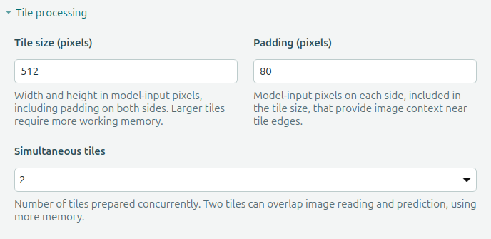</a>

_Tile processing for InstanSeg. The 80-pixel padding on each side leaves a 352-pixel interior within each 512-pixel tile. Cellpose and StarDist show the same size and padding controls._

## Run segmentation

Select **Configure** to save the settings and return to the workflow. If processing is paused, select **Continue saved work** on **Run**. The outline review opens after segmentation, where you can inspect the result and collect corrections before continuing to measurements. If processing fails, the error details identify the problem and available recovery action.

<a href="../../assets/results/luca-field-1-staining-outlines.png">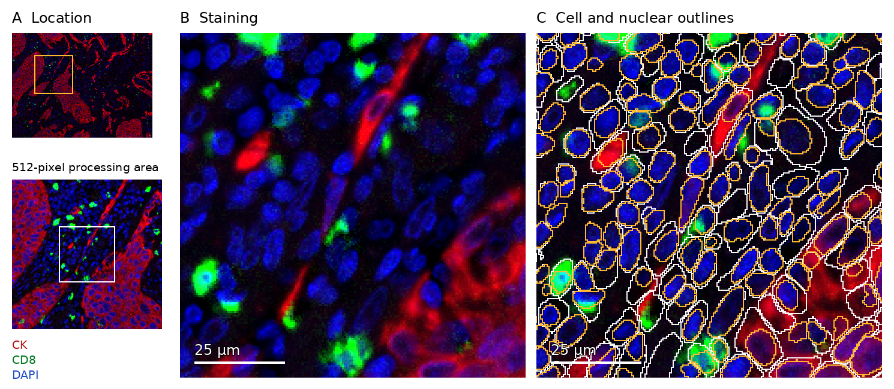</a>

_InstanSeg segmentation of a LuCa field. CK is red, CD8 green and DAPI blue; whole-cell outlines are white and nuclear outlines amber. The marked 512 × 512-pixel region contains 834 detected cells with 778 associated nuclear outlines._

## Review cell and nucleus outlines

The review opens when segmentation finishes and can be reopened from **Run → Cell segmentation → Review cell and nucleus outlines**. It shows the staining with cell boundaries in mint and nuclear boundaries in yellow. The available outlines depend on the segmentation method (Cellpose-SAM provides only cell outlines; expanded StarDist regions are labelled as estimated cell regions). Toggle the outlines to compare each boundary with the staining beneath it.

Under **Inspect**, choose **Browse fields** to step through the tissue and compare the saved outlines with the staining. Choose one of the other tasks to investigate missing, merged or fragmented outlines.

For **Missing or incomplete nuclei** and **Missing or incomplete cells**, **Survey tissue** calculates staining coverage in up to 64 fields across the selected segmentation area. The survey can include tissue where segmentation found no cells. Select a point in the plot or use **Previous field** and **Next field** to inspect its staining. To change the field dimensions, open **Sampling settings**. Run the survey again after changing the dimensions, stain or threshold. [How we select the survey fields](#calculate-staining-coverage)

### Missing or incomplete nuclei

Choose **Missing or incomplete nuclei** under **Inspect**. In the left panel, choose **Nuclear staining coverage** under **Inspection method** if both methods are available. Select the nuclear stain and enter a **Threshold** in that channel’s stored intensity units. Keep **Nuclear outline** on to compare the detected boundaries with the staining.

The **Uncovered fraction** is the percentage of above-threshold staining outside the nuclear outlines. Enable **Highlight contributing pixels** to locate all above-threshold pixels; blue marks above-threshold pixels inside an outline, and pink marks those outside. The [coverage calculation](#calculate-staining-coverage) describes the areas and percentage used.

In the survey plot, each point represents one field where its horizontal position gives the total above-threshold staining area, and its vertical position gives the area outside nuclear outlines. Select a point to open **Field n of N**. If you pan away, the navigator changes to **Current field** and coverage is calculated for the new view.

<a href="../../assets/screenshots/segmentation-mel-nuclear-coverage.png">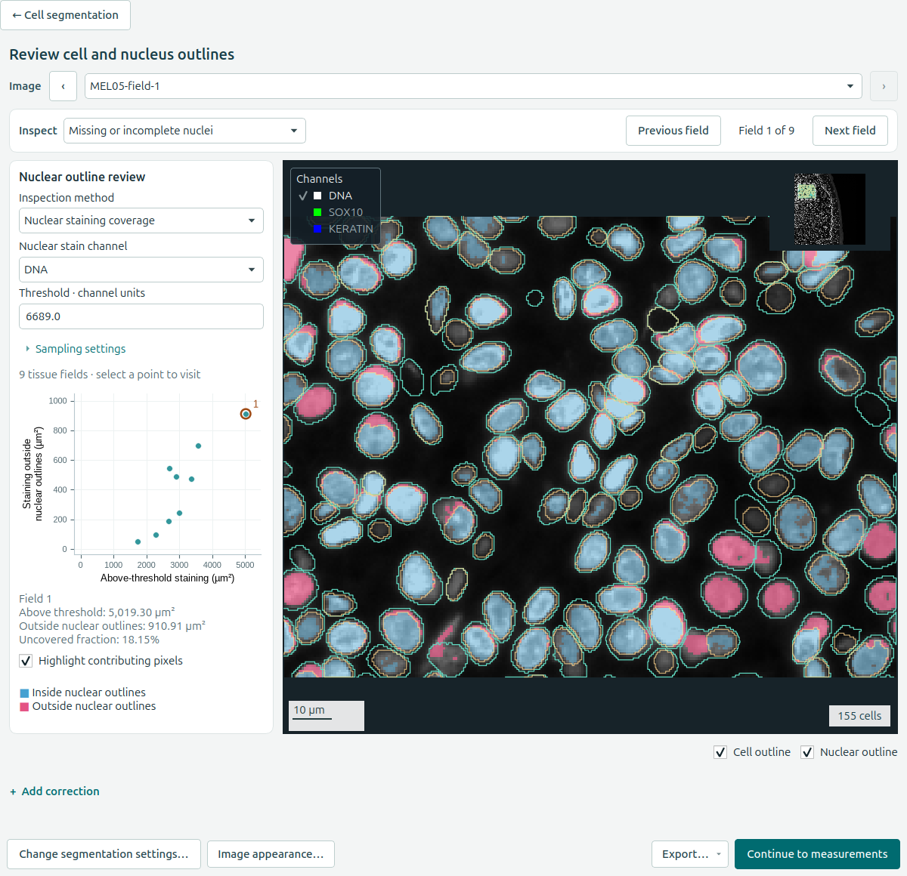</a>

_At a DNA threshold of 6,689, the first MEL05 field contains 5,019.30 µm² of above-threshold staining. Of that area, 910.91 µm² (18.15%) lies outside the nuclear outlines._

Inspect fields with substantial staining outside nuclear outlines and toggle the highlight to examine the original signal. Follow each nuclear profile to determine whether its outline is missing or excludes part of the nucleus. Background staining can also contribute to the uncovered area.

For InstanSeg results, switch the left panel to **Cells without nuclear outlines** to visit detected cells that have a cell boundary but no saved nuclear boundary. Use **Previous cell** and **Next cell** to check the nuclear stain within each cell.

**Export… → Nuclear coverage plot…** saves the scatter; **Nuclear coverage table…** saves field bounds, channel, threshold, pixel counts and areas.

### Missing or incomplete cells

Choose **Missing or incomplete cells**, select a stain showing the cell body or membrane and enter a **Threshold** in that channel's stored intensity units. Keep **Cell outline** on to compare the detected boundaries with the staining.

The **Uncovered fraction** is the percentage of above-threshold staining outside the cell outlines. The plot and blue/pink highlight use the same [coverage calculation](#calculate-staining-coverage) as the nuclear review, with cell outlines defining the covered area.

<a href="../../assets/screenshots/segmentation-mel-cell-coverage.png">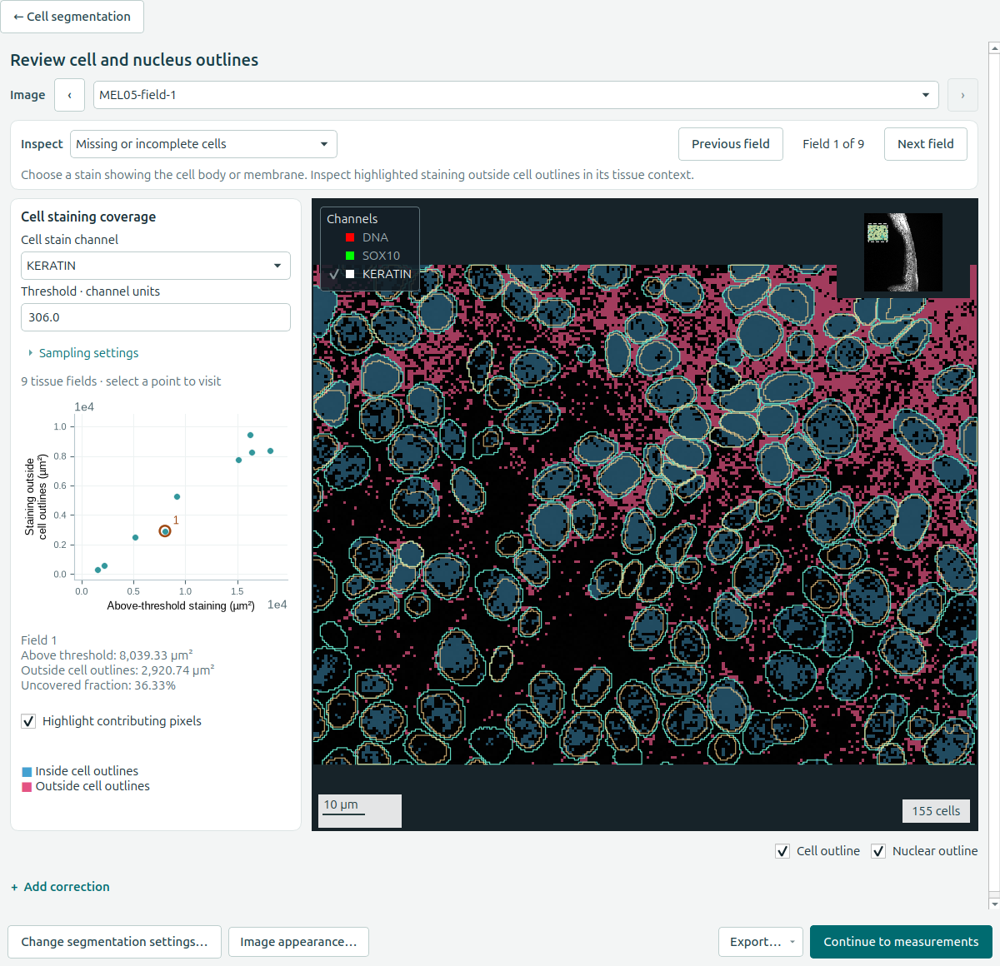</a>

_At a keratin threshold of 306, the first MEL05 field has 2,920.74 µm² of staining outside cell outlines, or 36.33% of the above-threshold area._

Inspect fields with substantial staining outside cell outlines. Follow the stained cell body or membrane, including visible extensions, and check neighbouring outlines to determine whether a cell was omitted, only partly outlined or included in a neighbour. Compare another relevant marker when the selected marker staining reveals only part of the cell or labels only some cell types.

**Export… → Cell coverage plot…** and **Cell coverage table…** save the plot and the same field-level quantities for cell outlines.

### Possible merged outlines

Choose **Possible merged outlines**, select a **Stain**, choose nuclear or cell **Outlines**, and enter a **Threshold**. Pixels above this threshold that touch along an edge or corner form a *stained region*. **Minimum overlap** sets the minimum area, in µm², that this region must share with an outline. The [overlap calculation](#calculate-staining-overlap) describes how stained regions are identified and how their overlap with outlines is calculated.

The candidate list contains outlines overlapping at least two stained regions, each meeting the minimum shared area and having at least half its staining inside the outline. Select an entry to locate the cell and compare these stained regions in the bar plot.

Each bar represents one stained region. Its coloured segment gives the area inside the selected outline, and its pale segment gives the area outside, on a common scale in µm². The percentage divides the shared area by that stained region's total area.

Select a bar to highlight its stained region and outline, then toggle **Highlight selected staining** to inspect the original signal. The list updates when the field or settings change.

<a href="../../assets/screenshots/segmentation-mel-merged.png">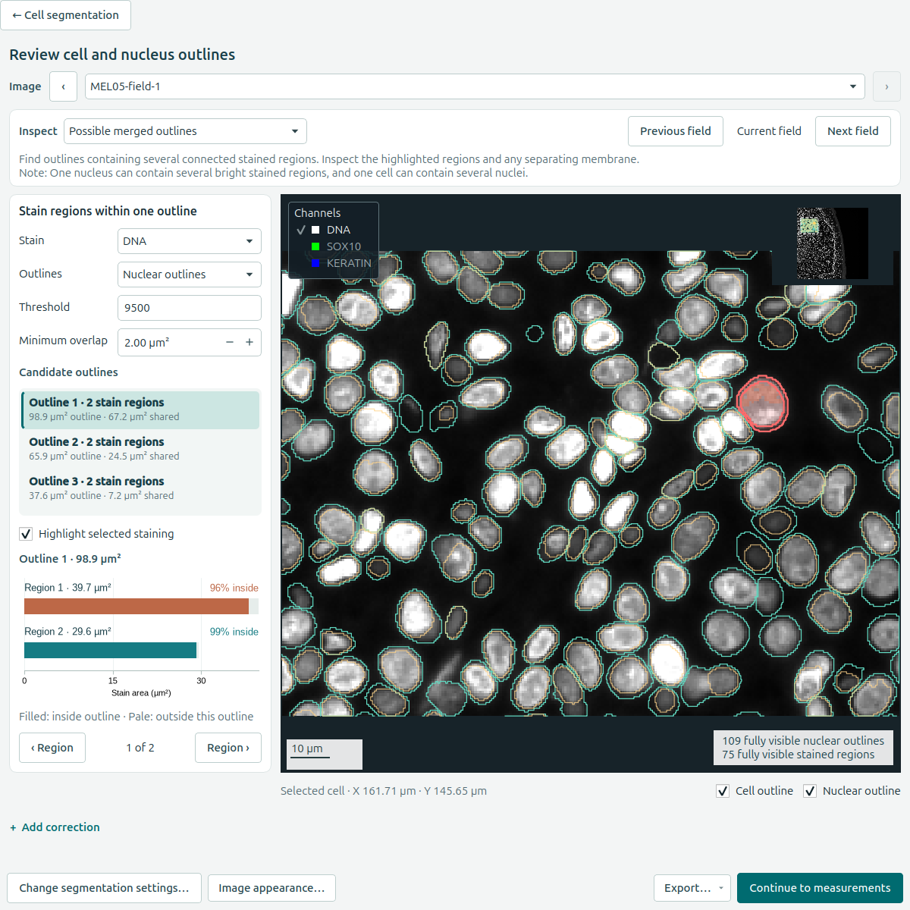</a>

_At a DNA threshold of 9,500, the selected nuclear outline overlaps two stained regions. The shared areas are 38.02 and 29.15 µm²._

For nuclear outlines, inspect whether the highlighted regions belong to distinct nuclei and follow the separation between them. For cell outlines, compare membrane or cytoplasmic staining to locate separate cell bodies within the proposed merged outline.

Uneven staining can produce several bright regions inside one nucleus, and a multinucleated cell can contain several nuclei. Use the complete staining pattern to assess the listed outline before collecting a correction.

### Possible split or fragmented outlines

Choose **Possible split or fragmented outlines**, select a **Stain**, choose nuclear or cell **Outlines**, and set the **Threshold** and **Minimum overlap**. These use the same [thresholding and overlap calculation](#calculate-staining-overlap) as the merged-outline review.

The candidate list contains stained regions overlapping at least two outlines, with each overlap meeting the minimum shared area. Select an entry to highlight the stained region and compare its overlaps in the bar plot.

Each bar shows how much of the selected stained region lies inside one outline. The coloured segment gives the shared area as a percentage of the stained region. The pale segment shows the remainder. Select a bar, or use **‹ Outline** and **Outline ›**, to locate the corresponding cell.

<a href="../../assets/screenshots/segmentation-mel-fragmented.png">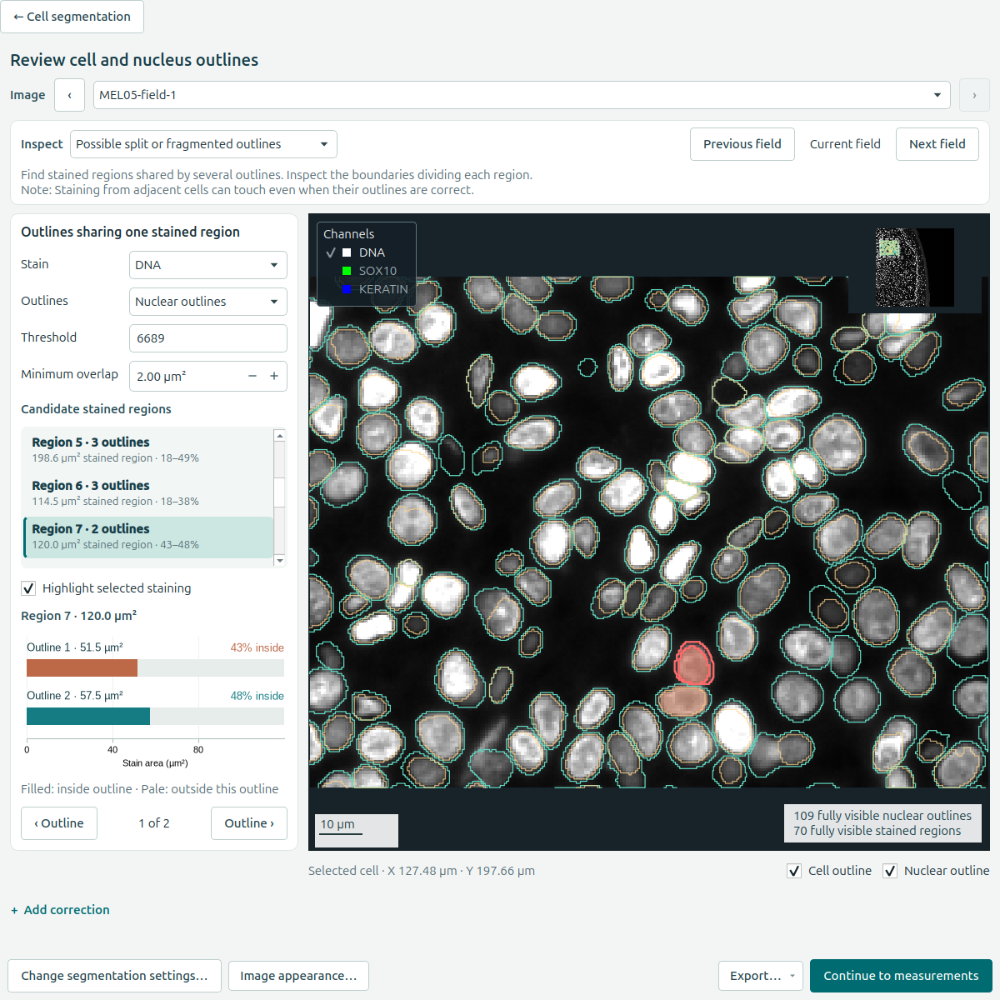</a>

_The highlighted DNA-stained region covers 119.99 µm² and overlaps two nuclear outlines. Select either bar to locate the corresponding outline._

Inspect the dividing boundaries within the highlighted staining. A boundary crossing one continuous nucleus or cell body may indicate that it has been split into several objects. Adjacent cells can also have connected above-threshold staining, so follow their outer boundaries and any separating membrane before collecting a merge correction.

Both overlap tasks require the complete stained region and outlines to be inside the field. Pan or zoom to include their full extent; objects touching the field edge are omitted from the comparison.

For both overlap tasks, **Export… → Selected stain/outline overlap…** saves the selected bars. **Field stain/outline overlaps…** saves all calculated overlaps, including the shared area, total stained-region area, outline area and fraction of staining inside each outline.

For any review task, **Export… → Tissue view…** saves the displayed staining, outlines and active highlights. **Tissue field data…** saves visible cell identities and coordinates as CSV, or image arrays, outline geometry and display settings as NPZ. Coverage highlights are also retained in the NPZ data.

## Collect, edit and review corrections

### Collect corrections

Select a cell in the image, a candidate list or a linked plot. Choose **+ Add correction** below the image and select the change. Once you have collected cells, scroll to the last row to add another correction.

- **Cells to delete:** choose **Delete cell…** to queue removal of the cell and its nuclear outline.
- **Outlines to edit:** choose a reshape, split, merge or drawing action. For a merge, add each fragment using **Add selected cell to merge**. For a missing cell, choose **Draw a new cell…** in the inspected field; nucleus-only segmentation offers **Draw a new nucleus…**.

**Collected corrections** groups the requests by image, with numbered entries locating cells in the tissue. Use **×** beside an entry to remove that request before editing. You can collect changes to both the cell and nuclear boundaries of one cell. Use the image selector or arrows to continue reviewing other images; selecting an image in the correction summary returns to its queued changes.

<a href="../../assets/screenshots/segmentation-collected-corrections-current.png">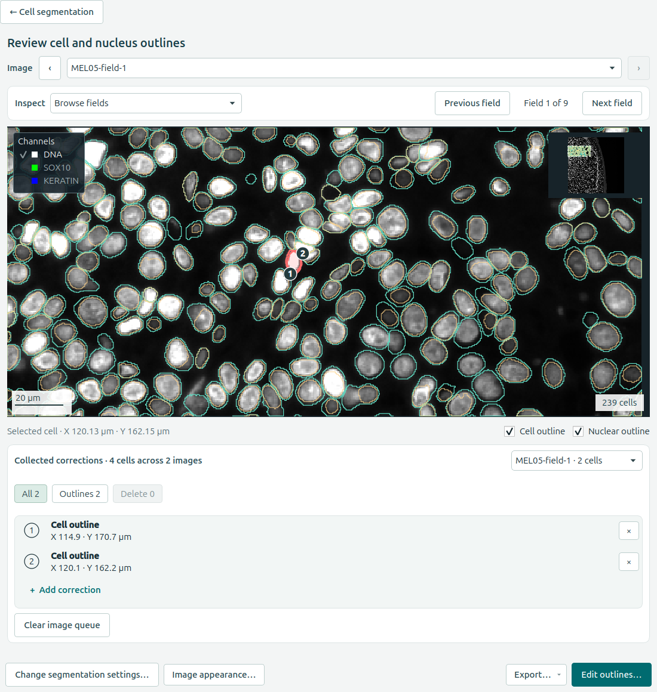</a>

_Four cells collected across MEL02 and MEL05. The selected MEL05 field shows the two numbered cells in its correction queue._

Choose **Edit outlines…** to open the editing tasks in QuPath. If every collected change is a deletion, this action opens the **Current** and **Proposed** comparison directly.

### Edit the collected outlines

The image navigator contains the images with queued corrections; selecting an image shows its tasks. Select a task in the list to centre its outline and show the tools for that correction. 

- **Reshape a boundary:** use **Move vertices** to adjust its vertices or **Brush** to add to it; hold **Alt** to erase.
- **Split an outline:** select **Cutline**, draw the dividing line across the cell, and choose **Apply**. You can then reshape the resulting boundaries.
- **Merge fragments:** edit the combined outline of the cells collected for merging.
- **Draw a missing outline:** draw the boundary and choose **Apply** to add it to the selected correction. **Draw a new cell…** creates a cell; nucleus-only segmentation offers **Draw a new nucleus…**. **Draw missing nuclear outline…** supplies a nucleus for an existing cell when the segmentation method supports separate cell and nuclear outlines.

<a href="../../assets/screenshots/segmentation-outline-editor-controls-current.png">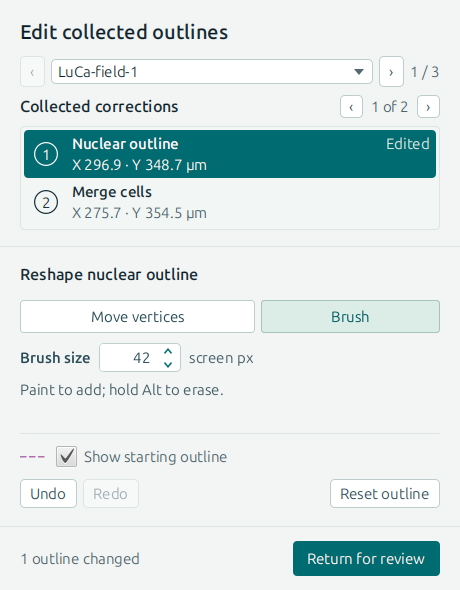</a>

_Brush is active for the selected LuCa nucleus. The correction queue identifies which collected outline receives the edit._

Enable **Show starting outline** to compare the edited boundary with its starting shape, shown as a dashed outline. **Reset outline** restores that boundary; for a split, merge or new-cell task, **Reset task** restores the whole task to its starting state. The drawing tools use [QuPath's annotation controls](https://qupath.readthedocs.io/en/stable/docs/starting/annotating.html).

For split or merge tasks, you must choose how to handle the nuclei. **Retain source nuclei** keeps each existing nuclear outline inside one resulting cell; in this case, the dividing line drawn must not cross the existing nucleus. If the nuclei also need correction, choose **Redraw nuclei**, select each resulting cell and draw its replacement nucleus. **No nuclei** leaves the resulting cells without nuclear outlines.

Select **Return for review** to save the draft and return to the comparison.

<a href="../../assets/figures/segmentation-correction-editor-current.svg">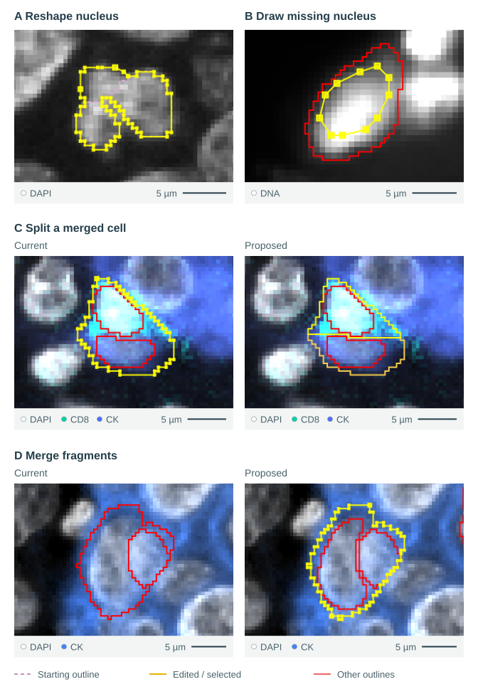</a>

_Editing collected outlines. **A:** reshape a nuclear boundary with Brush; the starting outline is dashed. **B:** draw a missing nucleus, ready to apply. **C:** split a selected cell outline. **D:** merge two fragments. The missing-nucleus example uses the MEL02 DNA channel; the other examples use LuCa DAPI. DNA/DAPI is gray, CD8 teal and cytokeratin (CK) blue; each footer keys its displayed channels. Scale bars: 5 µm._

### Review and accept the changes

Use the image navigator to review each image's corrections. Select a correction in the list to inspect its **Current** and **Proposed** outlines side by side. **Show current outlines**, beside **Proposed**, adds the original boundaries as amber dashes over the solid mint proposed outlines.

<a href="../../assets/screenshots/segmentation-corrections-paired-current.png">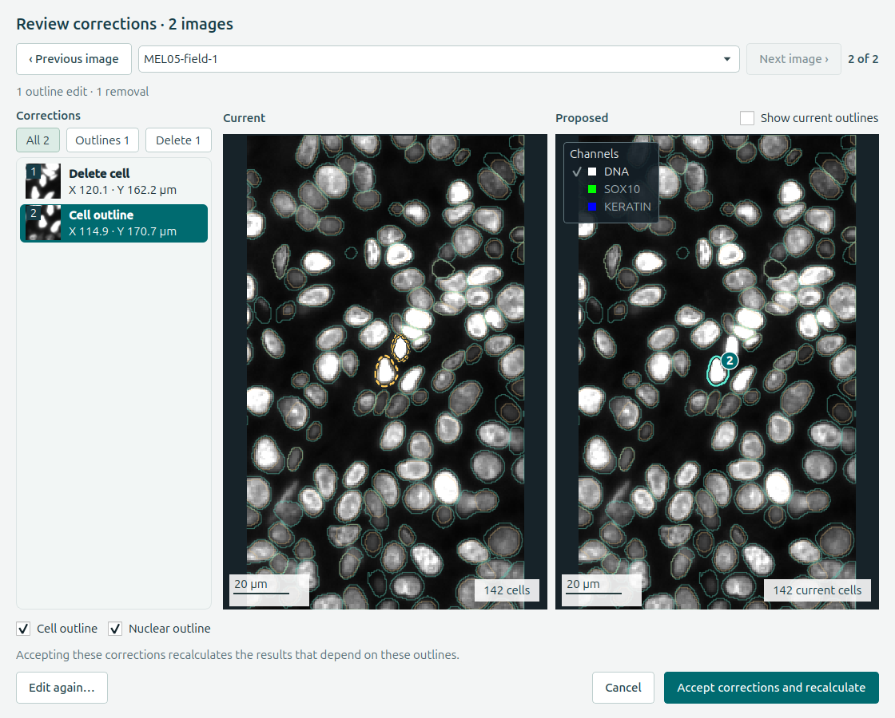</a>

_MEL05 in a two-image correction review, with DNA shown in greyscale. The selected cell has an edited boundary; the other collected cell is absent from the proposed population. The image navigator also opens the collected MEL02 corrections._

Use **Edit again…** to revise a proposal. **Accept corrections** applies the reviewed changes across the queued images. If accepting the edits will change a completed result/node, the review lists the stages to recalculate. Choose **Accept corrections and recalculate** to apply the edits and update those results with the saved settings.

**Cancel** leaves changes unapplied and retains the draft while this review remains open. Use **Review changes…** to return to the comparison, **Resume draft…** to continue editing, or **Discard draft** to remove the proposals. After applying or clearing the collected corrections, select **Continue to measurements**.

## Systematic issues

### Repeated segmentation errors

For repeated missed, merged or fragmented cells, review the selected model, its input channels and the staining quality. Use **Change segmentation settings…** to revise the method or its controls, then review the affected results and continue processing. Return to the same fields to assess the replacement outlines. [Changing a completed step](../run/index.md#change-a-completed-or-stopped-step) explains how to apply the revision.

For **StarDist cell expansion**, compare the estimated outlines with membrane or cytoplasmic staining. If the estimates extend beyond the visible cell boundaries, reduce the expansion distance. For excessive expansion around small nuclei, enable the nucleus-size limit or lower its scale factor, then repeat segmentation and inspect the same field. If nuclear expansion cannot represent the visible cell shapes, choose a method that predicts cell outlines from the staining.

### Processing-tile or padding artifacts

A repeated spatial pattern needs a separate check for tile or padding artifacts. If omissions, duplicate outlines or clipped boundaries recur along an edge, inspect nearby tissue away from that edge and compare the same locations after revising tile processing. [Processing and calculations](processing.md#read-padded-tiles-and-predict-outlines) explains how tile size and padding affect prediction context.

### Conflicting region assignments

A cell must have one analysis-region assignment and, when primary classification is used, an unambiguous primary tissue class.

If segmentation reports that a cell centre belongs to more than one active region, return to **Analysis regions** and open the QuPath region draft. Reshape their shared boundary or remove an unintended region from the selection, choose **Save selected regions**, close QuPath and review the returned regions before continuing the affected calculations. Follow the [analysis-region procedure](../tissue/index.md#selecting-analysis-regions).

For a conflict between **primary classes**, the error identifies the cell centre and matched region or class names. Return to [Tissue classification](../tissue-classification/index.md#inspecting-and-accepting-the-model), inspect those locations and revise the references or classifier settings responsible for the conflicting areas. Review the replacement classification before retrying. Secondary structures have their own [overlap and membership rules](../secondary-structures/index.md#user-guide-secondary-structures).

## How the staining review is calculated

The missing-outline and stain-overlap tasks use the selected channel at its original image resolution. The following calculations define the areas shown in the plots and image highlights.

### Staining coverage

We restrict the calculation to the area selected for segmentation. Within the visible field, we identify pixels inside this area with a finite intensity strictly greater than the chosen threshold, then check whether each pixel's centre lies inside a nuclear or cell outline.

Let `N_stain` be the number of above-threshold pixels and `N_outside` the number outside all selected outlines. With physical pixel width `p_x` and height `p_y`,

$$
A_{\mathrm{stain}}=N_{\mathrm{stain}}p_xp_y,\qquad
A_{\mathrm{outside}}=N_{\mathrm{outside}}p_xp_y,\qquad
f_{\mathrm{uncovered}}=\frac{N_{\mathrm{outside}}}{N_{\mathrm{stain}}}.
$$

Areas are reported in µm² and the uncovered fraction is displayed as a percentage. When no pixels exceed the threshold, the fraction is unavailable. The [survey plot](#inspect-nuclear-staining-coverage) places each sampled field at its total stained area and outside-outline area; the image highlight shows which pixels contribute to those quantities.

### Survey field selection

**Survey tissue** places a three-by-three grid of candidate field centres within each region's bounding rectangle, at one-quarter, one-half and three-quarters of its width and height. We keep centres inside the region. If none falls inside an irregularly shaped region, we use a point on its saved boundary instead—the first coordinate stored in that outline. Fields are selected from region geometry independently of staining and cell detections, allowing the survey to include areas where segmentation found no cells.

Each field uses the width and height set in **Sampling settings** and is moved inward if it extends beyond the image edge. After removing duplicate fields, we retain at most 64 at regular intervals through the candidate list.

### Connected staining and outline overlap

In the selected channel, we take the original pixels in the loaded field whose intensities are finite and strictly above the threshold. Pixels that touch along an edge or corner belong to the same stained region.

For each stained region and outline, we count the region's pixels whose centres lie inside that outline, excluding its holes. We omit regions and outlines touching the field edge because their full extent is unavailable. We also omit stained regions smaller than **Minimum overlap**, since their overlap cannot reach the requested minimum.

Let `N_region` be the stained region's pixel count and `N_shared` the count inside a particular outline. The shared area and percentage inside that outline are

$$
A_{\mathrm{shared}}=N_{\mathrm{shared}}p_xp_y,\qquad
P_{\mathrm{inside}}=100\frac{N_{\mathrm{shared}}}{N_{\mathrm{region}}}.
$$

**Possible merged outlines** lists an outline when at least two stained regions each satisfy both `A_shared ≥ Min. shared stain` and `P_inside ≥ 50%`. **Possible split or fragmented outlines** lists a stained region when at least two outlines each satisfy the minimum shared area; this task has no 50% requirement. The candidate lists therefore identify one outline containing several stained regions, or one stained region shared by several outlines, for inspection against the original staining.

**Field stain/outline overlaps…** exports every positive overlap calculated for the retained regions and outlines, including overlaps below the candidate-list minimum.

---

**Next:** [Cell measurements](../cell-measurements/index.md). **Calculation details:** [Segmentation processing](processing.md).
