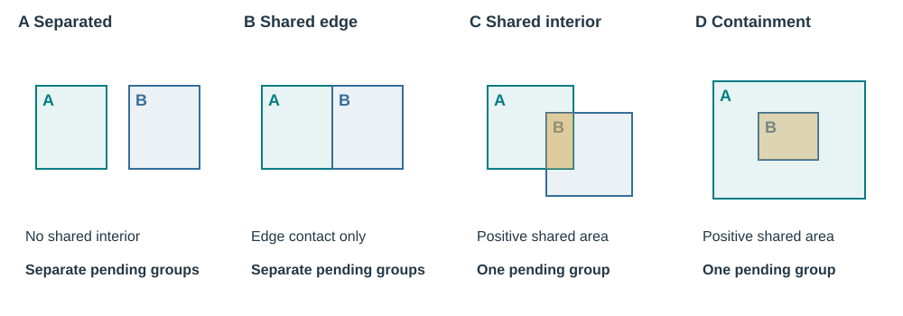
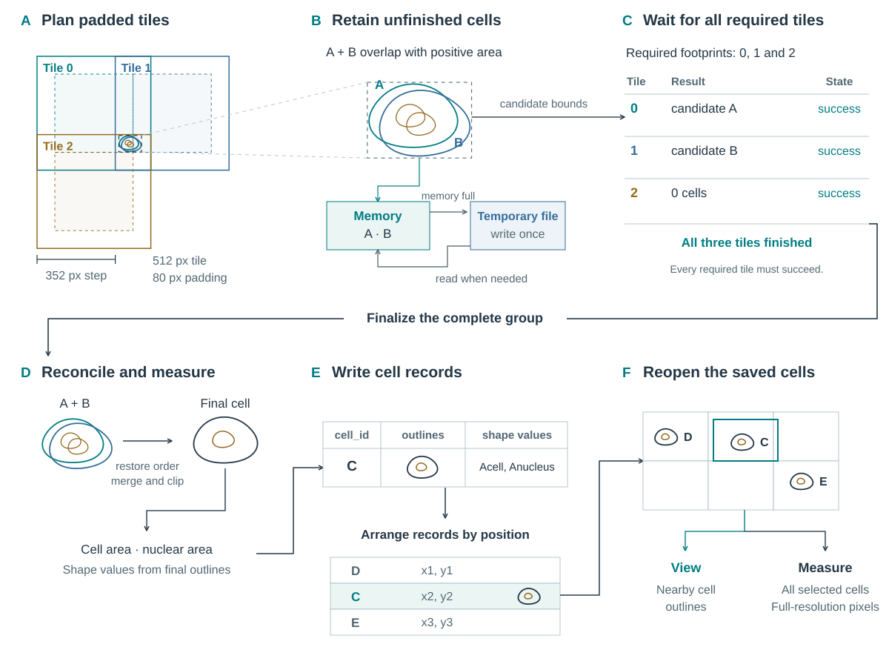

# Segmentation processing and measurements

[Cell segmentation](index.md) · [Cell measurements](../cell-measurements/index.md)

**On this page:** [Analysis area](#prepare-the-analysis-area) · [InstanSeg](#instanseg-processing) · [Cellpose-SAM](#cellpose-sam-processing) · [StarDist](#stardist-processing) · [Final shapes](#calculate-standard-cell-and-nuclear-shape-values) · [Cell identities and storage](#save-the-completed-cell-population) · [Intensity measurements](#measure-the-selected-cell-regions) · [Relative sizes and nuclear position](#add-the-selected-cell-to-nucleus-and-diameter-measures) · [Saved measurement result](#save-and-review-the-measurements)

We segment the accepted analysis area in overlapping tiles. The outlines we can measure depend on the selected model. InstanSeg predicts both cells and nuclei, Cellpose-SAM predicts cells, and StarDist predicts nuclei from which it can estimate the surrounding cell area.

After combining predictions across tiles, we save the final outlines in the spatial cell dataset. The measurement stage uses those outlines to identify which pixels contribute to each cell’s measurements.

## Prepare the analysis area

For each tissue section, the segmentation request supplies its accepted outline, active analysis regions, selected area restriction, image calibration and model. Let $S$ denote the tissue section and $D_1,\ldots,D_m$ its active analysis regions. Their included union is

$$
U=S\cap\left(\bigcup_{j=1}^{m}D_j\right).
$$

When selected primary-class regions provide a restriction $R$, prediction uses $U\cap R$. Combining the included regions gives one prediction area for the section. After the cell boundaries have been finalized, their centres determine the individual region assignments.

The selected method determines the channels and physical sampling used for prediction. All returned outlines are expressed in source-image coordinates before the shared shape, region-assignment and storage steps below.

## InstanSeg processing

We use the QuPath InstanSeg 0.1.7 extension to pass every channel from the prepared fluorescence image to the selected nuclei-and-cells model. The model returns cell and nuclear predictions at its required physical sampling. We retain the channel order, model files and physical pixel dimensions with the result.

### Map model sampling to the source image

Let $p_x$ and $p_y$ be the positive source pixel width and height in micrometres, and $p_{m,x}$ and $p_{m,y}$ the model's corresponding target dimensions. For the extension's selected downsample factor $d$, the calibration check requires

$$
|d p_x-p_{m,x}|\leq0.01p_{m,x},\qquad
|d p_y-p_{m,y}|\leq0.01p_{m,y}.
$$

The products $dp_x$ and $dp_y$ are the physical width and height of a resampled input pixel. Both must be within 1% of the model's corresponding target dimensions. Checking the axes separately matters when the source pixels are rectangular: one downsample factor must satisfy both dimensions.

For approximately square source pixels of size $p$, a model input pixel of physical size $p_m$ corresponds to a downsample factor $d=p_m/p$. A factor below one requests finer sampling than the source pixel spacing; a factor above one requests coarser sampling. QuPath reads and resamples the image at this scale, then maps the returned outlines into the original full-resolution coordinate system.

For example, with 0.65 µm source pixels and a 0.5 µm model preference, $d\approx0.769$. Model sampling describes the image supplied to prediction. Later intensity measurements use the prepared source-resolution image.

### Prepare intensities for prediction

The installed InstanSeg 0.1.7 extension first reads a reduced image of the **accepted prediction region**. Its read downsample is the larger of one and the region's longest bounding-box side divided by 1,024. The region mask selects pixels used to estimate each channel's lower and upper intensity percentiles.

For channel $c$, let $a_c$ and $b_c$ be the 0.1st and 99.9th percentiles from this region read. The extension applies

$$
I'_c=\frac{I_c-a_c}{b_c-a_c+10^{-6}}.
$$

Subtracting $a_c$ makes the lower reference intensity zero, and division uses the span from $a_c$ to $b_c$ as the channel's intensity scale. The added $10^{-6}$ keeps the denominator positive even for a constant channel. Each channel's percentile pair is reused across all tiles in the accepted prediction region, so the same stored intensity receives the same normalized value at a tile boundary. Changing the analysis area can change the percentile estimates; with that area unchanged, changing tile size or padding changes prediction context while retaining these normalization values.

If that region read fails, the extension logs **Error reading thumbnail** and uses its per-tile percentile preparation. Check the native log when comparing repeated runs because this changes the pixels used to estimate the normalization. The image, region and tile settings should be recorded with such a comparison.

### Read padded tiles and predict outlines

The tile plan divides the prediction area into interiors and reads surrounding pixels for each interior. For tile size $T$ and padding $P$, both in model-input pixels, the nominal interior advance is

$$
s=T-2P.
$$

The source-coordinate advance is rounded from $ds$. With the initial $T=512$ and $P=80$, successive interiors advance by 352 model-input pixels. Each read is expanded by the corresponding source-coordinate padding and clipped to the image bounds.

The surrounding pixels provide nuclear and cell-associated context near a tile's edges. InstanSeg predicts labels from the prepared multichannel tile. The extension converts these labels into cell and nuclear polygons, maps them to source coordinates, and applies its tile-interior inclusion rules. A cell near a tile edge can have predictions in more than one tile; these candidates remain available for reconciliation.

The [segmentation settings capture](index.md#set-tile-processing) shows the controls that determine tile size, padding and simultaneous tile tasks. One or two tasks may prepare tiles concurrently and share one model predictor. After label-to-outline conversion, the tile's image and output arrays are released. The pending cell polygons remain available for the next step.

### Adapt InstanSeg’s region-wide overlap processing

The ordinary QuPath InstanSeg operation processes every tile of the selected parent region before reconciling that region's predicted objects. It merges repeated predictions, corrects the remaining overlaps, and adds the completed cells to QuPath's object hierarchy: the collection of annotations and detections associated with the image. The predicted objects remain available until this region-wide reconciliation finishes.

Our adaptor identifies groups of candidate outlines that can affect one another. A group waits for every neighbouring tile that could contribute another candidate. Once those tiles finish, the adaptor applies the same native merging and overlap correction to that group, calculates the final shape values, and writes its cells to the spatial cell table. It can then release the group's candidate objects while prediction continues elsewhere in the tissue.

The memory needed for reconciliation depends on the size of the pending overlap groups. The following sections explain when a group is ready and how temporary storage handles candidates that are still waiting. Completed cells remain in the saved table, from which [interactive viewing](../run/interactive-viewing.md#how-the-saved-cells-reach-qupath) loads the cells needed at the current location.

### Finish cells after their neighbouring tiles

Two predictions from neighbouring tiles may describe the same cell. For each new outline, we use its bounding rectangle to find nearby candidates, then test their polygons with **RelateNG**. If their interiors overlap by a positive area, including when one encloses the other, we join their pending groups for reconciliation. Outlines that only touch at an edge remain in separate groups.

We group outlines connected by an overlap. If A overlaps B and B overlaps C, all three belong to the same group even when A and C are disjoint. Their boundaries must be considered together because resolving one overlap can change a boundary involved in another. When the group is complete, the native merger uses the intersection-over-smaller-area test described below to identify repeated predictions, then corrects remaining overlaps to obtain the final cells.

_Schematic of the pairwise test used to collect pending predictions. Each panel shows an independent pair. The shaded intersection in C and D has positive area and joins that pair into one pending group. The native merging and clipping step follows after the group's contributing tiles finish._

Each group is associated with the padded tile footprints that could still contribute a matching prediction. A footprint is the source-image area read for a tile, with a small allowance for coordinate rounding. The group waits for all footprints intersecting its bounding rectangle.

A group becomes ready after every relevant tile has completed successfully. A successful tile containing no detections still completes its contribution. A failed tile leaves its contribution unresolved, so the affected calculation stops before accepting an incomplete result.

#### Retain pending outlines within the available memory

We keep candidate cell and nuclear outlines in memory until the neighbouring tiles have been processed. If the pending outlines fill their memory allowance, we write the oldest records to a compressed temporary file, **frontier.bin**. We can then read them back when comparing overlapping predictions.

This storage is needed only for candidates still waiting for reconciliation. The model, image tiles, pending polygons and result writer each require memory during their part of the calculation. A complete overlap group must fit the memory allowed for its reconciliation. If it cannot fit, the error reports the required allocation; revise the processing allocation before repeating the calculation. [Computing](../setup/computing.md) describes the shared resource selection.

#### Reconcile repeated predictions and calculate the final shapes

For a ready group, we restore the candidate order used by the ordinary QuPath operation and apply InstanSeg's native overlap processing. Its merge test uses intersection over the smaller outline area:

$$
\operatorname{IoMin}(A,B)=\frac{|A\cap B|}{\min(|A|,|B|)}.
$$

Here, $|A\cap B|$ is the shared area and the denominator is the smaller candidate's area. The ratio is one when one outline is contained in the other, even if their sizes differ. The installed merger uses a threshold of **0.5** to reconcile repeated predictions. It then resolves the remaining competing areas in solidity order. Solidity divides the outline's area by the area of its convex hull, the smallest convex shape enclosing it, so indentations lower the ratio. The extension subtracts retained higher-priority outlines from the competing cell and nuclear outlines; a corrected cell is discarded if it becomes empty or clipping increases its number of disconnected pieces. [InstanSeg overlap processing](https://github.com/qupath/qupath-extension-instanseg/blob/v0.1.7/src/main/java/qupath/ext/instanseg/core/InstanSeg.java#L336-L350).

QuPath calculates the standard shape measurements from each finalized pair. The completed cell can then be assigned an identity and written to the output. Finishing groups progressively releases their pending polygons as later tiles are processed.

_Schematic of cell finalization. The same candidate outlines appear in the padded tiles and waiting group. The group waits for every intersecting footprint, including a tile that returns no cells. Pending records remain in memory or are read from the temporary file, then native overlap processing produces the completed cell and nucleus. Their standard shape values and identity accompany the saved spatial cell record._

## Cellpose-SAM processing

We use **Cellpose 4.0.9** with the original **`cpsam`** checkpoint from the pinned `mouseland/cellpose-sam` revision `7c61431b5fbb078f3296754bd15d9f51b320f837`. The model is loaded once for the section and reused across its tiles.

### Prepare Cellpose input and run inference

We supply the one to three channels selected in **Cellpose settings** in their chosen order, filling unused positions in the model's three-plane input with zeros. A selected nuclear stain contributes image context for predicting the cell boundary. The model returns a whole-cell mask, so this route supplies cell outlines without associated nuclear outlines.

The selected processing pixel size determines the physical image sampling. The outer tile width includes padding on both sides: with width 512 and padding 80, the nominal interior step is 352 model-input pixels. Source coordinates are rounded to whole source pixels. Cellpose normalizes each nonconstant input plane using its 1st and 99th percentiles within the read tile, then processes overlapping 256-pixel network patches with batch size 1. The pinned inference uses two-dimensional masks, no augmentation and a minimum mask size of 15 model-input pixels. Flow error and cell-score thresholds control mask formation.

### Form and check cell outlines

The network predicts horizontal and vertical pixel flows from the image. Pixels above **Cell score threshold** follow those flows; pixels converging at the same location form a candidate cell mask.

For the outline-based comparison, Cellpose selects an interior pixel near the mask's centre of mass and repeatedly adds and diffuses a signal within that mask. The signal's horizontal and vertical gradients provide directions towards the centre, which are normalized to unit length.

Let `M` be a candidate's pixels, `u_d(p)` the outline-derived flow at pixel `p` in direction `d`, and `f_d(p)` the network output. Cellpose 4.0.9 calculates

$$
 E(M)=\frac{1}{|M|}\sum_{p\in M}\sum_{d\in\{x,y\}}
 \left(u_d(p)-\frac{f_d(p)}{5}\right)^2.
$$

Dividing the network output by five restores the flow scale used for this comparison. The calculation averages over mask pixels and sums the X and Y contributions. A candidate is discarded when `E(M)` exceeds **Flow error threshold**. This measures agreement between the candidate shape and the predicted flows. [Pinned flow and rejection implementation](https://github.com/MouseLand/cellpose/blob/v4.0.9/cellpose/dynamics.py).

### Save cell outlines across tiles

Returned labels are traced into polygons and clipped to the accepted analysis area. For overlapping outer-tile candidates, the prediction whose centre is furthest from its read-tile edge is considered first. Its geometry is retained; later candidates have already retained areas removed. A remaining candidate must be a single polygon retaining at least half of the area it had after clipping to the analysis area. This resolves duplicates without joining cells.

The adaptor uses the same [pending-group tracking and memory handling](#finish-cells-after-their-neighbouring-tiles) as InstanSeg, with this Cellpose overlap rule. Groups wait for all neighbouring read tiles before reconciliation; pending records can be written to the compressed temporary file **alternative-frontier.bin**. One model worker processes the tiles in sequence.

The saved Cellpose result provides cell and boundary intensity measurements and cell shape measurements. It has no nuclear outline, so nuclear measurements, cytoplasm measurements and nucleus-to-cell ratios are unavailable. Select Cellpose's processor in [Computing](../setup/computing.md#this-computer).

## StarDist processing

StarDist uses the **QuPath StarDist extension 0.6.0** and the converted **`dsb2018_heavy_augment.pb`** model from `qupath/models` revision `727c9590cb607ef05f201f24e389aec1f492ed7c`. Inference uses QuPath 0.7.0's OpenCV runtime on CPU.

### Prepare StarDist input and predict nuclei

The selected nuclear channel is read at the chosen physical pixel size. The outer tile interior is the tile width minus twice its padding. The extension adds the padding, normalizes each read tile using its 1st and 99.8th percentiles, and reflects image borders as needed to reach a network-compatible dimension. It predicts candidate object probabilities and radial distances from each candidate centre. Candidates at or above the probability threshold pass to the extension’s overlap processing.

### Reconcile nuclei across tiles

The adaptor retains each candidate’s predicted probability and original nuclear area. It uses the same [pending-group tracking and memory handling](#finish-cells-after-their-neighbouring-tiles), including **alternative-frontier.bin**, while a single detector processes the tiles. When expansion is requested, the tile footprints include that extra distance so that potentially overlapping estimated cell regions wait together.

The extension first resolves overlaps within each tile. Once every contributing tile has finished, the adaptor applies its native rule again to the complete group: consider nuclei in descending probability order, subtract retained nuclei from later candidates, and retain a corrected candidate only when it is a single polygon with **more than half** its original area. The saved original area is reused in this second pass. [Pinned StarDist overlap implementation](https://github.com/qupath/qupath-extension-stardist/blob/v0.6.0/src/main/java/qupath/ext/stardist/StarDist2D.java#L1590-L1684).

Image-read failure and cancellation stop the calculation; an empty result from a failed tile is not accepted as a completed tile.

### Retain nuclei or estimate surrounding cell regions

With **Estimated cell expansion = 0**, the detected region and its nuclear outline are identical. The shared storage records them together, while review shows the nuclear outline and measurement setup offers nuclear measurements only.

With positive expansion, QuPath buffers each nucleus by the selected physical distance. **Limit expansion relative to nucleus size** optionally restricts this estimate using the nucleus's convex hull: the smallest convex shape enclosing its outline. Let $H$ be that hull, $c$ its centroid and $s>1$ the **Expansion scale factor**. The enlarged hull is

$$
H_s=\{c+s(p-c):p\in H\}.
$$

For example, $s=1.5$ enlarges both dimensions by 50%. QuPath intersects the distance-expanded estimate with $H_s$ and preserves the unscaled hull where needed by its boundary construction. Leaving the option off retains distance-based expansion alone.

QuPath then clips the estimated region to the analysis area. Where estimates overlap, a Voronoi partition derived from the nuclear outlines divides the contested space among the nuclei, keeping the estimated cells separate. Polygon simplification and clipping can adjust the final boundaries. Each region retains its associated nucleus, clipped when needed to remain inside that region. [QuPath cell-boundary calculation](https://github.com/qupath/qupath/blob/v0.7.0/qupath-core/src/main/java/qupath/lib/objects/CellTools.java). The result records `estimated_nuclear_expansion`, and review and measurement setup label cell, boundary and cytoplasmic regions as estimates.

## Calculate standard cell and nuclear shape values

For all three methods, QuPath calculates these values immediately after the method-specific overlap processing. The available calibrated cell and nuclear polygons supply area, perimeter, circularity, solidity and the two diameters. The values are saved with the completed cells and are available for selection in the measurement step.

For a single polygon, let $A_{o}$ and $L_{o}$ be the area enclosed by its outer boundary and that boundary's perimeter. Let $A$ be its full calibrated area, accounting for any holes. Native circularity and solidity are

$$
\operatorname{circularity}=\frac{4\pi A_{o}}{L_{o}^2},\qquad
\operatorname{solidity}=\frac{A}{A_{\mathrm{hull}}}.
$$

Here $A_{\mathrm{hull}}$ is the area of the polygon's convex hull, the smallest convex region enclosing it. Circularity compares outer area with squared outer perimeter: a circle gives one, while elongation or an irregular boundary reduces the value. It is available for single-part polygons and uses only their outer boundary. Solidity compares the occupied area with its convex enclosure, so holes and indentations reduce that ratio. The separately reported area subtracts holes, and perimeter includes their boundary lengths; their units are µm² and µm, respectively.

To obtain the native **minimum diameter**, imagine rotating a pair of parallel lines that just enclose the polygon and finding their smallest separation. The **maximum diameter** is the diameter of the smallest circle enclosing the polygon. QuPath applies both definitions to the cell and its associated nucleus, with distances in µm. Together with circularity and solidity, these values describe the saved geometry; comparing it with the staining establishes whether that geometry follows the intended biological structure.

## Save the completed cell population

The finalized cell's centroid, the area-weighted centre of its outline, must belong to exactly one active analysis region. We then test that point against the accepted primary-class polygons. Several covering polygons with the same class give one class assignment; a point outside every primary-class polygon has no primary-class assignment.

If different primary classes cover the centroid and the point lies in the interior of any of them, the overlap needs correction before assignment can continue. If the point lies only on shared boundaries, we use Java’s shape-containment test to decide which side contains it. Under its half-open convention a shared edge can belong to one side. We assign the cell when that test identifies exactly one class. Otherwise the boundary needs review.

For conflicting primary classes, the error gives the cell centre and the matched region/class names. The [region-correction procedure](index.md#resolve-overlapping-region-assignments) identifies the appropriate analysis-region or classifier review and the subsequent rerun. Secondary-region membership is calculated separately and may include several eligible structures.

Each completed cell receives a stable ID based on its segmentation population and finalized cell/nucleus geometry. Its record contains the image and section identities, source and physical centroid coordinates, associated region, cell and nuclear polygons, and standard shape values. The same ID is retained when those stored cells are reopened or receive additional measurements.

Java first writes the finalized cell records to a private intermediate dataset of Parquet row groups. Once that stream is complete, Python decodes its groups into bounded Arrow batches and supplies the records to a disk-backed sort. The sort orders cells by their spatial positions while preserving their IDs, outlines and measurements. Python then writes the final base tables, the spatial-group layout and the cell-ID index described in [Cell datasets and spatial queries](../../reference/cell-storage.md#ii-physical-row-layout).

The final **dataset.json** describes the files, columns, row counts and checksums used to reopen the population. Its spatial layout allows a tissue view to locate candidate groups before decoding individual outlines; its ID index locates known cells for later measurements and classifications. 

The analysis selects the new cell result after all required tiles, cell records and storage checks complete. Reopening uses that selected dataset and its saved image coordinates. The [interactive-viewing guide](../run/interactive-viewing.md) explains how the viewer requests outlines and individual cell measurements from it.

## Measure the selected cell regions

Measurement reads the selected cells, their accepted boundaries and the channels requested in **Cell measurements**. Each channel/region/statistic selection defines a named output column. The prepared image is read at **source resolution**, and the cell polygons are rasterized onto that pixel grid.

Let $C$ be the whole-cell mask and $N$ its associated nuclear mask. The selected masks are

$$
M_{\mathrm{cell}}=C,\qquad
M_{\mathrm{nucleus}}=N,\qquad
M_{\mathrm{cytoplasm}}=C\setminus N.
$$

For the membrane measurement, we retain the inner boundary pixels of $C$. At each source pixel, we check up to four edge-sharing neighbours and include the pixel in the rim if any available neighbour has a different cell label or is background. The resulting band is one source pixel thick, so its physical width follows the source calibration.

The [channel controls and four-mask diagram](../cell-measurements/index.md#select-channels-cell-regions-and-intensity-measures) show how these masks correspond to the measurement selections. A nuclear mask needs an associated nuclear outline. Every requested intensity measurement needs at least one included source pixel.

### Calculate intensity statistics

For one selected channel and mask, let $x_1,\ldots,x_n$ be its included pixel values. The arithmetic mean is

$$
\bar{x}=\frac{1}{n}\sum_{i=1}^{n}x_i.
$$

Minimum, maximum and median are calculated from the same included values. Median uses the central ordered value, or the mean of the two central values when $n$ is even. Sample variance and standard deviation are

$$
s^2=\frac{1}{n-1}\sum_{i=1}^{n}(x_i-\bar{x})^2,\qquad s=\sqrt{s^2},\quad n>1.
$$

For a one-pixel mask, the reported variance and standard deviation are zero. An empty mask has no intensity statistic. The error identifies the affected cell and requested measurement so its outline or measurement selection can be reviewed.

Mean, median, minimum, maximum and standard deviation retain the image intensity unit, while variance has its squared unit. These measurements use the prepared image's stored intensities; each method’s percentile normalization applies to the pixels supplied to its segmentation model.

QuPath supplies the native measurement values. We save its returned numerical values in Float64 table columns. A value previously rounded by a native Float32 calculation retains that rounding when stored. 

## Add the selected cell-to-nucleus and diameter measures

The measurement request also selects relative sizes and nuclear position. Standard shape values are reused for unchanged outlines. The additional diameter ratios and centre distance use those same accepted cell and nuclear boundaries.

For the selected cell or nuclear outline, let $D_{\max}$ be the enclosing-circle diameter and $D_{\min}$ the minimum width defined above. Their ratio compares the outline's overall extent with its narrowest width:

$$
R_D=\frac{D_{\max}}{D_{\min}}.
$$

For nuclear area $A_N$ and cell area $A_C$, QuPath records the area ratio clipped to the interval zero to one:

$$
R_A=\min\!\left(1,\max\!\left(0,\frac{A_N}{A_C}\right)\right).
$$

Let $(c_x,c_y)$ and $(n_x,n_y)$ be the geometric centres of the cell and nucleus in source coordinates. Their physical separation is

$$
D_{CN}=\sqrt{\left[p_x(c_x-n_x)\right]^2+\left[p_y(c_y-n_y)\right]^2}.
$$

The area fraction and diameter ratio are dimensionless; centre separation is in µm. Nuclear and relative cell/nuclear quantities require an associated nucleus and valid nonzero denominators. Inspect unusually large ratios or displaced centres in the image before treating them as biological shape differences.

## Save and review the measurements

The measurement result records each selected value against its cell ID and accepted outline revision. Additional measurement columns retain the existing cell and nuclear polygons. The selected result identifies its measurement definitions, source image, segmentation population and files, allowing later phenotyping to request the same columns.

After accepting an outline change, recalculate its measurements using the revised masks. Accepted deletions remove cells from the included population; the review records retain their identities and affected measurements. The available correction actions are described under [Outline review and corrections](index.md#correct-the-cause-and-repeat-the-affected-calculation).

Review saved values with the [interactive cell viewer](../run/interactive-viewing.md#inspect-a-cell) and [cell tables](../../reference/cell-storage.md). For unavailable values, inspect the reported cell and mask before revising the measurement request. For a replacement segmentation, review the new outlines before interpreting the recalculated marker values.

## Implementation and sources

[04_run_instanseg.groovy](../../../qupath/scripts/cell_analysis/04_run_instanseg.groovy) prepares the accepted area, dispatches the selected method, assigns completed cells to regions and selects the saved dataset. [NativeInstanSeg.java](../../../src/java/org/mif/segmentation/NativeInstanSeg.java) invokes the installed extension's image preparation, prediction and outline conversion. [ExactTileFinalizer.java](../../../src/java/org/mif/segmentation/ExactTileFinalizer.java) retains pending candidates and releases completed overlap groups.

[NativeCellStream.java](../../../src/java/org/mif/segmentation/NativeCellStream.java) writes the finalized records. [native_cells.py](../../../src/python/mif_pipeline/datasets/native_cells.py) imports them into the spatial cell dataset. [05_prepare_phenotyping_measurements.groovy](../../../qupath/scripts/cell_analysis/05_prepare_phenotyping_measurements.groovy) and [MeasurementRows.java](../../../src/java/org/mif/cells/MeasurementRows.java) calculate the requested cell measurements and retain their cell associations.

[alternative_segmentation.groovy](../../../qupath/scripts/cell_analysis/alternative_segmentation.groovy) supplies the optional detector branches and [cellpose_worker.py](../../../src/python/mif_pipeline/cell_analysis/cellpose_worker.py) runs the pinned Cellpose model. The official [Cellpose 4.0.9 source](https://github.com/MouseLand/cellpose/tree/v4.0.9), [original checkpoint model card](https://huggingface.co/mouseland/cellpose-sam/blob/7c61431b5fbb078f3296754bd15d9f51b320f837/README.md), [StarDist 0.6.0 implementation](https://github.com/qupath/qupath-extension-stardist/blob/v0.6.0/src/main/java/qupath/ext/stardist/StarDist2D.java) identify the selected implementations. The application software descriptions record the exact asset checksums.

The pinned versions and assets are recorded in [instanseg.json](../../../src/python/mif_pipeline/config/software/instanseg.json), [cellpose.json](../../../src/python/mif_pipeline/config/software/cellpose.json) and [stardist.json](../../../src/python/mif_pipeline/config/software/stardist.json), with initial tile settings in [segmentation.json](../../../src/python/mif_pipeline/config/defaults/segmentation.json). The [RelateNG reference](https://locationtech.github.io/jts/javadoc/org/locationtech/jts/operation/relateng/RelateNG.html) describes the positive-area relationship used for grouping. The upstream [InstanSeg 0.1.7 implementation](https://github.com/qupath/qupath-extension-instanseg/tree/v0.1.7) defines prediction preparation and overlap processing. QuPath's [ObjectMeasurements](https://github.com/qupath/qupath/blob/v0.7.0/qupath-core-processing/src/main/java/qupath/lib/analysis/features/ObjectMeasurements.java) defines the native intensity and shape calculations.

---

**Return:** [Cell segmentation](index.md) · [Cell measurements](../cell-measurements/index.md).
