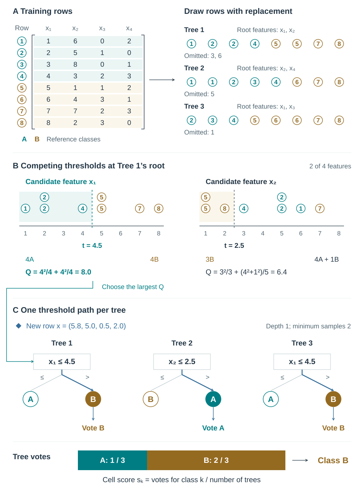
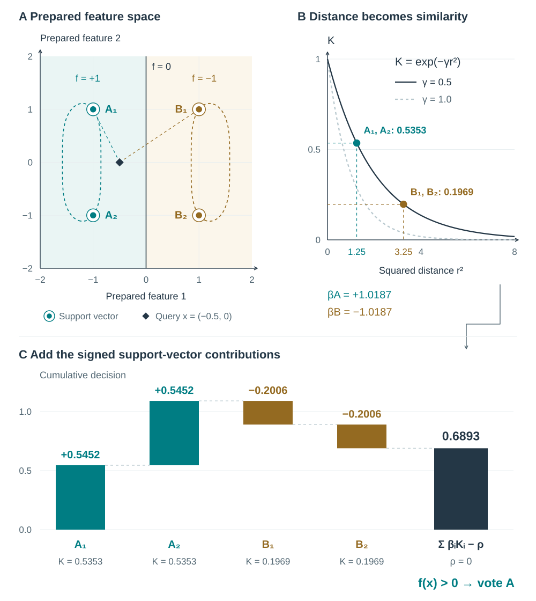
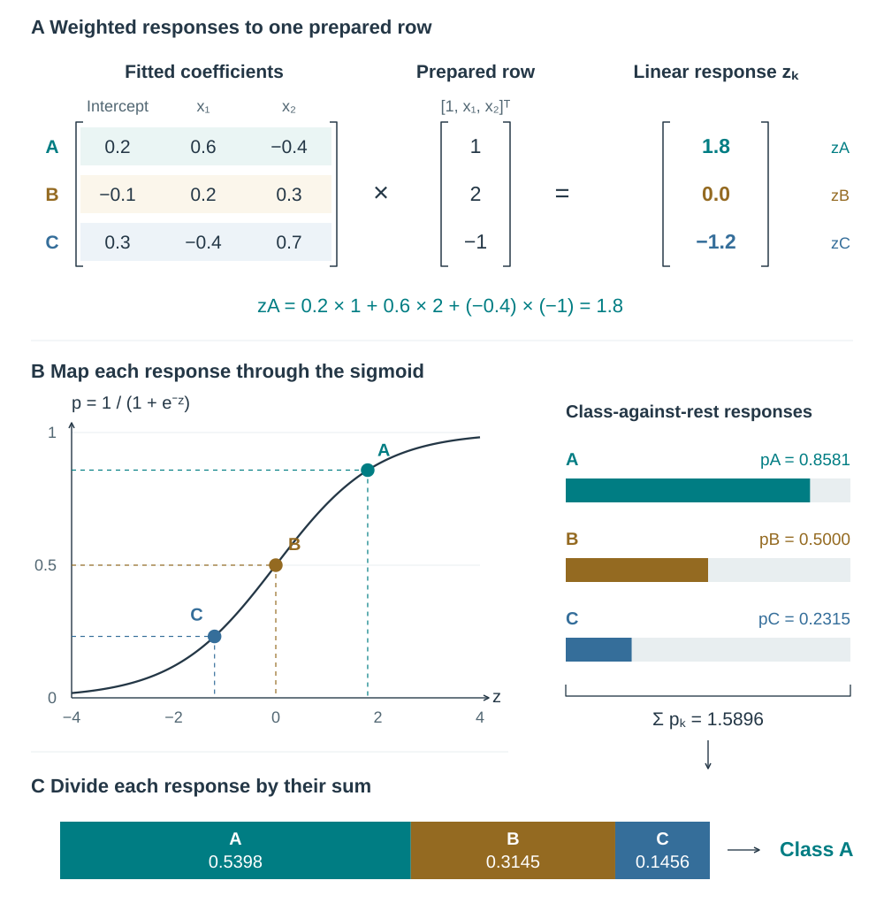

# Classifier methods

[Analysis stages](../../../README.md#analysis-stages) · [Tissue detection](../tissue/index.md) · [Tissue classification](../tissue-classification/index.md) · [Supervised cell phenotypes](../phenotyping/supervised.md)

In tissue classification, we use labelled pixels or image patches to train a random forest (**RF**) or a support vector machine (**SVM**) to recognize tissue compartments. In supervised cell phenotyping, we train RF, SVM or logistic regression (**LR**) on individual cells whose phenotypes we have labelled. Each labelled pixel, patch or cell supplies one row of numerical features and its reference class.

We prepare the features using the training references, then fit the selected classifier and apply it to new observations. For cells, we save the score for every phenotype as well as the predicted class. RF scores summarize agreement among decision trees, SVM scores summarize comparisons between phenotypes, and LR scores come from fitted responses to the cell's features. The stage guides describe how we collect the references and evaluate predictions on held-out subjects. [Tissue classification](../tissue-classification/index.md) · [Supervised cell phenotyping](../phenotyping/supervised.md)

## Feature rows and fitted transformations

The feature columns depend on what we classify. A pixel might supply the intensities of selected channels and the outputs of image filters. A cell might supply its area and mean marker intensities, or a vector of features extracted from its image. Before fitting, we can rescale each column and, optionally, use principal-component analysis (PCA) to combine columns that vary together. We use the same ordered features and fitted transformations for each new observation. In the calculations below, $x_i$ denotes the prepared row for observation $i$. We have $n$ training rows, $d$ features per prepared row and $M$ reference classes.

### Normalize the features

Let $r_i$ be the value of one feature in training row $i$. We use the finite values in this column to estimate its mean $\mu$ and standard deviation $\sigma$, or its minimum $a$ and maximum $b$. For a nonconstant feature, **Standardize each feature (z-scoring)** expresses $r_i$ in standard deviations from the training mean. **Scale each feature to 0–1 (min–max)** expresses its position within the training range. The respective transformed values $h_i$ are

$$
h_i=\frac{r_i-\mu}{\sigma}
\quad\text{or}\quad
h_i=\frac{r_i-a}{b-a}.
$$

For standardization, QuPath calculates the sample standard deviation from the finite training values using $n_{\mathrm{finite}}-1$ in the variance denominator. We apply the same fitted mean and standard deviation, or the same fitted minimum and maximum, to new observations. A new value above the training maximum can therefore exceed one after min–max scaling. With **Keep feature values unchanged**, we pass the features to the next step in their original units.

### Reduce the features with PCA

Two features that tend to rise together can describe much of the same variation among observations. PCA finds the direction of greatest variation through the training rows, then finds successive directions of greatest remaining variation perpendicular to the preceding ones. Let $\mathbf h_i$ be the feature vector after the chosen scaling, $\bar{\mathbf h}$ its mean across training rows and $v_j$ the fitted unit vector for direction $j$. To locate observation $i$ along this direction, we subtract the mean and multiply each centred feature by its corresponding weight in $v_j$. Their sum is the component value

$$
z_{ij}=v_j^T(\mathbf h_i-\bar{\mathbf h}).
$$

Each fitted direction $j$ accounts for a training variance equal to its covariance-matrix eigenvalue $\lambda_j$. To determine how many components the classifier receives, we add these variances from largest to smallest until their sum reaches the chosen fraction of total training variance. We keep at least two components if two have positive eigenvalues. Setting the target to one keeps all components with positive eigenvalues. The ordering depends on variation in the training features, so the class labels play no part in choosing these directions.

A constant feature contributes no variance. If no feature varies among the training observations, PCA cannot be fitted and we report the problem before classifier fitting.

**PCA whitening** divides each retained score $z_{ij}$ by the training standard deviation of that component, $\sqrt{\lambda_j}$. Each retained component then has unit variance in the training data. A difference of one training standard deviation along any component contributes one unit to the squared distance between two observations. Without whitening, the same difference contributes $\lambda_j$ units. This matters for the RBF kernel, which uses these distances to compare observations. How well a component distinguishes the classes still depends on the reference labels.

Conventional tissue classifiers and supervised cell classifiers offer PCA under **Classifier inputs**. Select **Whiten to unit variance** under **Component scaling** to rescale the retained scores. The KRONOS tissue classifier and the tissue detector use their features without PCA.

In subject-grouped validation, we fit the feature scales, PCA centre and directions using only the subjects in each fold's training set. We then transform that fold's held-out observations with these fitted values. This keeps variation specific to a held-out subject out of the feature preparation used to evaluate it. [Tissue feature preparation](../tissue-classification/index.md#feature-preparation) · [Cell feature preparation](../phenotyping/supervised.md#feature-preprocessing)

### Tissue-detector training rows

The interactive detector learns to distinguish **Tissue** from **Background**. Each class must supply at least two labelled pixels. For RF, we use all accepted pixels and leave the extracted feature values unchanged. For the detector's RBF SVM, we give each class equal representation before calculating feature distances. If $n_T$ and $n_B$ are the extracted class counts and $c$ is the configured per-class limit (10,000 by default), we take $m=\min(n_T,n_B,c)$ rows from each class. Within a class of size $n_k$, we select pixels at zero-based row positions $\lfloor i\,n_k/m\rfloor$ for $i=0,\ldots,m-1$ in extraction order.

We use those $2m$ selected pixels to centre each feature and calculate its population standard deviation, dividing its sum of squared deviations by $2m$. We divide by this deviation when it exceeds $10^{-12}$ and use a divisor of one otherwise. The detector stores these per-feature transformations and applies them to each new image tile before the SVM predicts its pixels. [Detector reference regions and preview](../tissue/index.md#native-editing-and-preview)

## Random forest

A decision tree predicts a class by asking a sequence of questions about one observation. For example, the first question might compare marker intensity with a threshold. The next can compare cell area with a different threshold chosen specifically for cells on that branch. This allows the effect of one feature to depend on the values of others. A forest grows many such trees and gives each one a vote.

To grow a tree, we draw $n$ times with replacement from the $n$ selected training rows. In this **bootstrap sample**, a row can appear several times or be omitted entirely. At every split, OpenCV draws a fresh subset of candidate features. Changing both the training sample and the features available for splitting allows trees to learn different decision rules from the same references. [OpenCV forest fitting](https://github.com/opencv/opencv/blob/4.11.0/modules/ml/src/rtrees.cpp)

### Choose a feature threshold

**Features considered per split** sets how many randomly selected features compete at a node. With **Default**, OpenCV uses the rounded square root of the number of prepared features, bounded by the available count. For each candidate feature, we sort the rows reaching that node by its value and test midpoints between successive distinct values. A threshold puts values at or below it in the left child and values above it in the right child.

We want a threshold that separates the reference classes. Let $L_k$ and $R_k$ be the sums of the training weights for class $k$ in the two children, counting repeated bootstrap draws each time. Let $L$ and $R$ be the sums over all classes in the respective children. With equal unit weights these totals are row counts. To compare candidate splits, OpenCV maximizes the score $Q$ given by

$$
Q=\frac{\sum_{k=1}^{M}L_k^2}{L}
+\frac{\sum_{k=1}^{M}R_k^2}{R}.
$$

With unit weights, four class-A rows on the left contribute $4^2/4=4$ to $Q$. Two A rows and two B rows contribute only $(2^2+2^2)/4=2$. The right child contributes by the same calculation. Maximizing $Q$ minimizes the children's combined Gini impurity, weighting each child by the total weight it receives. In conventional tissue classification, enabling class balancing increases the contribution of each pixel in a less frequent class. [OpenCV numerical splits](https://github.com/opencv/opencv/blob/4.11.0/modules/ml/src/tree.cpp#L603-L672) · [Tissue class weighting](../tissue-classification/index.md#apply-class-weighting-when-selected)

We repeat the split search within each child. **Maximum tree depth** limits how many successive splits a path can contain. **Minimum samples per node** prevents another split when the node has that many bootstrap rows or fewer. Because we test the parent, a child can contain fewer rows than this setting. A node also becomes terminal if all its rows have the same class or no usable threshold exists. The terminal node stores the class with the greatest total weight among the rows that reached it. [OpenCV node fitting](https://github.com/opencv/opencv/blob/4.11.0/modules/ml/src/tree.cpp#L338-L389)

### Combine tree predictions

After growing a tree, we can use it to predict the training rows omitted from its bootstrap sample. These rows are *out of bag* for that tree. As we add trees, OpenCV collects votes for each row from the trees that omitted it. We use these votes when an out-of-bag error threshold or a variable-importance calculation is enabled.

**Out-of-bag error threshold** allows the forest to stop growing before **Maximum trees** is reached. For the rows omitted by the latest tree, OpenCV compares the accumulated winning classes with the reference labels. It sums the weights of the misclassified rows and divides by the number of omitted rows. A positive threshold stops fitting when this error falls below it. At zero, fitting continues to the tree limit. Adding trees can stabilize the vote fractions, at the cost of fitting and traversing more trees.

**Calculate variable importance** estimates how much the predictions depend on each feature. OpenCV shuffles that feature among the omitted rows and counts how many the current tree classifies correctly. It subtracts this count from the number classified correctly by their accumulated out-of-bag votes, adds the differences across trees and sets negative totals to zero. When any totals are positive, it scales them to sum to one. If we used PCA, the importance values refer to the retained components. The omitted rows still come from training subjects. We use predictions on held-out subjects to evaluate performance beyond those references. [OpenCV out-of-bag error and feature importance](https://github.com/opencv/opencv/blob/4.11.0/modules/ml/src/rtrees.cpp#L184-L276)

To classify a new row $x$ with the completed forest, we follow its feature values down one path in every tree. Each terminal class contributes one vote. If $T$ trees were fitted and $v_k(x)$ voted for class $k$, the forest predicts the class with the largest vote count. In cell phenotyping, the score saved for class $k$ is its vote fraction

$$
s_k(x)=\frac{v_k(x)}{T}.
$$

*The first tree draws eight rows, including rows 2 and 5 twice each. A threshold of 4.5 on the first feature separates four A rows from four B rows and scores 8.0. The best threshold on the second feature leaves one mixed child and scores 6.4. The first tree therefore tests the first feature. The new row has value 5.8 and reaches its B leaf. The other two trees vote A and B, giving B a score of 2/3.*

## Support vector machine

We use OpenCV's C-support vector classifier (C-SVC) to fit one boundary for each pair of reference classes. Each fit uses the training rows from those two classes. When a new observation is classified, its position relative to a boundary gives one vote to the class on that side.

### Fit the boundary and its margin

For a pair of classes $a$ and $b$ in saved order, we give each training row $x_i$ a reference label $y_i=+1$ for $a$ and $y_i=-1$ for $b$. Let $\phi(x_i)$ denote the feature representation supplied by the selected kernel. In this representation the boundary is a hyperplane. Its orientation is set by a weight vector $w$ and its position by an intercept $b_0$. The signed decision $f(x_i)=w^T\phi(x_i)+b_0$ is zero on the boundary. It is positive on the side assigned to $a$ and negative on the side assigned to $b$.

We seek a band, the **margin**, between $f=-1$ and $f=+1$, with each class's training rows on or beyond its own edge. A row satisfies this condition if $y_i f(x_i)\ge 1$. Overlapping classes can make this impossible for every row. We therefore allow a shortfall $\xi_i\ge 0$ for each of the $n_{ab}$ rows in the pair and assign it a penalty $C_i>0$. The fitting objective is

$$
\min_{w,b_0,\xi}\ \frac12\lVert w\rVert^2+\sum_{i=1}^{n_{ab}}C_i\xi_i
\quad\text{subject to}\quad
y_i\big(w^T\phi(x_i)+b_0\big)\ge1-\xi_i,
\qquad \xi_i\ge0.
$$

The first term favours a wide margin because its width in this representation is $2/\lVert w\rVert$. The second term charges for every shortfall. For example, an A reference with $f=0.4$ lies on its correct side but falls short of its margin edge by $0.6$. An A reference with $f=-0.4$ crosses the boundary and falls short by $1.4$. At the optimum each row incurs just the shortfall needed, $\xi_i=\max(0,1-y_i f(x_i))$.

**SVM C** sets the cost of a unit shortfall relative to the margin term. A larger C gives the fit more incentive to accommodate a difficult reference even at the cost of narrowing the margin. Normally $C_i=C$. When we balance classes in conventional tissue classification, a class with $n_k$ of the $n$ selected training pixels has $C_i=C\,n/n_k$. Its less numerous pixels can then exert a larger penalty per violation. The cell and KRONOS tissue SVMs use a common C. [Tissue class weighting](../tissue-classification/index.md#apply-class-weighting-when-selected) · [OpenCV C-SVC](https://docs.opencv.org/4.11.0/d1/d2d/classcv_1_1ml_1_1SVM.html)

### Compare prepared rows with a kernel

The **kernel** gives us the inner product $K(u,v)=\phi(u)^T\phi(v)$ between two observations in the representation used to fit the boundary. We calculate it directly from their prepared rows $u$ and $v$, each containing $d$ features. The kernel choice determines the shapes the boundary can take in those original coordinates.

For **LINEAR**, let $u_j$ and $v_j$ be the values of prepared feature $j$ in the two rows. The kernel is

$$
K(u,v)=u^Tv=\sum_{j=1}^{d}u_jv_j.
$$

This leaves the boundary linear in the prepared features. Increasing one prepared feature by one unit adds its fitted weight to the decision, regardless of the values of the other features. Several measurements can jointly separate two classes even if their ranges overlap for each marker alone.

For **RBF** (radial basis function), the similarity depends on how far apart the rows lie across all prepared features. With positive **RBF gamma** $\gamma$, the squared distance and resulting kernel value are

$$
\lVert u-v\rVert^2=\sum_{j=1}^{d}(u_j-v_j)^2,
\qquad
K(u,v)=\exp\!\left(-\gamma\lVert u-v\rVert^2\right).
$$

The similarity is one for identical rows and falls to $e^{-1}$ at distance $1/\sqrt{\gamma}$. Larger gamma shortens this distance, allowing the fitted boundary to change within smaller neighbourhoods. Feature scaling also changes these neighbourhoods. Multiplying one coordinate by ten multiplies its contribution to the squared distance by one hundred. Gamma therefore has meaning in the units of the particular feature preparation used for the fit. [OpenCV kernel calculations](https://github.com/opencv/opencv/blob/4.11.0/modules/ml/src/svm.cpp)

### Fit coefficients and stop the optimizer

OpenCV fits one coefficient $\alpha_i$ per training row in the class pair. Each coefficient must stay within $0\le\alpha_i\le C_i$, and together they must satisfy $\sum_i y_i\alpha_i=0$. To improve the fit without violating that equality, the solver uses the gradients of the objective to select two coefficients and adjusts them together within their bounds. It repeats these updates until the violation of the optimality conditions falls within **SVM termination tolerance** or the fit reaches **Maximum SVM iterations** for that class pair. [OpenCV SVM solver](https://github.com/opencv/opencv/blob/4.11.0/modules/ml/src/svm.cpp)

### Retain the support vectors

Only training rows with a nonzero fitted coefficient contribute directly to the decision. These are the **support vectors**. At an exact optimum a row strictly beyond its own margin has zero coefficient. Rows on the margin, inside it or on the wrong side of the boundary can be support vectors. A mislabelled or genuinely unusual reference can therefore influence decisions for new observations.

Let $S_{ab}$ be the indices of the support vectors for this pair, $\beta_{ab,i}=\alpha_i y_i$ their signed coefficients, and $\rho_{ab}=-b_0$ the offset stored by OpenCV. For a new row $x$, the signed decision is

$$
f_{ab}(x)=\sum_{i\in S_{ab}}\beta_{ab,i}K(x_i,x)-\rho_{ab}.
$$

With RBF, the evidence from each support vector is its similarity to the new row multiplied by its signed coefficient. Similar A references contribute positive terms and similar B references contribute negative terms. A single nearest reference need not determine the vote because all support-vector contributions enter the sum.

*The diamond at (−0.5, 0) lies at squared distance 1.25 from each A support vector and 3.25 from each B support vector. With $\gamma=0.5$, the corresponding similarities are 0.5353 and 0.1969. In this example $C=10$, the coefficient magnitudes are $1/(1-e^{-4})$, and the offset is zero. Adding two contributions of about +0.5452 and two of about −0.2006 gives a decision of approximately +0.6893 using the unrounded terms, so this comparison votes for A.*

For LINEAR we can collect the support-vector contributions into one weight vector, $w=\sum_{i\in S_{ab}}\beta_{ab,i}x_i$. OpenCV stores this vector for the pair and evaluates $w^Tx-\rho_{ab}$ for each new observation. A saved linear support-vector row can thus be a combined vector of feature weights. [OpenCV saved decision functions](https://docs.opencv.org/4.11.0/d1/d2d/classcv_1_1ml_1_1SVM.html)

### Combine pairwise decisions and interpret scores

Each of the $M(M-1)/2$ class pairs awards one vote. For $a$ before $b$ in saved order, $f_{ab}(x)>0$ votes for $a$ and $f_{ab}(x)\le 0$ votes for $b$. Let $v_k(x)$ count the votes for class $k$. We assign the class with the most votes, taking the first tied class in saved order when necessary. Each class participates in $M-1$ comparisons. The saved cell score for class $k$ is the fraction of its comparisons that it won

$$
s_k(x)=\frac{v_k(x)}{M-1}.
$$

For three classes, winning both comparisons involving A gives A a score of one. The B–C comparison still awards a vote, so scores of $(1,0.5,0)$ are possible. In general, summing the scores over classes counts all $M(M-1)/2$ votes and divides by $M-1$, giving $M/2$. The magnitude of a pair's decision has no effect on how many votes it awards.

With two classes, every winner receives a score of one. The binary SVM confidence-review cutoff is therefore fixed at zero. To examine which cells lie close to a particular fitted boundary, use the signed decision saved in measurements such as `Classifier: SVM margin: A vs B`. Values near zero indicate proximity within that pair's decision scale. Dividing the decision by $\lVert w\rVert$ gives signed geometric distance in its kernel feature space. Different pairs can have different scales, so review a cell's signed decisions alongside its reference class and the errors on held-out subjects. [Cell confidence review](../phenotyping/supervised.md#review-confidence-handling)

## Logistic regression

In supervised cell phenotyping, logistic regression relates the prepared cell features to membership in a target class. For two classes we fit one model, giving the second class in saved order the positive label. For three or more, we fit a separate binary model for each class. Each model sees all the same training cells, but its positive label belongs to a different phenotype.

For one such fit, let $x_j$ denote prepared feature $j$ of a cell, $\theta_j$ its fitted coefficient and $\theta_0$ the intercept. We add the weighted features and intercept, then apply the sigmoid. For a cell with prepared row $x$, the linear response $z(x)$ and the fitted target-class response $p(x)$ are

$$
z(x)=\theta_0+\sum_{j=1}^{d}\theta_jx_j,
\qquad
p(x)=\operatorname{sigmoid}(z(x))=\frac{1}{1+e^{-z(x)}}.
$$

The linear response is the log odds, $z=\log[p/(1-p)]$. Holding the other features fixed, a one-unit increase in feature $j$ adds $\theta_j$ to the log odds, multiplying the fitted odds by $e^{\theta_j}$. For a standardized marker measurement, one unit is one training standard deviation in that marker. After PCA, one unit is a change along a component that may combine several markers.

### Fit the coefficients

For one target class, we give cell $i$ the label $y_i=1$ if it belongs to that class and $y_i=0$ otherwise. Let $p_i=p(x_i)$ be the response under the current coefficients $\theta$. To give each cell a high fitted probability for its reference label, we minimize the mean negative log probability of those labels. We can also penalize large feature coefficients during fitting. Let $\lambda=1$ for **L2** regularization and $\lambda=0$ for **DISABLE**. For $n$ cells the loss is

$$
J(\theta)=-\frac1n\sum_{i=1}^{n}
\left[y_i\log p_i+(1-y_i)\log(1-p_i)\right]
+\frac{\lambda}{2n}\sum_{j=1}^{d}\theta_j^2.
$$

For a positive reference, the loss includes $-\log p_i$, which grows rapidly as its fitted response approaches zero. A negative reference contributes $-\log(1-p_i)$ and is penalized most heavily near one. L2 penalizes large coefficients in either direction and leaves the intercept unrestricted. It acts on the *prepared* feature scale. For example, rescaling a feature by a factor of ten allows a coefficient one tenth the size to produce the same contribution to the log odds, at one hundredth of its former squared penalty. [OpenCV logistic-regression loss](https://github.com/opencv/opencv/blob/4.11.0/modules/ml/src/lr.cpp#L282-L333)

We start with zero coefficients, giving every cell a response of one half. To improve the fit, we calculate how each coefficient affects the loss across all cells. Let $x_{ij}$ be cell $i$'s value of feature $j$. The derivative for its coefficient is

$$
\frac{\partial J}{\partial\theta_j}
=\frac1n\sum_{i=1}^{n}(p_i-y_i)x_{ij}+\frac{\lambda}{n}\theta_j,
\qquad j=1,\ldots,d.
$$

For example, consider a target-class cell with $p_i=0.2$ and $x_{ij}=2$. Its contribution to the sum is $(0.2-1)\times2=-1.6$. That cell therefore favours increasing the coefficient, which would raise its response. The sign of the full update depends on the contributions from all cells. The regularization term pulls the coefficient towards zero. For the intercept, the derivative is simply the mean of $p_i-y_i$ over all training cells.

**Logistic regression learning rate** scales the step along this gradient, and **Logistic regression iterations** sets the number of full-data updates for each binary model. OpenCV divides the learning rate by the number of training cells when applying the already averaged gradient. Consequently, the same learning rate and iteration count can make less progress per update in a larger training set with a similar gradient.

OpenCV coefficient-update calculation

Let $\eta$ be the selected learning rate and $\nabla J(\theta)$ the vector of derivatives, including the intercept. At each iteration OpenCV evaluates the gradient at the current coefficients and applies the update

$$
\theta\leftarrow\theta-\frac{\eta}{n}\nabla J(\theta).
$$

For example, at $\eta=0.01$ with 1,000 training cells, the multiplier on the averaged gradient is $10^{-5}$. Each binary model performs the selected number of iterations. [OpenCV batch updates](https://github.com/opencv/opencv/blob/4.11.0/modules/ml/src/lr.cpp#L395-L429)

### Calculate cell scores

For two classes, the fitted response $p(x)$ belongs to the second class. We save $[1-p(x),p(x)]$ in class order. For more than two classes, each binary fit supplies its own sigmoid response $p_k(x)$ for class $k$ against the rest. Several fits can give the same cell a high response because they were trained separately. Dividing each response by the sum across all classes gives the saved multiclass score

$$
s_k(x)=\frac{p_k(x)}{\sum_{\ell=1}^{M}p_\ell(x)}.
$$

This preserves the ordering of the responses and gives scores that sum to one. The largest score determines the saved prediction, with an exact tie resolved in saved class order. The winning score depends on the responses of competing classes as well as the response for the winning phenotype.

*For the cell with features $(2,-1)$, the coefficients for class A give $z_A=0.2+0.6(2)-0.4(-1)=1.8$. The sigmoid responses for A, B and C are 0.8581, 0.5000 and 0.2315. Dividing each by their sum gives class scores of 0.5398, 0.3145 and 0.1456. The largest score assigns the cell to A.*

## Use scores in result review

For a cell assigned phenotype A, an RF score of 0.8 means that 80% of the trees voted for A. An SVM score of 0.8 means A won 80% of its comparisons with other classes. In multiclass LR, 0.8 means A contributed 80% of the sum of this cell's fitted sigmoid responses. None of these fits includes a calibration step that estimates how often cells with that score receive the correct phenotype.

We evaluate predictions against labelled cells from held-out subjects and inspect the images for phenotypes that the classifier confuses. During assignment review, the cutoff acts on each cell's *winning* score. At or above the cutoff we retain its predicted phenotype. Below the cutoff the accepted assignment becomes **Unclassified**, and the saved result still identifies the original model prediction and its scores. [Cell confidence review](../phenotyping/supervised.md#review-confidence-handling)

## Implementation and saved models

When we apply an accepted classifier to another image, we extract the same ordered features and apply the normalization and any PCA fitted to the training data. The saved decision trees, SVM decision functions or LR coefficients then produce predictions in the original class order. The stage guides describe how the models and assignments are saved and reopened. [Tissue-classification results](../tissue-classification/index.md#saved-result-and-later-changes) · [Cell-phenotyping results](../phenotyping/supervised.md#accept-the-model-and-assignment)

The fitted transformations, OpenCV parameters and per-cell score calculations are available in the implementation. [Feature preparation](../../../src/java/org/mif/classification/FeaturePreparation.java) · [OpenCV fitting](../../../src/java/org/mif/classification/OpenCvTraining.java) · [Classifier scores](../../../src/java/org/mif/classification/ClassifierScores.java) · [Cell assignment](../../../src/python/mif_pipeline/cell_analysis/supervised.py) · [Cell evaluation](../../../src/python/mif_pipeline/cell_analysis/supervised_qc.py)
