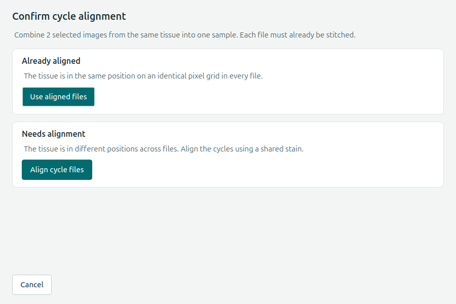
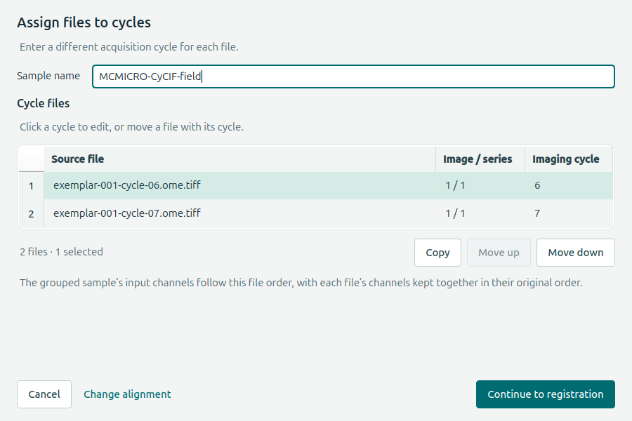
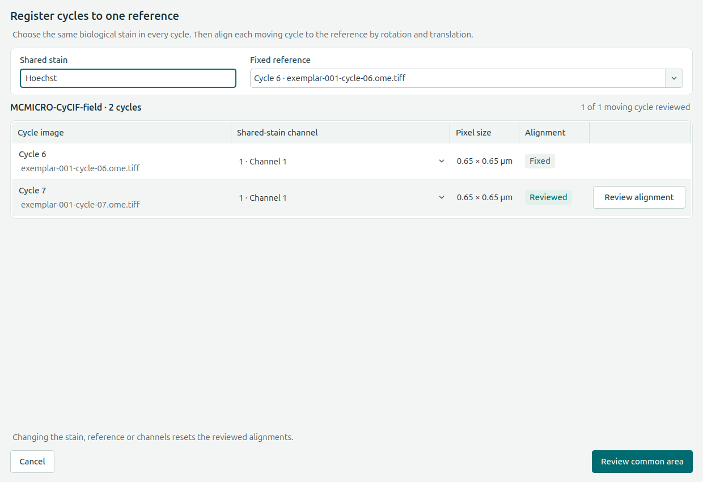
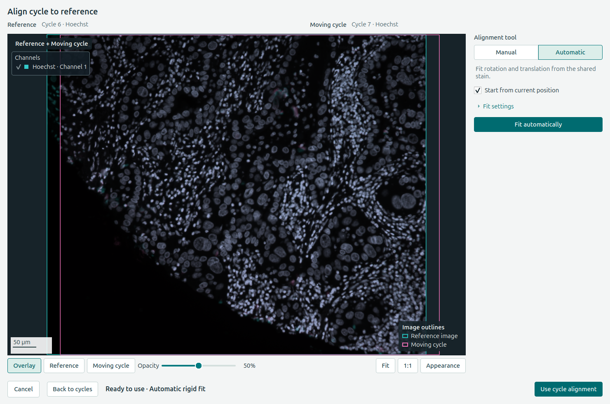
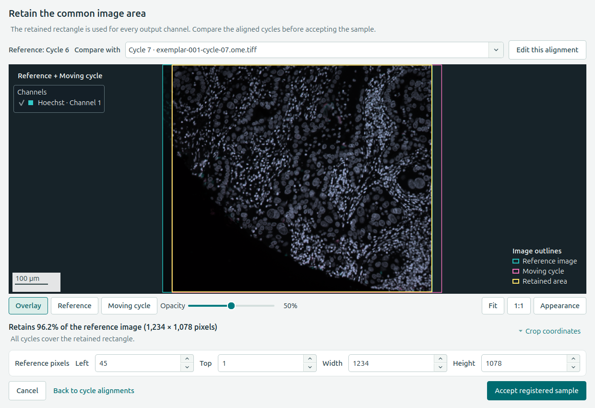
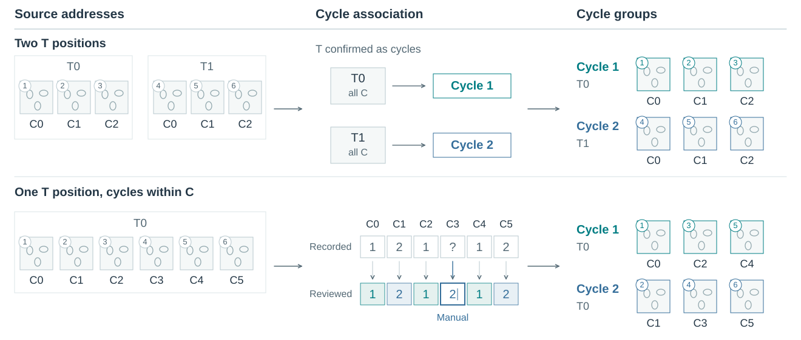
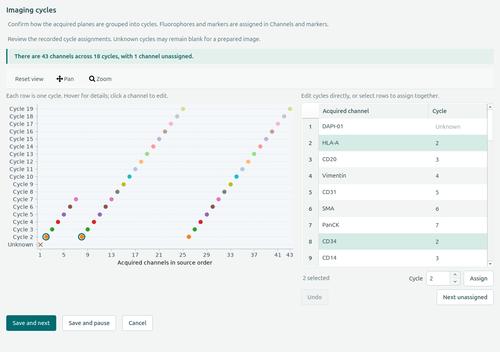
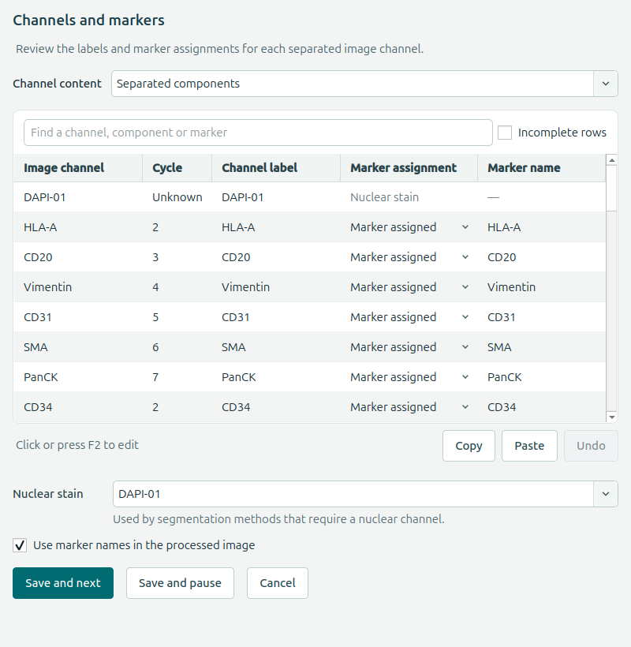

# Cyclic fluorescence images

[Samples](../setup/analysis.md#import-the-images-together) · [Channels and markers](../images/index.md) · [Spectral unmixing](../unmixing/index.md)

Cyclic fluorescence imaging records the same tissue over several imaging rounds. We import registered cycles or align separate cycle files, identify the round in which each channel was recorded, and assign the fluorophores and markers that will appear in the prepared image. When the acquired signals are mixed, we use those cycle assignments to fit the fluorescence components separately within each round, then combine the recovered channels for analysis.

## Import the cycle images

The import procedure depends on whether the cycles are stored together or in separate files.

### One assembled image

When one image contains all cycles, import it as one sample through the usual [Samples workflow](../setup/analysis.md#import-the-images-together). In this case, its channels must already be registered. Registration of cycles within an assembled image is not supported.

### Separate cycle files

When cycles are divided across files, import the files on **Samples**, select their rows and choose **Group cycle files…**.

First choose whether the files are already aligned or need registration, then enter the sample name and assign each file its **Imaging cycle**. The grouped sample's input channels follow this file order, with each file's channels kept together in their original order.

Choose **Use aligned files** when corresponding pixels represent the same tissue location across files. Their image dimensions, physical pixel sizes and storage types must match. Once you select **Group as one sample**, preparation reads the channels directly from the grouped files. To restore the individual rows on Samples, choose **Ungroup files**.

<table><tr>
<td></td>
<td></td>
</tr></table>

*Grouping two files from the [MCMICRO CyCIF exemplar](../../data/public-image-sources.md#separate-cycif-acquisition-files). **Confirm cycle alignment** leads to the file table, where the original cycle numbers, 6 and 7, identify the imaging rounds.*

## Align the cycle files

Choose **Align cycle files** when separate cycle files need registration. After assigning their cycle numbers, select **Continue to registration**. This route requires one file per cycle, with one Z-plane and one T position in each selected image series. Each cycle must contain a common stain, such as DAPI, whose structures can be matched across rounds.

Under **Fixed reference**, choose the cycle whose pixel grid will define the aligned image. Enter the **Shared stain** and select its channel in every file. We use these channels to align corresponding structures, then apply each cycle's transformation to all its channels.

*Hoechst in channel 1 is used for the shared nuclear structures. Cycle 6 is used for the reference grid at 0.65 µm/pixel; cycle 7 is shown after its alignment has been reviewed.*

Select **Align cycle** beside a moving cycle to open its overlay with the fixed reference. Select **Manual** to adjust shifts and rotation, or **Automatic** to estimate them by comparing the shared-stain images. There are three ways to establish its position:

1) **Manual positioning only.** Use **Shift + drag** to move the cycle, or enter horizontal and vertical shifts in micrometres and a rotation in degrees. Select **Apply position** to use these values, then inspect the alignment before saving it.
2) **Manual positioning followed by automatic fitting.** Position the images as above, select **Automatic**, keep **Start from current position** selected, then choose **Fit automatically**. Elastix uses the manual position as its starting point and adjusts it by comparing the shared-stain intensities.
3) **Automatic fitting only.** Select **Automatic**, clear **Start from current position** and select **Fit automatically**. The fit starts with the image centres aligned; **Search image orientations** additionally tests rotations of 0°, 90°, 180° and 270° when enabled.

Each moving cycle is aligned directly to the fixed reference using rotation and translation, preserving physical distances and shapes. Automatic fitting follows the [image preparation](../alignment/index.md#reference-registration--ii-prepare-image-views-for-automatic-fitting) and [mutual-information comparison](../alignment/index.md#reference-registration--intensity-metric-and-parameter-updates) described in the alignment guide. Under **Fit settings**, adjust the image-view size, optimizer iterations and thread count as described in [Global fitting settings](../alignment/index.md#global-fitting-settings).

*The same lung adenocarcinoma field in cycles 6 and 7 after manual positioning and automatic fitting. The overlaid nuclear structures show their correspondence; teal and pink outlines mark the image bounds. **Automatic** is selected, with **Start from current position** enabled for fitting from the manual position.*

After alignment, inspect the shared stain in several separated fields, including structures near the tissue boundaries. When corresponding structures align, select **Use this cycle alignment** and continue with the next cycle. Changing the fixed reference, shared stain or selected registration channels resets the reviewed alignments.

### Retain the common image area

After reviewing every moving cycle, select **Review common area**. We propose a rectangular crop within the area covered by every aligned cycle. Each output pixel then has a corresponding position in every source image. Open **Crop coordinates** to adjust **Left**, **Top**, **Width** and **Height** in reference-image pixels if needed.

The shared-stain overlay shows the original images at their saved positions, with teal reference bounds, pink moving-cycle bounds and a gold rectangle around the retained area. Use **Compare with** to inspect each moving cycle against the fixed reference. Pan and zoom to check corresponding structures within the rectangle; **Edit this alignment** returns to that cycle's positioning and fitting controls if a correction is needed. Once the rectangle is inside every cycle's image bounds and the alignments are satisfactory, select **Accept registered sample**. Tissue outside the rectangle is excluded from preparation.

*The common rectangle retains 1,234 × 1,078 pixels, or 96.2% of the reference image. The rectangle starts 45 pixels from the reference image’s left edge and one pixel from its top edge. The Hoechst overlay places the retained area directly over the tissue being reviewed; its coordinates remain editable before accepting the registered sample.*

During preparation, we use each accepted transformation to locate the original pixels corresponding to the cropped reference grid, then calculate their intensities by linear interpolation. We store the output as floating-point values to preserve fractional intensities. Its coordinates begin at the crop's origin, whose position in the original reference image is retained with the registration.

## Identify the imaging cycles

At the end of **Image inspection**, we review which acquired channels belong to each cycle. Images recognized as cyclic open this review even when their assignments are already recorded; accepted assignments carry into **Channels & markers**.

The source image locates each channel image by its channel coordinate **C** and time coordinate **T**. Some exporters store imaging cycles at separate T positions; others combine all cycle channels along C at a single T position. We support assembled images with one Z-plane, one intensity value per channel pixel and a complete C × T grid containing at most 512 planes. Source coordinates start at zero; the review displays cycle numbers starting at one.

Use your imaging notes or export settings to confirm that **T** represents imaging cycles, then choose **Imaging cycles** and confirm **The cycles are already registered to the same spatial grid**. Each T position supplies one cycle, and changing its cycle number updates all bands at that position together. Images combining imaging cycles with a separate time series must first be exported as registered cycle images for the time point being analysed.

When the cycles are combined along **C**, channels from different rounds may be interleaved. To identify their cycles, we use the metadata attached to each channel. A QPTIFF file, for example, can record **ImagingCycle** for each full-resolution channel. Compare the resulting assignments with the cycle and marker list used during imaging, then enter the missing cycle numbers in the table.

*Schematic of two storage layouts for six acquired planes. Above, confirming T as the cycle dimension assigns all channels at T0 to cycle 1 and all channels at T1 to cycle 2. Below, recorded per-channel values identify the cycles; C3 has no recorded value, so cycle 2 is entered from the imaging notes. The resulting groups retain their source C/T addresses. Source coordinates start at zero; displayed cycle numbers start at one.*

Select a point in the cycle diagram to locate its channel in the table. For channels combined along C, select several rows, set **Cycle** in the selection bar below the table, then choose **Assign** to give those channels the same cycle number. **Undo** or **Ctrl+Z** restores the preceding cycle values, including a whole selected-channel assignment in one step. **Next unassigned** moves to a channel whose cycle is still blank.

Every band used in cycle-specific spectral unmixing needs a cycle assignment. For already separated channels used directly, a missing cycle can remain **Unknown** when neither the image metadata nor your imaging notes identify it.

*Cycle assignments read from the [public tonsil image](../../data/public-image-sources.md#cyclic-tonsil-channel-assignments). Forty-two channels have per-channel cycle values. DAPI-01 is shown unassigned because its channel record omits that field; the embedded scan profile places it in cycle 1, which can be entered manually in this table.*

To supply missing cycle identities or revise the grouping later, open the completed **Image inspection** step's settings and select **Review cycle assignments**. 

## Assign fluorophores and markers

Open [Channels & markers](../images/index.md#assign-fluorophores-and-markers) to give the prepared channels their biological identities. We prefill fluorophores from explicit fluorophore metadata and markers from recorded marker identities. Complete missing names using the fluorophore and marker list for your imaging experiment.

For **Raw spectral bands**, define a component row for each fluorophore to recover within each cycle, choosing its **Cycle** and **Marker name**. Each component is estimated jointly from that cycle's measurement bands. Its fluorophore identifies the reference spectrum used for fitting, and its marker name identifies the labelled biological target.

For **Separated components**, each existing channel already represents a component. When cycles are known, the table includes a read-only **Cycle** column displaying the assignments accepted during inspection. Review **Channel label** and **Marker name** alongside this column; a channel with an unrecorded cycle is shown as **Unknown**.

*The same tonsil channels in **Channels & markers**. The accepted cycles appear beside their channel labels and recorded marker names. DAPI-01 is selected as the nuclear stain. Its channel record does not include a cycle number, so we enter cycle 1 manually in Image inspection, using the cycle listed in the embedded scan profile.*

Continue to [Confirm image status](../unmixing/index.md#image-state) for the preparation choices. When the measurement bands already isolate individual fluorophore signals, match each band to a component from the same accepted cycle.

## Reuse fluorophore reference spectra

When cycles use the same measurement bands and optical settings, we can reuse fluorophore reference spectra across rounds. In the [spectral CSV or table](../unmixing/index.md#import-measured-reference-spectra), provide one column per fluorophore, with rows identifying the measurement bands. We use the cycle assignments to select the spectra needed for each fit.

When [creating a library from reference images](../unmixing/library-from-images.md), supply each single-stain image and its matched controls once. After estimating the spectra, review the reference panel for each cycle before accepting the combined library. Use the same [intensity correction](../unmixing/index.md#acquisition-correction) for the image measurements and reference intensities so that their spectra have a compatible intensity scale.

Include an autofluorescence reference when AF is to be fitted. A shared AF reference must represent its spectral shape across the relevant rounds; if that shape changes between cycles, use cycle-matched controls. The AF intensity is fitted separately at each pixel within each cycle.

## Fit each cycle and prepare marker channels

We apply the selected [NNLS or clipped least-squares method](../unmixing/index.md#solver-methods) separately to each cycle's measurement bands, using the reference spectra for its assigned components. At every pixel, the fit estimates the intensity contributed by each component in that round.

*Both cycles use the reference spectra in matrix $S$. Fitting the six measured bands in each cycle gives separate component intensities $A_1$ and $A_2$, including an independent intensity for the shared autofluorescence spectrum. The marker table identifies which stain each fluorophore represents in the assembled image.*

We combine the recovered channels into one OME-Zarr image, retaining the reviewed component names, marker identities and cycle assignments. The shared spatial grid lets tissue and cell measurements use markers from all rounds at the same locations. Continue with [inspection of the prepared channels](../unmixing/index.md#inspect-the-prepared-channels) to review the result before analysis.
