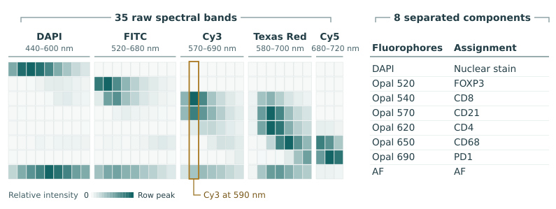
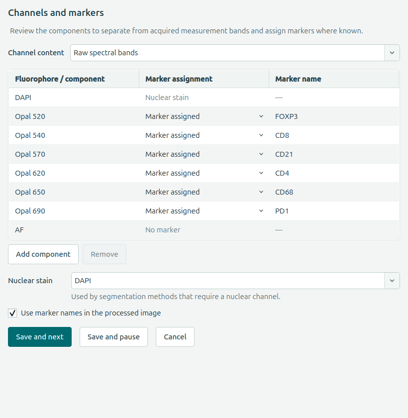
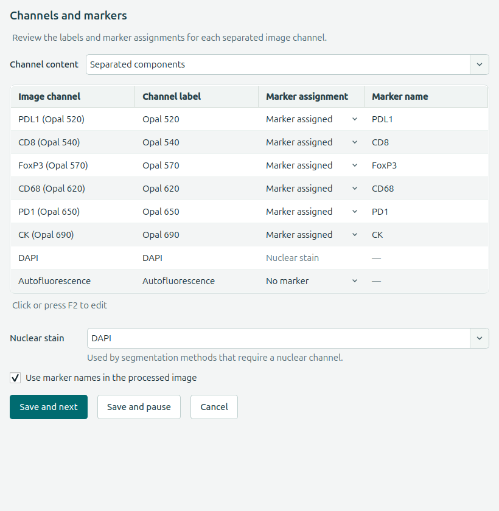

# Images and channel assignments

[Analysis stages](../../../README.md#analysis-stages) · [Image reading and preparation](processing.md) · [Storage and regional reads](storage.md)

**In this stage:** [Confirm the channel content](#confirm-the-channel-content) · [Assign fluorophores and markers](#assign-fluorophores-and-markers) · [Choose the nuclear stain](#choose-the-nuclear-stain) · [Save the assignments](#save-the-assignments)

Open **Channels & markers** to record the fluorophores used to stain the tissue, assign their biological markers and identify the nuclear stain.

## Confirm the channel content

On **Run**, select **Open review** under **Channels & markers**. We preselect **Channel content** when the image metadata identifies how the channels were produced. If the field is blank, check the export settings for the image.

### Raw spectral bands

Choose **Raw spectral bands** for a mixed image — where each image channel contains the intensities recorded by the microscope in one detection band. The table names the fluorescence components to recover during unmixing of these bands.

Typically, several fluorophores contribute to the intensity measured in each band. However, some microscopes use filters that isolate a single fluorophore in each band. These images still contain **Raw spectral bands**, but their signals can be used directly. When you reach [**Confirm image status**](../unmixing/index.md#user-guide-spectral-unmixing--image-state), choose **No — fluorophore signals are already separated (isolated by measurement bands)**. You can then match each band to its fluorophore and carry its measured intensities forward.

### Separated components

Choose **Separated components** for an image unmixed by the scanner or another program — where each image channel contains the estimated intensity of one fluorophore or, if retained, tissue autofluorescence. The table lists these channels in file order and fills in the channel label and marker name wherever they are recorded in the image metadata.

*For the FL6 image, the scanner sampled several detection wavelengths with each of five filter sets (DAPI, FITC, Cy3, Texas Red and Cy5). Each column represents one of the 35 raw bands. Several fluorophores can contribute to the same band because their emission spectra overlap. For example, both Opal 540 and Opal 570 emit light detected in the highlighted Cy3 band at 590 nm. Each row shows one component’s reference spectrum, with its strongest bands shaded darkest. During unmixing, we find the combination of these spectra that best reproduces the 35 intensities measured at each pixel. These estimates form the eight separated component channels shown on the right, one for each of the seven dyes and one for tissue autofluorescence (AF). Data from [Tsakiroglou and colleagues](https://doi.org/10.17632/274xbhc5rx.3), [CC BY 4.0](https://creativecommons.org/licenses/by/4.0/).*

## Assign fluorophores and markers

We fill in the fluorophore and marker names recorded in the image metadata. Check these assignments against the staining panel and enter any missing names.

For **Raw spectral bands**, enter missing fluorophores under **Fluorophore / component**. Use **Add component** if you need another row, or select a fluorophore absent from the panel and choose **Remove**. When naming components for unmixing, use the fluorophore names from the [spectral library you plan to import](../unmixing/index.md#import-measured-reference-spectra) or from the [single-stained reference images](../unmixing/library-from-images.md) you will use to build it.

For **Separated components**, edit **Channel label** if the recorded name needs changing. Hover over the channel to see its recorded fluorophore.

<table>
<tr><th>Raw spectral bands</th><th>Separated components</th></tr>
<tr>
<td width="50%" valign="top"></td>
<td width="50%" valign="top"></td>
</tr>
</table>

*For the mixed FL6 image (left), the eight rows name the components to recover from the 35 detection bands. The LuCa image (right) has already been unmixed, so each row corresponds to a component channel stored in the file.*

In either table, choose **Marker assigned** and enter the biological target under **Marker name**. Choose **No marker** for a component such as tissue autofluorescence. Select **Use marker names in the processed image** to label the channels in the prepared image by their biological targets. In this case, components with **No marker** keep their channel labels.

In cyclic immunofluorescence, the same fluorophore can label different markers in successive rounds of staining. Therefore, we add a **Cycle** column to identify the staining round in which the fluorophore labelled the marker in each row. See the table in [Assign fluorophores and markers by cycle](../cyclic-if-methods/index.md#assign-fluorophores-and-markers).

## Choose the nuclear stain

Under **Nuclear stain**, select the component or channel containing the DNA stain. We preselect DAPI when there is a single match. Select **No nuclear stain** if the image has none.

[Cell measurements](../cell-measurements/index.md#measurement-channels-and-compartments) initially assigns the DNA-stain role to this channel. If you include it in [KRONOS tissue classification](../tissue-classification/index.md#kronos-channel-inputs), we use it as the model’s DAPI input.

## Save the assignments

Select **Save and next** to continue to [**Confirm image status**](../unmixing/index.md#user-guide-spectral-unmixing--image-state), where you choose whether to unmix the image or copy its channels to OME-Zarr. To resume later, select **Save and pause**. Reopening the review restores the saved assignments and nuclear stain.

---

**Next:** [Spectral unmixing and component preparation](../unmixing/index.md).
