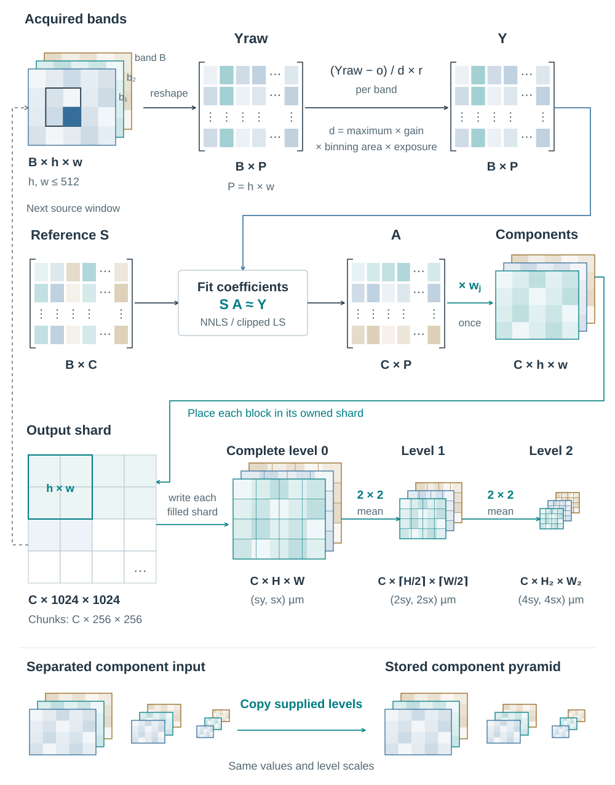
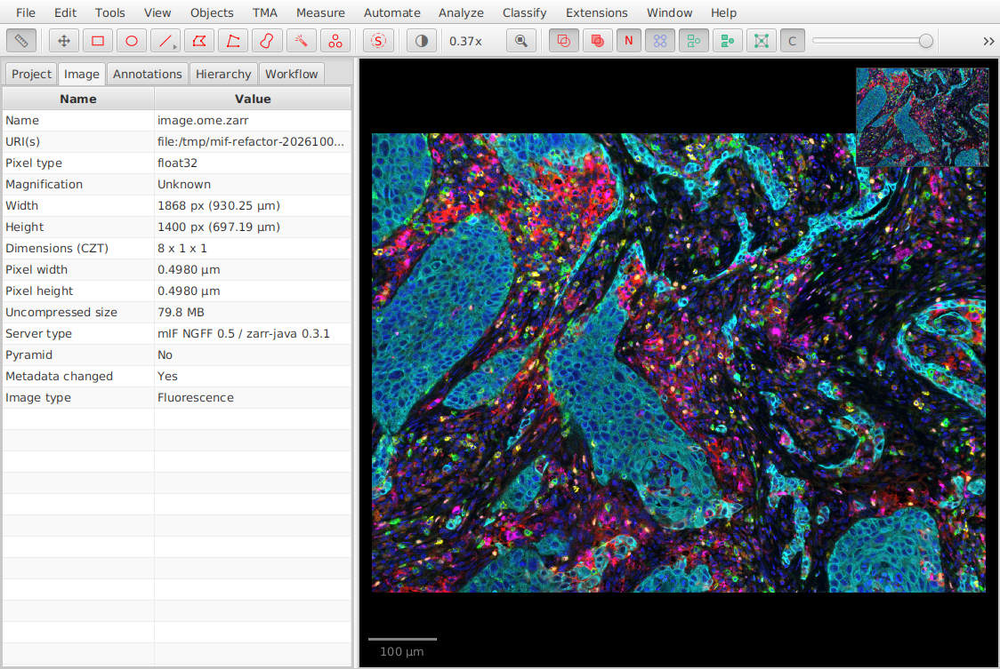
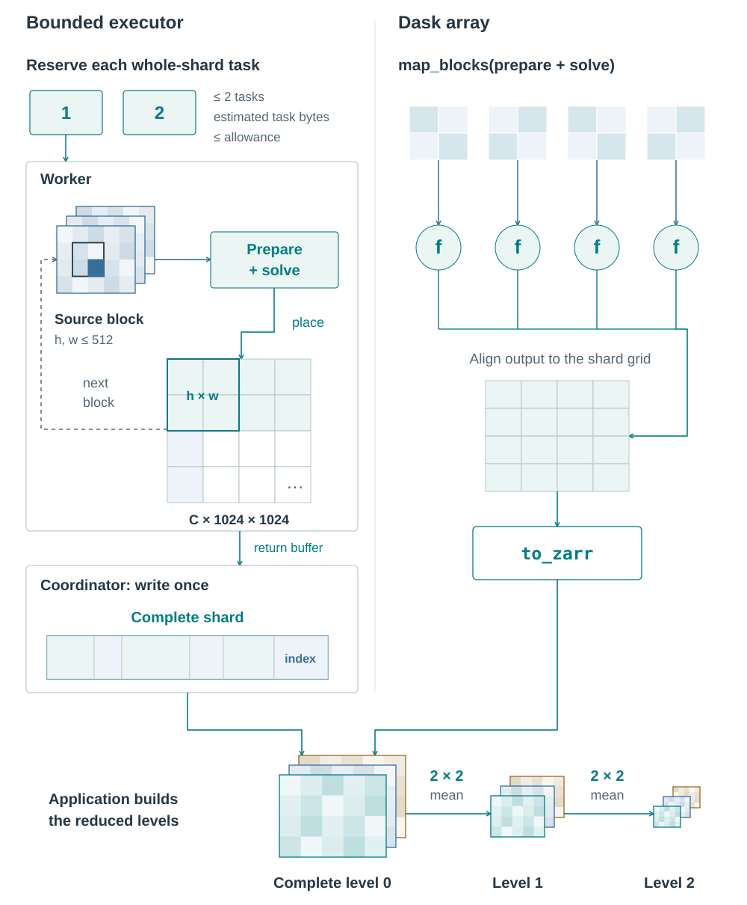
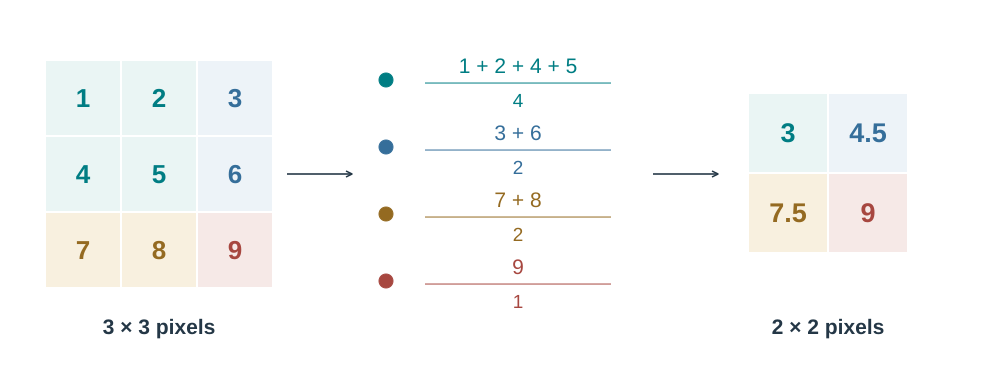

# Image processing

[Images and channels](index.md) · [Unmixing settings](../unmixing/index.md#user-guide-spectral-unmixing) · [Image storage](storage.md)

We prepare source images in a common OME-Zarr format for later stages. Bio-Formats reads the selected image and its metadata. The image state determines how we obtain the component intensities.

- **Mixed signals.** We apply the selected intensity correction and fit the reference spectra to the measured bands in each region.
- **Separated signals.** We copy the source intensities when the image has already been unmixed or its measurement bands cleanly isolate the fluorophores. For cycle files registered during import, we use the interpolated intensities at the aligned positions.

We write the components for each region to the corresponding output shard. The [unmixing guide](../unmixing/index.md) explains how to choose the image state, corrections, references and fitting method.

_Schematic of regional image preparation. `Yraw` and corrected `Y` hold `B` measured bands for `P = h × w` pixels, one complete spectrum per column. The accepted reference matrix `S` contains a spectrum across those bands for each of `C` components. Fitted and reporting-scaled component planes fill a 1024-square output shard, then supply the reduced levels. The lower route copies the separated component levels supplied by the source._

## Inspect the image and prepare OME metadata

Bio-Formats reads the source file and expresses the selected image’s dimensions, channel order, pixel sizes and imaging settings in OME metadata.

We first read each imaging setting from its standard OME field. If a value is missing, we check the vendor fields that Bio-Formats preserved in `OriginalMetadata` under `StructuredAnnotations`, using a mapping for that vendor when one is available. The imaging-settings review identifies any values still needed for correction and offers exposure-only correction when appropriate.

| Quantity | Standard OME field |
|---|---|
| Pixel width and height | `Pixels.PhysicalSizeX/Y`, converted to µm/pixel. |
| Exposure time | `Plane.ExposureTime` for each channel in the prepared metadata view at Z = 0 and T = 0, converted to seconds; source-plane mapping is described below. |
| Detector gain | `DetectorSettings.Gain`, then the gain of the channel's linked `Detector`.\* |
| Detector binning | `DetectorSettings.Binning`; a 2 × 2 setting gives a binning area of 4. |
| Detector offset | `DetectorSettings.Offset`, then the offset of the channel's linked `Detector`.\* |
| Pixel data type | `Pixels.Type`, such as `uint16` or `float` (32-bit floating point). |

\* A channel can record the gain and offset used for imaging in `DetectorSettings`. When either value is missing, we follow that channel's detector reference to the corresponding `Detector` entry. Vendor annotations fill values still missing after these linked standard fields have been read.

For an assembled cyclic image, [cycle review](../cyclic-if-methods/index.md#identify-the-imaging-cycles) identifies the source planes belonging to each imaging cycle. Each plane has its own address `(C, T, Z = 0)`. When preparing the metadata for intensity correction, we give each reviewed plane a channel entry and copy its exposure time and other settings into that entry.

This prepared channel list has a single time position (`T = 0`). To read the pixels we use each entry’s original C and T coordinates. A plane from a later time position therefore keeps both its own intensities and the exposure used to record them.

### Complete the imaging settings

The recorded metadata and your image-state review determine how the image is prepared. Mixed spectral bands undergo the selected intensity correction followed by unmixing. If the metadata records calibration that includes exposure normalization, unmixing uses the stored intensities directly. Previously unmixed images and images whose measurement bands already isolate the signals use the [copy route](#reference-image-processing--x-process-an-already-unmixed-image).

When a required imaging setting remains unresolved, the form offers manual entry or exposure-only correction. The [intensity-correction guide](../unmixing/index.md#acquisition-correction) explains these choices, compatibility requirements, units and equations. The accepted values and their sources are saved with the image's channel assignments and reused during regional processing.

### Resolve vendor annotations and processing history

The vendor mappings described below supplement the standard OME fields read during inspection. They associate each additional value with the image or channels to which it applies.

Some image readers omit imaging settings when creating the OME description. During the initial inspection of supported IM3 files, the metadata adapter reads the recorded band names, wavelengths, exposure times, gain, binning and physical pixel sizes, and fills the corresponding missing OME fields. We save this completed description with the inspection. Reference preparation and subsequent image reads reuse those saved values.

For Vectra images, we read the vendor's `Offset` value when the standard OME offset is missing. If both are missing, an explicit zero in `OffsetCounts` establishes a zero baseline. A nonzero `OffsetCounts` value requires review of the detector offset because it does not establish the offset needed by the correction equation. When the metadata records prior offset subtraction, the correction skips that subtraction and retains the original detector offset in the processing record.

Vectra's `SignalUnits` also identifies normalized-count values that already include exposure, gain, digital-range and binning correction. Those values enter fitting directly with compatible reference spectra. The [stored-range definition](#reference-image-metadata-and-coordinates--ii-determine-the-digital-range-used-for-normalization) explains how meaningful bit depth is resolved for correction of integer counts.

Spectral separation and autofluorescence subtraction are recorded separately. `IsUnmixedComponent` identifies separated component data; `AutofluorescenceSubtracted` records whether autofluorescence was subtracted. A retained autofluorescence output channel can accompany separated marker channels. The [image-state review](../unmixing/index.md#image-state) explains how these fields determine whether the file needs unmixing and an AF reference.

Fluorescence exported with a **Brightfield / OD** protocol contains logarithmically transformed optical-density values. Fluorescence unmixing fits a linear combination of intensities, so this input is rejected. Re-export the fluorescence intensity data and select that image for processing. Brightfield RGB images used as a paired anatomical reference follow the [RGB copy route](#prepare-a-packed-rgb-image) and [alignment workflow](../alignment/index.md).

## Read the selected vendor series

Bio-Formats calls each image in a vendor file a *series*. After image selection, all processing requests use that series. To read a rectangle `(x, y, width, height)`, we request the same coordinates from each selected measurement band.

When reopening an inspected single-file image, we compare its file size, modification time and filesystem identity with the inspection, and check the reader version and image dimensions. An unchanged file reuses its recorded checksum, OME metadata and stored bit depth. Bio-Formats initializes the pixel decoder from the file headers; imaging settings and recorded intensity corrections come from the saved OME description. For a dataset spread across several files, the metadata is interpreted again because the saved file record covers only the primary file.

Raw unmixing reads the full-resolution image, called level zero. Each band returns a `height × width` array. We check that the requested resolution and rectangle agree with the image information recorded during inspection. The reader stays open throughout processing and closes after the component arrays have been written.

One calculation task fills all output components over a 1024-by-1024-pixel area, which will be saved as one *shard*. It works through smaller source rectangles, no larger than 512 by 512 pixels, so correction and spectral fitting need only that rectangle's measurements at a time. Rectangles at the right and bottom edges contain the remaining image pixels. Tasks can calculate concurrently when memory allows, but take turns reading from the shared source reader. The writer later divides the shard into independently compressed chunks for [regional access](storage.md).

## Prepare separated fluorescence channels

If a band already measures a single fluorescence component, its pixels can be copied directly. During image-state review, distinguish an image that was previously unmixed from an image whose measurement bands isolate the signals. For isolated bands, match each band to its component and assign the marker where known. Each band and component must occur once, and any recorded cycles must agree. These assignments identify the signals in their original channel order. We can reuse the existing source if it meets the image-format requirements or copy its channels to the requested output.

Copying reads each supplied resolution level in small rectangles and writes each shard once. It preserves the pixel data type, intensities, channel order and pyramid levels supplied by that source.

For separately registered cycle files, the source first samples the original images onto the common reference crop using linear interpolation and supplies float32 pixels. Copying preserves these aligned values; the interpolation can change the values and data type relative to the original files. [Common image area](../cyclic-if-methods/index.md#retain-the-common-image-area) explains the registration and sampling step.

The processing record retains the source's spectral history and records the accepted reason for copying, component assignments and metadata changes. The copy route does not require the imaging settings used for intensity correction.

_LuCa's eight fluorescence components already contain separated intensities, so this route copies their values into OME-Zarr. The prepared field displayed here is 1868 × 1400 pixels at approximately 0.498 µm/pixel. Its component names, float32 values and calibration are preserved._

### Prepare a packed RGB image

The image-copy writer also supports a selected uint8 RGB image whose OME channel contains three samples per pixel. It reads each `height × width × 3` source region once, arranges Red, Green and Blue as three stored sample planes and writes them together in each shard. The retained OME description preserves the original channel and its `SamplesPerPixel=3`; the NGFF display entries identify each sample by its source channel ID and sample index.

The Python reader reconstructs the original `height × width × 3` view from those planes. QuPath's native reader uses the retained OME description to recognize RGB and returns packed RGB images for display. Its decoded display-cache allowance includes four bytes per packed pixel. 

Use the prepared RGB image as the moving image in [paired-image alignment](../alignment/index.md). Its original colour channels provide the stain-contrast view used for fitting and the colour pixels shown in the registered overlay.

## Prepare the regional spectral matrix

The solver needs all measured bands for each pixel. We prepare one source rectangle at a time.

1. **Read the measurement bands.** We request the rectangle from each band in turn through the open Bio-Formats reader. The resulting arrays contain the measurements at the same pixel positions in every band.

2. **Arrange complete pixel spectra.** We stack the arrays in the chosen band order and prepare an independent float32 working array of shape `(bands, height, width)`. Reading across the bands at one pixel position gives that pixel's measured spectrum.

3. **Correct the working intensities for the imaging settings.** Full correction uses each band's offset, exposure time, gain, binning, digital range and response factor. If the offset was already subtracted, we omit that term. Exposure-only correction divides by exposure time. When metadata establishes calibration including exposure normalization, the stored values pass directly to spectral fitting. The [intensity-correction calculation](../unmixing/index.md#acquisition-correction) defines these operations and the compatible scale required for reference spectra.

4. **Prepare the least-squares input.** We reshape the corrected working array to `(bands, height × width)`, giving one complete pixel spectrum per matrix column. Reshaping exposes those values to the solver without another copy. The solver reuses the prepared reference matrix across the columns and returns one fitted coefficient per component and pixel. The scheduler limits simultaneous tasks to keep their working arrays within the calculation's memory allowance.

See [Spectral unmixing](../unmixing/index.md#reference-unmixing) for the least-squares and NNLS objectives, component-reporting weights and stopping criteria.

## Schedule bounded shard fitting

The local executor runs at most two shard calculations at a time. Each task reads its source rectangles, corrects and unmixes their intensities, applies the component-reporting weights and fills one output shard. The coordinating thread writes each shard as soon as its calculation finishes, releases the array from memory and starts the next task.

The scheduler accounts for threads used by the matrix calculations and for memory needed to fit the spectra, assemble the shard and compress it. GPU solvers take turns updating arrays shared on the device.

After saving a shard, we mark it complete and save a summary of the fitting results. When retrying interrupted processing, we check that the source and settings still match, reuse the completed shards and their convergence counts, and calculate the unfinished shards. Slurm runs this same operation using the resources allocated to the job.

Scheduling diagram and comparison with a Dask task graph

_Schematic of the implemented bounded executor and a conceptual Dask array graph. On the left, each worker fills one shard **buffer**—a temporary all-channel array—by reading and solving smaller source blocks. At **Return buffer**, the worker passes that array to the coordinator, which encodes and writes the shard, records completion and releases the buffer before starting replacement work. The memory estimate includes both the buffer and the numerical work needed to fill it.  On the right, [map_blocks](https://docs.dask.org/en/stable/generated/dask.array.Array.map_blocks.html) expresses the calculation as a lazy graph, with output blocks aligned to storage before [to_zarr](https://docs.dask.org/en/stable/generated/dask.array.to_zarr.html). Dask can [optimize and fuse tasks](https://docs.dask.org/en/stable/optimize.html). Planning these chunks must allow for concurrent blocks and solver workspaces as well as [storage alignment](https://docs.dask.org/en/stable/array-chunks.html). Both formulations require serialized access to this vendor reader. In either case, the pipeline separately constructs reduced levels and NGFF metadata after the array write._

## Select the number of simultaneous regions

The initial execution policy permits two simultaneous shard tasks within a 2 GiB numerical-array budget. Each task needs the working arrays for its largest source rectangle, the shard being assembled and the encoding buffers. Before allocating the output, we estimate those requirements to determine the rectangle size and number of tasks that fit the allowance.

Let `P` be the source rectangle's pixel count, `B` the number of measurement bands, `C` the number of output components and `o` the number of bytes stored for one output value. The general estimate `E`, in bytes, covers its measurements, numerical workspace and component output:

$$
E=P\,[8(3B+12C+16)+oC].
$$

For the float64 CPU `BatchedNnlsSolver`, the internal iterative block contains `Q=min(P,65536)` pixels, and the more specific estimate is

$$
E=P\,[8(3B+4C)+oC]+8Q(32C+6B+32).
$$

The first term includes measurements and outputs for all `P` pixels. The second includes the iterative workspace for at most `Q` pixels at a time. This separates the size of a source read from the smaller block used within NNLS. Source rectangles remain capped at 512-by-512 pixels.

Each task also reserves three output-shard buffers and four inner-chunk buffers for the standard sharding encoder. With image width `W_img`, height `H_img` and output scalar width `o`, the complete task estimate is

$$
E_{\mathrm{task}}=E+3Co\min(1024,W_{\mathrm{img}})\min(1024,H_{\mathrm{img}})+4Co\,256^2.
$$

This estimate covers the arrays and encoding buffers for one fitting task. The Java image reader, loaded models and other processes on the computer also use memory.

A single worker can use several CPU threads for matrix operations. We therefore limit the worker count by both the configured maximum `W_max` and the available CPUs. In the expression below, `n` is the CPU count returned by `os.cpu_count()` and `t` is the largest thread count reported by the active calculation libraries.

$$
W=\min\left(W_{\max},\max\left(1,\left\lfloor n/t\right\rfloor\right)\right).
$$

We then calculate how many tasks can fit in the memory budget `M` using the estimated bytes per task. We also apply the worker limit `W`, the configured limit on outstanding tasks `N_inflight,max` and a maximum of two concurrent regions.

$$
N_{\mathrm{regions}}=\min\left(W,2,N_{\mathrm{inflight,max}},\left\lfloor M/E_{\mathrm{task}}\right\rfloor\right).
$$

If one fitting task exceeds the budget, we halve the longer side of its pixel block and repeat the estimate until a task fits. We then calculate how many of those tasks can run together. This changes the area fitted in one call. The stored image still uses 256 × 256-pixel chunks and 1024 × 1024-pixel shards. If the budget cannot accommodate even one pixel and the required encoding buffers, processing stops before creating the output image.

## Write calculated component regions to Zarr

We create a disk-backed Zarr array of shape `(components, image_height, image_width)`. Each 1024 × 1024-pixel shard contains sixteen 256 × 256-pixel chunks. All components for one chunk are compressed together so a regional read can retrieve the component values for that area. Scalar bytes are little endian where byte order applies, with lossless Blosc/Zstd level 1 and byte shuffle matching the scalar width. Each shard is written once after its valid numerical rectangles are complete.

Before writing level zero, we multiply each component’s fitted coefficient by its reporting weight to obtain the [saved intensity](../unmixing/index.md#reference-unmixing). This full-resolution image supplies the pixels for cell measurement and for all lower-resolution levels. For NNLS, every fitted region must pass the chosen convergence check before the result is accepted.

## Derive the component pyramid

We build the pyramid from the fitted component image. This order matters because NNLS and clipping are nonlinear. Averaging four raw spectra before fitting them can give a different component intensity from fitting the four pixels and averaging their results.

At each level, we halve the width and height, rounding up to keep the final row and column. For each component, the next pixel is the mean of the available pixels in its 2 × 2 group. An interior group contributes four values. If a dimension is odd, the group at that edge contributes two, or just one at an odd bottom-right corner. We repeat this averaging until the longest side is at most 512 pixels. Because edge groups can contain fewer pixels, successive reductions can give original edge pixels a different weight from interior pixels.

_Schematic of a 3 × 3 array reduced to 2 × 2 using the reducer’s odd-edge calculation. The four coloured groups divide by their actual contributor counts. The same spatial operation is applied independently to every channel._

For dimensions divisible by successive powers of two, the pyramid contains approximately

$$
1+\frac14+\frac1{16}+\cdots=\frac43
$$

of the level-zero pixel count. Storage estimates use the actual rounded dimensions of every level.

## Complete the calibrated sharded image

When we finish writing the arrays, we record the channel names and order, physical pixel sizes and scale of each pyramid level in the NGFF metadata. Readers use these values to open and display the prepared image. Embedded OME metadata records the fluorescence components, biomarkers, imaging settings, source image and spectral reference.

Once the shard writes have been synchronized to storage, we check the completion bitmap for each level. This bitmap records which shards have been written. We assign the completed image a generation ID and calculate a digest of its root metadata to identify this saved version.

We save the image and processing record as a version whose contents will remain unchanged. After synchronizing the record of its files, we update the analysis to use this completed version in one atomic operation. If completion fails, the previous result remains selected and successfully written shards remain available for retry. 

QuPath opens this image through the pipeline's native reader. For a requested rectangle, the reader locates the overlapping chunks within their shards, reads those byte ranges and decodes the pixels. The recorded scale for each pyramid level determines their physical coordinates, including at the edges of images with odd dimensions.

## Account for memory and temporary storage

Direct vendor-image processing removes the complete intermediate raw-image write and read. If that intermediate file would occupy `R` bytes, the avoided file operations are approximately `R` bytes of writing and `R` bytes of reading, together with the corresponding compression and decompression. Actual elapsed time also depends on source decoding, solver iterations, storage speed and final output encoding.

The storage estimate includes the component image, its reduced levels and the small records used to locate chunks and track completion. For multiple images, it adds the required output space according to the processing schedule and accounts for files already on the destination volume. Previously accepted results remain available until their replacements are complete. To identify an input file, inspection calculates its checksum; to identify a completed image version, we read its small root metadata record.

Processing small regions limits the image data held in memory at one time. For scale, an eight-channel, 100,000-by-100,000 uint16 image contains 160 GB of uncompressed values. A 1024-by-1024-pixel area from that image contains 16 MiB. Correction and fitting require additional arrays, which are included in the memory estimate above.

## Calibration and coordinates

The selected image determines the channel order, pixel size and coordinate system used by later calculations. We retain these values with the prepared image so that tissue boundaries, model predictions and cell measurements refer to the same locations.

### Selected-image identity and prepared arrays

Image inspection compares the source's OME image list with the reader's image-series descriptions. We select the analytical series containing the required tissue and fluorescence channels, retaining its original image and series positions, Image ID, Pixels ID and ordered Channel IDs. Metadata review lists only the selected image, at position zero. Subsequent pixel reads use its original position in the vendor file.

For an already-separated image, the reviewed component and marker remain associated with their original OME Channel ID. For a mixed image, acquired Channel IDs identify the measured spectral bands; the reference library determines the order of the new component channels, which receive the markers assigned in **Channels & markers**.

Each output channel stores its fluorophore in OME `Channel.Fluor` and its display name in `Channel.Name`. The display name can use the assigned biomarker. A linked OME annotation records the explicit biomarker assignment, while an image annotation identifies the chosen nuclear-stain component. These annotations retain the distinctions between the displayed name, antibody target and nuclear-stain role. If unmixing changes the component order, we match the saved nuclear stain to its component name in the output library.

The prepared `.ome.zarr` folder describes one calibrated fluorescence image with its channel order and resolution levels. The full-resolution array has shape **channels × image height × image width**. Each reduced level contains the same ordered channels at its recorded sampling scale. Image metadata supplies the X/Y physical pixel sizes and the names used when selecting classifier inputs or measurements. QuPath opens the folder and its associated metadata through the installed pipeline reader. [Storage and regional reads](storage.md) explains how the reader retrieves the required pixel arrays.

### Determine the digital range used for normalization

For unsigned source intensities, we normally read the meaningful bit depth from OME `SignificantBits` when available, or from the actual stored sample width reported by the reader. Full intensity correction uses the corresponding maximum, `2^b − 1` for `b` bits. [Digital intensity range](../unmixing/index.md#digital-intensity-range) explains how that value enters the correction. Separated component images retain their stored values during image preparation.

### Retain physical calibration and native image levels

We store the physical pixel width `p_x` and height `p_y` in µm/pixel, together with their original OME values and units. Physical area represented by one image pixel is `p_x p_y`. Geometry calculations use both values when converting areas and boundary displacements.

Level zero defines the selected image's full-resolution coordinates. Each reduced level retains its actual dimensions, channel count, dtype and recorded downsample. Resolution selection reads those explicit values and associates both physical pixel dimensions with the chosen level.

For a scalar reading downsample `d`, the physical sampling is `(d p_x, d p_y)`. For example, original sampling of `0.5 × 0.6 µm/pixel` becomes `2.0 × 2.4 µm/pixel` at downsample four. We use the reader's recorded reduction and calibration when preparing native-resolution tissue detection or a lower-resolution model input.

#### Stored image levels for tissue detection

Both detector editors start by looking for an image level close to **8 µm/pixel**. The threshold editor chooses among the reduced levels and uses full resolution if the image has none. For a new RF or SVM detector, full resolution is always among the choices. You can change the initial level in [detector setup](../tissue/index.md#physical-detection-scale).

To compare a level with the target, we use its pixel width and height in µm/pixel. We take the larger of `|ln(pₓ,level / 8)|` and `|ln(pᵧ,level / 8)|` so the dimension farthest from the target determines the difference for that level. We select the level with the smallest difference.

When you choose **Match a target resolution within its allowed difference**, both pixel dimensions must fall within the specified interval. A target of **8 µm/pixel** with an allowed difference of **0.05** admits levels from **7.6 to 8.4 µm/pixel** on each axis, including both endpoints. Exactly one stored level must qualify. If the interval contains none or several, adjust it or select a level directly. This interval applies when you request a match. When you reopen a saved detector, detector setup offers the levels compatible with the physical sampling used to train it.

### Convert image-region and model coordinates

Tissue boundaries, analysis regions and cell geometry use the processed mIF image's full-resolution coordinates. For a read beginning at `(x_0,y_0)` with downsample `d`, local position `(x_l,y_l)` maps to

$$
x=x_0+d x_l,\qquad y=y_0+d y_l.
$$

For example, local position `(25,10)` in a read beginning at `(1000,2000)` with downsample four becomes `(1100,2040)` in the full image. Where a model added padding around the region, we first subtract the padding from its local output position.

We convert these full-resolution positions to micrometres using

$$
x_{\mu m}=p_xx,\qquad y_{\mu m}=p_yy.
$$

For a boundary segment with pixel displacement `(\Delta x,\Delta y)`, the calibrated length is `sqrt((p_x\Delta x)²+(p_y\Delta y)²)`. Polygon area is multiplied by `p_xp_y`. Cell export retains both pixel and physical centroids, allowing their agreement to be checked against the same calibration.

## Sources and implementation

The output layout follows [NGFF 0.5](https://ngff.openmicroscopy.org/0.5/) and the [Zarr 3 indexed sharding specification](https://zarr-specs.readthedocs.io/en/latest/v3/codecs/sharding-indexed/index.html).

Metadata and source selection use `inspect_source_series_inventory`, `selected_canonical_ome` and `open_reviewed_source`. Regional processing uses `run_unmixing`, `process_regions_to_zarr`, `_region_schedule`, `_prepare_region` and `_solve_region`. Pyramid construction and writing use `_build_pyramid`, `build_unmixed_ome` and `finish_processed_image`, `write_image_shard` and `publish_canonical_image`. Capacity is calculated by `estimate_capacity`.

---

**Continue:** [Image storage and regional reads](storage.md).
