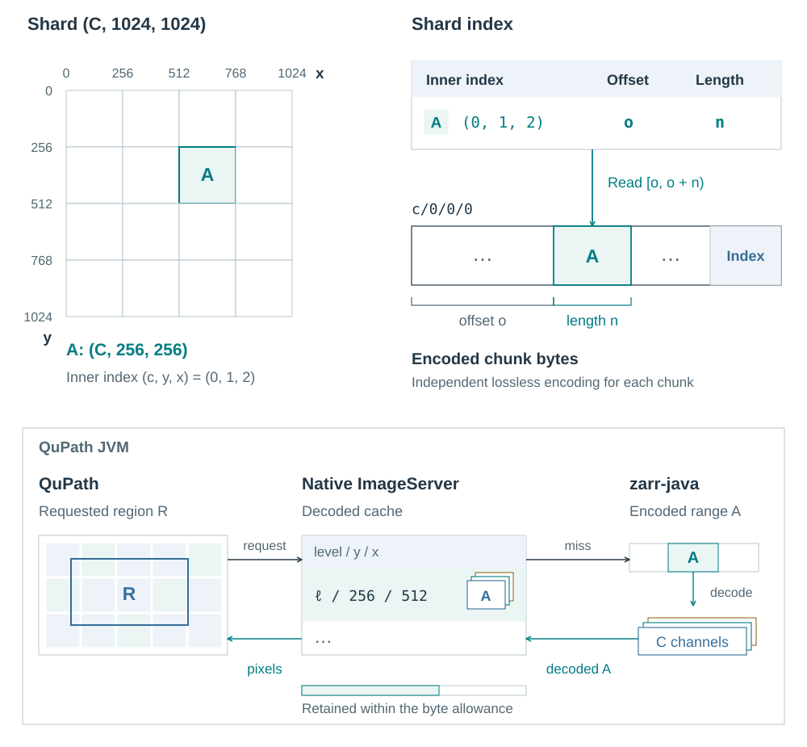

# Multichannel image storage and regional access

[Images and channels](index.md) · [Preparing image pixels](processing.md)

Each resolution of the prepared OME-Zarr image has its own array with dimensions in channel, row and column order (`c, y, x`). Within that array, a **chunk** holds all channels for a 256 × 256-pixel area. We compress each chunk independently and store groups of sixteen in a **shard** covering 1024 × 1024 pixels.

To open a field, the reader selects the array for the requested resolution and uses the index in each intersecting shard to locate its chunks. It can then read and decompress just the chunks that contain pixels in the field.

## i) Array shape, metadata and encoding

| Property | Definition |
|---|---|
| Image dimensions | `(C, H_l, W_l)` at level `l`; the supported analysis image is a selected two-dimensional plane |
| Axis order | Channel, Y, X; X is contiguous within each channel plane |
| Independent chunk | `(C, 256, 256)` |
| Outer shard | `(C, 1024, 1024)` |
| Pixel type | The approved output dtype, recorded independently of the solver's calculation precision |
| Inner encoding | Little-endian typed values; lossless Blosc/Zstd level 1 with byte shuffle |
| Shard index | Standard end-of-shard offset/length entries and CRC32C index checksum |
| Outer encoding | Indexed sharding; each inner chunk carries its own lossless encoding |
| Image metadata | OME-NGFF 0.5 on Zarr v3 |

In `zarr.json`, the regular array grid gives the shard dimensions. The `sharding_indexed` codec gives the dimensions of the chunks inside each shard. The index at the end of each shard records where each compressed chunk begins and how many bytes to read. [1]

At the image root, the `ome` attributes in `zarr.json` list the pyramid levels and identify the axes. Each level records its array dimensions, pixel type and the physical size of a pixel along X and Y in micrometres. The reader uses these scales to locate the same tissue field at different resolutions. The array dimension names follow the axis order declared for the image. [2]

The channel metadata identifies the fluorophore, its reviewed marker assignment and any role such as nuclear stain or autofluorescence. For an unmixed image, the processing record also identifies the intensity corrections and spectral library used.

The image directory contains one numbered folder per resolution level.

```text
images/<image-version>.ome.zarr/
    zarr.json                 Image axes, pyramid paths and channel metadata
    0/
        zarr.json             Full-resolution array, codec and grid definition
        c/0/<shard-y>/<shard-x>
    1/
        zarr.json             Next resolution level
        c/0/<shard-y>/<shard-x>
    ...
```

In `c/0/<shard-y>/<shard-x>`, the first index is always zero because each shard holds all channels. At the right and bottom edges, the stored array dimensions determine which pixels belong to the image. Calculations exclude padding beyond those dimensions.

## ii) Channel grouping and decoded-data cost

InstanSeg, KRONOS and multichannel measurements often need several intensities at the same tissue position. Grouping the channels in one chunk lets the reader retrieve those values together. A request for a single channel still decodes the whole chunk. If a second request needs another channel in the same field, it can use the pixels already in memory.

To estimate how much memory the decoded pixels occupy, multiply the number of spatial positions by the channel count `C` and the number of bytes `s` per intensity. A chunk covers 256 × 256 positions and a complete shard covers 1024 × 1024, giving

\[
D_{\mathrm{chunk}}=C\,256^2s,\qquad
D_{\mathrm{shard}}=C\,1024^2s.
\]

| Channels and type | Decoded chunk | Decoded shard |
|---|---:|---:|
| 8 channels, float32 | 2 MiB | 32 MiB |
| 16 channels, float32 | 4 MiB | 64 MiB |
| 32 channels, float32 | 8 MiB | 128 MiB |

The shard column gives the combined size of its sixteen decoded chunks. A field that intersects only two chunks requires just those two to be decoded. Processing also needs memory for the compressed bytes, decompression buffers and any model or solver used on the returned pixels.

The native reader identifies each cached tile by the completed image directory’s URI, stored level and pixel origin `(y,x)` at that level. Requests for different channels share the same read-only tile. The image directory remains unchanged after completion. Model feature caches also identify the sampling and normalization settings because those operations change the values supplied to the model.

## iii) Mapping a request to chunks

An image request specifies a rectangle in the primary image's full-resolution coordinates and the required pixel size. The adapter selects a stored level using its recorded scale, converts the rectangle to that level's coordinates and includes surrounding pixels when interpolation requires them.

For a half-open rectangle `[x0,x1) × [y0,y1)` expressed in the chosen level, the contributing horizontal chunk indices are:

\[
k_x=\left\lfloor\frac{x_0}{256}\right\rfloor,\ldots,
\left\lceil\frac{x_1}{256}\right\rceil-1.
\]

The vertical indices are calculated identically. Each shard spans four chunks along each axis, so `(floor(k_y/4), floor(k_x/4))` identifies the containing shard and `(k_y mod 4, k_x mod 4)` identifies the chunk's row and column within it. The shard index then supplies the byte offset and encoded length needed to read that chunk.

<a href="../../assets/figures/image-access.svg"></a>

_Chunk A covers pixels `[512,768) × [256,512)` at the selected level. The reader opens shard `c/0/0/0` and uses its index to find A’s compressed bytes. After decoding them, it can serve another request for the same tile from memory. The first zero in the shard path is the channel index because each shard holds all channels._

For example, a request for `[900,1200) × [400,700)` touches horizontal chunks 3–4 and vertical chunks 1–2. The reader retrieves four inner chunks from two shards. With eight float32 channels, their decoded buffers total 8 MiB before cropping.

<a id="vi-native-access-and-result-selection"></a>
<a id="iv-native-access-and-result-selection"></a>
## iv) Open the saved image and reuse regional reads

The image becomes selectable after its shards and resolution levels have been written and its processing checks have passed. QuPath's ImageServer adapter reads the channel order, pixel data type and physical scales from that completed metadata, then uses the pinned Java Zarr reader in the same JVM to retrieve pixels.

QuPath assembles the requested field from the chunks it intersects. If a chunk is already in memory, the reader can use it immediately and share it with concurrent requests. Otherwise, it looks up the chunk in the shard index, reads its compressed pixels and decompresses them before assembling the field for display or calculation. The reader limits the memory retained for both decoded chunks and shard indexes.

Python also reads dimensions, channel descriptions and physical pixel sizes from the saved metadata. It opens a pyramid level's Zarr array when a calculation first requests pixels at that level, then reuses the open array. Results can list reconstruction figures using the metadata alone.

**References:** [1. Indexed sharding](https://zarr-specs.readthedocs.io/en/latest/v3/codecs/sharding-indexed/index.html); [2. OME-NGFF 0.5](https://ngff.openmicroscopy.org/0.5/); [3. Zarr performance guidance](https://zarr.readthedocs.io/en/stable/user-guide/performance/).

---

**Continue:** [Images and channels](index.md).
