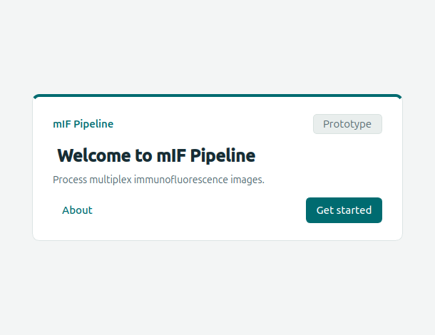
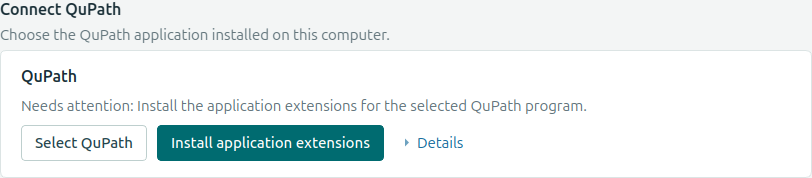
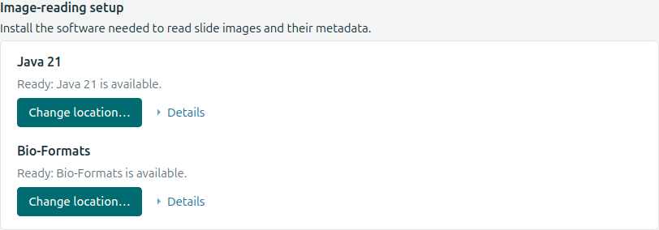
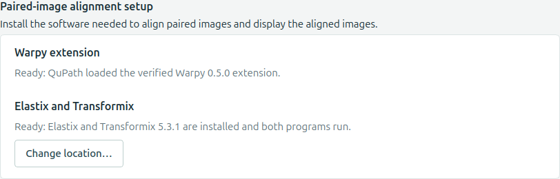
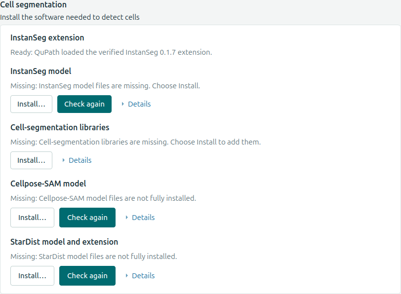
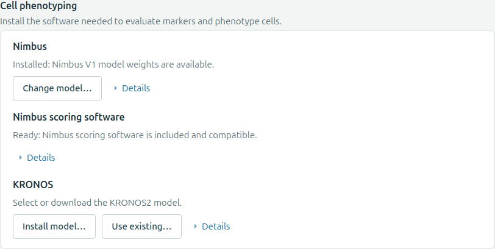
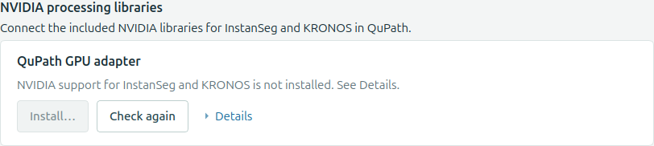

# Software setup

[Analysis stages](../../../README.md#analysis-stages) · [Building and releasing](building-and-releasing.md) · [Command-line setup](../setup/command-line.md)

<a id="getting-started-installation"></a>

<a id="getting-started-installation--install-and-configure-the-desktop"></a>

The MIFflow desktop runs on Windows 11 and Ubuntu 24.04.

| What you have | How to install MIFflow |
|---|---|
| A portable application from [MIFflow releases](https://github.com/04-zain/MIFflow/releases) | [Extract the archive and open the desktop](#open-a-portable-application). Python and the processing libraries are included. |
| A Python wheel (`.whl`) | [Install the wheel](#install-a-shared-wheel) in a Python 3.12 environment. The compiled QuPath extension is included. |
| A repository checkout or GitHub source-code download | [Build the QuPath extension, then install the Python application](#install-the-python-application). |

## Open a portable application

There are two portable editions of MIFflow. The **CPU edition** runs the analysis on the computer’s CPU. The **NVIDIA edition** includes the libraries that let supported methods use a compatible NVIDIA GPU. To get started:

1. Download the archive for your operating system (Windows 11 or Ubuntu 24.04) and edition at [MIFflow releases](https://github.com/04-zain/MIFflow/releases)
2. Extract the complete archive into a writable folder. The executable loads its libraries from the other files in that folder.
3. On Windows, open `mif-desktop.exe`. On Ubuntu, open a terminal in the extracted folder and run `./mif-desktop`.

Continue to [Software setup](#open-software-setup) after opening the desktop.

## Install a shared wheel

A wheel (`.whl`) contains the MIFflow Python package and its compiled QuPath extension. Use a Python 3.12 environment for the installation. Installing the wheel with `[desktop]` adds the graphical interface. For a processing host that receives jobs from another computer, omit `[desktop]` and use the [command-line setup instructions](../setup/command-line.md#reference-command-line--software-setup).

Open a terminal in the folder containing the wheel. The commands below create a Python environment named `.venv`, install the wheel and launch the desktop. Substitute your wheel’s filename in the installation command. For subsequent launches after installation, run only the last command from the directory containing `.venv`, or use the full path to the launcher.

**Linux**

```bash
python3.12 -m venv .venv
.venv/bin/python -m pip install "./mif_pipeline-0.1.0-py3-none-any.whl[desktop]"
.venv/bin/mif-desktop
```

**Windows PowerShell**

```powershell
py -3.12 -m venv .venv
.\.venv\Scripts\python.exe -m pip install ".\mif_pipeline-0.1.0-py3-none-any.whl[desktop]"
.\.venv\Scripts\mif-desktop.exe
```


For the following two methods, you will need additional libraries after installing the wheel:

- **Nimbus scoring** uses versions of NumPy and PyTorch that differ from those used by the main application. Install its [separate scoring program](#nimbus-for-source-installations) if you plan to use Nimbus, including on a CPU.
- **NVIDIA processing** requires GPU-enabled libraries for Python calculations and a matching PyTorch library for models that run in QuPath. Follow [Add NVIDIA processing libraries](#add-nvidia-processing-libraries) on the computer that will run those models.

<a id="getting-started-installation--1-install-the-python-application"></a>
<a id="install-the-python-application"></a>
## Install from source

When you install from a repository checkout, pip builds the wheel locally and installs it in the selected Python environment. Supply the compiled Java extension during that build so the installed application can use it in QuPath.

Install Python 3.12 and [QuPath 0.7.0](https://github.com/qupath/qupath/releases/tag/v0.7.0). Follow [Build the QuPath extension](native-extension.md#build-and-install) and keep the resulting JAR in its build folder.

From the repository root, create a Python environment and set `MIF_NATIVE_READER_BUILD_DIR` to the extension’s output directory. Run the installation command in the same terminal so pip can read that setting.

**Linux**

```bash
python3.12 -m venv .venv
export MIF_NATIVE_READER_BUILD_DIR="$HOME/mif_pipeline_build/native"
```

**Windows PowerShell**

```powershell
py -3.12 -m venv .venv
$env:MIF_NATIVE_READER_BUILD_DIR = 'C:\mif_pipeline_build\native'
```

Continue with **Desktop** for an interactive installation or **Processing host without Qt** for a computer that receives jobs from a streaming desktop or runs command-line automation.

### Desktop

From the repository root, install the application with the `desktop` extra to include Qt. Once installed, open the desktop using the launcher in that environment.

**Linux**

```bash
.venv/bin/python -m pip install ".[desktop]"
.venv/bin/mif-desktop
```

**Windows PowerShell**

```powershell
.\.venv\Scripts\python.exe -m pip install ".[desktop]"
.\.venv\Scripts\mif-desktop.exe
```

After launching, follow [QuPath and application extensions](#qupath-and-application-extensions) to select QuPath and install the extensions it needs.

### Processing host without Qt

Install the base package on the processing host. It supplies the scientific libraries and remote processing commands. For streaming jobs, the desktop on your local computer supplies the interface.

**Linux**

```bash
.venv/bin/python -m pip install .
.venv/bin/mif-batch --help
```

**Windows PowerShell**

```powershell
.\.venv\Scripts\python.exe -m pip install .
.\.venv\Scripts\mif-batch.exe --help
```

[Cluster computing](../setup/computing.md#cluster-streaming) explains how the local application connects to this installation. [Command-line setup](../setup/command-line.md) documents the commands used for software selection, processing and review responses.

### Update an existing source installation

Close the desktop and open a terminal in the updated checkout. If the Java sources changed, [rebuild the extension](native-extension.md#build-and-install). Set `MIF_NATIVE_READER_BUILD_DIR` to the current JAR folder and repeat the [desktop](#desktop) or [processing-host](#processing-host-without-qt) install command using the existing environment. The next desktop launch picks up the updated Python and Groovy code and refreshes the bundled extension if it changed.

<a id="nimbus-for-source-installations"></a>
<a id="add-libraries-for-nimbus-or-nvidia-processing"></a>
## Add Nimbus processing libraries

The portable editions include the Nimbus scoring program. For a wheel or source installation, you can build it from the repository on the computer where scoring will run. The builder creates a separate Python environment and packages the model code with the versions of NumPy and PyTorch it requires. [Libraries included with Nimbus](building-and-releasing.md#bundled-numerical-workers)

From the repository root, run the command below for your operating system. Give it a directory outside the checkout for temporary build files and a separate, new output directory where the scoring program will stay. The commands build the CPU edition by default. For NVIDIA processing, add `--accelerator cuda`.

**Linux**

```bash
.venv/bin/python scripts/build_nimbus_runtime.py \
  --source-root "$PWD" \
  --build-root /absolute/external-build/nimbus \
  --output-root "$PWD/.venv/runtimes/nimbus"
```

**Windows PowerShell**

```powershell
.\.venv\Scripts\python.exe scripts\build_nimbus_runtime.py `
  --source-root "$PWD" `
  --build-root 'C:\external-build\nimbus' `
  --output-root "$PWD\.venv\runtimes\nimbus"
```

Keep the completed folder at `.venv/runtimes/nimbus`, where the application looks for the scoring executable. Select or download the model weights separately under **Software setup → Cell phenotyping → Nimbus**.

## Add NVIDIA processing libraries

The Python application and QuPath models require different versions of PyTorch for NVIDIA processing. The portable NVIDIA edition supplies both. For a wheel or source installation, install each version in the location used by its program.

| Calculations | Library installation |
|---|---|
| Main application's Python calculations, including Cellpose | PyTorch 2.6.0 and Torchvision 0.21.0 with CUDA 12.6, installed in the application's Python environment |
| InstanSeg and KRONOS calculations in QuPath | PyTorch 2.7.1 with CUDA 12.8 and its matching Java adapter, stored in `.venv/runtimes/torch-native` |

### Calculations in the main application

Install CUDA-enabled PyTorch and Torchvision in the application’s Python environment.

**Linux**

```bash
.venv/bin/python -m pip install torch==2.6.0+cu126 torchvision==0.21.0+cu126 --index-url https://download.pytorch.org/whl/cu126
```

**Windows PowerShell**

```powershell
.\.venv\Scripts\python.exe -m pip install torch==2.6.0+cu126 torchvision==0.21.0+cu126 --index-url https://download.pytorch.org/whl/cu126
```

These versions follow the [PyTorch 2.6 installation matrix](https://docs.pytorch.org/get-started/previous-versions/#v260).

### Calculations in QuPath

Build the QuPath library package on the operating system where it will run. From the repository root, choose a fresh build directory outside the checkout and an output directory that does not already exist.

**Linux**

```bash
.venv/bin/python scripts/build_native_gpu_runtime.py \
  --source-root "$PWD" \
  --build-root /absolute/external-build/torch-native \
  --output-root "$PWD/.venv/runtimes/torch-native"
```

**Windows PowerShell**

```powershell
.\.venv\Scripts\python.exe scripts\build_native_gpu_runtime.py `
  --source-root "$PWD" `
  --build-root 'C:\external-build\torch-native' `
  --output-root "$PWD\.venv\runtimes\torch-native"
```

The builder downloads the pinned Torch and NVIDIA libraries and their Java adapter. Keep the completed folder at `.venv/runtimes/torch-native`. MIFflow passes these library locations to QuPath when it launches, allowing QuPath’s Java model code to call Torch.

Finish by checking [NVIDIA processing libraries](#nvidia-processing-libraries) in Software setup, then select the processor and run its check in [Computing](../setup/computing.md#this-computer). Software setup checks the installed libraries; Computing checks whether the chosen processing computer can use its GPU. That computer needs an NVIDIA driver compatible with CUDA 12.8.

<a id="getting-started-installation--2-open-software-setup"></a>
## Open Software setup

On first launch, select **Get started**. To reopen **Software setup** later, use **Home**.

1. [Connect QuPath](#qupath-and-application-extensions) to open images and annotations from MIFflow.
2. [Set up the image reader](#check-the-combined-runtime) so MIFflow can open your image files with Bio-Formats.
3. Open the entries for the methods you plan to use. Choose **Use existing…** for files already on disk or **Install…** to review the download and its destination.
4. If using the NVIDIA edition, [check the GPU libraries](#nvidia-processing-libraries). Then open [Computing](../setup/computing.md#this-computer) to select and test the processor before creating your analysis.

<a href="../../assets/screenshots/welcome-first-launch-current.png"></a>


### QuPath and application extensions

Install QuPath 0.7.0 if it is missing. QuPath provides [installation instructions for each operating system](https://qupath.readthedocs.io/en/stable/docs/intro/installation.html).

Under **Connect QuPath**, choose **Use QuPath** for a detected installation or **Select QuPath** to locate its executable. We keep the extensions for MIFflow in a dedicated QuPath user directory. If the required files are missing, select **Install application extensions** to populate its `extensions` folder.

- **MIFflow extension.** We copy the bundled extension into the `extensions` subfolder.
- **InstanSeg and Warpy.** On first setup we look for these extensions in the selected QuPath installation. On subsequent installations we check the folder prepared during setup. We copy each verified file into the folder and download the required version if a suitable local copy is unavailable.

When we open QuPath from MIFflow, a launch option selects the preferences that point to this user directory. QuPath then loads the extensions from its `extensions` folder. If QuPath was already open during setup, reopen it from MIFflow. [QuPath launch option and profile](native-extension.md#how-qupath-loads-the-extension)

<a href="../../assets/screenshots/software-qupath.png"></a>

<a id="check-the-combined-runtime"></a>
<a id="getting-started-installation--3-check-the-combined-runtime"></a>
### Check the image reader

Under **Image-reading setup**, install or select Java 21 and Bio-Formats 8.5.0. We start Java and check that it can load the required Bio-Formats version and its image readers. Both entries should show **Ready**. If a check fails, open **Details** for the selected location and the error.

The image reader retains that Java runtime and those libraries until the application closes. If the reader has already started and you need to change Java or Bio-Formats, restart the desktop and make your selection before opening an image.

<a href="../../assets/screenshots/software-image-reader.png"></a>

### Paired-image alignment

If your analysis includes a paired image, such as an H&E section, open **Paired-image alignment setup**. We use Warpy 0.5.0 to display the aligned image over the mIF tissue. For [automatic alignment](../alignment/index.md), Elastix fits the transformation and Transformix calculates the corresponding positions in the paired image.

Complete the **Warpy extension** and **Elastix and Transformix** checks. To reuse an Elastix installation, choose **Use existing…** and select the folder containing both programs from Elastix 5.3.1.

<a href="../../assets/screenshots/software-alignment.png"></a>

### Cell segmentation

Under **Cell segmentation**, open the entry for the method you intend to use. Select the model files and check the listed processing libraries.

| Method | Required software or model |
|---|---|
| InstanSeg | Use extension 0.1.7 with the `fluorescence_nuclei_and_cells` 0.1.1 model. Keep its description and weights together in the downloaded folder. |
| Cellpose-SAM | Use Cellpose 4.0.9. |
| StarDist | Use the StarDist 0.6.0 QuPath extension. |

The [segmentation guide](../cells/index.md) explains which outlines each method predicts and which image channels it requires.

<a href="../../assets/screenshots/software-cell-segmentation.png"></a>


### Nimbus and KRONOS

#### Nimbus

Nimbus needs its scoring software and its trained model. Portable editions include the scoring software. For a wheel or source installation, first add the [Nimbus processing package](#nimbus-for-source-installations).

Under **Cell phenotyping → Nimbus**, select **Install model…** to download the public V1 weights, or **Use existing…** to select them on disk. Under **Nimbus scoring software**, look for **Ready**. After installing a missing runtime, select **Check again** to verify it. [Nimbus setup](../phenotyping/nimbus.md#reference-nimbus--runtime-setup)

For cluster processing, install the application and Nimbus libraries on the processing host. Model and imported-score paths must be accessible there. **Browse…** can select a mounted file; the application translates its location using the saved cluster mount mapping.

#### KRONOS

For KRONOS tissue or cell classification, select the approved model folder under **Cell phenotyping → KRONOS**. [Request access and download the model](#access-and-download-kronos)

<a href="../../assets/screenshots/software-phenotyping-setup.png"></a>

<a id="unsupervised-phenotyping"></a>

[Unsupervised phenotyping](../phenotyping/unsupervised.md) uses the FlowSOM and PhenoGraph libraries included with MIFflow.

<a id="nvidia-processing-libraries"></a>
## Check NVIDIA processing in Software setup

Use **Software setup → NVIDIA processing libraries** to verify that QuPath’s Torch libraries and Java adapter are present. InstanSeg and KRONOS use this adapter for model calculations. Open **Details** to inspect the application’s Python libraries as well. Portable NVIDIA releases include these libraries; source installations follow [Add NVIDIA processing libraries](#add-nvidia-processing-libraries).

If the Java adapter is missing, select **Install…**. We install the matching 3.4 MB adapter and check that it can load the QuPath libraries. To add complete NVIDIA support to a CPU portable application, use the NVIDIA release.

Running QuPath with these libraries requires a compatible NVIDIA driver, including when a calculation uses the CPU. Select and check the processing device in [Computing](../setup/computing.md#this-computer). For cluster streaming, install the libraries on the processing computer and use Computing's processor check to test a cluster node assigned to the job.

<a href="../../assets/screenshots/software-nvidia.png"></a>

<a id="getting-started-installation--4-prepare-storage-and-computing"></a>
## Prepare storage and computing

Choose an analysis location with enough free disk space for the prepared images, QuPath projects, cell measurements, fitted models and exported results. Also allow space for model downloads and temporary processing files. Keep the original images available throughout the analysis.

We store prepared images in `.ome.zarr` folders containing the full-resolution image and smaller versions for viewing at different magnifications. The storage check estimates their uncompressed size because compression depends on the image data. Open [Computing](../setup/computing.md#this-computer) to check available disk space and memory and select the processor.

For cluster processing, install the application and required software on the cluster and choose an analysis folder accessible to its processing jobs. [Cluster setup](../setup/computing.md#getting-started-cluster-setup) explains the connection, storage and computing settings.

<a id="getting-started-installation--5-create-a-test-analysis"></a>
<a id="luca-example"></a>

## Create a test analysis

Once the software required for your analysis is ready, return to Home and follow [First analysis](../setup/analysis.md#getting-started-first-analysis) with a small image representative of your study. Open it with the selected image reader and run the methods you intend to use. For a worked example, the [LuCa guide](../../data/luca.md) provides the public vendor image, channel panel and stage walkthroughs.

The [software definitions](../../../src/python/mif_pipeline/config/software) record supported downloads and versions. Use [Building and releasing](building-and-releasing.md) to prepare packages and [Troubleshooting](../../troubleshooting.md) to investigate installation errors.

## Access and download KRONOS

MIFflow includes the libraries that run the KRONOS encoder. MahmoodLab distributes the **KRONOS2** weights under a separate access agreement. [How KRONOS encodes the images](../tissue-classification/model-execution.md)

### Request model access

Open **Software setup → Cell phenotyping → KRONOS → Open KRONOS access page**, or visit [MahmoodLab/KRONOS2](https://huggingface.co/MahmoodLab/KRONOS2). Sign in with a Hugging Face account whose primary email matches your institutional email. Complete the access form with your affiliation and intended research use, review the [model’s terms](https://huggingface.co/MahmoodLab/KRONOS2/blob/main/README.md#requesting-access), and wait for approval before downloading.

### Download the model folder

Use a software directory outside the application and analysis folders. Install Hugging Face's `hf` download tool using its [standalone installer](https://huggingface.co/docs/huggingface_hub/guides/cli#standalone-installer-recommended). Run `hf auth login` with the account granted access, then download the model into the software directory.

```text
hf auth login
hf download MahmoodLab/KRONOS2 --local-dir KRONOS2 --exclude "demo_image/*"
```

The download creates a `KRONOS2` folder with the model’s subdirectories, excluding the optional demonstration image. To retrieve the same model revision as an earlier download, add `--revision` followed by its commit identifier. Hugging Face documents [authentication, local folders and revision selection](https://huggingface.co/docs/huggingface_hub/guides/cli).

The following files supply the model inputs used by MIFflow. Keep the complete downloaded directory together.

| File or directory | Used for |
|---|---|
| `config.json` | Model dimensions, backbone architecture and the filenames of the weights and marker table |
| `kronos2_vitb16_teacher.pth` | Pretrained encoder weights; the download listing reports approximately 440 MB |
| `marker_metadata.csv` | Marker names, biological descriptions and intensity normalization values |
| `marker_utils.py` and `dinov2/` | Code that constructs the marker-aware encoder |
| `requirements.txt` | Dependencies for the downloaded model code |

These filenames match the [published model listing](https://huggingface.co/MahmoodLab/KRONOS2/tree/main). We read the weight and marker-table filenames from `config.json` and check that the model uses the supported KRONOS2 architecture with 768 output features.

### Select the model in Software setup

Open **Software setup → Cell phenotyping → KRONOS** and choose **Use existing…** to select the `KRONOS2` directory containing `config.json`. If you started with **Install model…**, follow its access and download instructions, then choose **Select downloaded folder…**. Keep the model at the selected location. After moving it, use **Use existing…** to update its path.

For a cluster desktop, select the model folder on that computer. For streaming, select it through the mounted cluster folder in local **Software setup**. The application translates this location to the cluster path; the processing node reads the model there.

If download access is denied, confirm that the account used for `hf auth login` has approval. If files are missing, repeat the download into the same folder and select it again.

### Prepare the description model for new markers

If your selected markers include one absent from the KRONOS marker table, prepare **BioLinkBERT-large** so we can encode that marker’s biological description. Open **Software setup → Cell phenotyping → KRONOS → Install model…**, expand **Additional markers**, then select **Install marker model…**. The dialog shows the download source, size, licence and destination before installation. We save the approximately 1.33 GB download in the application’s data folder. To reuse a complete copy of the supported version, choose **Use existing marker model…**.

For a cluster desktop, install or select the description model on that computer. For streaming, select it through the mounted cluster folder, then save **Computing** again to pass the location to the processing node.

---

**Next** [Create an analysis and add samples](../setup/analysis.md).
