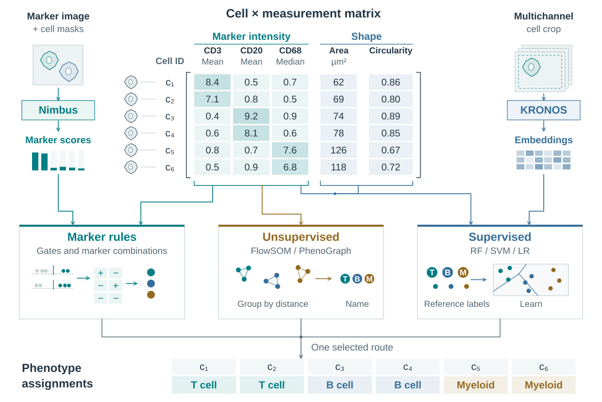

# Cell phenotyping

[Analysis stages](../../../README.md#analysis-stages)

Cell phenotyping assigns biological labels to segmented cells from their staining and, for some classifiers, their shape.

## Choose a phenotyping method

On **Run → Cell phenotyping → Open review**, choose how to identify phenotypes in the cells included in your analysis.

[**Marker rules**](marker-rules.md) suit phenotypes defined by known combinations of positive and negative markers. For each marker, set a threshold on the measured staining intensity or on the expression score estimated by Nimbus. Then specify the marker combination that determines each phenotype.

[**Supervised classification**](supervised.md) suits predefined phenotypes for which you can identify representative cells in tissue. For each phenotype, label reference cells in QuPath that capture the variation in staining within that class. Train the classifier on their measurements or image features to predict phenotypes for other cells.

[**Unsupervised phenotyping**](unsupervised.md) suits studies in which the cell populations are unknown or a known population may contain subgroups with distinct marker profiles. Use PhenoGraph or FlowSOM to group cells with similar marker measurements. Compare the groups’ marker profiles and staining in tissue before assigning phenotype names.

## How the methods use cell measurements and images

The cell ID links each row in the measurement table to the corresponding segmented outline in the marker images.

**Saved cell measurements.** Marker thresholds and unsupervised phenotyping use the mean or median marker intensity measured within the selected part of each cell, such as its nucleus or whole-cell outline. Supervised classifiers can also use other intensity statistics and measurements of cell or nuclear shape. If a measurement you want to use is missing, calculate it in [Cell measurements](../cell-measurements/index.md#choose-cell-measurements) before fitting.

**Features from cell images and outlines.** For marker rules, Nimbus uses the marker image and segmented outlines to estimate an expression score for each cell. You can threshold this score directly or [fit an intensity threshold to the reviewed Nimbus decisions](marker-rules.md#review-an-intensity-distillation). For supervised classification, KRONOS encodes staining within each reference cell’s outline across the selected channels. The classifier learns to predict phenotype labels from these feature embeddings.

*The first two cells have strong CD3 staining. Among the four cells with low CD3, the CD20 and CD68 measurements distinguish two further groups. The labels at the bottom identify the three staining patterns as T cells, B cells and myeloid cells in this example.*

---

**Next:** [Secondary structures](../secondary-structures/index.md).
