# Marker thresholds and phenotype rules

[Analysis stages](../../../README.md#analysis-stages)

[Select measurements](#select-markers-and-measurements) · [Choose the fitting scope](#choose-the-threshold-scope) · [Fit a marker](#define-the-marker-models) · [Review the gate](#review-the-marker-decision) · [Review Nimbus scores](#review-nimbus-scores) · [Write phenotype rules](#write-phenotype-combinations) · [Inspect assignments](#review-phenotype-assignments) · [Fitting calculations](#calculate-the-marker-proposal-and-counts)

On **Run → Cell phenotyping**, choose **Marker rules** to identify phenotypes from combinations of positive and negative stains. First decide which cells are positive for each marker, using either a measured staining intensity or a Nimbus image score. Then specify the marker states that define each phenotype. If a cell matches several definitions, their order determines its assignment.

<a href="../../assets/figures/marker-fitting.svg">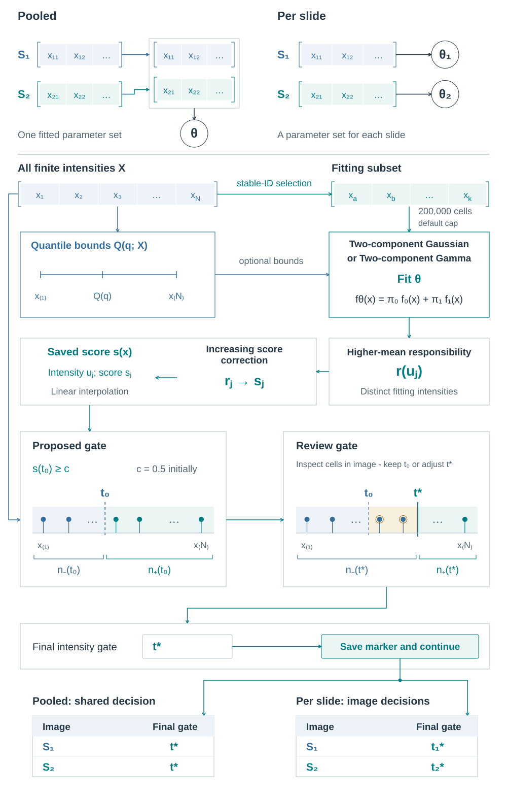</a>

_A Gaussian or Gamma mixture proposes a gate for all pooled slides or a separate gate for each slide. A large population can be sampled for fitting. During review, moving the gate from **t₀** to **t*** updates the positive and negative counts across all measured cells. The accepted calls for each marker then supply the phenotype rules._

## Select the cells to phenotype

By default, all segmented cells in the accepted analysis regions contribute to the marker distributions. To fit the gates for particular tissue compartments, enable **Restrict to selected regions** and choose the primary tissue classes. We fit and apply the gates to cells whose centres fall in those regions. Cells outside them remain **Not phenotyped**.

## Select markers and measurements

Select each marker you intend to use in a rule. Beside its name, choose a saved **Mean** or **Median** intensity. Check the cellular region in the measurement name. For example, a nuclear mean summarizes staining inside the nuclear outline, so it can give a different gate from a whole-cell mean for the same marker.

To add a missing measurement, use **Cell measurements → Change cell measurements…** and complete that calculation before returning to the marker gates. The [measurement guide](../cell-measurements/index.md#choose-cell-measurements) describes the available regions and statistics.

<a href="../../assets/screenshots/luca-marker-inputs-current.png">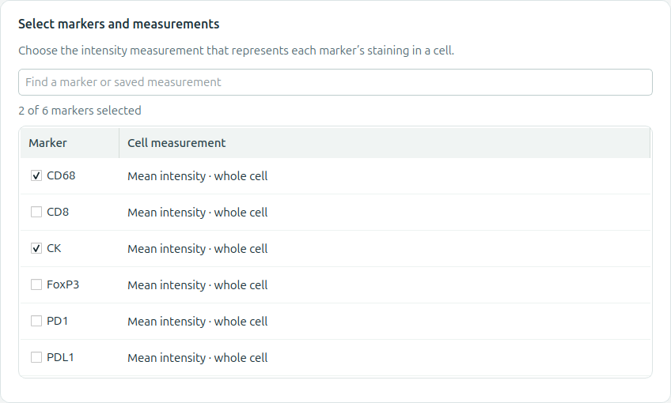</a>

_The LuCa example uses whole-cell mean intensity for both CD68 and CK._

Select **Next: fitting scope**. You can return to the marker list until you confirm the first gate. To change a confirmed gate, [revisit its marker](#change-a-saved-marker-decision).

## Choose the threshold scope

Choose the scope according to whether a given intensity represents comparable staining across the slides in a processing group.

**Pooled** fits one threshold per marker from all included cells in the processing group. Each cell contributes one measurement, so a slide with more cells contributes more observations to the fit.

**Per slide** fits and reviews each slide independently. This can accommodate differences in staining intensity between slides. Cell composition also matters. On a slide with little or no positive staining, a mixture can fit both components to variation within the negative cells.

<a href="../../assets/screenshots/luca-marker-scope-current.png">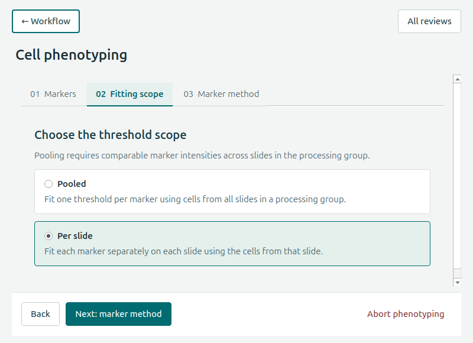</a>

Manual gates follow the same scope. For Nimbus, we use the same pretrained image model on all slides. The scope determines which cells are fitted together if you later derive an intensity threshold from their Nimbus scores.

## Define the marker models

For the current marker, the histogram shows how staining intensity varies across the selected cells. Each cell contributes its saved measurement to one intensity interval on the horizontal axis. The height of the bar gives the number of cells in that interval. For a per-slide fit, **Slide** switches between images when more than one is available.

Inspect the shape of the distribution before choosing a **Threshold method**. If many cells have low intensities, the tallest bars can make a small population of strongly stained cells difficult to see. Turn on **Log count scale** to inspect those sparsely populated intervals. This changes the height of the bars on screen. The fit still uses the measured intensities.

Select **Fit and review [marker]** to calculate a proposal using the chosen method. For large populations, the Gaussian and Gamma methods can [fit a subset of cells](#subset-used-for-mixture-fitting). The counts shown during review include every cell with a usable measurement.

<a href="../../assets/screenshots/luca-marker-method-current.png">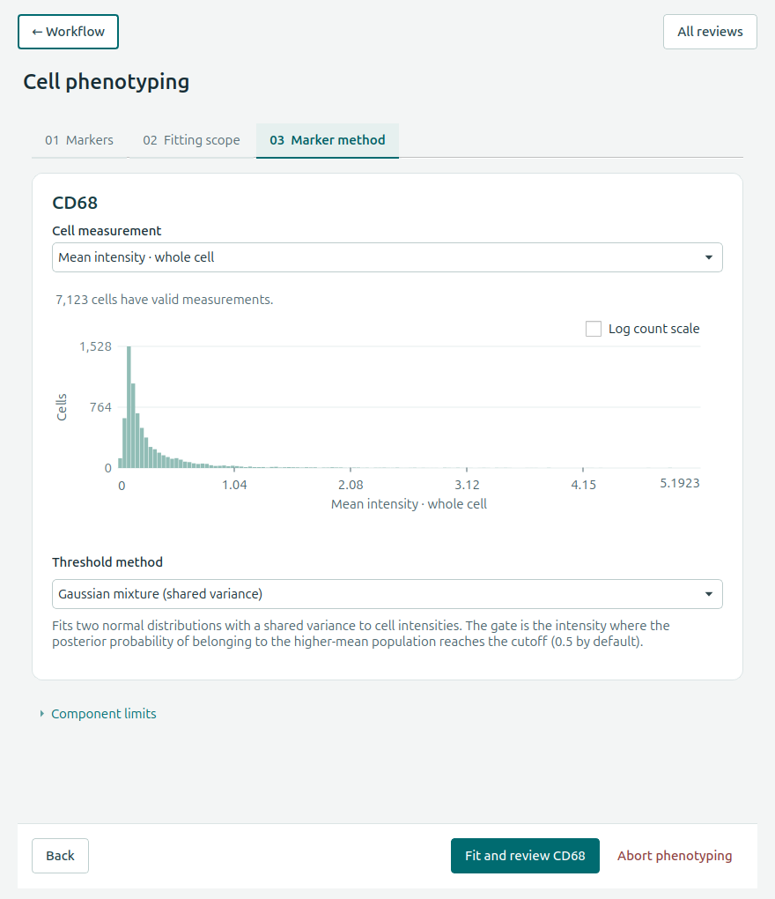</a>

_Most of the 7,123 LuCa cells have low whole-cell CD68 intensity. A smaller number extend into the bright tail. A two-component Gaussian mixture is selected to estimate a gate for this slide._

## Threshold methods

An intensity gate sets the minimum staining intensity for a cell to count as marker-positive. If you selected Nimbus, continue to [Review Nimbus scores](#review-nimbus-scores) to set a cutoff on the image-based scores.

### Manual gate

Choose **Manual** when a staining control or an established protocol can provide a threshold for the selected measurement. During review, enter the intensity or drag the gate to that position on the histogram.

<a href="../../assets/figures/marker-gate-manual.svg">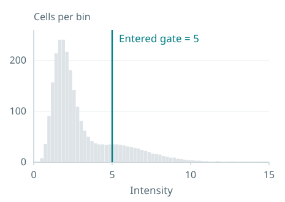</a>

_The vertical line sets the manual gate at 5. Cells along the bright tail to its right meet the threshold._

### Triangle gate

Choose **Triangle** when most cells form one prominent peak and brighter cells form a sparse tail. We draw a line from the tallest bin to the last occupied bin on the longer side of the peak. The bin farthest from this line gives the proposed gate. If both sides have occupied bins, the distance from the peak to the outermost occupied bin determines which side we use. The fit details show how the gate changes with one fewer or one additional bin. [Triangle calculation](#reference-marker-thresholds--iv-triangle-threshold)

<a href="../../assets/figures/marker-gate-triangle.svg">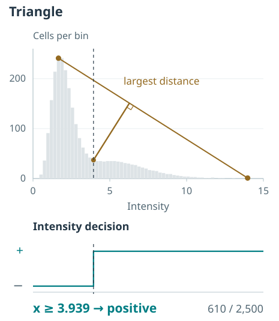</a>

_The bright tail extends to the right of the main peak. The farthest bin from the amber line gives a gate of 3.939._

### Gaussian mixtures

A Gaussian mixture describes weak and strong staining with two bell-shaped curves. We estimate each population’s mean intensity and its proportion of the cells. The combined histogram can show a single peak where the populations overlap.

Start with **shared variance** to fit both curves with the same width. Inspect the fitted components against the histogram. If the fit spreads one component across a visibly narrow peak or misses a broader shoulder, compare **separate variances**. Each component then has its own width. Inspect cells near the proposed gate in tissue to decide which fit better separates the staining of interest. [Gaussian fitting equations](#reference-marker-thresholds--v-two-component-gaussian-mixture)

<a href="../../assets/figures/marker-gaussian-variance.svg">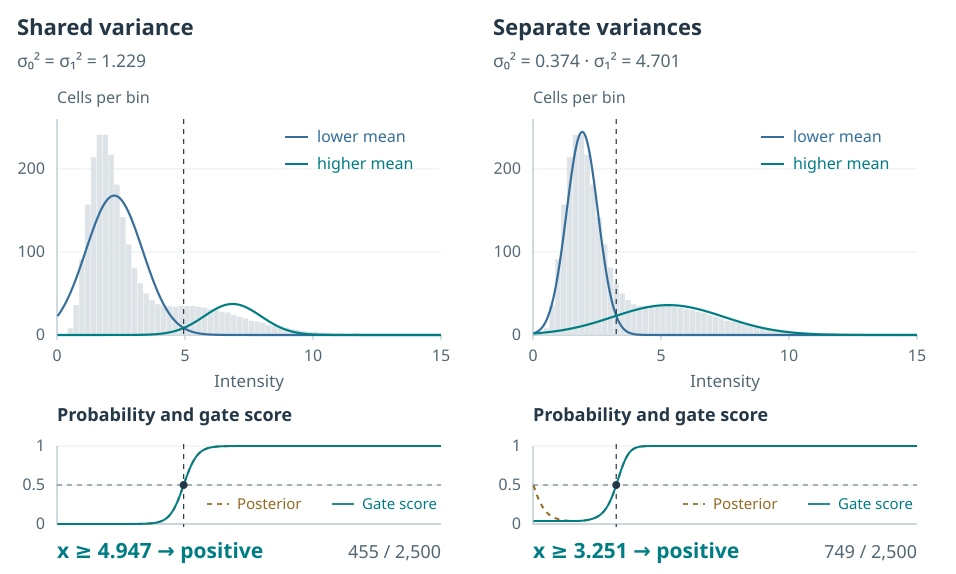</a>

_Shared variance gives a gate of 4.947, with 455 cells above it. Allowing the higher-mean population a wider spread moves the gate to 3.251 and includes 749 cells from the same distribution._

### Gamma mixture

Consider a Gamma mixture for nonnegative intensities when a staining population has a peak near the low end of its range and a tail towards brighter cells. Each component can describe that asymmetry. A few bright cells alone give little evidence about the shape of either population. Compare the fitted curves with the histogram and examine those cells in tissue.

We estimate a shape, rate and population proportion for each component from intensities greater than zero. The higher-mean component represents the positive population. Exact zeros receive a negative decision. [Gamma fitting equations](#reference-marker-thresholds--vi-two-component-gamma-mixture)

<a href="../../assets/figures/marker-gate-gamma.svg">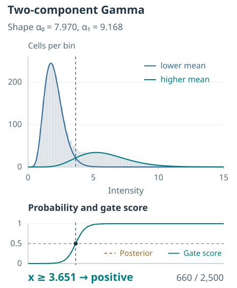</a>

_The fitted Gamma components overlap near the main peak. Their different shapes give a gate of 3.651 for these cells._

### Finding the threshold from the fitted curves

For both Gaussian and Gamma mixtures, we use the two fitted curves to estimate how likely a cell with intensity $x$ is to belong to the higher-mean population. Let $f_0(x)$ and $f_1(x)$ be the densities of the lower- and higher-mean components. Their contributions to the combined density depend on the fitted proportions of cells in the two populations, $\pi_0$ and $\pi_1$.

$$
f(x)=\pi_0 f_0(x)+\pi_1 f_1(x),\qquad \pi_0+\pi_1=1.
$$

The probability that a cell at this intensity belongs to the higher-mean population is its share of the combined density,

$$
r_1(x)=\frac{\pi_1 f_1(x)}{f(x)}.
$$

At $r_1(x)=0.5$, the two components contribute equally to the fitted density. We use 0.5 as the default score cutoff for choosing the intensity gate.

#### How the posterior varies with staining intensity

For a **shared-variance Gaussian mixture**, the two curves have the same shape and the higher-mean curve is shifted towards brighter intensities. The higher-mean component therefore contributes a progressively larger share of the fitted density as intensity rises. Because its posterior increases monotonically, it can reach 0.5 at most once within the observed range.

For **separate Gaussian variances** or a **Gamma mixture**, one component can have a broader tail than the other. When the **higher-mean component** contributes most of the fitted density at both the dim and bright ends, its posterior falls as the narrower lower-mean curve rises towards its peak, then rises again as that curve tapers off. When the **lower-mean component** has the broader bright tail, the higher-mean posterior can rise around its own peak and then fall among the brightest cells, where the lower-mean curve overtakes it.

If the posterior stays below 0.5 throughout an initial dip, the weighted curves can still cross just once, on the bright side. However, if the posterior falls from above 0.5 to below it and then rises above it again, the curves cross twice. Using the dimmer crossing as the gate would include cells between the two crossings, where the lower-mean component contributes more of the fitted density. We therefore calculate a **monotonic score** and take the first intensity at which it reaches the chosen cutoff as the gate.

<a href="../../assets/figures/marker-score-tails.svg">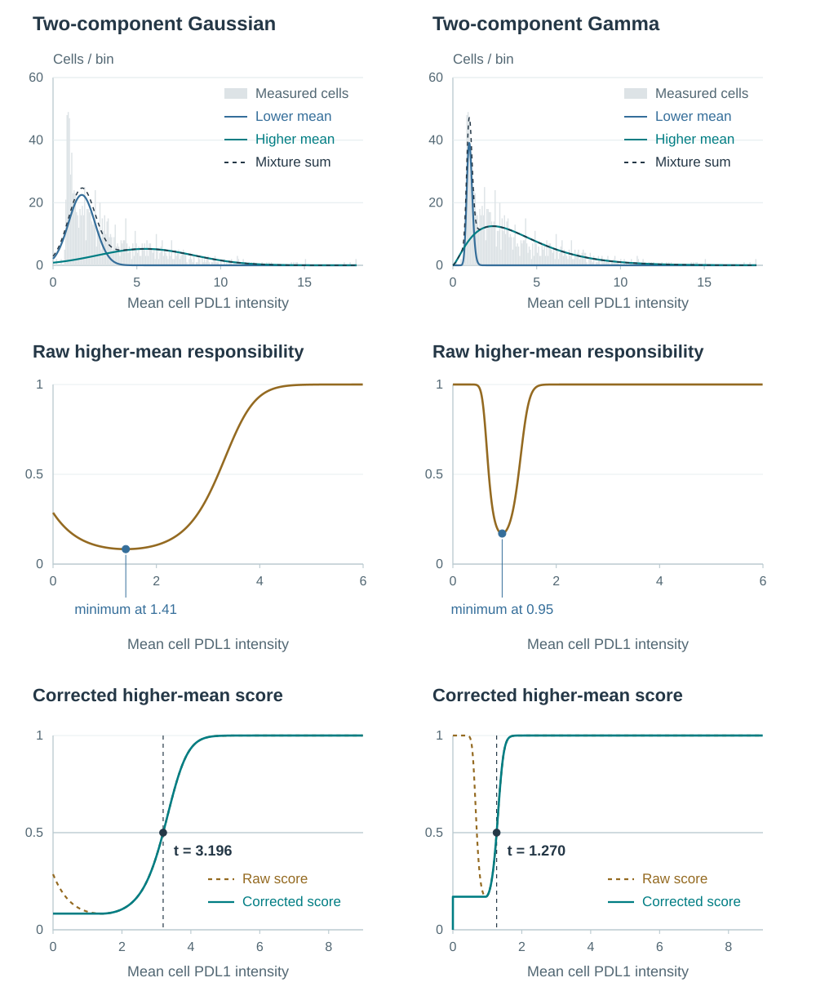</a>

_In the 1,173 LuCa cells, the Gaussian posterior stays below 0.5 throughout its initial dip. It reaches 0.5 at a PDL1 intensity of 3.196 (475 positive cells). The Gamma posterior crosses 0.5 on the way down near 0.695 and again on the way up at 1.270. Its increasing score reaches the cutoff at the second crossing (897 positive cells). [LuCa dataset](../../data/luca.md)_

#### Calculate the increasing score and interpolate the gate

We calculate the higher-mean component’s posterior at each distinct fitting intensity, from dimmest to brightest. Cells with the same intensity contribute individually to the fit and share one score. If the posterior rises or stays level throughout, it already gives us the marker score.

When the posterior falls over part of the range, we start the dimmest intensity at the **lowest posterior in the fitting sample**. Moving towards brighter intensities, we add each rise in posterior to the preceding score and keep that score wherever the posterior falls. An initial decline therefore gives the dimmest cells the same score as the cells at the bottom of the decline. For posterior values $r_j$ and marker scores $s_j$ at successive intensities, this gives

$$
s_1=\min_j r_j,\qquad
s_j=s_{j-1}+\max(r_j-r_{j-1},0),\quad j>1.
$$

At each successive intensity, the equation adds either a positive increment or zero. The resulting score is therefore monotonic, and we can use a single intensity gate to identify marker-positive cells.

We save each measured intensity $u_j$ with its score $s_j$. To find the intensity corresponding to the score cutoff (0.5 default), we interpolate linearly between the last point below the cutoff and the first point that reaches or exceeds it. The intensity where this line reaches the cutoff is the proposed gate. [Endpoint and exact-zero decisions](#derive-and-apply-the-intensity-decision)

<a href="../../assets/figures/increasing-score-correction.svg">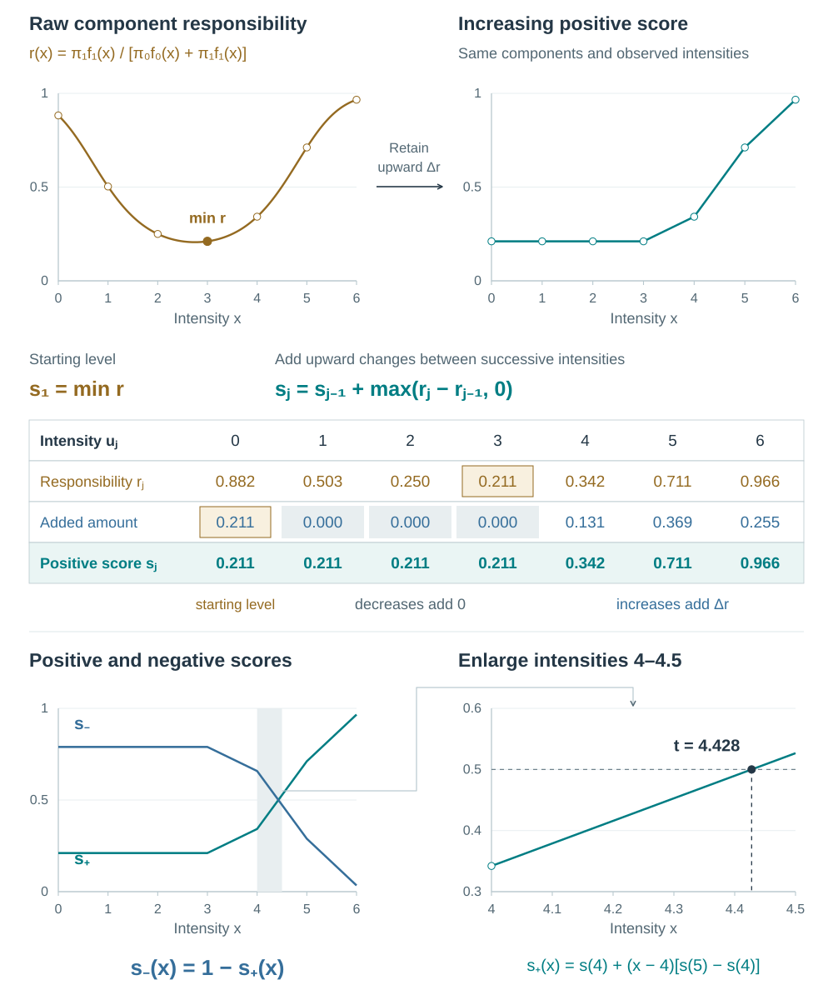</a>

_The table follows seven intensities through the calculation. Where the posterior falls, the score stays level. Between intensities 4 and 5 the score crosses 0.5. Interpolating between those observations places the gate at approximately 4.428._

## Limit the fitted component means or peaks

Use **Component limits** when staining controls provide an expected range for either fitted population. The two rows refer to the lower-mean and higher-mean components. For a Gaussian mixture the entries limit each component’s **mean**. For a Gamma mixture they limit its **peak**, the intensity where that curve reaches its maximum density.

Enter a minimum, a maximum or both for the component of interest. Leave unused fields empty. If you enter an intensity, the same limit applies to every slide. If you enter a percentile such as **Q95**, we calculate the 95th percentile from all usable intensities before sampling cells for the fit. A pooled fit uses the percentile across slides. A separate fit uses each slide’s own percentile. [How limits are calculated](#reference-marker-thresholds--ii-scope-and-optional-component-location-constraints)

<a href="../../assets/screenshots/marker-expected-intensity-ranges.png">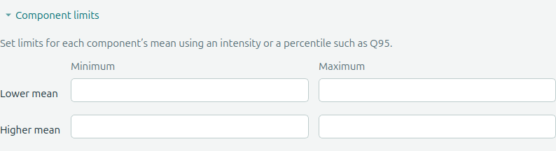</a>

_The CD68 fit has no limits on either Gaussian mean. If a fitted mean reaches a specified limit, compare the fitted curve with the staining controls used to set that limit._

## Review the marker decision

The vertical line marks the gate for this marker. The counts beneath the histogram show how many cells meet that threshold and how many fall below it. Inspect staining in cells near the line to decide whether to keep or adjust the gate.

<a href="../../assets/screenshots/luca-marker-gate-page.png">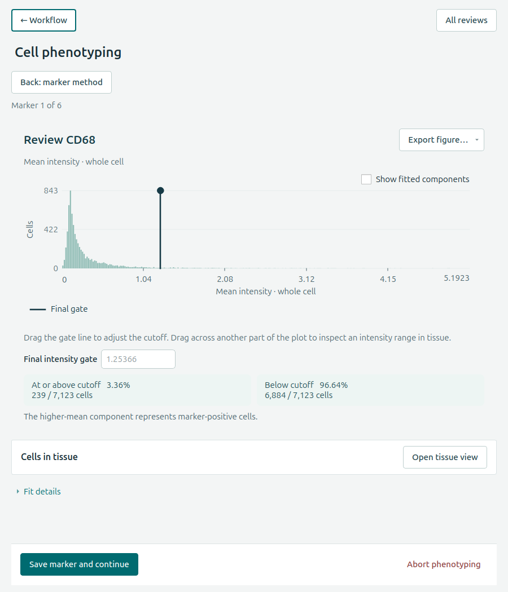</a>

_The Gaussian fit proposes a whole-cell CD68 intensity gate of 1.25366. Of the 7,123 cells on this slide, 239 reach that intensity._

### Compare the gate with staining

Select **Open tissue view** to locate cells at or above the gate. On the tissue overview, brighter amber marks areas with more selected cells. Hover over an area to read its counts, or select **Inspect dense area** to see the individual cell and nuclear outlines. Click an outline to read its intensity and marker decision.

To assess weak staining near the cutoff, drag across a narrow interval of the histogram on either side of the line. Compare staining inside the measured compartment with nearby background and adjacent cells. **Use current gate** returns the tissue selection to all cells at or above the cutoff.

For separate slide fits, the image navigator above the histogram changes the distribution, gate and tissue view together. For a pooled fit, the histogram describes the full processing group. Use the navigator in the tissue viewer to inspect individual slides against the shared gate.

<table>
<tr>
<td valign="top"><a href="../../assets/screenshots/luca-marker-gate-overview-current.png">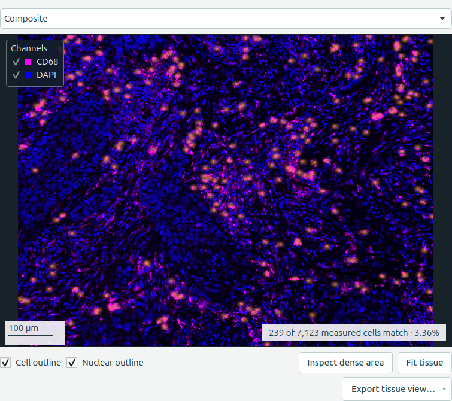</a></td>
<td valign="top"><a href="../../assets/screenshots/luca-marker-gate-detail-current.png">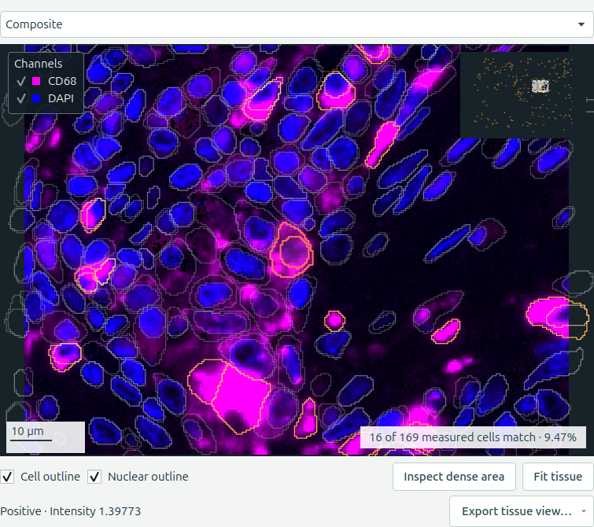</a></td>
</tr>
</table>

*The LuCa overview shows the 239 of 7,123 cells with a CD68 intensity at or above 1.25366. In the enlarged field, 16 of 169 cells meet that gate. The selected cell has a whole-cell mean intensity of 1.39773.*

### Inspect the fitted distribution

Select **Show fitted components** to compare the Gaussian or Gamma curves with the measured distribution. The histogram changes to density so the bars and curves share a vertical scale. Each component curve includes its fitted weight. A small component can therefore be hard to see even if its mean is well separated from the other. [Histogram and curve scaling](#reference-marker-thresholds--ix-review-the-calculated-proposals)

The fitted weight estimates the size of a population from the entire curve. The positive fraction counts the cells on the bright side of the reviewed gate, so the two can differ where the curves overlap. [How we find the gate from the fitted curves](#finding-the-threshold-from-the-fitted-curves)

<a href="../../assets/screenshots/luca-marker-gate-fit-current.png">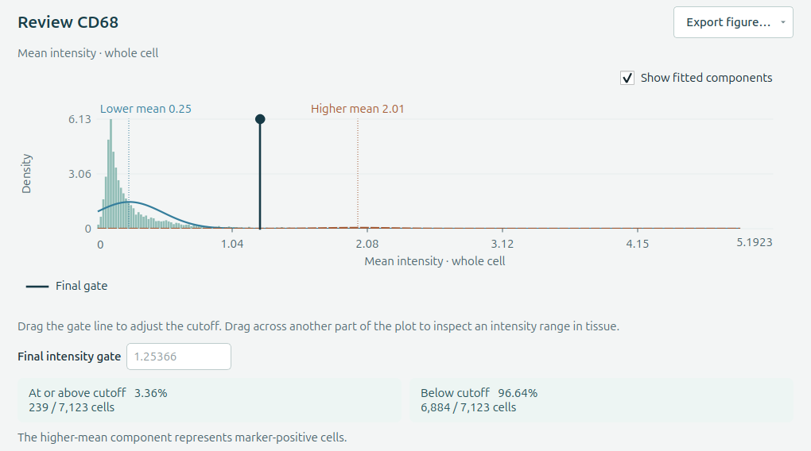</a>

*This Gaussian fit has component means 0.24844 and 2.00593, shared variance 0.06637 and weights 0.96605 and 0.03395. The small higher-mean weight places its curve near the horizontal axis. Compare the fitted curves with the observed bars and staining when reviewing the proposed gate.*

Open **Fit details** to inspect the fitted parameters, the bounds used for the fit and whether the fit converged. For Gamma components, the weights refer to cells with positive intensities. We calculate each component’s variance from its fitted shape and scale.

Use **Export figure…** to save the current view as SVG, PDF or 300 dpi PNG. **Histogram…** includes the current gate, including any adjustment made during review. **Fitted distribution…** also includes the component curves and a table of their means, variances and weights. [Example CD68 fit export](../../assets/figures/luca-CD68-gate-fit-current.svg)

### Change the gate or method

To adjust the gate, drag the vertical line or enter a **Final intensity gate** beneath the plot. The counts update at the new intensity. A dashed line marks the original proposal so it can be compared with the adjustment. **Reset to proposal** restores the original gate.

To change the measurement, method or bounds, select **Back: marker method**. Earlier saved markers are retained. Choose **Manual** there to define the boundary from controls or reference cells. The manual gate starts halfway between the first and last histogram edges. Enter the intended threshold or drag the line to set it.

<a href="../../assets/screenshots/luca-marker-gate-manual-current.png">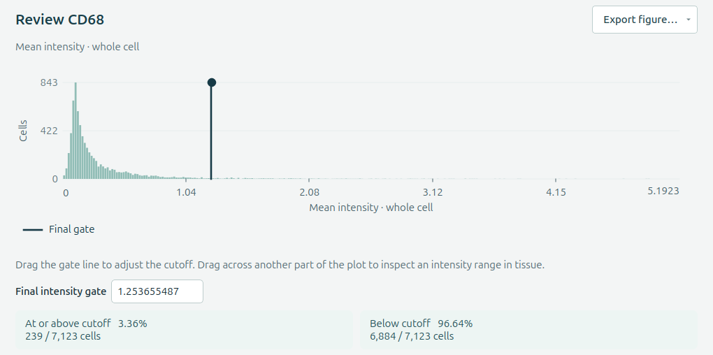</a>

*The manually entered CD68 gate of **1.25366** selects **239 of 7,123 cells** at or above the boundary.*

If a fit is unavailable, review its explanation in **Fit details** and return to the marker method to change its settings or choose a manual threshold supported by controls. Missing measurements remain unknown.

### Save the marker decision

For a per-slide fit, **Save image and continue** records the gate for the current image and opens the next image that needs review. Once all images for the marker have been reviewed, **Save marker and continue** advances to the next marker. A pooled fit has one decision for the processing group.

The saved result links the marker’s positive and negative calls to the input measurement, fitting method and accepted gate. Its gate figures are available under **Results & export → Completed stages**.

## Review Nimbus scores

Nimbus uses the staining around a segmented cell and its outline to score expression of the selected marker. The horizontal axis shows these scores from 0 to 1. The gate line marks the score required for a positive call and starts at **0.5**. Cells without a score have no positive or negative call for this marker.

To judge the cutoff, drag across a narrow range of scores near the line and select **Open tissue view**. Examine the marker signal inside those cells, including whether it lies in the expected compartment or comes from a bright neighbour. Compare cells just below and just above the line. Drag the line or edit **Nimbus score cutoff** if another boundary better separates the staining patterns. [How Nimbus calculates a cell’s score](nimbus.md#normalize-the-marker-image)

<a href="../../assets/screenshots/luca-nimbus-PDL1-review.png">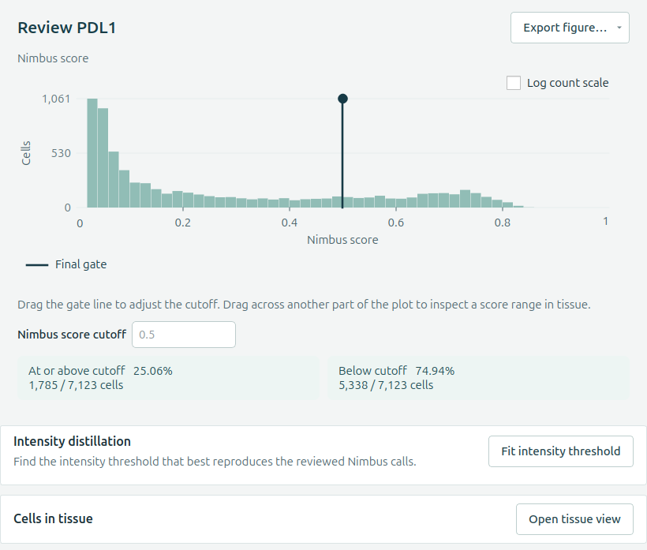</a>

_At the score cutoff of 0.5, Nimbus classifies 1,785 LuCa cells as PDL1-positive and 5,338 as negative. The intensity fit below uses these calls and the whole-cell mean PDL1 intensity from each of the same cells._

For a pooled review, **Save marker and continue** accepts the score cutoff for all participating images. For a per-slide review, use **Save image and continue** until you reach the last image. To assess whether the selected intensity measurement could reproduce these calls, choose **Fit intensity threshold** before finishing the marker. If this is the only cutoff, the comparison opens after fitting. If other images still need review, save their cutoffs and select **Generate intensity review** on the last one.

### Review an intensity distillation

Nimbus uses the pattern of staining around each cell, so two cells with the same mean intensity can receive different scores. To see how well intensity alone reproduces the reviewed Nimbus calls, we fit a threshold to the selected **Mean** or **Median** measurement. A pooled fit uses cells from all participating images whereas a per-slide fit finds a threshold for each image.

For each cell with a marker intensity $x_i$ and a Nimbus score $q_i$, we use the accepted score cutoff $c$ to define its reference call. We write this call as $b_i=1$ when $q_i\ge c$ (positive) and $b_i=0$ otherwise (negative). Replacing the Nimbus cutoff with an intensity threshold $t$ introduces two possible errors. We lose a positive call when a Nimbus-positive cell falls below $t$ (a false negative), and we gain a positive call when a Nimbus-negative cell falls at or above $t$ (a false positive). The total disagreement at $t$ is the sum of these two counts,

$$
D(t)=\sum_{i:\,x_i<t} b_i + \sum_{i:\,x_i\ge t}(1-b_i).
$$

To find the threshold that minimizes this disagreement, we sort the cells by intensity and count the Nimbus-positive and Nimbus-negative cells at each distinct value. We use cumulative sums of these counts to determine how many positive calls we would lose below each threshold and how many we would gain at or above it. For $J$ distinct intensities, this gives $D(t)$ for each of the $J+1$ possible splits, including the two that classify every cell alike (all positive or negative). We choose the split that minimizes $D(t)$, resolving a tie in favour of the higher threshold so that fewer cells receive a positive call.

The agreement table shows how often the fitted intensity threshold reproduces the accepted Nimbus calls. The **Nimbus positive** row shows how many of those cells remain positive and how many fall below the intensity threshold. The **Nimbus negative** row shows how many gain a positive call and how many remain negative. Each percentage is calculated within its Nimbus row. Inspect the staining of cells near the gate in tissue to judge whether to use the intensity threshold or keep the Nimbus calls.

<a href="../../assets/screenshots/luca-nimbus-intensity-comparison.png">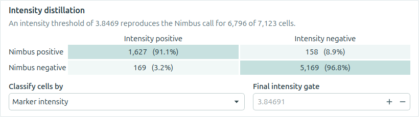</a>

_At the fitted intensity gate of 3.8469, 1,796 LuCa cells are PDL1-positive. The agreement table shows that 1,627 of these cells also met the Nimbus score cutoff._

Under **Classify cells by**, choose **Marker intensity** to use the intensity gate or **Nimbus scores** to use the reviewed score cutoff. To adjust the intensity gate, type a value, use the + and − controls to step between measured intensities, or drag the line on the histogram. The counts under the histogram follow the edited gate. The agreement table retains the comparison at the fitted gate. Select **Save marker and continue** to accept the decision, or **Save image and continue** if another slide needs review.

<a href="../../assets/figures/nimbus-distillation.svg">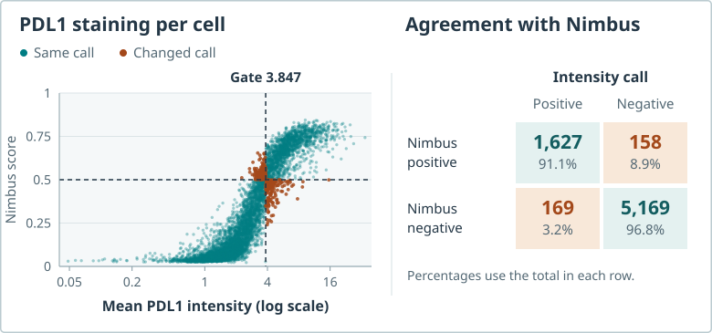</a>

_Each point pairs one LuCa cell’s mean PDL1 intensity with its Nimbus score. Replacing the score cutoff of 0.5 with the fitted intensity threshold of 3.847 changes the calls for 327 of 7,123 cells (4.59%). Of the orange cells, 158 lose their positive call and 169 gain one._

## Write phenotype combinations

After reviewing the markers, choose **Add phenotype** and name the cell population you want to identify. Use **Add condition** to specify which markers must be positive or negative for a cell to belong to that population. The cell must meet every condition you add. For example, a cell missing its CK measurement can qualify for **CD68+**, but it cannot qualify for **CD68+/CK−**. Select a condition to change its state or remove it.

Order matters wherever two definitions overlap. We start with the first rule and assign its phenotype to all matching cells. Each subsequent rule can assign only cells that are still unassigned. If you want to distinguish a subset of a larger population, put the subset first. In the example below, **CD68+/CK−** identifies a subset of the **CD68+** population. Putting **CD68+** first would assign every cell in that subset before the more specific rule was reached.

Drag a row or change its position number to set the order. Use **×** to remove a rule. Once we have applied the last rule, any included cells that still have no assignment receive **Unmatched cells**.

<a href="../../assets/screenshots/luca-marker-rules-current.png">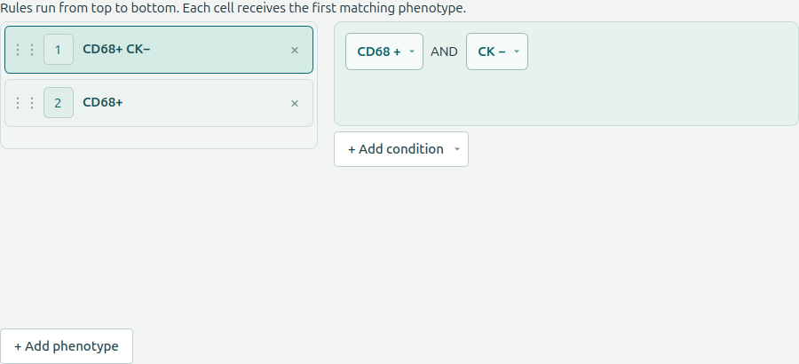</a>

_With this order, CD68-positive cells with a negative CK call receive the first phenotype. The second rule can take CD68-positive cells with a positive or unavailable CK call._

### Read the observed marker combinations

Select a rule and read **Matching cells** to check the effect of its position. The table includes every cell with the marker states the rule requires. Each row breaks out a distinct combination of states across the measured markers and gives its share of the matching cells. The teal edge identifies the combinations still available for this rule to assign.

Below the match count, the review reports how many included cells match none of the rules. Select **Unmatched cells** to inspect their marker patterns before deciding whether another phenotype is warranted.

<a href="../../assets/screenshots/luca-marker-combinations-observed.png">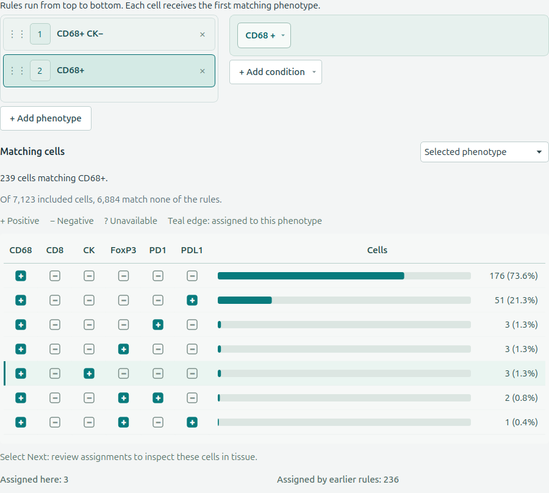</a>

_The selected CD68-positive rule matches 239 cells across seven marker combinations. The earlier CD68-positive/CK-negative rule assigns 236 of them. The teal edge identifies the remaining three cells, which are CK-positive and receive the broader phenotype. Percentages use all 239 matching cells._

Choose **All included cells** to compare pattern frequencies across the whole phenotyping population. The table orders combinations by cell count and displays up to 128 per page. Choose **Next: review assignments** to inspect the cells that actually received each phenotype.

<a href="../../assets/figures/marker-thresholding.svg">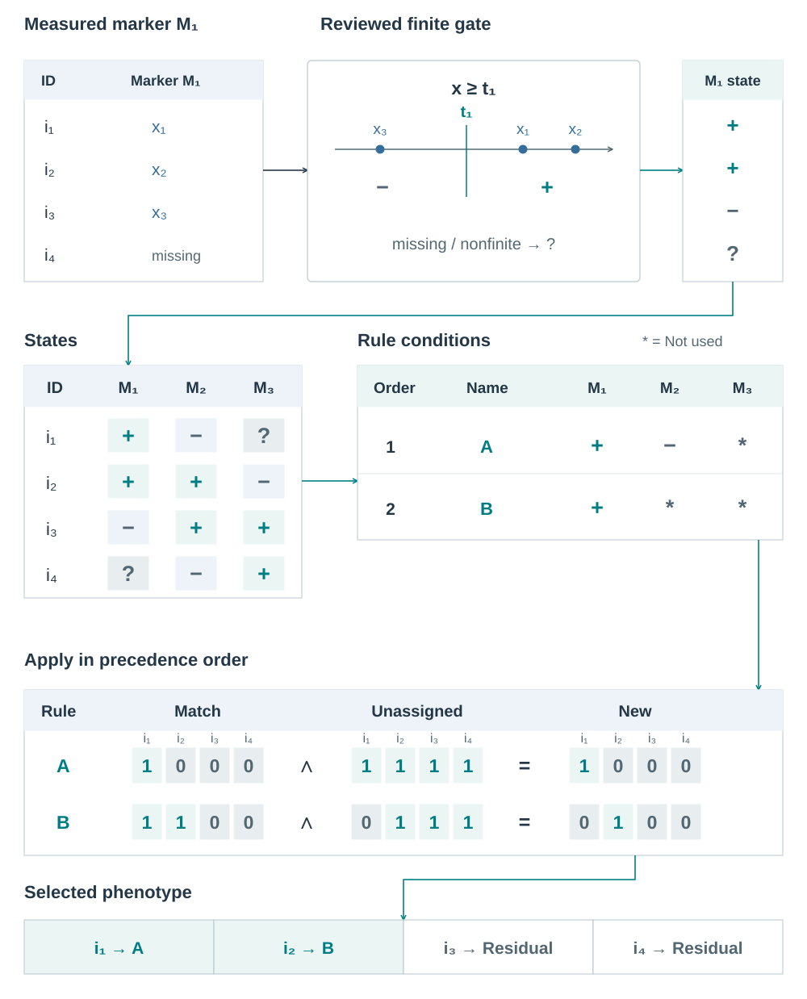</a>

_Rule A requires both markers to be positive. Rule B requires only the first marker. Two cells satisfy B, but one already belongs to A. B therefore assigns one cell. A missing marker decision prevents a match only for rules that require that marker._

## Review phenotype assignments

Select a phenotype to see which marker combinations occur among the cells assigned to it. The table now counts only cells that received the selected phenotype after applying the rules in order. **Unmatched cells** shows cells that met none of the rules. **All included cells** gives the distribution across the whole population.

Selecting a marker pattern in the table highlights cells with those exact states in the tissue viewer. Use **All patterns** to show every cell assigned to the phenotype.

<a href="../../assets/screenshots/luca-marker-assignments-overview.png">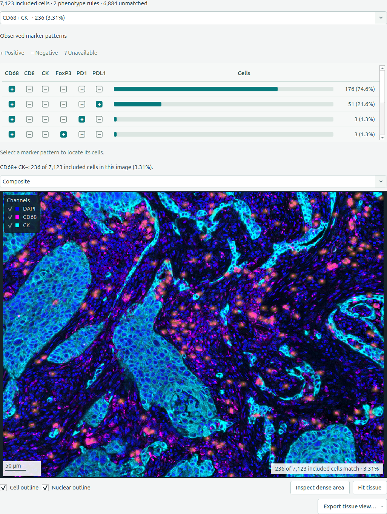</a>

_The first rule assigns **236 of 7,123 cells** to CD68+/CK−. The broader CD68+ rule receives the remaining **three** CD68-positive cells. The whole-image view displays CD68, CK and the nuclear channel; the pattern table describes the 236 cells assigned to the selected phenotype._

### Inspect assigned cells in tissue

At whole-image scale, the amber overlay shows where the selected cells occur most frequently. We count their centres in a grid across the tissue and smooth the grid counts with a Gaussian filter for display. Choose **Inspect dense area** to visit the field with the most selected cells. **Next dense area** visits the remaining fields in decreasing order of count.

You can also click a location, drag to pan or use Ctrl+scroll to zoom. At cell scale the viewer shows the cell and nuclear outlines. Select a cell to read its phenotype and marker states. **Fit tissue** returns to the whole image.

### Compare images and counts

For a multi-image analysis, the pattern plot initially includes **All images**. The tissue viewer opens one image at a time. Use the arrows or search by image name to visit another slide. Choose **Selected image** to calculate the pattern frequencies for the slide on screen, including slides with no matching cells.

The navigator reports the proportion of all included cells in each image that match the selection. When zoomed in, the count inside the viewer uses only cells whose centres fall in the displayed field. A locally concentrated phenotype can therefore account for a larger fraction of cells in the field than in the image as a whole.

<a href="../../assets/screenshots/luca-marker-assignments-detail.png">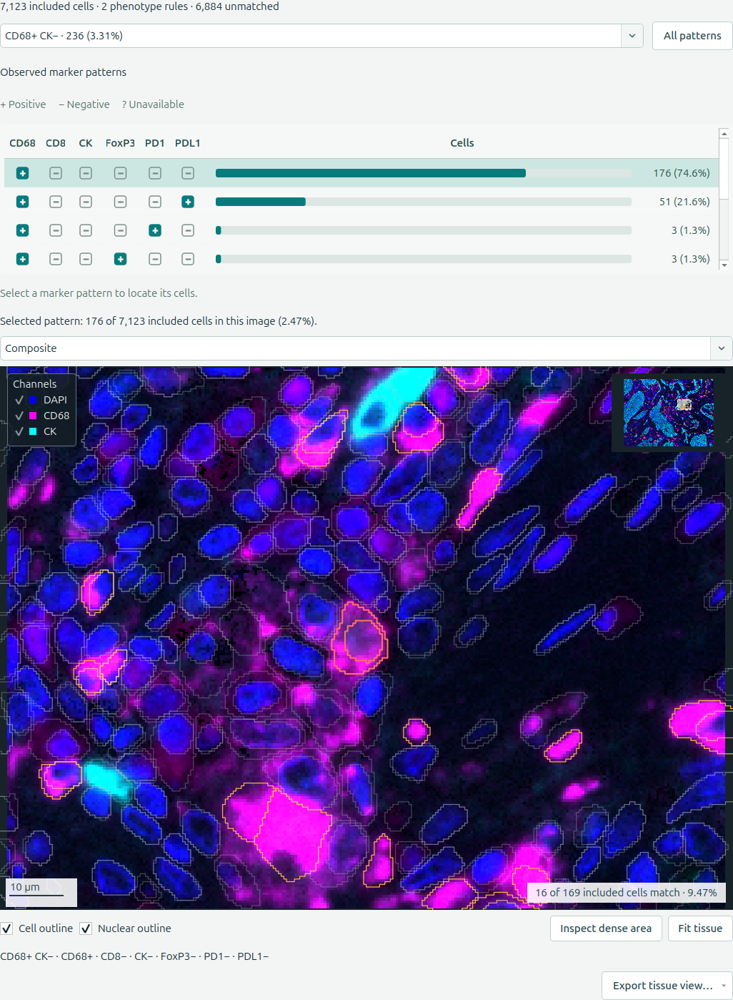</a>

_The selected pattern accounts for **176 of the 236 cells** assigned to this phenotype (74.6%), or **2.47% of all 7,123 included cells**. This visible field contains **16 selected cells among 169 included cells (9.47%)**. The highlighted outline reports its assigned phenotype and all six marker states below the image._

### Revise assignments

If a cell has an unexpected phenotype, select its outline and check the individual marker calls against the staining. Revisit a marker gate if the boundary is inconsistent with the staining. If the marker calls are appropriate, use **Back: phenotype rules** to change the definition or its position among overlapping rules.

**Export tissue view…** saves the displayed field as a figure. **Field data…** exports the image arrays and count grids as NPZ. At outline scale, the accompanying CSV identifies the visible cells, their coordinates, phenotypes and marker states.

The [complete review with navigation](../../assets/screenshots/luca-marker-assignments-full-review.png) shows the **Back: phenotype rules** and **Accept phenotype assignments** actions beneath the image.

## Save and apply

Select **Accept phenotype assignments** to save the result. Each included cell retains its ID, measured values and assigned phenotype. Cells outside the phenotyping regions remain **Not phenotyped**. To change a name, a definition or its priority after acceptance, reopen the phenotype-combination step. We can calculate the new assignments from the accepted marker gates.

In Results, [marker-combination figures](../results/figures.md#marker-combinations) report how often marker states occur together. [Phenotype rule assignments](../results/figures.md#phenotype-rule-assignments) reports how many cells each rule matched, how many it assigned and how many already belonged to an earlier phenotype.

### Change a saved marker decision

During an unfinished review, choose **Revisit a confirmed marker…** and select the marker to change. The preview lists the confirmations that will need repeating. **Revisit [marker]** reopens that marker’s method settings. Fit and confirm it and each subsequent marker again. The cell selection, slide scope and decisions for earlier markers are retained.

To replace a completed or stopped review, use **Run → Cell phenotyping → Change phenotyping choices…**. This restarts the marker sequence using the accepted cells and measurements. [Restarting a marker review](../run/index.md#restart-a-marker-review) explains the editable starting choices and dependent results.

## Calculate the marker proposal and counts

### Read the measurements and select cells for fitting

The histogram and reviewed counts use every included cell with a finite intensity for the marker. For large populations, fitting the Gaussian or Gamma mixture uses a subset of those cells. Percentile bounds for either component still use the full intensity distribution.

How cells are selected for mixture fitting

We collect the marker measurements from the slides in the selected fitting scope. The initial preview summarizes their range in up to 128 histogram bins. The saved fit uses 256 bins. A missing or nonfinite value leaves that cell without an intensity decision for this marker. If no finite values remain, an intensity threshold cannot be fitted.

The default mixture fit uses up to **200,000 cells**. When more are available, we divide the sample among the tissue sections and compartments represented. We first reserve one place per group if the limit permits. We allocate the remaining places in proportion to each group’s remaining cell count, rounding down and distributing the unused places in order of largest fractional remainder.

Within each group, we sort cells by ID and select approximately evenly spaced positions. The saved seed determines the starting offset. We record the selected cells with the fit so the sample can be reproduced.

### Apply the gate to all included cells and review it

We apply the proposed gate to every included cell with a usable measurement, including cells outside the fitting subset. If the score reaches its cutoff across the entire fitted range, all usable intensities qualify. If it never reaches the cutoff, none qualify. The fitted Gamma rule handles [exact zeros](#reference-marker-thresholds--gamma-exact-zero-handling) separately. Changing the gate during review recalculates the counts from the measured intensities.

Inspect cells near the boundary in the [tissue viewer](#review-the-marker-decision) before accepting the gate.

Fitting equations, increasing scores and saved results

### Fitting defaults

For each mixture, we try **six initial parameter sets** and retain the converged fit with the greatest likelihood. Trying several starts reduces dependence on one initial division of the intensities. Each fit stops when the relative change in likelihood meets the tolerance of **10⁻⁶** or reaches the limit of **100 updates**. The **seed is 0**, making the fitting subset and starts reproducible for the same recorded cells. The [Gaussian](#reference-marker-thresholds--v-two-component-gaussian-mixture) and [Gamma](#reference-marker-thresholds--vi-two-component-gamma-mixture) calculations give the exact updates and stopping rule. The defaults are recorded in [phenotyping.json](../../../src/python/mif_pipeline/config/defaults/phenotyping.json).

### Calculating component-location bounds

To convert a requested quantile `q` to an intensity, sort all usable values within the fitting scope as `x₀ ≤ … ≤ x_(N−1)`. For example, **Q05** uses `q=0.05`. The fractional position in this ordered list is `a=(N−1)q`. Its integer part `j=floor(a)` identifies the lower observation, and its remainder `h=a−j` determines how far to interpolate toward the next. The bound is `(1−h)x_j+h x_(j+1)`. At the last observation, use its value directly.

A missing bound leaves that endpoint unconstrained. The lower endpoint cannot exceed the upper endpoint, and Gaussian intervals must permit ordered means. Gamma mode bounds are nonnegative and apply independently to the components identified by their means. Their permitted mode intervals may appear in either order.

### Manual threshold

For `N` included cells with usable measurements, the fractions **at or above** and **below** a manual threshold are

$$
f_{\ge}(t)=\frac{1}{N}\sum_{i=1}^{N}\mathbf{1}(x_i\ge t),
\qquad f_{<}(t)=1-f_{\ge}(t).
$$

A cell without a finite measurement remains unclassified for that marker.

### Triangle threshold

The Triangle method locates a departure of the intensity histogram from a straight line joining its dominant peak to a tail endpoint. We calculate it as follows. [doi:10.1177/25.7.70454](https://doi.org/10.1177/25.7.70454)

1. Count the observations in each bin and locate the tallest bin. Measure the distance in bins from this peak to the outermost occupied bin on each side. Use the longer tail, choosing the right tail if the distances are equal.

2. Draw the line from the peak `(p,h_p)` to the tail endpoint `(q,h_q)`. For each bin `j` between them, calculate the following quantity from the bin position and height `h_j`.

$$
D_j=\left|(h_q-h_p)j-(q-p)h_j+qh_p-h_qp\right|.
$$

All bins are compared with the same line, so the factor that converts this expression to a distance is the same for every bin.

3. Find the bin with the largest value of `D_j`. If several bins tie, choose the first in ascending intensity order. The centre of that bin gives the proposed gate.

The histogram requires at least three occupied bins, differing occupied-bin counts and an intervening bin between the peak and selected endpoint. Without these, there is no peak-to-tail geometry from which this procedure can estimate a threshold, so the candidate is unavailable.

To check how strongly the choice of bins affects the result, we repeat the calculation with one fewer bin and one additional bin. The review reports the change in threshold for each alternative.

### Two-component Gaussian mixture

We model the distribution of cell intensities as the weighted sum of two normal densities.

$$
f(x)=\pi_0\phi(x;\mu_0,v_0)+\pi_1\phi(x;\mu_1,v_1),
\qquad\pi_0+\pi_1=1.
$$

Here `φ` is a normal density and `π_k` is the proportion assigned to component `k`. We order the means as `μ₀ ≤ μ₁`. Under **Shared variance**, both curves have the same variance `v`. Under **Separate variances**, we estimate `v₀` and `v₁` individually.

#### Responsibilities and parameter updates

We fit the Gaussian mixture by alternating responsibility calculations with parameter updates. Each responsibility weights an observation's contribution to the next estimate, allowing overlapping components to share observations. Let `m` be the number of finite intensities in the fitting sample, including repeated values. For each observation `x_i`, we evaluate

$$
r_{ik}=\frac{\pi_k\phi(x_i;\mu_k,v_k)}{\sum_{l=0}^{1}\pi_l\phi(x_i;\mu_l,v_l)},
\qquad N_k=\sum_{i=1}^{m}r_{ik}.
$$

Summing the responsibilities over the fitting cells gives `N_k`, the effective cell count for component `k`. Its estimated proportion is therefore `N_k/m`. We calculate responsibilities from weighted log densities so that very small density values can still be compared accurately.

For unconstrained means and separate variances, we update the parameters as

$$
\bar x_k=\frac{\sum_i r_{ik}x_i}{N_k},\qquad
\mu_k=\bar x_k,\qquad
v_k=\frac{\sum_i r_{ik}(x_i-\mu_k)^2}{N_k}.
$$

For shared variance, the corresponding update is

$$
v=\frac{1}{m}\sum_{k=0}^{1}\sum_{i=1}^{m}r_{ik}(x_i-\mu_k)^2.
$$

When means have location bounds, the conditional mean update minimizes

$$
\sum_{k=0}^{1}\frac{N_k}{v_k}(\mu_k-\bar x_k)^2
$$

subject to their bounds and `μ₀≤μ₁`. We first clamp each weighted mean to its interval. If the clamped means violate the order, we pool them using weights `N_k/v_k` and clamp that common mean to the shared feasible interval. Variances are then updated around the constrained means. We alternate these parameter updates with recalculation of the responsibilities until the likelihood meets the stopping condition below.

Before fitting, we centre the selected intensities on their median and divide by the largest absolute deviation from it. We convert the fitted parameters and score coordinates back to the original intensity units for review. To keep either fitted curve from collapsing to zero width, we impose a minimum variance equal to `10⁻⁸ × (maximum absolute deviation)²` in the original units.

We start six fits from different intensity splits. The first split is at the median. The other five use quantiles sampled uniformly from `[0.05,0.95)` using the recorded random seed. Each fit allows up to 100 updates and stops when the change in log likelihood satisfies `|ℓ_new−ℓ_old| ≤ 10⁻⁶(1+|ℓ_old|)` on the scaled intensities. We keep the converged fit with the highest observed log likelihood and report that likelihood in the original units, accounting for the change of scale.

A usable Gaussian fit requires finite parameters, distinct means and a positive total responsibility for each component. If these checks or the convergence check fail, review the reason before choosing a different method.

#### Raw component responsibility and the selected score

The higher-mean raw responsibility is

$$
r_1(x)=\frac{\pi_1\phi(x;\mu_1,v_1)}{\pi_0\phi(x;\mu_0,v_0)+\pi_1\phi(x;\mu_1,v_1)}.
$$

With shared variance, the derivative of the log odds is `(μ₁−μ₀)/v`. The ordered, distinct means make this positive, so the higher-mean responsibility increases with intensity. With separate variances the log odds include a quadratic term and responsibility can decrease in one tail. The [score correction](#increasing-score-correction) retains the increasing part of that relationship.

For interpretation of the raw fitted curve, the equation `r₁(t)=0.5` is equality of the weighted densities. Its quadratic form is `at²+bt+c=0`, where

$$
\begin{aligned}
a&=\frac1{2v_1}-\frac1{2v_0},\\
b&=\frac{\mu_0}{v_0}-\frac{\mu_1}{v_1},\\
c&=\frac{\mu_1^2}{2v_1}-\frac{\mu_0^2}{2v_0}
+\log\frac{\pi_0}{\sqrt{v_0}}-\log\frac{\pi_1}{\sqrt{v_1}}.
\end{aligned}
$$

With common variance `v` and distinct means, this reduces to

$$
t=\frac{\mu_0+\mu_1}{2}+\frac{v}{\mu_1-\mu_0}\log\frac{\pi_0}{\pi_1}.
$$

With unequal variances, the two weighted densities can cross twice. The [increasing-score calculation](#calculate-the-increasing-score-and-interpolate-the-gate) converts their relative contributions across the observed intensities into a single positive interval.

### Two-component Gamma mixture

We fit a two-component Gamma mixture conditional on strictly positive intensities:

$$
f(x\mid x>0)=q_0g(x;\alpha_0,\beta_0)+q_1g(x;\alpha_1,\beta_1),
\qquad q_0+q_1=1,
$$

where `α>0` is shape, `β>0` is rate, and

$$
g(x;\alpha,\beta)=\frac{\beta^\alpha}{\Gamma(\alpha)}x^{\alpha-1}e^{-\beta x},
\qquad x>0.
$$

The scale parameter is `θ=1/β`. The component mean, variance and mode are

$$
\mathrm{mean}=\frac{\alpha}{\beta},\qquad
\mathrm{variance}=\frac{\alpha}{\beta^2},\qquad
\mathrm{mode}=\frac{\max(\alpha-1,0)}{\beta}.
$$

We order the Gamma components by their means, requiring `α₀/β₀ ≤ α₁/β₁` during fitting. Each component has its own shape and rate. The optional bounds constrain where the curves peak. The component with the higher mean can peak at a lower intensity if its right tail extends farther. Both curves can peak at zero when both shapes are at most one.

For example, Gamma `(shape, rate)=(6, 2)` has mean 3 and mode 2.5, while `(2, 0.5)` has mean 4 and mode 2. We retain the mean ordering and use the higher-mean component for the positive score.

#### Exact zeros and the fitted population

We fit the Gamma density to strictly positive measured intensities on their recorded scale. For this method, we define an intensity of zero as marker-negative, with score `s(0)=0`. A negative measured value makes the Gamma fit unavailable, with the reason recorded alongside the result.

Suppose `m₀` of the `m` sampled intensities equal zero. Their observed fraction is `p₀=m₀/m`. We fit the two Gamma curves to the positive measurements. If a component accounts for fraction `q_k` of those positive measurements, it accounts for fraction `(1−p₀)q_k` of the full fitting sample.

The full measurement model therefore assigns probability `p₀` to zero and density `(1−p₀)Σqₖgₖ(x)` to positive values. The common factor cancels from the relative contributions of the curves at a positive intensity. The review histogram includes the zeros, so we scale the fitted curves by the positive fraction in that histogram.

#### Weighted likelihood updates

As in the Gaussian fit, the expectation step assigns each strictly positive observation a fractional responsibility `r_ik` for each component. For one component, the total responsibility `R` supplies the denominator for its weighted intensity and log-intensity means:

$$
R=\sum_i r_i,\qquad
\bar x=\frac{\sum_i r_i x_i}{R},\qquad
\overline{\log x}=\frac{\sum_i r_i\log x_i}{R}.
$$

These two means determine the next shape and rate estimates. For an unconstrained component, the weighted maximum-likelihood update solves

$$
\log\alpha-\psi(\alpha)=\log\bar x-\overline{\log x},
\qquad \beta=\frac{\alpha}{\bar x},
$$

where `ψ` is the derivative of the logarithm of the Gamma function. The conditional mixture proportion is updated as `q_k=R_k/m₊`, where `m₊` is the number of strictly positive fitted observations.

If an update violates a bound on a component peak or reverses the order of the means, we refit the parameters subject to those constraints. We use sequential least-squares programming (SLSQP) to maximize the weighted log likelihood, providing its analytic gradient for the four parameters `(α₀,β₀,α₁,β₁)`.

A positive lower bound `L` on the mode requires `α−1−βL ≥ 0`. An upper bound `U` requires `1+βU−α ≥ 0`. We enforce both components’ bounds together with the mean-ordering condition `α₀/β₀ ≤ α₁/β₁`, then recalculate the responsibilities using the updated curves.

We divide the positive fitting intensities by their median and convert the returned rates, scales and score coordinates back to the original units. As in the Gaussian fit, we try the median split and five seeded random quantiles. If an initial split is incompatible with the bounds or the order of the means, we adjust its starting parameters on a log scale until they satisfy the constraints. Of the converged fits, we retain the one with the largest log likelihood across the positive observations,

$$
\ell_+=\sum_{i:x_i>0}\log\left[\sum_{k=0}^{1}q_kg(x_i;\alpha_k,\beta_k)\right].
$$

Each starting fit allows 100 updates and uses the same relative likelihood tolerance as the Gaussian fit. Within an update, the constrained optimizer allows 200 iterations with objective tolerance `10⁻¹⁰`. If `log(x̄)−mean(log x) ≤ 10⁻¹²`, the observations assigned to a component have too little variation to estimate its width reliably. A usable fit requires convergence, finite parameters, positive total responsibility for both components, distinct means and compatible bounds.

The result records the fitted means, variances and weights. It also records the Bayesian information criterion (BIC), which combines the log likelihood with a penalty for the number of fitted parameters.

#### Component scores and saved model details

For positive intensity `x`, the higher-mean raw responsibility is

$$
r_1(x)=\frac{q_1g(x;\alpha_1,\beta_1)}{q_0g(x;\alpha_0,\beta_0)+q_1g(x;\alpha_1,\beta_1)}.
$$

We apply the [increasing score correction](#increasing-score-correction) to the higher-mean responsibilities. Its resulting increasing score and the accepted cutoff determine the proposed intensity decision.

For interpreting the raw density curves, `r₁(t)=0.5` has the form

$$
A\log t+Bt+C=0,
$$

where $A\log t+Bt+C$ is the log ratio of the weighted densities. Its slope at positive intensity $t$ is $A/t+B$. If the slope changes sign within the observed range, the posterior also changes direction. The coefficients are

$$
\begin{aligned}
A&=\alpha_1-\alpha_0,\\
B&=\beta_0-\beta_1,\\
C&=\log(q_1/q_0)-\log\Gamma(\alpha_1)+\log\Gamma(\alpha_0)
+\alpha_1\log\beta_1-\alpha_0\log\beta_0.
\end{aligned}
$$

For nonzero `A` and `B`, its real solutions can be expressed through the Lambert W function,

$$
t=\frac AB W\left(\frac BA e^{-C/A}\right),
$$

with logarithmic or linear special cases when a coefficient is zero. These solutions locate intensities at which the two components contribute equally to the fitted density. The [increasing-score calculation](#increasing-score-correction) uses those relative contributions across the measured range to propose the gate.

### Increasing-score calculation

The [visible derivation](#calculate-the-increasing-score-and-interpolate-the-gate) gives one corrected score for each distinct fitting intensity. We save these intensity–score pairs as interpolation points, called knots. Gaussian fitting uses every finite value in the fitting sample. The Gamma knots use only positive values, with a separate rule at zero.

For the raw responsibility `r`, the derivative of the log odds `log(r/(1−r))` is linear in intensity for Gaussian components and has the form `A/x+B` for Gamma components. In either case the responsibility can turn at most once. Starting at its minimum and accumulating its upward changes therefore gives a score between zero and one in exact arithmetic.

In float64 arithmetic, we allow a rounding error of eight units of machine epsilon on input and eight per knot after accumulation. Machine epsilon is the gap from one to the next representable number. We clip scores that fall just outside the interval within this allowance. A larger discrepancy makes the fit unavailable.

#### Scores between observed intensities

We interpolate between adjacent knots:

$$
s(x)=s_j+\frac{x-u_j}{u_{j+1}-u_j}(s_{j+1}-s_j),
\qquad u_j\le x\le u_{j+1}.
$$

For values outside the fitted range, we use the nearest endpoint score. Within the range, interpolation also supplies scores for intensities observed in other cells but absent from the fitting sample.

#### Two-component Gamma: exact-zero handling

Gaussian treats zero as an ordinary finite intensity. Gamma assigns the separately defined score `s(0)=0` and stores only positive knots. Every `0<x<u₁` receives the first positive knot's score. This allows the score to jump between exact zero and a small positive intensity.

If the first positive knot reaches the score cutoff, the gate includes every positive intensity and excludes zero. We display this as **Intensity > 0** and store the boundary as the smallest positive float64 value, `nextafter(0,+∞)`, so it can use the usual inclusive comparison.

A sample containing only zeros has no positive intensities from which to fit the Gamma curves. Negative values prevent fitting. When applying an accepted Gamma fit, negative and nonfinite measurements receive an unknown call for that marker. Gaussian also treats nonfinite measurements as unknown.

#### Derive and apply the intensity decision

The score cutoff `c` starts at 0.5 and must lie strictly between zero and one. We seek the lowest intensity `t` for which `s(t)≥c`. This expresses the decision in the units of the selected measurement, so it can be applied directly to other cells.

We find the first adjacent saved intensities `u_j` and `u_(j+1)` whose scores satisfy `s_j<c≤s_(j+1)`. The straight line between these scores reaches the cutoff at

$$
h=\frac{c-s_j}{s_{j+1}-s_j},\qquad
t=(1-h)u_j+h u_{j+1}.
$$

For example, if the scores at intensities 100 and 200 are 0.4 and 0.6, the line reaches 0.5 halfway between them, at intensity 150.

To make the intensity comparison agree with the saved score even at the boundary, we check the crossing in the 64-bit floating-point format used to store the measurements. Rounding can make the algebraic crossing differ slightly from the first intensity whose calculated score reaches the cutoff. We therefore evaluate the score at the proposed threshold and at the immediately preceding representable intensity, `t₋`, and accept the threshold when

$$
s(t_-)<c\le s(t).
$$

This confirms that `t` is the first representable intensity reaching the cutoff; `t₋` can lie between observed cell intensities. If either check fails, we locate that boundary by binary search over representable values between the two saved intensities. This requires at most 64 further score evaluations, once per fitted curve and cutoff.

A score that always reaches the cutoff gives an all-positive decision. A score that never reaches it gives an all-negative decision. Gamma retains its separate exact-zero rule.

For an ordinary finite gate, we compare each usable intensity with the saved threshold using `x≥t`. A constant decision assigns the same call to every usable value. Invalid values remain unknown. A manual adjustment replaces the applied threshold and retains a record of the original proposal. We evaluate the interpolated curve separately when an individual score is requested.

### Nimbus calculations

See the Nimbus guide for [image normalization and scoring](nimbus.md#normalization-and-inference-geometry) and the [saved score file](nimbus.md#saved-score-file). The [intensity comparison](#review-an-intensity-distillation) uses the reviewed score calls.

### Review the calculated proposals

The [fitted-component display](#inspect-the-fitted-distribution) and **Fitted distribution…** export put the histogram and component curves in density units. For bin `b`, with count `n_b`, width `Δx_b` and total histogram count `N`, the displayed height is

$$
 h_b=\frac{n_b}{N\,\Delta x_b}.
$$

Each Gaussian component curve is its fitted density multiplied by its mixture weight. Gamma components are fitted to strictly positive measurements, so their displayed curves are also multiplied by `(N − N₀)/N`, the fraction of measured cells with intensity greater than zero. Here `N₀` counts exact-zero observations, which remain in the histogram. The fitted-distribution export includes the component means, variances and weights alongside the curves.

### Combine marker states into cell phenotypes

For each rule `j`, record two yes/no values per cell. The first, `M_j`, indicates whether the cell satisfies every condition in the rule. The second, `U_j`, indicates whether it is still unassigned when the rule is reached.

The rule assigns a cell only when both values are true, giving `A_j = M_j AND U_j`. We remove these cells from the unassigned set before evaluating the next rule, so `U_(j+1) = U_j AND NOT A_j`. **Total matches** counts all true entries in `M_j`. **Newly assigned** counts the true entries in `A_j`. Their difference gives the overlap with earlier rules.

For example, suppose 30 cells are CD3-positive and 12 of those are also CD8-positive. Applying the CD3+/CD8+ rule first assigns 12 cells. The broader CD3+ rule then matches 30 cells and assigns the remaining 18. Reversing the order gives all 30 cells to the broader rule. The narrower rule still matches 12 cells but assigns none.

After the final rule, cells still in the unassigned set receive **Unmatched cells**. Editing the rule order repeats this calculation on the same cells and accepted marker decisions.

Implementation and scientific sources

## Sources and implementation

[1] Zack GW, Rogers WE, Latt SA. Automatic measurement of sister chromatid exchange frequency. *Journal of Histochemistry & Cytochemistry*. 1977;25:741–753. [doi:10.1177/25.7.70454](https://doi.org/10.1177/25.7.70454).

[2] Xiong J, McKinley E, Roland JT, et al. Faster estimation for constrained gamma mixture models using closed-form estimators. [arXiv:2110.13074](https://arxiv.org/abs/2110.13074).

[3] Rumberger JL, Greenwald NF, Ranek JS, et al. Automated classification of cellular expression in multiplexed imaging data with Nimbus. *Nature Methods*. 2025;22:2161–2170. [doi:10.1038/s41592-025-02826-9](https://doi.org/10.1038/s41592-025-02826-9). [Official inference implementation](https://github.com/angelolab/Nimbus-Inference).

The [mixture implementation](../../../src/python/mif_pipeline/cell_analysis/marker_models.py) fits the Gaussian and Gamma components and calculates their increasing scores. The [threshold calculations](../../../src/python/mif_pipeline/cell_analysis/thresholds.py) select the fitting cells and apply the gates. The [plotting functions](../../../src/python/mif_pipeline/cell_analysis/threshold_plots.py) generate the review figures.

[Nimbus score matching](../../../src/python/mif_pipeline/cell_analysis/nimbus.py) links scores to measured cells. The [rule implementation](../../../src/python/mif_pipeline/cell_analysis/marker_rules.py) assigns phenotypes from the reviewed marker decisions. The [phenotyping defaults](../../../src/python/mif_pipeline/config/defaults/phenotyping.json) specify the initial histogram, sampling and fitting settings.

The [marker review](../../../src/python/mif_pipeline/gui/qt/marker_gates.py) and [form navigation](../../../src/python/mif_pipeline/gui/qt/forms.py) implement the desktop controls.

---

**Continue:** [Secondary structures](../secondary-structures/index.md).
