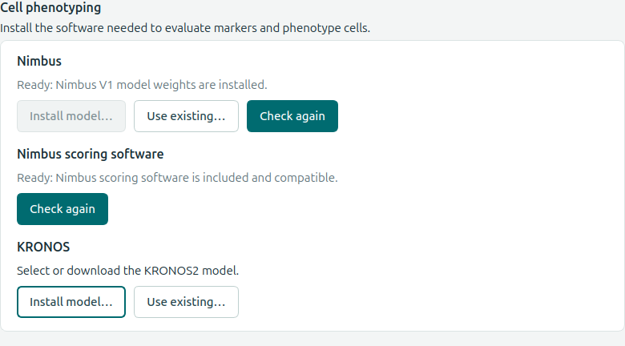
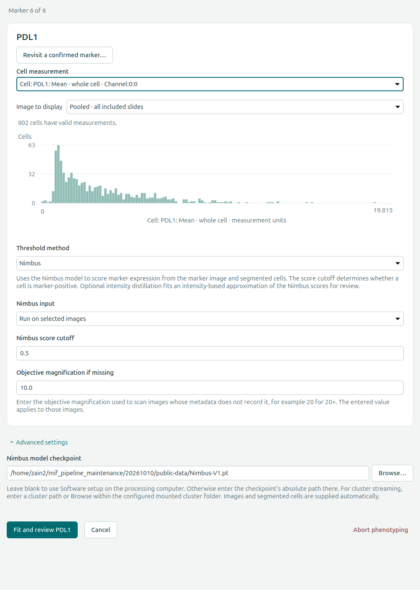
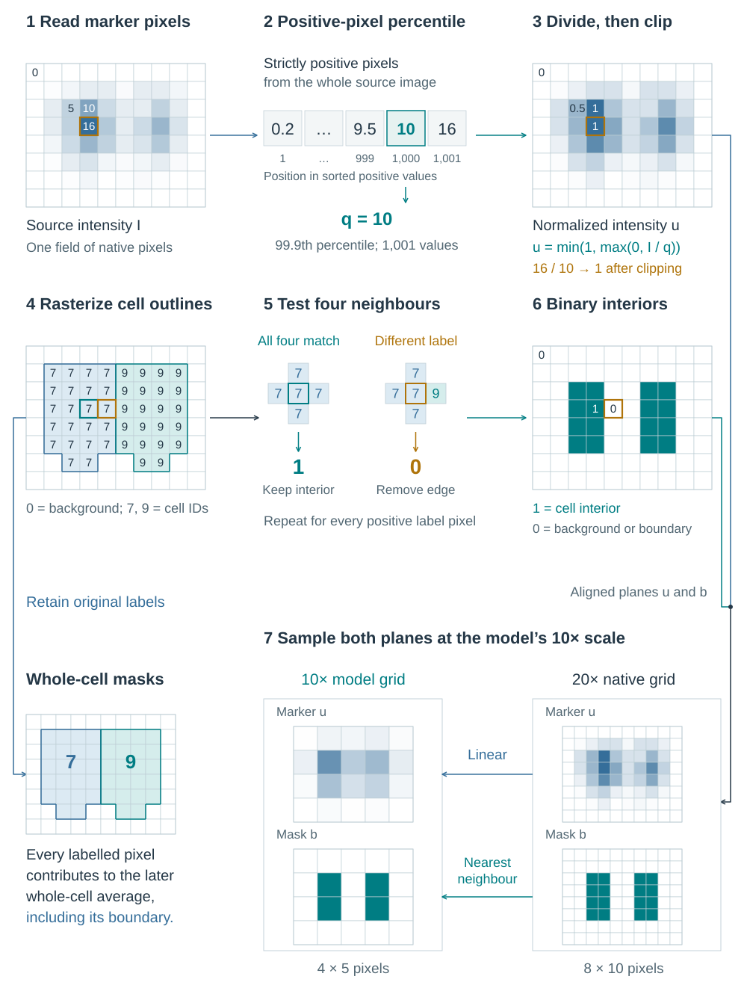
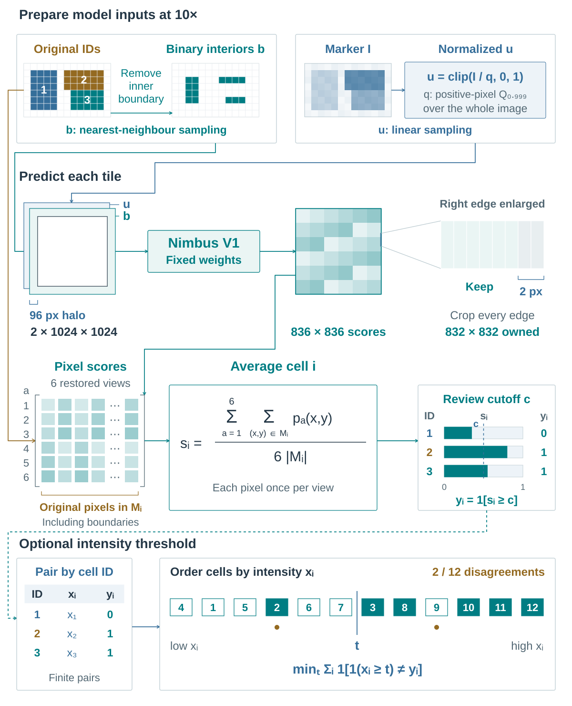
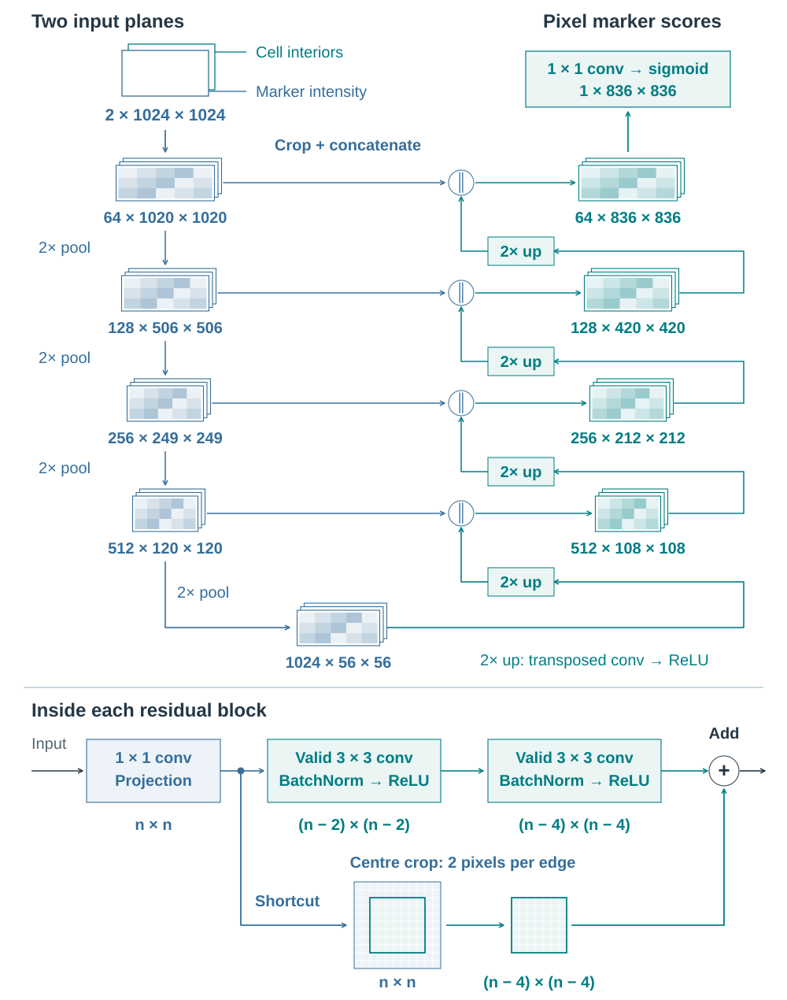

# Nimbus

[Analysis stages](../../../README.md#analysis-stages)

<a id="reference-nimbus"></a>
<a id="reference-nimbus--nimbus-setup-and-calculation"></a>

On **Run → Cell phenotyping → Marker rules**, choose **Nimbus** to assess marker expression from the staining image. Nimbus reads one marker channel and the segmented cell outlines. It predicts a score at each pixel and averages the scores inside each cell.

Review the cell scores to choose a cutoff for marker positivity. If you need a rule based on measured intensity, you can also fit an intensity threshold to the reviewed Nimbus decisions.

[Install Nimbus](#install-the-model-and-choose-the-processing-device) · [Choose marker inputs](#select-the-marker-inputs) · [Review scores](#review-the-marker-scores) · [Fit an intensity threshold](marker-rules.md#review-an-intensity-distillation) · [How scores are calculated](#normalize-the-marker-image) · [Saved scores](#saved-scores-and-later-changes)

<a id="reference-nimbus--runtime-setup"></a>
<a id="runtime-setup"></a>
<a id="set-up-the-model-and-image-scale"></a>
## Install the model and choose the processing device

1. Open **Software setup → Cell phenotyping** on the processing computer. The portable editions include the Nimbus scoring software. For a wheel or source installation, [install the Nimbus processing libraries](../installation-and-build/software.md#nimbus-for-source-installations). Use **Check again** to verify the Python packages.
2. Under **Nimbus**, choose **Install model…** to download the V1 model or **Use existing…** to select its checkpoint file. We verify the weights and save their location for subsequent analyses. You can reopen **Software setup** from marker setup to change the model.
3. In **Computing**, choose the processor for scoring. **Automatic** uses an available NVIDIA GPU if its memory can accommodate the model and otherwise uses the CPU. The score record identifies which device was used. For cluster processing, the worker and model must be accessible from the compute node. [Processor settings](../setup/computing.md)

<a href="../../assets/screenshots/software-cell-phenotyping.png"></a>

_Software setup shows the installed Nimbus V1 model and CPU scoring software._

<details>
<summary>Model package and checkpoint</summary>

Nimbus runs in its own Python environment because it requires a specific NumPy version. The bundled worker contains Python 3.12, `Nimbus-Inference==0.0.5`, `numpy==1.26.4`, `torch==2.7.1` and `opencv-python-headless==4.11.0.86` (OpenCV reports `4.11.0`). It scores one input per batch in 32-bit floating point and uses up to eight CPU threads within the task’s allowance. For a source installation, follow the [instructions for building this worker](../installation-and-build/software.md#nimbus-for-source-installations).

The checkpoint is `V1.pt` from [JLrumberger/Nimbus-Inference](https://huggingface.co/JLrumberger/Nimbus-Inference), revision `3affc9e774d68408701e44ed6136b1e13503c639`. The repository declares the MIT license. Its SHA-256 is:

```text
0651a3852fbafc03be415a1ec80ef947cc1913a081cf0bc649301ade887a82a9
```

The Python process verifies this checksum and loads the model once for the selected images. [Dependency and model notices](../installation-and-build/building-and-releasing.md#dependencies-and-licences) describe the redistribution requirements.

</details>

## Select the marker inputs

Select the marker’s saved **Mean** or **Median** intensity and choose **Nimbus**. The measurement supplies the values for the intensity histogram and for optional [intensity distillation](marker-rules.md#review-an-intensity-distillation). To add a missing measurement, use **Cell measurements → Change cell measurements…**.

- **Nimbus input.** Choose **Run on selected images** to score the marker channel within the whole-cell outlines. This scoring area also applies when the selected intensity measurement comes from the nucleus, cytoplasm or membrane. Choose **Advanced: load saved scores** to reuse predictions for the same image, marker and segmented cells.
- **Nimbus score cutoff.** Start with the default of **0.5** or enter a cutoff for the initial review. You can adjust it after inspecting the score distribution.
- **Objective magnification if missing.** Nimbus resizes the image to the model’s 10× scale using the objective magnification recorded in the metadata. If an image lacks this value, enter the magnification used to capture it (for example, **20** for a 20× objective).
- **Nimbus model checkpoint** under **Advanced settings** lets you use a different checkpoint for this calculation. Enter a path accessible on the processing computer.

<a href="../../assets/screenshots/luca-nimbus-inputs-current.png"></a>

_PDL1 setup for **802 segmented cells** in a 512 × 512-pixel [LuCa](../../data/luca.md) field. The histogram displays the selected whole-cell Mean intensities; Nimbus will calculate image-based scores. **Advanced settings** is expanded to show the saved checkpoint path._

<a id="review-an-intensity-distillation"></a>
## Review the marker scores

After scoring, compare the score histogram with staining in the tissue viewer. The marker review guide describes how to [choose the Nimbus cutoff](marker-rules.md#review-nimbus-scores) and [compare the resulting calls with an intensity threshold](marker-rules.md#review-an-intensity-distillation).

<a id="reference-nimbus--normalization-and-inference-geometry"></a>
<a id="normalization-and-inference-geometry"></a>
## Normalize the marker image

We normalize each marker using the positive pixel intensities across the entire source image. After converting the pixels to float32, we calculate their 99.9th percentile by linear interpolation between ordered positive values. This gives every prediction tile for the marker the same intensity scale.

For source intensity `I(x,y)` and image-level quantile `q`, the normalized input is

$$
u(x,y)=\min\left(1,\max\left(0,\frac{I(x,y)}{q}\right)\right).
$$

`I` and `q` have the same source intensity units, so `u` is dimensionless. Zero or negative intensities become zero, the quantile becomes one, and brighter intensities are clipped to one. Every processing window for that marker in the same source image uses this factor.

An all-zero channel uses the defined factor `1e-8` and remains zero. A nonzero channel containing no positive values cannot supply this quantile. Nonfinite intensities also stop scoring because they cannot form valid model inputs. In either case, inspect the reported channel and its image preparation before retrying.

<a id="reference-nimbus--native-pixels-masks-and-identities"></a>
<a id="native-pixels-masks-and-identities"></a>
## Marker images and cell masks

1. **Identify the cells.** QuPath draws the segmented outlines on the marker’s original pixel grid. Each cell receives a distinct integer label, with zero for background. Two cells claiming the same pixel must be corrected before scoring. Cells excluded from intensity-threshold fitting still appear in the image seen by Nimbus.
2. **Form the model mask.** For each cell pixel, we check its neighbours above, below, left and right. If any is background or belongs to another cell, we set the pixel to zero. The remaining interiors are set to one. This separates touching cells for prediction. We keep the original labels, including boundary pixels, for calculating whole-cell scores.
3. **Resize both inputs.** For an objective magnification of `m`, each model dimension is `int(original_dimension × 10 / m)`. A 20× image therefore has half as many pixels along each axis at the model’s 10× scale. We interpolate marker intensities linearly and use the nearest mask pixel for each new mask value. The physical size represented by a model pixel also depends on the camera and detector binning.

<a href="../../assets/figures/nimbus-input-preparation.svg"></a>

_Nimbus receives two image planes. In the intensity plane, the 99.9th percentile of the positive pixels is 10, so an intensity of 16 reaches the normalized maximum of 1. The mask plane marks cell interiors using the four neighbours of each pixel. Resampling the two planes from 20× to 10× reduces the 8 × 10 field to 4 × 5 model pixels. The original cell labels identify which predictions to average for each cell._

<a id="apply-nimbus-and-review-marker-decisions"></a>
## From marker pixels to whole-cell scores

Nimbus processes the marker and mask planes together, preserving surrounding staining and neighbouring cells as image context. The residual U-Net predicts a marker score between zero and one at each output pixel; the whole-cell masks then determine which predictions contribute to each cell.

<a href="../../assets/figures/nimbus-application.svg"></a>

_Schematic of normalization, cell-mask preparation and tiled prediction. The numbered cells retain their identities through whole-cell averaging; the final branch compares score decisions with an optional intensity rule._

### Cover the image with matching prediction tiles

A large image uses 1,024 × 1,024 model-input windows. Valid convolutions produce an 836 × 836 prediction, and we discard two pixels from each edge to assign the central **832 × 832** output to that tile. The wider input supplies **96 pixels of surrounding context** on each side of the assigned output. Adjacent tiles therefore use overlapping inputs while contributing different output pixels.

Tiles belong to one grid over the complete image. Reflection at the full-image edges supplies context outside the image. Before reading pixels, we use saved cell-group bounds to skip a tile only when its output cannot contribute to any cell being scored. All retained tiles use the same normalization, global position and surrounding masks.

### Check the model image dimensions

Nimbus uses reflection padding to score the whole image in one pass when both scaled dimensions are at most 1,024 pixels. Each dimension must be at least 32 pixels. If the source is already at 10×, both dimensions must also be multiples of 16. Otherwise the model crops its prediction to that spacing and the result no longer fits the source grid.

Larger images are scored in tiles. If a scaled dimension leaves a remainder of **831** when divided by **832**, the last output tile along that axis would be empty and the image is rejected.

These checks apply to the complete source image after magnification-based resizing. If the reported dimensions are incompatible, select a source image with supported dimensions or return to marker setup and choose another method.

### Combine predictions from transformed views

Nimbus evaluates transformed views to combine predictions from different orientations. The released six-entry sequence repeats a 270° rotation four times and includes one vertical flip and one horizontal flip. We calculate the three distinct predictions once, restore each to the original orientation, and weight them **4:1:1** to preserve that averaging rule.

### Average predictions over each whole cell

The restored predictions are sampled onto original-resolution cell pixels using nearest-neighbour sampling. For whole-cell mask `M_i` and restored prediction `p_a(x,y)` at position `a` in the six-entry sequence, the cell score is

$$
s_i=\frac{1}{6|M_i|}\sum_{a=1}^{6}\sum_{(x,y)\in M_i}p_a(x,y).
$$

Here, `|M_i|` is the number of original pixels in cell `i`, including the boundary removed from the model's mask input. The denominator `6|M_i|` averages over those pixels and the six transformed views. A pixel contributes once per view even when its cell crosses a tile boundary, and the number of contributing pixels must agree between views. A cell whose mask covers no image pixels receives an unknown score.

<a id="image-model-and-cell-scores"></a>
### The pretrained residual U-Net

<a href="../../assets/figures/nimbus-architecture.svg"></a>

_Schematic of the fixed Nimbus network. The two input planes produce one pixel-score plane; cropped connections combine fine image structure with features calculated over wider context._

The two input planes contain the normalized image of one marker and a binary image of cell interiors. The contracting path builds 64, 128, 256, 512 and 1,024 feature maps at progressively smaller spatial scales. Four pooling operations reduce the image dimensions; four learned upsampling operations restore spatial detail. At each matching scale, the expanding path combines its features with cropped features from the contracting path. The deeper layers describe wider image context, while these connections retain finer staining patterns for the final pixel prediction.

Each residual block projects its input through a 1 × 1 convolution and applies two 3 × 3 convolutions, each followed by batch normalization and ReLU. Each valid convolution reduces both spatial dimensions by two pixels. We crop two pixels from every edge of the projected input to match the calculated features, then add the two arrays element by element to complete the block. A final 1 × 1 convolution and sigmoid produce one marker-score plane. [Prediction tiles](#cover-the-image-with-matching-prediction-tiles) explains the resulting output dimensions and how the retained pixels cover the complete image.

<a id="reference-nimbus--retained-evidence-and-limitations"></a>
<a id="retained-evidence-and-limitations"></a>
## Saved scores and later changes

Changing only the score cutoff reuses completed scores. Returning to marker setup with the same image, marker channel, segmented cells, objective magnification and model reopens that calculation. Replacing the image or segmentation, or changing a model input, requires scores for the new inputs. Intensity distillation uses the saved scores and selected measurement column without another image-model inference.

Each saved score remains associated with its image, marker and cell ID. Missing identity rows are an input error; an explicit null score identifies a present cell with an unknown outcome. For a mismatched or incomplete imported file, select scores generated for the current cells or choose **Run on selected images** to calculate them.

If image reading or scoring fails, open **Run → Details** and use the available retry or correction action. To replace a stopped review after correcting its inputs or choosing another method, use [**Change phenotyping choices…**](../run/index.md#restart-a-marker-review). This restarts the marker review and requires new marker confirmations.

<a id="saved-score-file"></a>
<details>
<summary>Saved score-file format and cell identities</summary>

The imported NDJSON file has schema `mif-nimbus-scores/v1` and contains one marker. Its first record declares `record_type="header"`, the marker, `score_kind="nimbus_cell_expression_confidence"`, `model_id`, `package_version`, `weights_sha256` and the image-section scopes. Each scope records `(sample_id, project_entry_id, slide_id, section_id)`, the segmentation-population identity and source-image identity.

Each later row contains `cell_identity`, formed by appending the existing pipeline cell ID to the four-part scope, and `score`. This key identifies the segmented cell within its image and section. The reader matches each requested cell once and returns its score in the measurement table’s cell order. It reports missing or duplicate rows, foreign scopes, changed image/population identities and scores outside `[0,1]`. A JSON `null` records an unknown score.

The saved review retains the score-file checksum, model identifier, package version and weights checksum. Application checks the reviewed score file and its cell identities, then applies the accepted cutoff to those saved scores.

</details>

<details>
<summary>Bounded reads and saved calculation details</summary>

Each source must have one Z plane, one time point and distinct channel names. QuPath reads the objective's `NominalMagnification` from the source OME metadata when a saved image entry omits it from display metadata. The score record identifies the objective value and whether it came from metadata or manual entry.

The positive-pixel quantile uses NumPy 1.26.4's linear interpolation convention. We locate the two ordered intensities surrounding the requested percentile without holding or sorting the complete image in memory. Four passes over bounded image rectangles progressively narrow their values using 256-bin histograms, considering one byte of each positive float32 intensity at a time. The first pass also counts positive pixels to determine the required positions in the ordered values; after the fourth pass, linear interpolation between the two selected values gives the quantile.

Each rectangle exchanges at most 16 MiB of float32 values, with each axis at most 1,024 pixels. Cell-mask reads include one native pixel of neighbouring context for the four-neighbour boundary calculation.

QuPath opens one image at a time and returns original-resolution float32 marker rectangles or int32 cell labels. Python checks their image, dimensions, data type, path and byte count. Mask labels map to the existing cell IDs, and source checks bind the masks to the selected segmentation. QuPath closes each image after its selected markers have been processed; Python keeps the model loaded for the next image.

Temporary prediction tiles are released after their per-cell sums have been accumulated. Model memory, QuPath's cell-ID table and spatial index, and Python's score arrays remain in memory alongside the bounded image windows. Cell tables and score arrays grow with cell count; calculation time also depends on image dimensions, marker count and read speed.

</details>

<details>
<summary>Implementation and source references</summary>

[AutomaticNimbusScoreProvider](../../../src/python/mif_pipeline/orchestration/batch_phenotyping/nimbus_execution.py) selects the image, marker, model and cells, then either reopens completed scores or starts scoring. [The native image-source script](../../../qupath/scripts/cell_analysis/nimbus_image_source.groovy) supplies the image rectangles and cell labels. [Nimbus streaming](../../../src/python/mif_pipeline/cell_analysis/nimbus_streaming.py) calculates the whole-image normalization factors and accumulates predictions by cell ID. [Nimbus tiling](../../../src/python/mif_pipeline/cell_analysis/nimbus_tiling.py) maps the full-image grid, transformed views and native pixels without making storage-window boundaries into model boundaries. [Marker setup](../../../src/python/mif_pipeline/gui/marker_setup.py) supplies the displayed choices and defaults.

Primary implementation sources are the [official Nimbus-Inference repository](https://github.com/angelolab/Nimbus-Inference), the [0.0.5 package release](https://pypi.org/project/Nimbus-Inference/0.0.5/) and the pinned public checkpoint above. The package version and checkpoint checksum fix the calculation used for each saved score file.

</details>

---

**Continue:** [Marker decisions and phenotype rules](marker-rules.md).
