# Supervised cell phenotypes

[Analysis stages](../../../README.md#analysis-stages)

[Define phenotypes](#define-the-phenotype-classes) · [Choose a classifier](#choose-the-classifier) · [Select the cell features](#choose-cell-features) · [Allocate subjects](#allocate-subjects) · [Label reference cells](#label-and-freeze-reference-cells-in-qupath) · [Review the fit](#review-validation-and-independent-test-results) · [Inspect cell assignments](#review-cell-assignments)

In supervised phenotyping, you label individual cells in QuPath as examples of each phenotype. We train the classifier using either measurements from those cells or features that KRONOS extracts from the staining within their outlines. The fitted model predicts a phenotype and a score for each cell included in the analysis. During review, you can set a score cutoff to leave lower-scoring cells **Unclassified**.

<a href="../../assets/figures/supervised-cell-workflow.svg">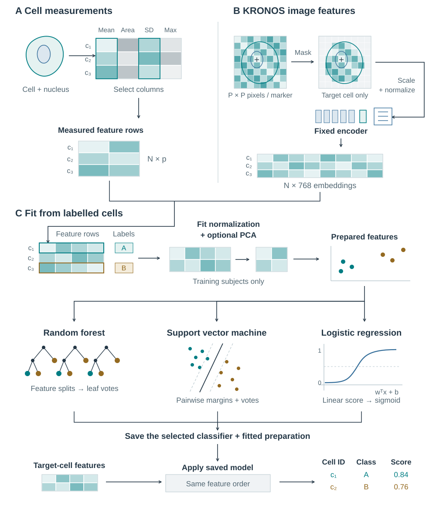</a>

_Each row represents one cell. Route A uses its selected measurements. Route B uses 768 features that KRONOS extracts from the marker images inside its outline. In C, the labelled training cells supply the feature rows and known phenotypes used to fit the classifier. Applying the fitted model gives each target cell a predicted class and score._

## Define the phenotype classes

On **Run → Cell phenotyping**, select **Supervised classification**. On **Class labels**, enter at least two **Phenotype names**. Use those names when labelling reference cells in QuPath. If labels were imported with a training plan, that plan fixes the class names. Continue to **Classifier** to choose how the model will learn these labels.

## Choose the classifier

On **Classifier**, select **Random forest**, **Support vector machine** or **Logistic regression** to use saved cell measurements. To use cell images, select **KRONOS** and choose the **Final classifier**. Each cell then contributes 768 features from its marker images. Random forest is initially selected.

A **random forest** combines votes from trees whose successive feature thresholds separate the labelled cells. An **SVM** fits a separating boundary for each pair of classes, using either the prepared features directly or distances between them through an RBF kernel. **Logistic regression** fits weighted combinations of the features and converts them into class scores. KRONOS supplies image embeddings to these same classifiers. The [classifier-methods guide](../classifier-methods/index.md) follows each calculation from the training rows to the predicted class and score.

## Choose the training procedure

On **Classifier**, choose how to train and evaluate the model. Cross-validation compares parameter settings by holding out different subjects in turn. Independent testing reserves subjects for a final evaluation after training and parameter selection are complete.

The initial choice is **Training only** for one subject and **Training and validation (cross-validation)** for two or more. On [Subject allocation](#allocate-subjects), assign the subjects to training or testing and choose the number of validation folds.

| Training procedure | How the references are used |
|---|---|
| **Training only** | Fit one model with the settings you enter. |
| **Training and validation (cross-validation)** | Compare settings across subject folds. Refit the selected settings using all training and validation subjects. |
| **Training and independent testing** | Fit one model on the training subjects, then evaluate it on the reserved test subjects. |
| **Training, validation and independent testing** | Select settings by cross-validation, refit on all training and validation subjects, then evaluate that model on the reserved test subjects. |

## Set the classifier parameters

Enter one value per parameter to fit a single model. If you chose cross-validation, enter the values you want to compare in each search field, separated by commas. The [classifier methods guide](../classifier-methods/index.md) explains how the parameters affect fitting.

### Random forest

**Maximum tree depth** limits the number of successive splits along a tree path. **Minimum samples per node** stops further splitting when a node contains that many training cells or fewer. The initial values are **16** and **10**, respectively. Deeper trees and smaller permitted nodes allow the forest to distinguish smaller groups of cells with different feature values.

**Maximum trees**, initially **50**, limits the number of trees voting on the prediction. Under **Advanced settings**, **Features considered per split** sets how many randomly chosen features compete at each split. The default is the square root of the number of classifier inputs, rounded to the nearest integer. With PCA, that count comes from the retained components. [How a tree chooses a split](../classifier-methods/index.md#choose-a-feature-threshold)

Leave **Out-of-bag error threshold** at **0** to use the tree limit. A positive threshold permits earlier stopping based on predictions for training cells omitted from each tree’s bootstrap sample. Enable **Calculate variable importance** to estimate how much those predictions change when the values of each feature are shuffled. [Out-of-bag predictions and importance](../classifier-methods/index.md#combine-tree-predictions)

<a href="../../assets/screenshots/supervised-rf-main-current.png">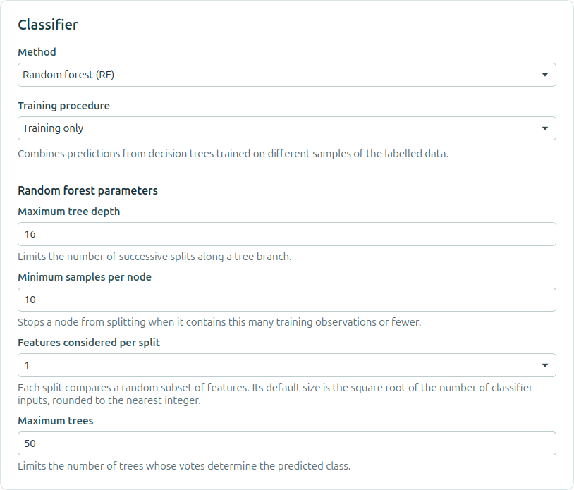</a>

*Tree depth and the minimum sample count determine how finely each tree can divide the labelled cells.*

### Support vector machine

**SVM kernel** determines how the classifier separates a pair of classes. The initial **Linear** kernel fits a boundary using a weighted sum of the input features. The **RBF** kernel can fit a curved boundary. It uses distances between feature vectors to measure similarity. A larger **RBF gamma** makes similarity fall more quickly with distance.

**SVM C**, initially **1**, sets the penalty for training cells that fall inside the class margin or on the wrong side of the boundary. [SVM margins and kernels](../classifier-methods/index.md#support-vector-machine)

For cross-validation, enter the kernels and C values to compare. The initial search uses **LINEAR** with C values of `0.1, 1, 10`. If you include **RBF**, enter the gamma values for those fits, initially `0.01, 0.1, 1`. Gamma applies only to the RBF kernel.

Under **Advanced settings**, **Maximum SVM iterations**, initially **1,000**, limits the updates for each pair of classes. **SVM termination tolerance**, initially **10⁻⁶**, sets how closely the solution must satisfy the stopping condition. A smaller tolerance can require more iterations. [SVM stopping criteria](../classifier-methods/index.md#fit-coefficients-and-stop-the-optimizer)

The cell [vote-agreement score](../classifier-methods/index.md#classifier-scores) reports agreement among these pairwise class comparisons.

<a href="../../assets/screenshots/supervised-svm-main-current.png">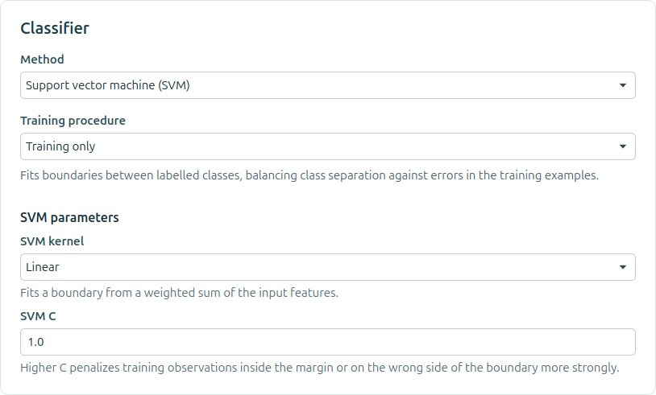</a>

*SVM fitting controls with the initial linear kernel. Selecting RBF reveals its gamma parameter.*

### Logistic regression

**Logistic regression regularization** starts at **L2**, penalizing large feature coefficients during fitting; **DISABLE** removes that penalty. Under **Advanced settings**, **Logistic regression learning rate**, initially **0.01**, scales each coefficient update, and **Logistic regression iterations**, initially **1,000**, sets the number of updates using all training rows. In the OpenCV optimizer, the number of training cells also affects the coefficient-update size. The [logistic-regression calculation](../classifier-methods/index.md#logistic-regression) explains the loss, the exact update and the conversion of fitted responses into class scores.

<a href="../../assets/screenshots/supervised-lr-main-current.png">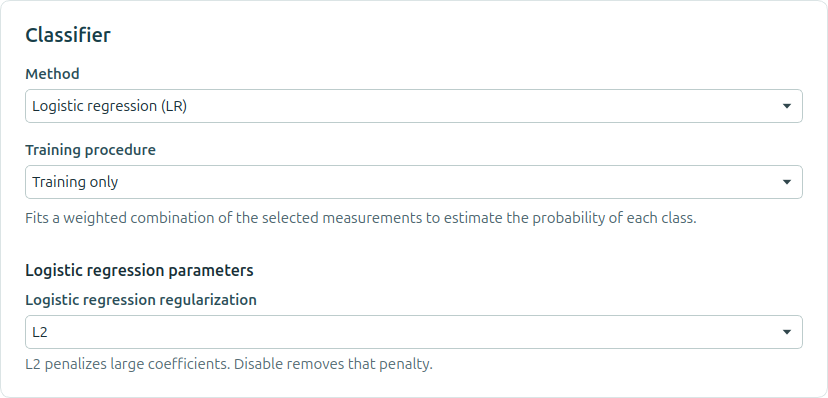</a>

*Logistic regression starts with the visible L2 penalty. Its learning rate of 0.01 and 1,000 batch updates remain under **Advanced settings**.*

### Compare settings before fitting

Expand **Compare parameter combinations** to see which settings will be tested in each validation fold. The table appears when you have at least two combinations. Each row shows one combination, with columns for the parameters that change between fits. To change the values tested, edit the parameter fields above the table.

You can compare up to twelve combinations. We evaluate them on the same held-out subjects, then fit the selected combination once more using all training and validation subjects. The [validation review](#compare-validation-results) explains how subject-weighted macro-F1 determines the selection.

## Choose cell features

The classifier needs one set of input features per labelled cell. For RF, SVM and LR, select the [saved cell measurements](#measurement-based-cell-features) to use as features. For a KRONOS classifier, choose the [marker channels and cell-centred image patches](#image-based-cell-features-with-kronos) from which the encoder calculates those features.

## Measurement-based cell features

On **Cell measurements**, choose the saved marker intensities and shape measurements that will distinguish the labelled phenotypes. For staining, select the intensity measured in the relevant part of each cell. To include shape, select measurements of the cell or nuclear outline. **Inputs for each cell** lists the chosen values in the order supplied to the classifier. 

Only measurements already calculated in the [measurement stage](../cell-measurements/index.md#choose-cell-measurements) are available. To add another, use **Cell measurements → Change cell measurements…**, complete the calculation, then return to classifier setup.

### Marker intensities

The **Marker intensities** matrix has one row for each saved channel and cell region, with its available statistics in separate columns. Choose one or more statistics from a row. A dash marks a combination that was not saved. For panels with more than 20 channels, search narrows the rows; each statistic's column menu selects or clears that statistic in the shown rows.

Choose measurements from a [cellular region](../cell-measurements/index.md#set-each-channels-cellular-region-and-intensity-measure) suited to the marker's localization. Nuclear measurements summarize pixels inside the nuclear outline, while whole-cell measurements also include staining outside it; inspect the outlines when assessing whether a measured difference reflects the intended staining.

**Mean** and **Median** summarize intensity within the chosen region. **SD** (standard deviation) and **Variance** describe its variation, which can distinguish cells with similar mean intensities but different staining patterns. **Maximum** records the brightest included pixel and is particularly sensitive to isolated bright pixels. Staining from an adjacent cell can affect these measurements when the outline includes it, so compare the selected values with the staining when choosing classifier inputs. The [intensity calculations](../cells/processing.md#calculate-intensity-statistics) define each statistic and its units.

<a href="../../assets/screenshots/supervised-measured-inputs-current.png">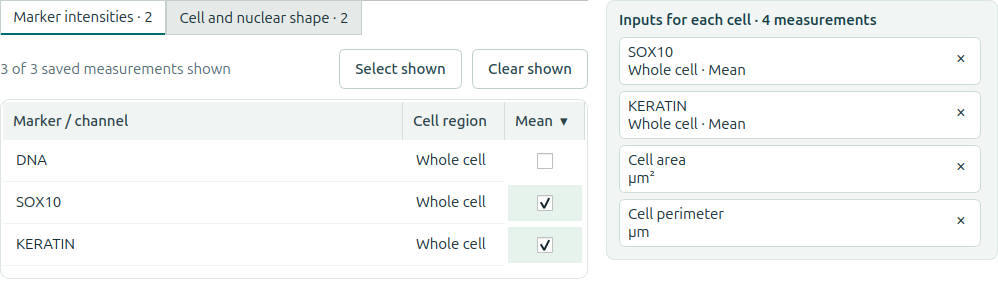</a>

_The retained MEL05 setup selects whole-cell SOX10 and KERATIN Means, cell area and cell perimeter. All four measurements appear in the shared input list._

### Cell and nuclear shape

The **Cell and nuclear shape** tab lists the saved shape measurements and their units. These inputs can add information when labelled phenotypes differ in cell size, outline shape or relative nuclear size. Nuclear and relative cell/nuclear measurements require an associated nucleus. The [measurement-stage shape selection](../cell-measurements/index.md#add-cell-and-nuclear-shape-measurements) describes the available quantities and links to their exact calculations.

Shape values describe the accepted outlines, so an apparent difference can also arise from a truncated cell, a merged pair or an inaccurate nuclear boundary. Compare those outlines with the staining when deciding whether the measured difference is a useful classifier input.

<a href="../../assets/screenshots/supervised-shape-inputs-current.png">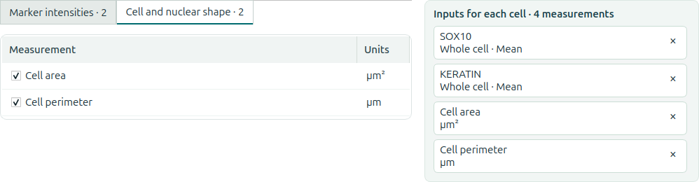</a>

_The MEL05 shape tab selects cell area and perimeter. These remain in the shared input list alongside the whole-cell SOX10 and KERATIN Means when switching tabs._

## Image-based cell features with KRONOS

KRONOS uses each cell's multichannel image to calculate numerical features for the phenotype classifier. The [cell and nuclear outlines from segmentation](../cells/index.md#choose-a-segmentation-method) identify the staining to include and the centre of the image patch.

### Prepare and encode the cell image

We prepare a square, multichannel image centred on each nucleus, covering the complete cell outline. The **patch size** determines the number of pixels along each side; the **sampling resolution** determines the physical width and height represented by each pixel. Multiplying the pixel count by the sampling resolution gives the physical length along each side. For example, a 256 × 256-pixel patch at 0.5 µm/pixel covers 128 × 128 µm.

<a href="../../assets/figures/kronos-patch-sizes.svg">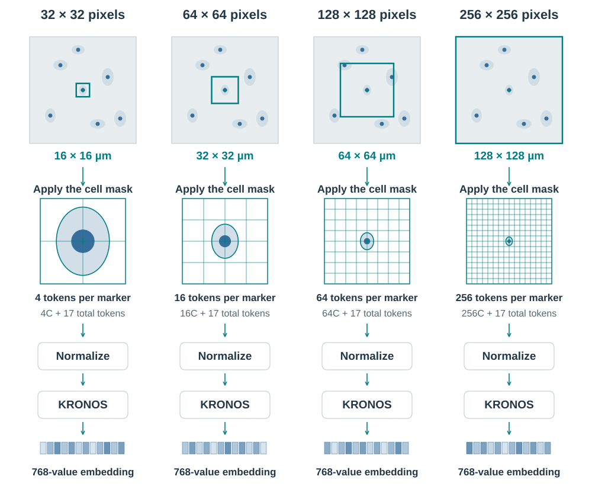</a>

_Four patch sizes at 0.5 µm/pixel. Teal squares locate each patch in the same field, and the enlarged views show the cell surrounded by pixels set to zero before normalization._

We use the cell outline to isolate its staining from the surrounding tissue. At the original sampling resolution, the patch contains the original pixel intensities, with pixels outside the cell set to zero. For coarser sampling, we first set pixels outside the cell to zero, then average the original pixel intensities over the area covered by each patch pixel. We then [normalize each channel using its marker's reference mean and standard deviation](../tissue-classification/kronos.md#normalize-the-marker-intensities) before passing the multichannel patch to the pretrained encoder.

The encoder converts each 16 × 16-pixel block of a normalized channel image into an **image token**. It uses the tokens' positions and marker identities to relate staining patterns across the cell, producing an **embedding** of 768 features for the phenotype classifier. The pretrained encoder's weights stay fixed when we fit that classifier. The [shared KRONOS guide](../tissue-classification/kronos.md#calculate-the-fixed-kronos-representation) explains how its internal layers calculate the embedding.

<a href="../../assets/figures/kronos-cell-input.svg">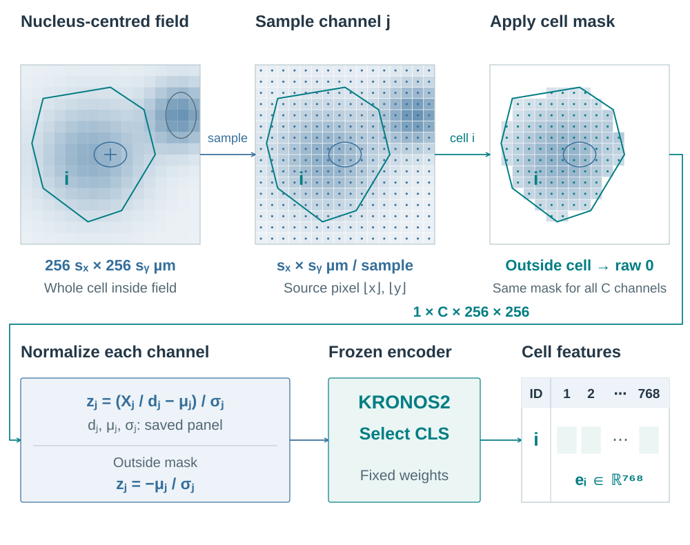</a>

_Schematic of a 256 × 256-pixel cell input at the original image resolution. The upper panels show the same field and cell outline; the cross marks the nucleus centroid. The lower panels follow the masked intensities through normalization and the fixed encoder to the cell's feature row._

Sampling coordinates and encoder dimensions

Let $(c_x,c_y)$ be the nucleus centroid in full-resolution image coordinates and $(p_x,p_y)$ the original pixel width and height in µm. One patch pixel spans $d_x=s_x/p_x$ original pixels horizontally and $d_y=s_y/p_y$ vertically. For input indices $u,v=0,\ldots,P-1$, its centre lies at

$$
x_u=c_x+(u+\tfrac12-P/2)d_x,\qquad
y_v=c_y+(v+\tfrac12-P/2)d_y.
$$

At the original resolution, we read the source pixel at $(\lfloor x_u\rfloor,\lfloor y_v\rfloor)$. For coarser sampling, a source pixel contributes only if its centre lies inside the cell. If $a_{ij,uv}$ is the area shared by source pixel $(i,j)$ and patch pixel $(u,v)$, measured in original-pixel units, the averaged intensity is

$$
I_{uv}=\frac{\sum_{(i,j)\,\text{inside cell}} a_{ij,uv} I^{\mathrm{source}}_{ij}}{d_xd_y}.
$$

The denominator is the full patch-pixel area, including any portion outside the cell or image. Those portions contribute zero to the numerator. We retain the resulting intensity only when the patch-pixel centre lies inside both the image and cell. The patch must contain at least one such centre; otherwise, extraction stops and asks for finer sampling or correction of the outline.

Each channel supplies $(P/16)^2$ image tokens. Patch sizes of 32, 64, 128 and 256 therefore supply 4, 16, 64 and 256 tokens per marker. With $C$ marker channels, one class token and 16 register tokens, the encoder processes $C(P/16)^2+17$ tokens. Its normalized class token supplies the 768-value embedding.

### Choose channels, patch size and sampling resolution

On **KRONOS image inputs**, select the **Channels to encode** and choose a **Patch size (pixels)** of 32, 64, 128 or 256. The initial size is 256. Each patch must contain the complete cell outline; increase its size or use coarser sampling if the cell extends beyond it.

Under **Sampling resolution (µm/pixel)**, the **X** and **Y** values specify the pixel width and height used to prepare the patch. They initially use the original image's pixel size. For a processing group with different pixel sizes, we use the largest recorded pixel width and height across its images to give all cells the same sampling resolution.

Increasing the sampling values covers more tissue with the same number of patch pixels and less spatial detail. For example, changing a 256 × 256-pixel patch from 0.5 to 1 µm/pixel increases its field from 128 × 128 to 256 × 256 µm. Increasing the patch size instead keeps the selected sampling resolution and supplies more image tokens to the encoder.

<a href="../../assets/screenshots/supervised-kronos-inputs-current.png">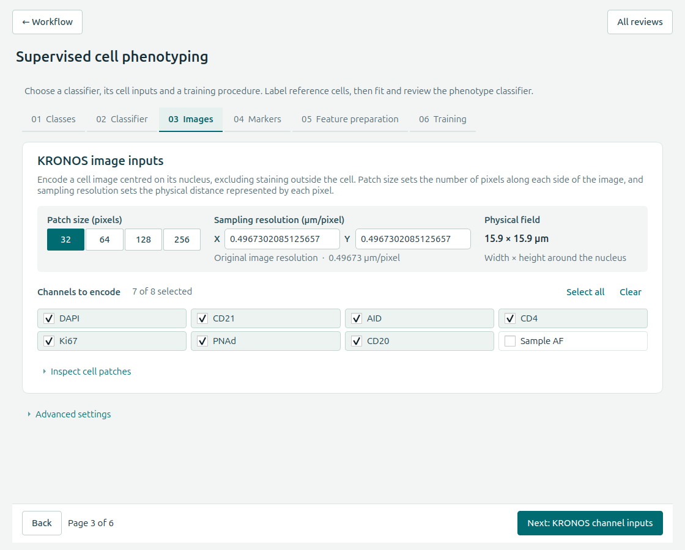</a>

_KRONOS image inputs for the public tonsil field, with a 32 × 32-pixel patch covering approximately 15.9 × 15.9 µm._

Open **Inspect cell patches** and select a cell in the tissue viewer to show its nucleus-centred patch. Adjust the patch size or sampling resolution to compare its extent with the cell outline. Pan or zoom to inspect other cells, and use the image selector when the processing group contains several images.

<a href="../../assets/screenshots/supervised-kronos-patch-inspection.png">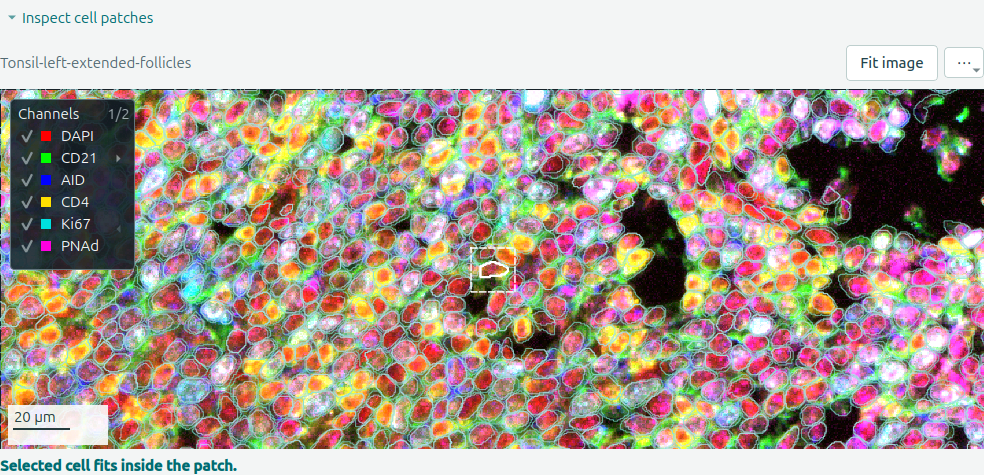</a>

_The selected cell and its 32 × 32-pixel patch in the public tonsil field._

### Assign markers and normalization values

On **KRONOS channel inputs**, select an image channel under **Channel assignments**, find its marker in the searchable **Model markers** list and choose **Use marker**. This loads the marker's reference mean and standard deviation from the model table. The selected [nuclear stain](../images/index.md#choose-the-nuclear-stain) uses the model's DAPI entry automatically.

If the marker is absent, choose **Add a marker not listed…** to enter its name and description. The [new-marker procedure](../tissue-classification/kronos.md#add-a-marker-absent-from-the-model-table) explains the required information.

<a href="../../assets/screenshots/supervised-kronos-markers-current.png">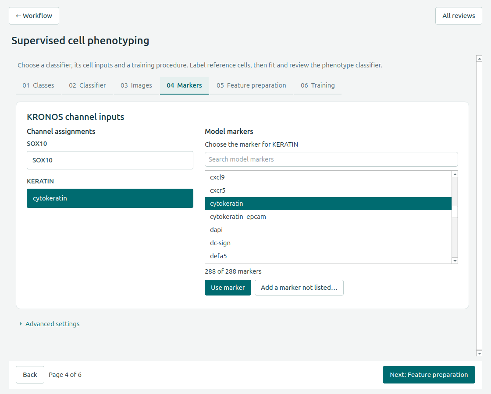</a>

_Channel assignments beside the model-marker list. **Add a marker not listed…** opens the new-marker form._

### Set encoder resources

Under **Advanced settings** on **KRONOS image inputs**, **Processor threads** starts at **1** and allows one to eight CPU threads. **Memory for cell features (MiB)** starts at **512 MiB** and covers intermediate encoder calculations. Larger patches and more selected channels increase this requirement; the loaded model and application also require memory.

## Feature normalization and PCA

Feature preparation transforms the selected measurements or KRONOS embeddings before fitting the classifier. We calculate the transformation from the training cells and apply it to validation cells, test cells and later images.

### Standardize or scale the features

**Feature scaling** starts at **Keep feature values unchanged**. **Standardize each feature (z-scoring)** subtracts the mean calculated from the training cells and divides by their standard deviation; this is generally appropriate for SVM and LR. **Scale each feature to 0–1 (min–max)** subtracts the smallest training value and divides by the difference between the largest and smallest training values, mapping them to zero and one.

### Retain principal components

Principal component analysis (**PCA**) forms new features from weighted combinations of the inputs after the selected feature scaling. The components are ordered by how much variation they capture among the training cells. Under **Classifier inputs**, choose **Principal components (PCA)** and enter the **Target fraction of training variance**. For example, 0.95 retains enough components to account for at least 95% of the training variance. Choose **Individual features** to use the selected features after scaling. The [component-selection calculation](../classifier-methods/index.md#feature-normalization-and-pca) describes how we choose the retained components.

Under **Principal components (PCA)**, choose **Keep component variances** to retain the spread of the training scores along each component. **Whiten to unit variance** divides the scores by their training standard deviations, giving a one-standard-deviation difference the same weight along each retained component in a distance calculation.

During cross-validation we fit these transformations using the training subjects in each fold. For KRONOS, they act on the features produced by the encoder. The earlier marker normalization acts on the image channels. [Normalization and PCA calculations](../classifier-methods/index.md#feature-normalization-and-pca)

<a href="../../assets/screenshots/supervised-preparation-main-current.png">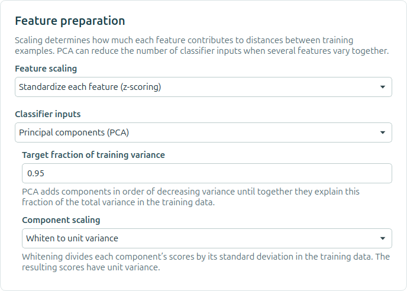</a>

_Feature preparation with standardized inputs, a 95% variance target and whitening selected._

## Allocate subjects

On **Subject allocation**, assign subjects to the training and evaluation groups required by the chosen procedure. All images from one subject remain together. You can move subjects between groups or use **Assign automatically** and inspect the resulting allocation; with one subject, we assign it to training and skip this page.

For cross-validation, select a fold under **Training and validation** to see which subjects train its model and which are held out. Reserve independent-test subjects before inspecting their predictions. The [subject-allocation guide](../tissue-classification/index.md#allocate-reference-subjects) explains the controls, minimum subject counts and fold calculation.

## Label and freeze reference cells in QuPath

In QuPath, place a point on each cell you want to use as a reference and give it the corresponding phenotype name. Choose cells that span the variation in staining, shape and surrounding tissue within that phenotype. Before placing a point, inspect the cell and nuclear outlines together. If one outline encloses two cells, the recorded features can combine their signals and misrepresent the cell you intended to label. Save the annotations and close QuPath to return them to the review.

Each new point selects the nearest eligible cell centre in the same image and tissue section, using Euclidean distance in full-resolution pixels. **Point annotation radius (full-resolution pixels)** sets the maximum distance, including its boundary, and defaults to **10 pixels**; it is editable under **Advanced settings** on **Class labels**. A point with no eligible centre within that radius must be moved before the references can be accepted. Place points near the intended cell centre, particularly where cells are tightly packed. We save the matched cell ID with the point and use that cell's measurements or image features for fitting. Moving a point repeats the match at its new position.

Review the labelled-cell counts by class, image and subject. Every class must be represented in training. With subject-grouped cross-validation, this must hold in each training fold after its validation subjects have been held out. Each validation or independent-test subject also needs labelled cells in at least one included section so its predictions can be evaluated. Sections without labels contribute no reference cells.

Select **Freeze references and fit** when the reference set is ready. The chosen training procedure determines which subjects are used for fitting, parameter selection and independent testing; see [subject allocation](../tissue-classification/index.md#allocate-reference-subjects).

## Review validation and independent-test results

Review the model using the evaluation selected during setup. **Cross-validation** compares predictions for cells whose subjects were held out from each fold's fit; **Independent test** evaluates the accepted model on subjects excluded from fitting and parameter selection. **Training only** provides reference counts, fitting images and model settings for inspection.

### Compare validation results

The confusion matrix compares each labelled reference cell with the class predicted when its subject was held out from fitting. Rows are reference classes and columns are predicted classes. Each entry gives the cell count and its percentage of that reference class; diagonal entries agree with the labels and off-diagonal entries identify confusions.

On **Evaluation → Cross-validation**, compare the same reference–prediction pair across subjects to determine whether a confusion is widespread or concentrated in particular images. The **Subjects** table shows the evaluated-cell counts and agreement for each subject, allowing you to distinguish a result supported by many reference cells from one based on only a few examples.

Parameter selection uses [subject-weighted macro-F1](../tissue-classification/index.md#calculate-the-subject-weighted-selection-score), giving subjects equal influence. The displayed combined matrix instead pools cell counts, so subjects with more labelled cells contribute more to it. Compare the subject-specific results when judging consistency across the batch. Individual-cell inspection is available for independent testing; the cross-validation review retains confusion counts rather than individual fold predictions.

When comparing feature sets, keep the same subject allocation and folds. This makes their validation results comparable, although repeated choices based on those results remain part of model development. The tissue-classification guide provides further guidance on [interpreting disagreement across subjects and references](../tissue-classification/index.md#compare-validation-results-across-subjects-and-references).

### Check the fit before accepting

**Images and references** shows class balance and the labelled cells contributed by each image and subject. **Model and settings** records the measurements or KRONOS inputs, feature preparation and parameters used for the fit. Use these together to investigate uneven class representation or differences in performance across subjects. The shared [fit-review guide](../tissue-classification/index.md#check-the-fitting-references-and-settings-then-accept-or-revise) explains when to revise references or settings. For cell procedures without cross-validation, **Change settings** allows a parameter revision and refit using the saved reference cells before confirming the model.

Accept the fitted model before evaluating the reserved test subjects. If the procedure has no independent test, continue to [Review cell assignments](#review-confidence-handling).

### Review independent-test results

**Evaluation → Independent test** compares the accepted model's predictions with the reserved subjects' reference labels. The matrix uses the same cell counts and reference-class percentages as validation. Select an off-diagonal entry to investigate a particular confusion; **Cells in selected pair** shows how those errors are distributed across test subjects.

The filtered table lists the cells contributing to the selected pair. Select a row and choose **Inspect cell in QuPath** to examine its staining and outlines alongside its reference label and prediction. **Export review data…** saves the cell IDs, labels and evaluation counts.

<a href="../../assets/screenshots/supervised-heldout-reference-current.png">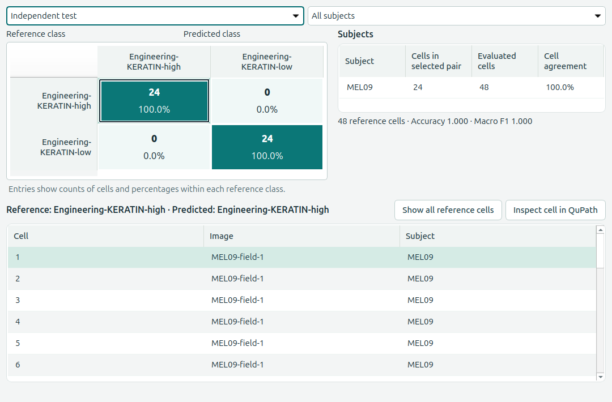</a>

_Independent-test review for MEL09 after fitting on MEL02 and MEL05. The walkthrough's reference labels were defined from KERATIN intensity. The matrix contains 48 held-out reference cells; the selected high-KERATIN pair contains 24. The cell list retains each exact identity for **Inspect cell in QuPath** while showing image and subject context._

Inspect cells from the main confusions for incorrect reference labels, merged outlines or staining patterns that the selected inputs do not distinguish. These findings can justify revised annotations, segmentation or classifier inputs. Once test results inform a revision, those subjects have contributed to model development; evaluate the revised model on a new independent test set. See [independent-test review](../tissue-classification/index.md#review-independent-test-results) for the shared acceptance procedure.

Continue to [Review cell assignments](#review-confidence-handling) to inspect predictions across the included population and choose a cutoff.

### Calculate cell-level evaluation scores

Evaluation uses each held-out cell's original predicted class, before any confidence cutoff is applied. We compare its reference label `y_i` with the prediction `ŷ_i`. For `K` classes, the confusion matrix contains

$$
C_{ab}=\#\{i:y_i=a,\ \hat y_i=b\}.
$$

Row `a` contains all `n_a = Σ_b C_ab` reference cells of class `a`; column `a` contains all predictions of that class. Precision `P_a` measures how many class-`a` predictions agree with the reference, recall `R_a` measures how many reference class-`a` cells we recover, and F1 combines them:

$$
P_a=\frac{C_{aa}}{\sum_b C_{ba}},\qquad
R_a=\frac{C_{aa}}{n_a},\qquad
F1_a=\frac{2P_aR_a}{P_a+R_a}.
$$

A metric with a zero denominator is recorded as zero. Macro precision, recall and F1 average over all declared classes, including a class absent from the held-out sample. Overall accuracy divides the diagonal total by the number `N` of held-out cells:

$$
\mathrm{accuracy}=\frac{\sum_a C_{aa}}{N}.
$$

Independent testing records pooled, per-image and per-subject metrics. In a pooled calculation, every labelled cell contributes one observation, so subjects with more labelled cells contribute more to the counts. The subject-weighted score used for parameter selection first normalizes each subject's confusion counts, as described in [parameter comparison and scoring](../tissue-classification/index.md#fit-and-evaluate-each-configuration).

Worked example

For 60 reference cells of class A and 40 of class B, suppose the predictions give

$$
C=\begin{pmatrix}54&6\\4&36\end{pmatrix}.
$$

Of the 60 A cells, 54 are predicted as A and six as B. Of the 40 B cells, four are predicted as A and 36 as B. Accuracy is `90/100 = 0.90`. Both classes have recall `0.90`; precision is `54/58` for A and `36/42` for B. Their F1 values are approximately `0.9153` and `0.8780`.

## Review cell assignments

After you accept the fitted model, it predicts a phenotype and records a score for each cell selected for phenotyping. You can set a score cutoff to leave lower-scoring predictions **Unclassified**. Review their staining and outlines alongside labelled examples before choosing the cutoff.

### The confidence cutoff

For each predicted cell, the confidence cutoff applies to the score of its winning class, $q_i$, which ranges from zero to one. How we calculate that score depends on the classifier.

- For **RF**, it is the fraction of trees that voted for the winning class.
- For **SVM**, we count the pairwise comparisons involving that class and use the fraction it won.
- For **LR** with two classes, a single logistic response and its complement give the two class scores. With more classes we fit a response for each class against the rest and divide each response by their sum. The largest of the resulting class scores supplies $q_i$.

The [classifier methods guide](../classifier-methods/index.md#classifier-scores) derives the scores from the fitted models.

With accepted confidence threshold `t`, we reject a prediction when

$$
\operatorname{rejected}_i=\mathbf{1}(q_i<t).
$$

Cells at or above the cutoff retain their predicted phenotype; those below it receive **Unclassified**. QuPath displays the accepted assignment. The original prediction and score remain available in the saved results.

<a href="../../assets/figures/result-reuse.svg">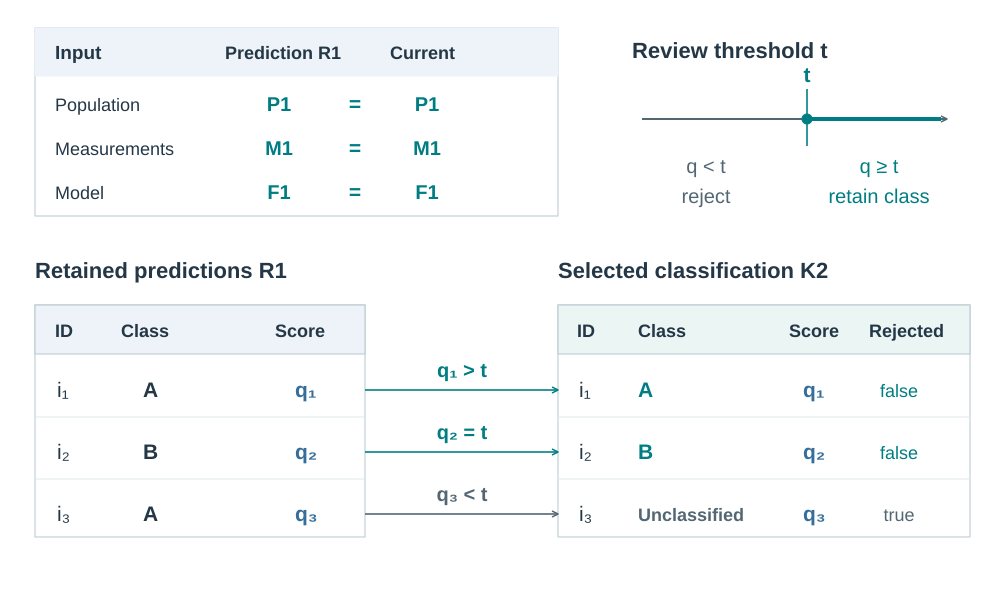</a>

_Schematic of applying a revised cutoff to saved predictions. `P1`, `M1` and `F1` identify the cells, measurements and fitted model. Scores at or above the cutoff retain their predicted class; lower scores become Unclassified._

### Apply the confidence threshold

#### Select the image or processing group

Use the navigator above the plot to choose an image or **Processing group**. Images using the same fitted classifier can share a group cutoff. The cutoff applies to every predicted class in the selected image or group; choosing one class in the plot filters the display only.

The score curve shows the fraction of predictions whose scores reach or exceed each value on its horizontal axis. For **All predicted classes**, its denominator is every predicted cell in the selected image or group. Selecting a **Predicted class** restricts the curve and its counts to cells predicted as that class. This lets you examine how many cells would retain that phenotype at a proposed cutoff.

#### Set the cutoff

For RF and LR, the initial cutoff is **0.5**. For SVM with three or more classes, it starts at **0**, retaining every predicted phenotype. Enter a value or drag the amber **Cutoff** handle above the plot to update the proposed assignments. SVM scores are fractions of pairwise comparisons, so increasing the cutoff changes assignments only when it passes a score present among the predictions.

For a two-class SVM, each winning prediction has a vote-agreement score of **1**. The review therefore shows its cell predictions without a score curve or cutoff control.

#### Inspect cells within a score range

To inspect a score range, drag across the plot or move its **From** and **To** bounds. Both endpoints are included. These bounds also support arrow keys; hold Shift for smaller steps. **Clear score selection** restores the full range. **Unclassified only** limits inspection to predictions below the current cutoff.

For a **Processing group**, the navigator below the plot shows how many cells in each image match the selected class and score range. Choose an image to inspect its cells while keeping the group's score curve above. The cell table sorts scores from highest to lowest within each predicted class; selecting a row centres the tissue viewer on that cell.

Compare low-scoring cells with labelled examples of the predicted phenotype to assess whether their staining and morphology support the prediction. Inspect individual channels for possible bleed-through or weak staining, and check the cell and nuclear outlines. If these checks do not explain the low score, review whether the training examples represent those cells and whether the selected classifier inputs distinguish the phenotypes.

<table><tr>
<td valign="top"><a href="../../assets/screenshots/supervised-processing-group-current.png">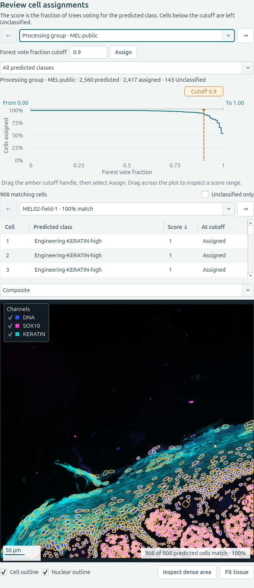</a></td>
<td valign="top"><a href="../../assets/screenshots/supervised-image-cutoff-current.png">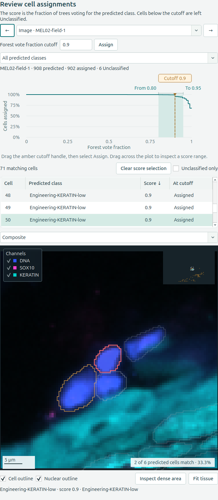</a></td>
</tr></table>

_Left: a **0.9** cutoff across the MEL02/MEL05 processing group retains **2,417 of 2,560 predictions** and leaves **143 Unclassified**. Right: the MEL02 score interval **0.80–0.95** contains **71 cells**; selecting a row centres the view on that cell. The highlighted prediction scores **0.9**, so it is retained at the cutoff. These reference classes were defined from KERATIN intensity. DNA is blue, SOX10 magenta and KERATIN cyan; the selected cell is outlined in coral. Scale bars: 50 µm and 5 µm._

When the sample has an accepted paired H&E alignment, the image dropdown also offers **H&E** and **Fluorescence + H&E**. Adjust the overlay opacity with the slider at the bottom right. The exported figure uses the displayed appearance; the accompanying field data includes the aligned H&E pixels and their position and spacing alongside the fluorescence image.

 

## Accept the model and assignment

After completing the required model and assignment reviews, select **Assign** to save phenotype assignments for the chosen image or Processing group. The result retains each cell's original predicted class and score alongside its accepted phenotype and rejection flag.

Changing only the confidence cutoff applies a new decision to those saved predictions. Changing reference labels, selected measurements, normalization, classifier parameters or KRONOS inputs requires a new fit. For a missing measurement, use **Cell measurements → Change cell measurements…**. For classifier inputs or reference labels, use **Cell phenotyping → Change classifier setup…**. Preview the affected steps before continuing, as described in [Change a completed or stopped step](../run/index.md#change-a-completed-or-stopped-step).

Native KRONOS encoding, cache and resource limits

### Frozen encoding, fitting and application

The [encoder preparation and deployment procedure](../tissue-classification/model-execution.md#prepare-the-encoder-and-image-patches) exports the selected model and marker panel for QuPath. Cell image sessions using that same package and panel share the exported encoder.

QuPath retains one loaded model and predictor for successive cells. Each encoder evaluation uses one cell; crop preparation retains at most 16 cells within a 64 MiB bound and passes those crops directly to the native session. A saved encoder can be reopened for later cell extraction.

Before a supervised reference snapshot is frozen, the image cells receive the exact ordered measurements `KRONOS2: cell embedding: 0000` through `0767`. The reference review checks these measurements with the accepted image and segmentation. Reference labels enter the classifier fit after image encoding. The training cells then fit the selected [feature normalization and PCA](#feature-normalization-and-pca) and classifier.

The saved object classifier retains the encoder, channel mapping and crop settings in its `feature_source`, together with the fitted RF/SVM/LR, class order, normalization and PCA where selected. During application or evaluation, it uses those settings to check the image inputs and obtain each cell's 768 features before prediction. A changed package, missing channel, unsupported crop policy or mismatched segmentation generation stops the operation.

### Identity and cache reuse

Saved embeddings are reused only for the inputs that produced them. These include the model-package checksum, selected marker panel, normalization, channel order and crop settings. Cell-specific inputs include the image checksum, segmentation version, cell ID, source channel indices and calibration, nucleus and cell ROI checksums, image plane, crop geometry, raw pixels and binary mask. Moving an outline, replacing pixels or changing the channel mapping therefore prevents reuse of the old vector.

The feature cache stores float32 vectors indexed by a checksum of these model, image and cell inputs. It retains at most 4,096 entries, approximately 12 MiB of stored vectors and checksums, and checks integrity when reading. A checksum mismatch stops feature reuse and reports the affected entry. A later calculation using the same cache can reuse entries whose inputs match. Each calculation verifies the model package and the image and mask data used to identify those entries.

### Input and resource checks

The implementation rejects uncalibrated images because the requested physical sampling cannot be mapped to their source pixels. Confirm the image calibration before preparing the cell inputs.

It also rejects excessively large full-resolution reads, capping a sampled source rectangle at four million pixels and its conservative multichannel allocation estimate at 256 MiB. Select a smaller physical sampling size if the read exceeds these bounds, while keeping the complete target cell inside the field. If both requirements cannot be met, inspect the segmentation or use measured-cell features.

Saved classifier, assignments and memory use

### Prediction review, saved state and resources

We save each cell’s original predicted class and score with its accepted phenotype and cutoff. Before writing assignments, we check that the reviewed predictions still correspond to the selected image, segmentation, measurements and model. The saved decision also records the local account that accepted it.

The selected features enter OpenCV as a matrix of 32-bit floating-point values, with one row per cell and one column per feature. Java fits QuPath's normalizer and, when selected, its PCA projector; both are saved with the feature extractor and classifier. Classes use consecutive integer codes in the saved class order. During validation, predictions are applied to copies of the reference cells, preserving the classes displayed on the original QuPath objects.

The saved QuPath `ObjectClassifiers` JSON contains the OpenCV classifier, class list, score kind, feature extractor and optional KRONOS source. Reopening it restores the fitted model together with the feature preparation and class order needed to interpret its predictions.

The saved score definition identifies how the winning value was calculated:

| Classifier | Saved score kind |
|---|---|
| RF | `native_tree_vote_fraction` |
| SVM | `native_svm_pairwise_vote_fraction` |
| LR | `native_logistic_ovr_normalized_score` |

For each classified cell we save its predicted class, winning score and one `Classifier: score: <class>` measurement per class. For an SVM we also save the applicable pairwise margins. The `mif_classifier_score_kind` field identifies the type of score. Replacement clears prior classifier score/margin columns. Preview and failed application restore the captured prior classes, class probabilities, metadata and numerical columns written by that classifier. Other measurement columns retain their values.

Prediction uses batches of at most 4096 cells, with a float feature budget of 8,388,608 values and an additional estimated 32 MiB limit for boxed score/margin workspaces. SVM batch size includes its quadratic pair count; a single row exceeding that score workspace is rejected. Training retains the selected feature matrix in memory for OpenCV. Saved per-cell scores and margins also require more storage as the number of classes increases.

### Outputs and failure conditions

The fit saves the native classifier, fitted feature preparation, class order, training counts and a report of the selected training procedure. Independent evaluation returns its declared-label confusion counts and metrics. Application records each cell's prediction, the reviewed score cutoff and its accepted phenotype assignment.

The saved image, cell population and analysis regions must match the selected inputs so assignments return to the cells for which they were calculated. A mismatch stops execution. Review the current input selection before proceeding; replacement segmentation requires references to its new cells, as explained [above](#label-and-freeze-reference-cells-in-qupath).

Every training cell needs the selected measurements, and every phenotype needs labelled training cells. For KRONOS, the selected channels must also match the saved marker mapping and normalization. Errors identify the missing measurement, channel or class; the revision controls above return to the relevant selection.

Application checks the saved classifier and support script, the returned classes and scores, and agreement between the SVM margin-derived label and native prediction. A failed application restores the accepted classes, scores and measurements. Inspect the recorded error before requesting another application; the restored assignments are the preceding accepted result.

KRONOS cell implementation and sources

### Sources and implementation

[1] Shaban et al., *A Foundation Model for Spatial Proteomics*, Methods,
[cell phenotyping](https://arxiv.org/html/2506.03373v1), arXiv:2506.03373.

[2] Mahmood Lab, [CORAL](https://github.com/mahmoodlab/CORAL), official project description of cell patches and KRONOS2 representations.

[KronosCellFeatureSource](../../../src/python/mif_pipeline/orchestration/batch_training/qupath_kronos_cell.py) records the selected channels, encoder settings and cell-crop settings. The [Groovy cell-extraction script](../../../qupath/scripts/cell_analysis/kronos_cell_features.groovy) opens the image and cell dataset, checks that each cell fits inside its nucleus-centred crop, and requests the required image region from QuPath.

Java's [CellImageSamples](../../../src/java/org/mif/image/CellImageSamples.java) samples that region and constructs the cell mask. [FrozenEncoder](../../../src/java/org/mif/inference/FrozenEncoder.java) applies the exported KRONOS model to the masked crop and returns its 768-value embedding. The supervised classifier reads these embeddings in the same order as the reference-cell labels.

Native supervised implementation and sources

### Implementation and sources

Java's [FeaturePreparation](../../../src/java/org/mif/classification/FeaturePreparation.java) calls QuPath's normalization and PCA functions on the selected training measurements or embeddings. [OpenCvTraining](../../../src/java/org/mif/classification/OpenCvTraining.java) fits RF, SVM or LR through OpenCV; their shared [method calculations](../classifier-methods/index.md) describe fitting and prediction. [MifSupervisedObjectClassifier](../../../src/java/org/mif/classification/MifSupervisedObjectClassifier.java) retains the fitted feature transformation and classifier, then applies them to later cells.

The Groovy scripts connect these calculations to the selected images, reference cells and review decisions: [fit a classifier](../../../qupath/scripts/general/02_train_native_classifier.groovy), [evaluate held-out cells](../../../qupath/scripts/general/04_evaluate_held_out_classifiers.groovy), and [apply cell phenotypes](../../../qupath/scripts/cell_analysis/05_train_supervised_phenotypes.groovy).

The classifier integrates with [QuPath's object-classifier interface](https://github.com/qupath/qupath/blob/v0.7.0/qupath-core/src/main/java/qupath/lib/classifiers/object/ObjectClassifiers.java). The [OpenCV 4.11.0 LR implementation](https://github.com/opencv/opencv/blob/4.11.0/modules/ml/src/lr.cpp) defines the logistic-regression optimizer and prediction calculation.

---

**Continue:** [Secondary structures](../secondary-structures/index.md).
