# Unsupervised phenotyping

[Analysis stages](../../../README.md#analysis-stages)

**Open:** **Run → Cell phenotyping**, then select **Unsupervised phenotyping**.

**On this page:** [Fit across slides](#choose-how-to-fit-slides) · [Choose a method](#choose-the-clustering-method) · [Prepare measurements](#select-features-and-weights) · [PhenoGraph method and settings](#phenograph) · [FlowSOM method and settings](#flowsom) · [Review groups](#run-and-inspect-the-measured-profiles) · [Name, combine or subdivide groups](#assign-biological-names) · [Accept and export](#saved-result)

Unsupervised phenotyping groups cells by their selected marker measurements. Each cell contributes a vector containing those measurements, such as whole-cell CD20 Mean, CD4 Mean and Ki67 Mean. Choose **PhenoGraph** or **FlowSOM** to fit the groups, then compare their marker profiles and staining before assigning phenotype names.

## Choose how to fit slides

The preceding phenotyping page determines which cells enter the fit. On **Choose how to fit slides**, **Pooled** fits those cells together within each **Processing group** defined on Samples. Each processing group receives its own fitted model and set of clusters. Images containing more cells contribute more measurement rows.

**Per slide** fits each slide separately. After fitting, interpret and name its clusters using that slide's marker profiles and staining. A cluster number is specific to its fit. Compare the marker profiles across slides before giving two clusters the same phenotype name.

For pooled fitting, use the same measurement definitions and comparable intensity scales across images. Differences in staining, intensity correction or imaging settings can separate cells by image. The [feature scaling](#robust-feature-scaling-and-weights) uses the combined fitting population and retains these between-image differences.

<a href="../../assets/screenshots/maps-chl-clustering-scope-current.png">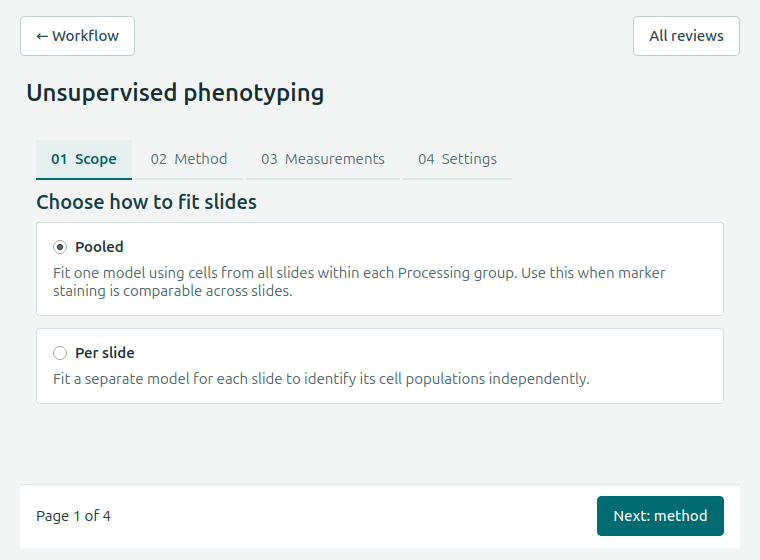</a>

_**Per slide** fits the cells from each slide separately. **Pooled** fits slides together within each Processing group._

## Choose the clustering method

On **Choose a method**, select **PhenoGraph**, the initial choice, or **FlowSOM**.

**Choose FlowSOM** when you have an approximate number of phenotype groups in mind or need efficient fitting across a large slide batch. The [FlowSOM section](#flowsom) explains how SOM training and hierarchical clustering form these groups.

**Choose PhenoGraph** when you want to explore the measured populations without specifying their number in advance. Fitting generally requires more time and memory as the cell population grows. The [PhenoGraph section](#phenograph) explains how neighbour connections and Leiden partitioning form these groups.

Either method can separate one cell type into several groups or combine cell types whose selected measurements are similar. After fitting, compare marker profiles and staining during [group review](#name-merge-or-split-groups), then merge groups that represent the same phenotype. If a group contains distinguishable populations, [recluster its cells](#refit-selected-clusters) with either method to examine finer groups. 

<a href="../../assets/screenshots/maps-chl-clustering-method-current.png">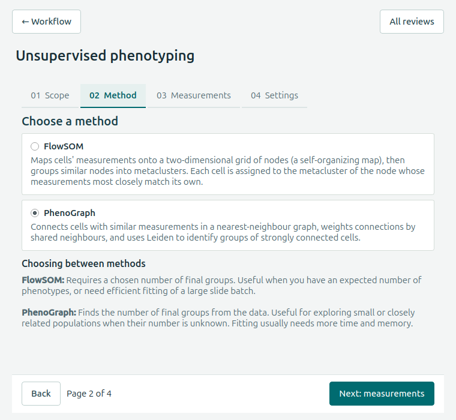</a>

_The MAPS example selects **PhenoGraph** for its initial fit._

## Select features and weights

On **Choose marker measurements**, select the marker, cellular region and saved **Mean** or **Median** to use for each input. The matrix shows the available combinations; **Inputs for each cell** lists the selected measurements and lets you remove them.

For a larger marker panel, use the search and cell-region/statistic filters to find measurements. **Select shown** and **Clear shown** affect only the filtered rows. Each statistic's column heading provides the same actions for that column.

Choose measurements that distinguish the populations being studied. Mean and Median from the same marker contribute separate distance terms, so selecting both gives that marker two contributions. A whole-cell Mean and a nuclear Mean also summarize different pixels, according to the regions chosen in [Cell measurements](../cell-measurements/index.md#choose-cell-measurements). Channels assigned nuclear/DAPI or autofluorescence roles are excluded from the protein-marker inputs.

<a href="../../assets/screenshots/maps-chl-clustering-inputs-current.png">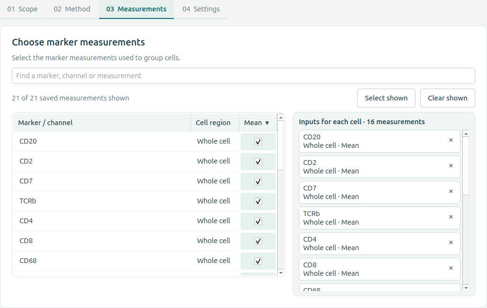</a>

_The MAPS example selects **16 whole-cell Mean measurements**: **CD20, CD2, CD7, TCRb, CD4, CD8, CD68, CD163, CD206, CD11c, CD16, CD31, Podoplanin, CD56, CD30 and HLA-DR**._

Every included cell must have a finite value in every selected measurement. If fitting reports missing or non-finite values, inspect the identified cells and measurements. Select measurements available for every included cell, or correct the problem in [Cell measurements](../cell-measurements/index.md) before fitting again.

### Robust feature scaling and weights

Markers can have very different numerical ranges. Before either method compares cells, we subtract each selected measurement's population median and divide by its interquartile range. This expresses a difference relative to the spread of that measurement in the fitting population. Both statistics come from the full fitting population, so adding or removing cells in a new full fit can change the scaling.

For cell `i` and measurement `j`, let `x_ij` be the saved value, `m_j` the population median, `q25_j` and `q75_j` the 25th and 75th percentiles, and `w_j` its chosen positive weight. The transformed input is

$$
 s_j=\begin{cases}
 q75_j-q25_j,&q75_j>q25_j,\\
 1,&q75_j=q25_j,
 \end{cases}
 \qquad z_{ij}=w_j\frac{x_{ij}-m_j}{s_j}.
$$

When the interquartile range is zero, a divisor of one retains the cell's deviation from the median. 

**Advanced settings → Feature scaling and weights**, on **Set method parameters**, shows a weight for each selected measurement. Every weight starts at **1.0** and must be positive. Increasing a weight increases that measurement's contribution to differences between cells. For Euclidean distance,

$$
 d(i,l)^2=\sum_j(z_{ij}-z_{lj})^2
 =\sum_j w_j^2\frac{(x_{ij}-x_{lj})^2}{s_j^2}.
$$

The same median is subtracted from every cell, so it cancels in the difference between two cells. The divisor `s_j` and weight `w_j` determine each measurement's contribution to their distance. A weight of two multiplies its squared-distance contribution by four. The sections below explain how [PhenoGraph](#phenograph) and [FlowSOM](#flowsom) use these distances.

## PhenoGraph

PhenoGraph represents cells as nodes in a graph and groups them by the strength of their connections. We find each cell's nearest neighbours in the scaled, weighted measurements, then use the overlap between neighbour sets to weight those connections. Leiden partitions the resulting graph into groups. The original method was introduced by [Levine and colleagues](https://doi.org/10.1016/j.cell.2015.05.047); we use **Python PhenoGraph 1.5.7** with **Leiden** community detection.

### Find neighbouring measured profiles

We use scikit-learn's nearest-neighbour search to find the `k` closest other cells to each cell, using Euclidean distance in the [scaled, weighted measurements](#robust-feature-scaling-and-weights). For a population of `N` cells, the number of neighbours is limited to `k_effective = min(k, N−1)`.

Each cell therefore selects a fixed number of neighbours, even where measured profiles are sparsely distributed. This selection can place cell `j` among cell `i`'s closest neighbours even when `i` is outside `j`'s set. These neighbour sets define the candidate connections whose weights we calculate next.

### Weight the shared neighbours

To give greater weight to cells embedded in similar local populations, we compare their neighbour sets. Two cells with many shared neighbours receive a stronger connection than two whose neighbours differ. Let `N(i)` and `N(j)` be these sets. Their Jaccard similarity is the number of shared neighbours divided by the number of distinct neighbours in either set:

$$
 J_{ij}=\frac{|N(i)\cap N(j)|}{|N(i)\cup N(j)|}.
$$

For equal-sized sets of `k_effective` neighbours with `c_ij` shared members,

$$
 J_{ij}=\frac{c_{ij}}{2k_{\mathrm{effective}}-c_{ij}}.
$$

We calculate Jaccard weights only for the directed candidate connections selected by the neighbour search. Calling the resulting matrix `A`, we combine the two directions into an undirected weight:

$$
 W_{ij}=\frac{A_{ij}+A_{ji}}{2}.
$$

A reciprocal connection retains its Jaccard weight and a connection present in one direction receives half that weight. Cells can be near one another in measurement space but share no selected neighbours; their connection then has zero weight and is removed before community detection.

<a href="../../assets/figures/clustering-graph.svg">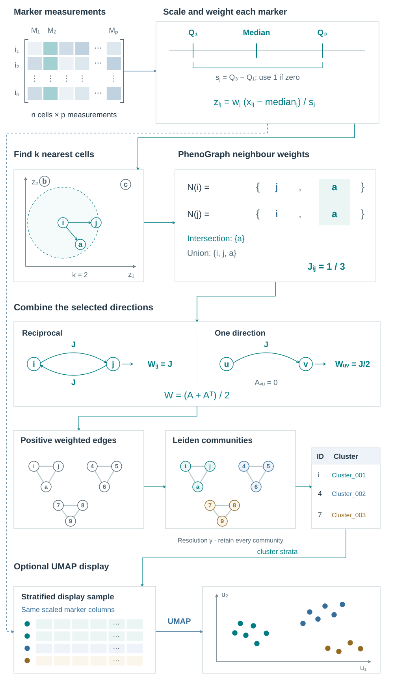</a>

_Schematic of scaling, neighbour selection, graph construction and Leiden grouping. With **k=2**, the worked neighbour sets for `i` and `j` share cell `a`, giving a Jaccard weight of **1/3**. Reciprocal and one-way connections become undirected weights by averaging the selected directions. The weighted graph separates into three groups. The UMAP branch uses the scaled measurements to position cells and the fitted groups to colour them._

### Partition the graph with Leiden

We use Leiden to search for groups whose internal connections are stronger than expected from the cells' total connection weights. For each cell `i`, the **weighted degree** `s_i = sum_j W_ij` is the sum of the weights connecting it to its neighbours. Let `m = sum_(i<j) W_ij` be the total weight of the graph, counting each undirected connection once. Leiden seeks to increase the following objective:

$$
 Q=\sum_{ij}\left(W_{ij}-\gamma\frac{s_i s_j}{2m}\right)
       \mathbf1(c_i=c_j).
$$

Here, `c_i` is cell `i`'s group and `gamma` is the selected resolution. The expected-weight term depends on the cells' weighted degrees. Increasing `gamma` raises the amount of observed connection weight needed to favour putting cells together. At `gamma=1`, the objective is proportional to weighted modularity. [Objective definition](https://leidenalg.readthedocs.io/en/latest/reference.html#rbconfigurationvertexpartition).

Leiden first moves cells between neighbouring groups when doing so improves this objective. It then refines the provisional groups into smaller connected parts and aggregates those parts into a smaller graph, retaining the provisional grouping as the starting assignment. Moves on that graph can transfer several cells together. We repeat these iterations until the optimizer reports no further improvement. [Leiden algorithm](https://doi.org/10.1038/s41598-019-41695-z).

We retain every resulting group without a minimum-size filter, so groups containing only one or a few cells remain available for marker and tissue review. We also retain **isolated cells**, whose candidate connections all received zero weight and were removed during graph construction. If the graph has no remaining connections at all, we assign each cell to its own group without running Leiden.

### Set PhenoGraph parameters

**Nearest neighbours (k)** starts at **15** and accepts 1–64. Increasing `k` broadens the [neighbour sets](#find-neighbouring-measured-profiles) and can connect populations that remain separate with fewer neighbours. Its effect depends on how the enlarged sets overlap, because that overlap determines the graph weights.

**Leiden resolution** starts at **1.0**. Through the expected-weight term in [Leiden's objective](#partition-the-graph-with-leiden), higher values favour smaller groups and lower values favour larger groups.

**Random seed**, under **Advanced settings**, starts at **0** and controls the stochastic community search.

<a href="../../assets/screenshots/maps-chl-clustering-phenograph-current.png">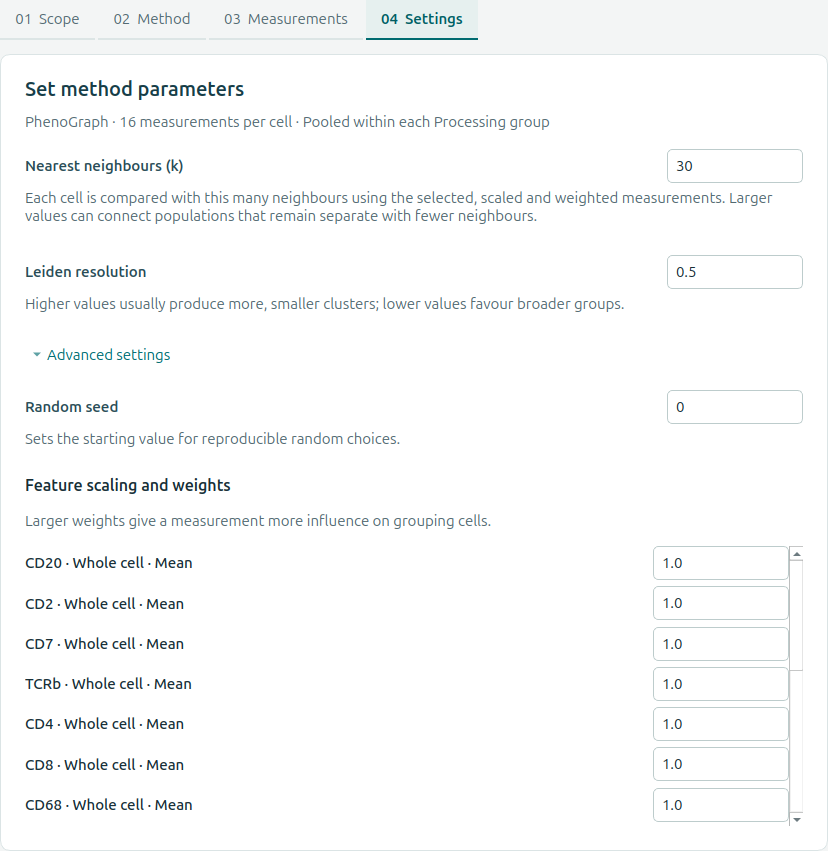</a>

_The initial MAPS fit uses **30 nearest neighbours**, **Leiden resolution 0.5**, seed **0** and weights of **1.0** for all **16 whole-cell Mean measurements**. It produces the **12 groups** reviewed below._

## FlowSOM

FlowSOM represents the cells' measurement patterns with a smaller set of learned profiles. We learn these profiles on a **Self-Organizing Map (SOM)**, a two-dimensional grid whose nodes each store one numerical value for every selected measurement. We then group the learned profiles into **metaclusters**, and each cell inherits the metacluster of its closest profile. The map size controls how many profiles can be learned; the requested number of metaclusters controls how those profiles are combined into cell groups. The two-stage construction was introduced by [Van Gassen and colleagues](https://doi.org/10.1002/cyto.a.22625); we use the **FlowSOM 0.2.2** implementation described below.

### Learn the map profiles

We start each grid node with the scaled, weighted measurements of a different randomly selected cell. The node stays in that grid position throughout training, but its measurement profile changes as cells are presented to the map.

At each update we draw a cell at random and find the node whose profile is closest to its measurements. We move that profile towards the cell’s values and adjust the profiles of neighbouring nodes in the same direction. Updating neighbours together encourages nearby positions on the grid to represent similar patterns of staining. For `N` cells and `R` training iterations we perform `R × N` updates. Because we draw a cell afresh for each update, an individual cell can contribute several times.

For a drawn cell's scaled, weighted measurement vector `z`, the closest node is

$$
 b(z)=\arg\min_u\lVert z-c_u\rVert_2,
$$

where `c_u` is the profile stored at node `u`. We update the profiles at the winning node and its current grid neighbours as follows:

$$
 c_u^{\mathrm{new}}=c_u+\alpha_t(z-c_u)
 \qquad\text{when}\qquad d_{\mathrm{grid}}(u,b(z))\le r_t.
$$

The learning rate `alpha_t` sets the fraction of the difference between the stored profile and the drawn cell that is added to the profile. The radius `r_t` determines which grid neighbours receive that update. Grid distance is the largest absolute difference between the two nodes' row and column positions, called **Chebyshev distance**. Every node inside the radius uses the same learning rate; nodes outside it retain their current values.

The learning rate decreases from **0.05 towards 0.01** as training proceeds. The radius begins at the 67th percentile of the distances between grid nodes and contracts until only the winning node is updated. Early updates therefore adjust broader regions of the map, while later updates refine individual profiles. [Pinned SOM implementation](https://github.com/saeyslab/FlowSOM_Python/blob/e13e1d2b1d11e3c4540c444131967b4dc6d05871/src/flowsom/models/som_estimator.py), [training updates](https://github.com/saeyslab/FlowSOM_Python/blob/e13e1d2b1d11e3c4540c444131967b4dc6d05871/src/flowsom/models/_som.py).

### Combine the map profiles and assign cells

After training, we combine the learned profiles using **agglomerative hierarchical clustering**. We start with each profile in a separate group, join the closest pair of groups, then repeat the comparison with the merged group included. These successive merges form a hierarchy of increasingly broad groups. We calculate the distance between groups using **average linkage**, taking the mean Euclidean distance over every pair of profiles with one member in each group. For profile groups `A` and `B`, this is

$$
 D(A,B)=\frac{1}{|A||B|}\sum_{u\in A}\sum_{v\in B}\lVert c_u-c_v\rVert_2.
$$

We cut the hierarchy at the requested number of metaclusters. Groups can contain profiles from different parts of the training grid because the comparison uses their learned marker values. Each profile contributes equally to the average, regardless of how many cells are closest to it. Profiles with no assigned cells also participate in this calculation.

We compute this hierarchy directly from the learned profiles, so metaclustering is deterministic for a fixed set of profiles. Changing the random seed can affect the result through the preceding SOM training. [Pinned metaclustering implementation](https://github.com/saeyslab/FlowSOM_Python/blob/e13e1d2b1d11e3c4540c444131967b4dc6d05871/src/flowsom/models/consensus_cluster.py).

We then assign each cell to its closest learned profile using the same Euclidean distance as in training, and give it that profile's metacluster label. Several profiles can therefore contribute cells to one fitted group. Only metaclusters with assigned cells appear in review, so the number of reviewed groups can be below **Final clusters**.

<a href="../../assets/figures/flowsom-mechanism.svg">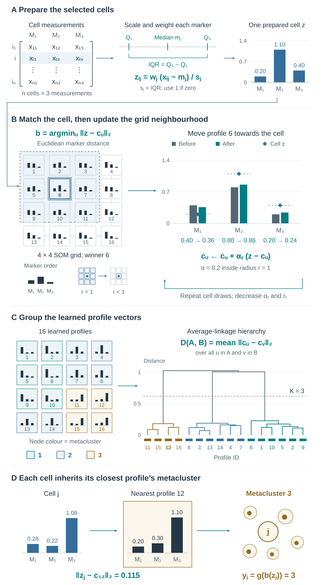</a>

_The bars show three prepared marker measurements for each cell or map profile. In B, profile 6 is closest to the selected cell. It and its eight neighbours move towards that cell’s values, with progressively smaller updates and neighbourhoods as training proceeds. In C, average-linkage clustering groups the 16 learned profiles into three metaclusters. Cell j receives metacluster 3 through its nearest profile, number 12._

### Set FlowSOM parameters

**Final clusters** starts at **20** and specifies the number of metaclusters; it must be between two and the number of map nodes. Too few groups can combine distinct cell types. Too many groups can divide one cell type into several clusters.

Under **Advanced settings**, **Map width and height** starts at **10**, giving a **10 × 10 map with 100 profiles**. Larger maps can retain finer patterns during learning, but require more profile comparisons and memory. The side length can be 2–30, and the fitting population must contain at least as many cells as nodes.

**Training iterations** starts at **10** and accepts 1–100. Increasing this value gives the map more [training updates](#learn-the-map-profiles) and increases fitting time.

**Random seed**, initially **0**, controls map initialization and the training draws; it accepts integers from 0 through 4,294,967,295.

<a href="../../assets/screenshots/maps-chl-clustering-flowsom-current.png">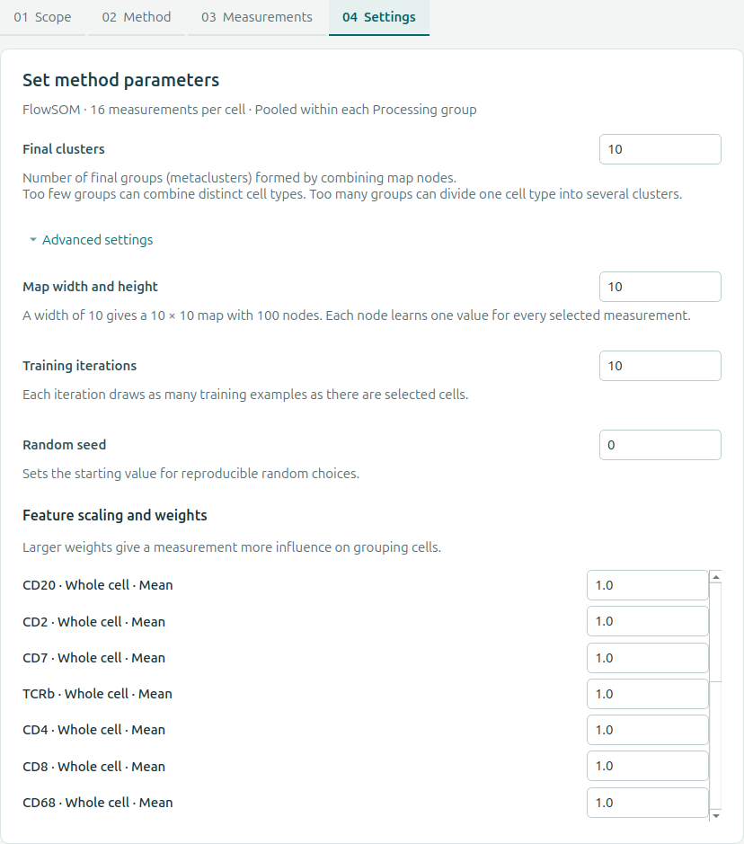</a>

_For the **16 MAPS measurements**, this FlowSOM fit uses **10 final clusters**, a **10 × 10 map**, **10 training iterations**, seed **0** and a weight of **1.0** for each measurement. **Advanced settings** exposes the map, training and scaling choices. The main walkthrough uses the initial PhenoGraph fit shown above._

## Interpret groups

Select **Apply settings** to fit the selected cells. On **Interpret groups**, compare their marker profiles and staining, then name, merge or recluster the selected groups. **Review phenotypes** summarizes the resulting phenotype groups before acceptance.

We give initial groups labels such as `Cluster_001` and `Cluster_002`, ordered by their first member in stable sample/image/cell order. When reclustering, we assign new labels above the highest existing cluster number, preserving the distinction between previous and resulting groups.

Select one or several fitted groups above the marker-profile comparison. Choose **FlowSOM map** or **UMAP** from the graph selector to explore their measurement patterns, and use **Cells in tissue** to inspect the staining and outlines. Selecting a profile, map node or UMAP point locates its group or cell in that tissue view. Enter phenotype names and choose group actions for the checked groups in the editing panel.

### Compare the marker profiles

The profile comparison summarizes the selected marker measurements for the cells in each fitted group. It initially shows **Median across cells**. For example, for **Cell: Ki67: Mean**, we take each cell's saved whole-cell Ki67 Mean and calculate the median within its group. **Mean across cells** calculates the arithmetic mean of those same cell measurements. Both summaries use the original measurement units.

For a pooled fit, we summarize all member cells together, so an image contributing most of a group's cells also contributes most of the values being summarized. A median can conceal a smaller population with different marker expression, while a mean can be shifted by a few unusually bright cells. Compare the summaries with the group's image counts and staining before assigning a phenotype name.

Each measurement column has its own colour scale, spanning its lowest to highest cluster profile value. Hover a square to read its exact mean and median in the original measurement units. When comparing different markers, use those values and their staining patterns; equally dark squares can represent different intensities.

<a href="../../assets/screenshots/maps-chl-initial-profiles-current.png">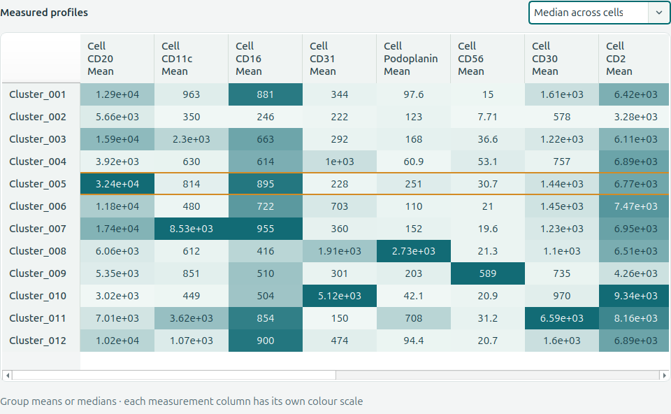</a>

_The MAPS initial **PhenoGraph** fit contains **12 groups** across **3,459 cells**, using **30 neighbours**, resolution **0.5**, seed **0** and the 16 measurements above. Selected **Cluster_005** contains **607 cells (17.55%)**. Its CD20-rich profile and inspected membrane staining support the name **B cells**._

### Inspect the learned FlowSOM map

For a FlowSOM result, choose **FlowSOM map** beside the marker profiles to examine how the learned profiles vary within and between metaclusters. Each node stores one vector learned during SOM training, in the median-centred, IQR-scaled and weighted units used for [fitting](#robust-feature-scaling-and-weights). Its values reflect the sequence of training updates. To read the mean or median of the cells assigned to a cluster in original measurement units, use the **Measured profiles** table.

#### Construct the review tree

The review map connects the learned profiles in a tree so their similarities can be inspected. The regular grid determines which nodes receive joint updates during [SOM training](#learn-the-map-profiles); average-linkage clustering then assigns their metaclusters. With those profiles and assignments fixed, we build the review tree by calculating the Euclidean distance between every pair of learned profiles:

$$
 d(u,v)=\sqrt{\sum_j(c_{uj}-c_{vj})^2}.
$$

Here, `c_uj` is the learned value of measurement `j` at node `u`. Every pair of nodes is a candidate connection, including pairs that were far apart on the training grid. [Kruskal's algorithm](https://docs.scipy.org/doc/scipy/reference/generated/scipy.sparse.csgraph.minimum_spanning_tree.html) considers these connections from shortest to longest distance and adds a connection when it joins two previously disconnected parts of the tree. The resulting **minimum spanning tree** connects all `M` nodes with `M − 1` links and has the smallest possible total distance across those links.

<a href="../../assets/figures/flowsom-review-tree.svg">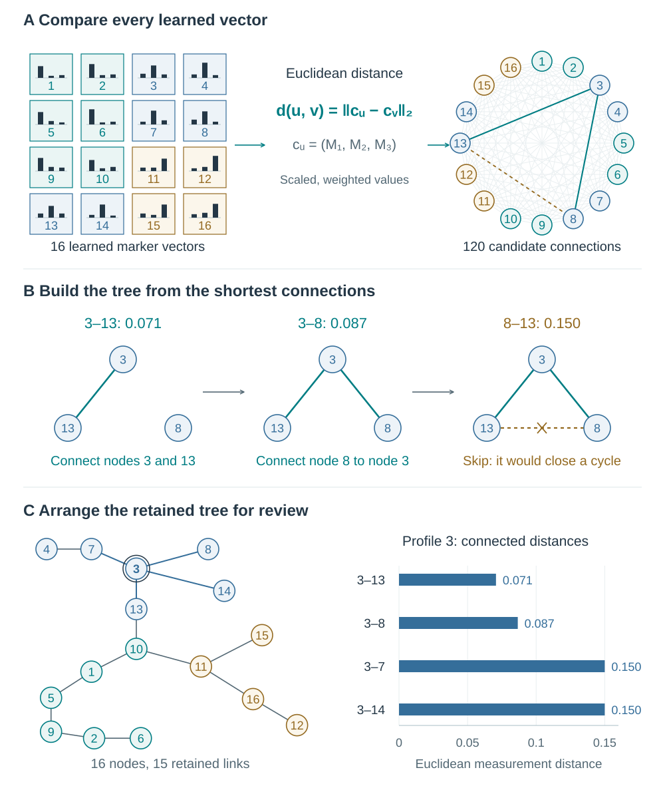</a>

_The review tree uses the 16 learned profiles from the [FlowSOM overview](#combine-the-map-profiles-and-assign-cells). A compares all 120 pairs. In B, the edges from 3 to 13 and from 3 to 8 connect previously separate profiles. Adding the edge from 8 to 13 would close a loop, so we skip it. C shows the resulting 15 connections. Use the distance axis beside the tree to compare the four neighbours of profile 3._

#### Inspect profiles and their distances

For display, we arrange the tree's branches around a central node. The drawn length of a link follows this layout; its reported **distance** measures the difference between the two nodes' learned profiles using the equation above. Node colours identify the metaclusters formed by [average-linkage clustering](#combine-the-map-profiles-and-assign-cells).

Amber rings mark the nodes belonging to the selected groups, with a darker ring around the focused node. The upper-left readout identifies that node as **Profile** and reports the distance to its neighbour, or the range of distances if it has several neighbours. Hover over a node to inspect its learned measurement values.

Use **⋯ → Learned profile values** to compare the complete learned vectors, or **Fit graph** to restore the full tree after zooming or panning. After acceptance, **Results & export → FlowSOM learned profiles** provides CSV tables of those vectors and the distance associated with each tree connection.

<a href="../../assets/screenshots/maps-chl-flowsom-profiles-current.png">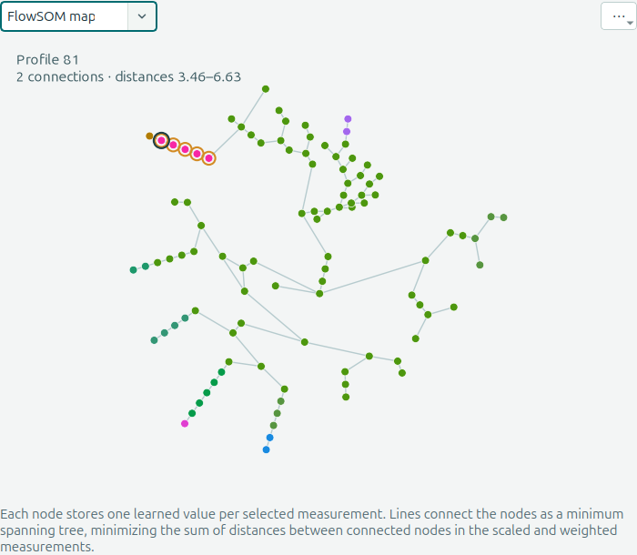</a>

_The FlowSOM fit of the same **3,459-cell MAPS field** uses the **16 selected measurements**, a **10 × 10 map** and **10 metaclusters**. Amber rings identify the nodes of **Cluster_040**, which contains **117 cells**. The focused node, **Profile 81**, has two tree connections with distances ranging from **3.46 to 6.63** in the scaled, weighted measurements._

### Inspect the UMAP view

Choose **UMAP** from the graph selector, then select **Calculate UMAP view** if the plot has not yet been calculated. UMAP uses the selected measurements with the same median/IQR scaling and weights as clustering to place each displayed cell at a two-dimensional plot position. Each point retains the cell identity and fitted cluster, linking its position in the plot to the same cell in the tissue viewer. Use **⋯ → UMAP settings…** to reopen the settings for an existing view. [UMAP method](https://arxiv.org/abs/1802.03426).

Hover a point for its coordinates, cluster and displayed marker value. Selecting a group in the profile comparison highlights its points. The **Colour by** control switches between clusters and individual marker measurements. Marker colouring uses the original values among the displayed cells, with their range shown on the colour bar.

<a href="../../assets/screenshots/maps-chl-umap-view-current.png">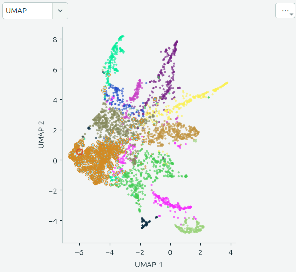</a>

_UMAP view of the **3,459-cell MAPS field** in the [12-group initial fit](#maps-initial-example). Amber rings identify the **607 cells** in Cluster_005, labelled **B cells** after reviewing their marker profiles and staining. The [linked tissue view](#inspect-cells-in-tissue-with-flowsom-and-umap) shows the selected cell and its surrounding field._

#### Set sampling and layout

**Maximum cells** starts at **50,000**. Larger populations use a reproducible sample across clusters and image sections. The sampler reserves one cell per cluster/section combination when the selected maximum permits, then allocates the remaining places in proportion to group sizes. If the maximum cannot represent every combination, increase it as requested.

Under **Advanced settings**, **Neighbours** starts at **15** and controls how many cells with nearby measurement vectors influence the plot layout. **Minimum distance**, initially **0.1**, controls how tightly points can gather in that layout. **Seed**, initially **0**, controls repeatable sampling and placement. Changing these settings recalculates the plot positions; changing the colouring reuses them.

Distances and gaps in the two-dimensional layout can differ from those in the selected measurements. Use UMAP to locate cells for image inspection. To divide a fitted cluster, use [Recluster selected groups…](#refit-selected-clusters).

**Export figure…** saves SVG, PDF or a 300 dpi PNG. Dense points are rasterized within SVG/PDF while axes and text remain editable. The accompanying coordinate data include cell identities, original measurement values, cluster labels and UMAP settings.

### Inspect cells in tissue with FlowSOM and UMAP

Select a group in the measured-profile table or a node in the **FlowSOM map** to highlight that group's cells in **Cells in tissue**. Selecting a point in **UMAP** also centres the viewer on that individual cell.

#### Locate the selected group

If the result contains several images, choose an image from the navigator. Each entry reports how many of its clustered cells belong to the selected group, as a count and percentage. Comparing both values helps distinguish a large cell contribution from a high proportion of that image's cells. A group concentrated in one image may reflect biological composition or differences in staining and image preparation. Compare its marker profiles and staining across images when interpreting it, especially when one image supplies most of the cells summarized in the pooled profile.

The tissue overview uses an amber overlay to show where the selected group's cells are concentrated. We count the selected cell centres in a regular grid, then apply a Gaussian filter to this count map to form the overlay. Hover over an area to read its exact selected count and percentage of all clustered cells there. The overlay's brightness scale is calculated separately for each image and selected group.

<a href="../../assets/figures/maps-chl-cluster-005-whole-field.png">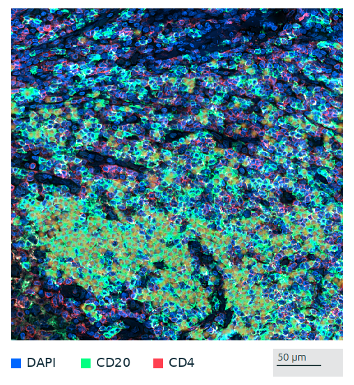</a>

_Whole-field view of the MAPS example: **607 of 3,459 cells (17.55%)** belong to Cluster_005. The amber overlay shows where these cells are concentrated over DAPI, CD20 and CD4 staining. Scale bar: **50 µm**._

#### Compare staining and outlines

Click an area in the tissue overview to zoom in, or choose **Inspect dense area** to open a field containing many selected cells. The button then becomes **Next dense area**, visiting fields in order of their selected-cell counts, from highest to lowest. Nearby locations are skipped to avoid repeatedly inspecting the same area. 

Drag to pan and use Ctrl+scroll to zoom. At closer views, amber outlines identify the selected group's cells and grey outlines show other clustered cells. Click an outline to select that cell's group in the profiles, graph and naming controls. When several groups are selected, the tissue heading identifies the group being displayed. The field summary reports how many clustered cells in the visible field belong to that group, as a count and percentage.

<a href="../../assets/screenshots/maps-chl-unsupervised-interpret-current.png">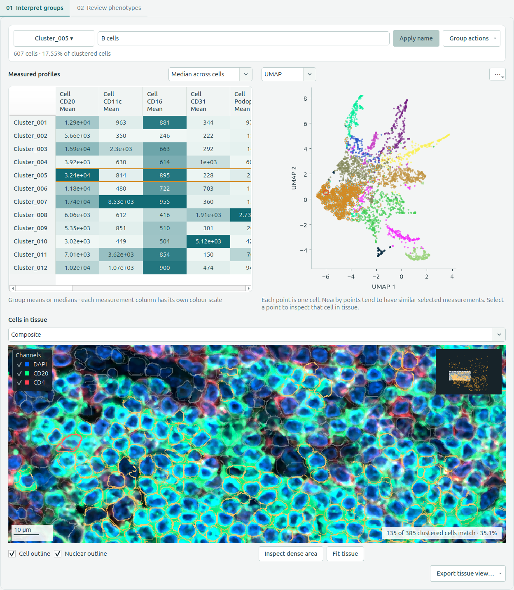</a>

_The [MAPS classical Hodgkin lymphoma field](../../data/public-image-sources.md#maps-classical-hodgkin-lymphoma-fluorescence) contains **3,459 cells** in the [12-group initial-fit example](#maps-initial-example). Selected **Cluster_005** contains **607 cells** and is labelled **B cells**, supported by its high whole-cell CD20 Mean, HLA-DR expression and CD20 membrane staining around the inspected nuclei. Its median whole-cell CD20 Mean is approximately **32,373**. Amber outlines identify the group in UMAP and tissue; coral marks the selected cell. DAPI is blue, CD20 green and CD4 red. The displayed field contains **135 of 385 cells (35.1%)** from this group._

If the image has an accepted paired-image alignment, choose **H&E** or **Fluorescence + H&E** from the image selector. Adjust the **H&E** opacity slider to compare the paired staining with the fluorescence and outlines at the same location. The [alignment guide](../alignment/index.md) explains how to prepare that alignment.

**Export tissue view…** saves the displayed field and its data, including cell identities, outlines and spatial cell counts. The same menu provides a representative cell gallery. **Export review data…** saves the marker profiles, image counts and current reporting groups.

## Name, merge or recluster groups

### Assign phenotype names

On **Interpret groups**, check the groups to name, enter a **Phenotype name**, and select **Apply name**. Base the name on their marker profiles and staining. An unnamed group retains its numbered cluster label.

With several groups checked, selecting a plot point or profile changes the group shown in tissue while preserving the checked set. The panel identifies a group outside that set as **Viewing Cluster_…**. Naming and group actions apply to the checked groups; use the group selector to change the set, or Ctrl-click a plot group to add it.

### Merge groups under one phenotype

Check the groups to combine and enter their shared phenotype name. The preview reports how many groups and cells will be combined, including groups already using that name. Select **Merge in reports** to update the draft. All selected groups must be included in phenotyping.

Merging combines their counts under one phenotype name and preserves each cell's original fitted group. Compare the relevant markers and staining before merging. To separate the reporting groups later, give their member clusters different names or clear their names.

### Exclude groups from phenotyping

Use **Group actions → Exclude from phenotyping** for checked groups that should be excluded from phenotype assignments. Their cells are recorded as **Not phenotyped**. Excluded profiles are muted. **Include in phenotyping** restores them with their previous draft names; **Clear phenotype name** returns included groups to their numbered labels.

### Recluster selected groups

Use **Group actions → Recluster selected groups…** to examine a finer or coarser division of selected cells. We fit a new graph or SOM using only those cells and the original measurements, scaling and weights. Use **Change groups** to revise the selection, then choose the method and settings.

More FlowSOM metaclusters or a higher PhenoGraph resolution favour a finer division of the selected cells; fewer metaclusters or a lower resolution favour a coarser division. When several groups are selected, their cells enter one joint fit, so a new group can draw cells from several original groups and an original group can be divided among several new ones. To combine counts under a shared phenotype while preserving the fitted memberships, use [Merge in reports](#merge-groups-under-one-phenotype).

The [PhenoGraph](#phenograph) and [FlowSOM](#flowsom) settings apply to the selected cells. For FlowSOM, this population must contain at least as many cells as map nodes; a small selection may therefore require a smaller map.

<a href="../../assets/screenshots/maps-chl-refit-settings-current.png">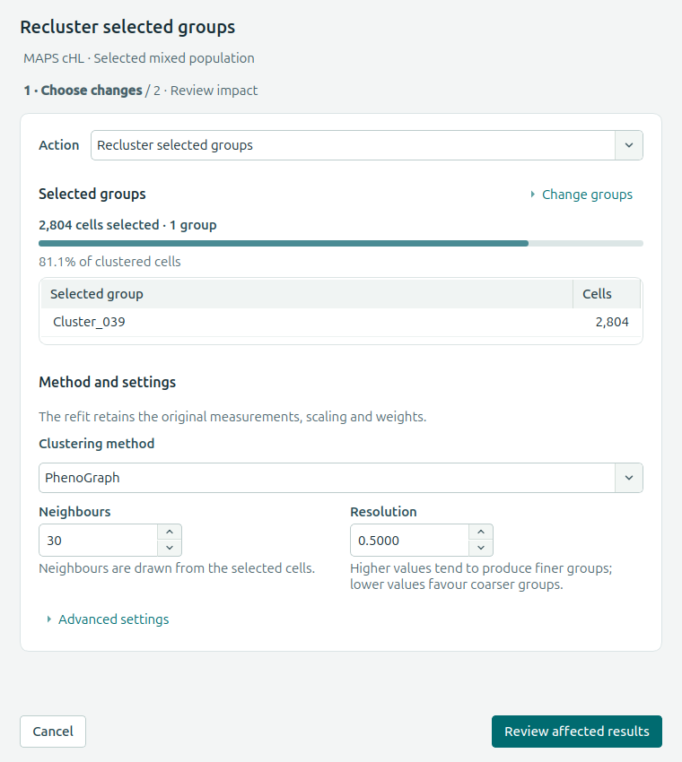</a>

_Reclustering **Cluster_039** from a **10-group FlowSOM fit** of the MAPS field. Its **2,804 cells (81.1%)** are refitted with **PhenoGraph, 30 neighbours, resolution 0.5 and seed 0**. The refit produces **nine new groups**, giving **18 groups** across the field._

After reclustering, compare the new groups' marker profiles and staining before assigning phenotype names. For a FlowSOM refit, the **FlowSOM map** shows the profiles learned from the selected cells.

To undo the latest refit, open **Recluster selected groups…** and choose **Restore previous groups**. This returns cells to their groups before that refit and opens **Review phenotypes**, where you can revise and accept their names and exclusions. Restoration is available before or after accepting the refit.

## Accept and export

On **Review phenotypes**, inspect the phenotype names, cell counts, percentages of all clustered cells and exclusions. Select a phenotype to see its contributing fitted groups, their cell counts and their **Share** of that phenotype’s cells. Select a group to inspect its profiles and staining, or choose **Review selected group** to inspect all groups assigned to that phenotype. Choose **Save and next** to accept the phenotype names and exclusions.

After a refit, **Latest reclustering** shows which groups were reclustered, the resulting groups and the number of cells refitted. Open **Previous groups** or **Current fitted groups** to see their IDs. In the selected phenotype's table, **Latest fit** identifies groups created by that refit.

<a href="../../assets/screenshots/maps-chl-unsupervised-phenotypes-current.png">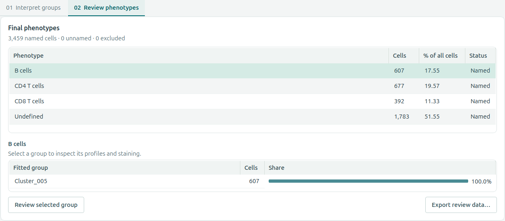</a>

_The accepted initial MAPS review contains **12 fitted groups**: **607 B cells (17.55%)**, **677 CD4 T cells (19.57%)**, **392 CD8 T cells (11.33%)** and **1,783 Undefined (51.55%)**. **CD4 T cells** combines Cluster_001 and Cluster_012 (**555 + 122 cells**). All **3,459 cells** remain included. Names reflect the reviewed group profiles and staining._

To revise accepted names, select **Run → Change phenotyping choices… → Cluster labels**. Apply the proposed change and select **Continue saved work** to reopen the review. The [completed-step guide](../run/index.md#change-a-completed-or-stopped-step) explains how affected results are shown before applying a change.

### Saved cell assignments

The accepted result retains each cell's fitted group and the phenotype name or exclusion chosen during review.

To examine how reclustering changed individual assignments, choose **Results & export → Completed stages → Cluster memberships and lineage → Export data…**. The CSV identifies each cell and records its original group, its group immediately before its most recent refit, and its current group. Cells that have never been reclustered have the same group in all three columns.

Computational cost and implementation

Both methods hold the complete fitting population in memory as an `N × F` matrix, with one row per cell and one column per selected measurement. We apply the [scaling and weights](#robust-feature-scaling-and-weights) to these values before fitting.

PhenoGraph also stores the neighbour indices and graph connections, whose storage grows in proportion to `N × k`. Its memory requirements therefore depend on both the cell count and the selected number of neighbours. The time needed to find those neighbours also depends on the number and distribution of the measurements.

FlowSOM stores an `M × F` matrix of learned profiles, where `M` is the number of map nodes. Each training update compares one cell with all `M` profiles; the requested map size and training iterations therefore determine how many of these comparisons are performed. For final cell assignment, we calculate the distances from cells to the learned profiles in batches of at most **8,192 cells**. We reduce the batch size further when needed to keep this temporary distance array within **16 MiB**.

The [build guide](../installation-and-build/building-and-releasing.md#dependencies-and-licences) records the pinned dependencies and their licence notices. The calculation and resource choices described here are implemented in [method integration](../../../src/python/mif_pipeline/cell_analysis/clustering_methods.py) and [clustering records and scaling](../../../src/python/mif_pipeline/cell_analysis/clustering.py). Review behaviour is implemented in [aggregate profile review](../../../src/python/mif_pipeline/orchestration/batch_phenotyping/review_execution.py), [cluster-cell image lookup](../../../src/python/mif_pipeline/orchestration/batch_phenotyping/cluster_review_gallery.py), [UMAP calculation](../../../src/python/mif_pipeline/cell_analysis/embeddings.py) and [figure rendering](../../../src/python/mif_pipeline/cell_analysis/embedding_plots.py).

---

**Continue:** [Secondary structures](../secondary-structures/index.md).
