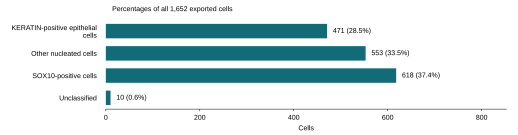
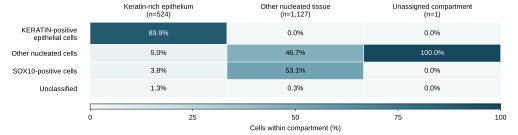
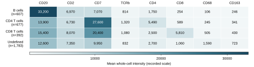
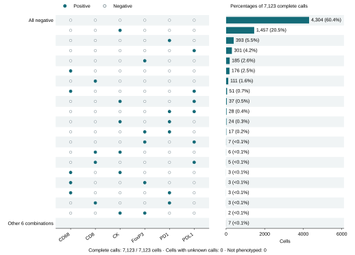
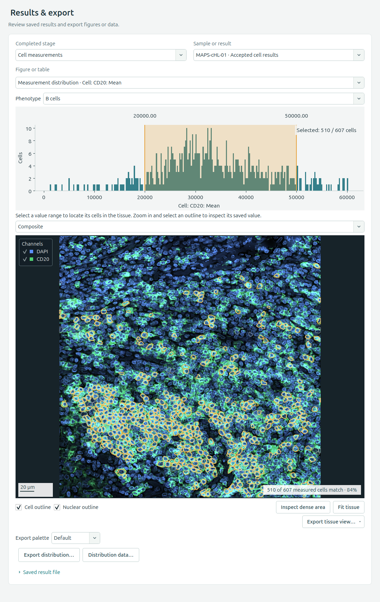
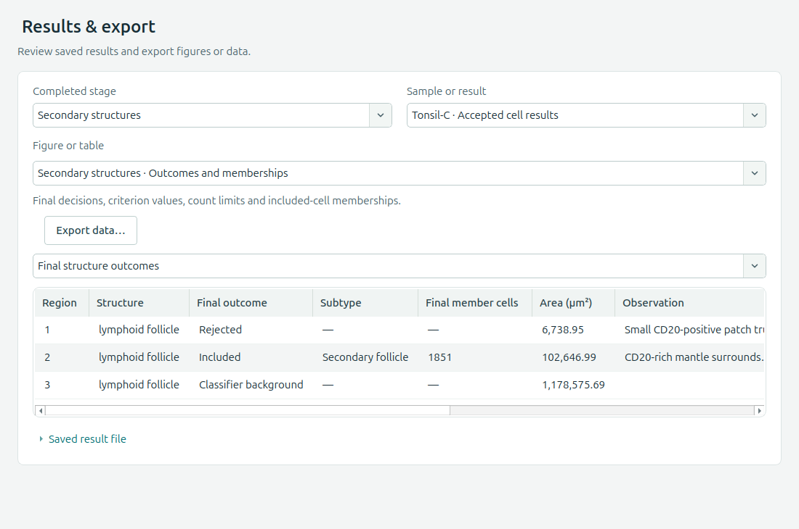
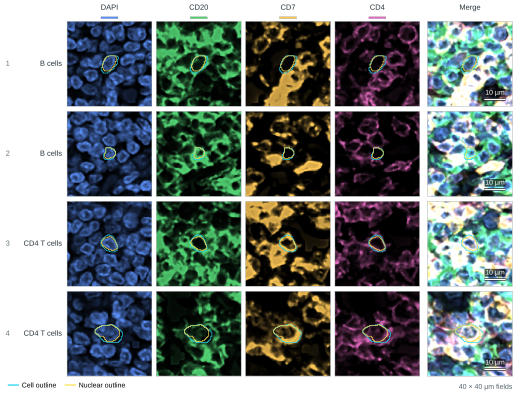

# Classifier, cell and structure summaries

[Results and export](index.md) · [Figure data](../../reference/data-formats.md#figure-data) · [Complete cell tables](../../reference/cell-storage.md)

In **Results & export**, select the completed stage and sample or result, then choose the **Figure or table** to export. The sections below describe the figures for classifier evaluation, cell assignments, measurements and accepted structures. To find a figure, see the [list by stage](index.md#additional-figures). To export a figure you inspected during processing, [reopen its stage review](index.md#reopen-a-stage-review) or use the [export controls](index.md#open-and-export-figures).

## Tissue classifier precision–recall

An accepted native random-forest tissue classifier with retained held-out pixel scores offers a separate **Precision–recall** figure under **Accepted classifiers**. Select all subjects or one subject. Each observation is a pixel on the classifier's saved sampling grid. Same-class reference overlaps contribute once, and pixel centres on reference boundaries are included. Pooled curves give each evaluated pixel equal weight, so larger reference areas contribute more.

For each class, a point on the curve represents the pixels whose vote score reaches a given threshold. **Precision** is the fraction of those pixels labelled as that class in the references. **Recall** is the fraction of all reference pixels of that class recovered at the threshold.

To trace the curve, we lower the threshold to each successive score, adding tied pixels together. **AP** (average precision) sums the increase in recall at each step multiplied by its precision, without linear interpolation. The dotted line marks the class’s fraction of the evaluated reference pixels. A class with no positive references is marked unavailable.

Native votes are uncalibrated scores, not probabilities of a correct classification. For cross-validation, each pixel is scored by a model trained without the subjects in that pixel's validation fold; these curves evaluate the fitting and parameter-selection procedure. Cross-validation confusion matrices also count held-out pixels. Test curves use the independently held-out test references, but the independent-test confusion matrix counts one majority prediction per reference region. Its observation unit therefore differs from the pixel precision–recall curve.

**Export data** provides the curve thresholds and counts, the exact tied-score counts with image, subject, fold and model identities, and a table defining the evaluation.

## Phenotype composition and tissue compartments

**Phenotype composition** shows the number of included cells with each saved phenotype assignment, with percentages calculated over all included cells in the selected result. A named unresolved group remains part of that denominator; an unavailable assignment is reported separately. Category pages share the complete denominator and the same count scale, and the data export includes every category. A result containing no cells has counts of zero and undefined percentages.

*Supervised phenotype assignments in a MEL05 field. At a 0.70 tree-vote cutoff, 471 cells are assigned **KERATIN-positive epithelial cells**, 553 **Other nucleated cells**, 618 **SOX10-positive cells**, and 10 remain **Unclassified**. Percentages include all 1,652 cells. [Image source and attribution](../../data/public-image-sources.md#melanoma-classifier-batch).*

Use **Phenotypes by tissue compartment** to see what fraction of cells in each accepted primary tissue class belongs to each phenotype. The count printed in a column is the number of included cells assigned to that compartment and serves as the denominator for its percentages. Cells without a compartment assignment have their own column. **Export data…** gives the underlying counts and denominators for every category and compartment, including those on other figure pages.

*The same MEL05 cells grouped by their accepted primary tissue compartment. Column denominators contain 524 cells in **Keratin-rich epithelium**, 1,127 in **Other nucleated tissue**, and one without a compartment assignment; all ten **Unclassified** cells remain included.*

## Marker profiles

**Marker profiles** compares staining between phenotypes or reviewed clusters. Rows represent cell groups, and columns identify saved **Mean** intensity measurements together with their cellular regions. For each square, we sum that measurement's available, finite values within the group and divide by the number of contributing cells. Each cell contributes equally to this group mean, regardless of its size. A whole-cell CD20 column, for example, averages the cells' individual whole-cell CD20 means.

The printed value and colour both represent this arithmetic mean on the saved intensity scale. Compare groups within a marker column to examine differences in staining; intensities from different markers also depend on their staining and imaging settings. The default palette runs from light blue for lower means to dark blue for higher means, with a shared scale across pages of the same measurement group. Measurements with different units appear in separate figures.

Each row label gives the group's total cell count. When a measurement is missing or non-finite for some cells, its square also reports the smaller contributing count; a grey square with a dash indicates that no values contributed. [Clustering review](../phenotyping/unsupervised.md#run-and-inspect-the-measured-profiles) explains how to inspect the profiles before naming clusters.

A group mean can conceal a mixture of high and low values. Use a [phenotype-filtered measurement distribution](#measurement-distributions) and the linked tissue field to inspect that variation before interpreting the mean as a uniform staining pattern.

*Whole-cell marker means for the 3,459-cell [MAPS cHL unsupervised phenotyping result](../phenotyping/unsupervised.md#maps-refined-example). Rows retain the four accepted reporting groups, including **Undefined**. The first measurement group contains CD20, CD2, CD7, TCRb, CD4, CD8, CD68 and CD163; every selected measurement is available for every cell. Values use the saved intensity scale without per-marker normalization.*

## Marker combinations

**Co-expression** counts saved positive and negative calls, including calls made with Nimbus. For panels of two to eight accepted markers, choose all markers or a named pair. For larger panels, choose **Co-expression · Selected markers**, select two to eight markers, then preview or export.

Each row shows one marker combination. Filled dots mark positive markers and hollow dots mark negative markers. The bar shows the number of cells with that combination and their percentage among cells with a known result for every selected marker. Unknown calls and cells outside the phenotyping selection are counted separately. **Unclassified** cells contribute when their calls for the selected markers are known.

The figure shows up to 20 combinations individually and combines the remaining counts in **Other … combinations**. An observed **All negative** combination retains its own row. **Export data…** includes every observed combination, along with counts for unknown calls and cells outside the selection. A marker-pair view considers only its two markers, so its complete-call count can differ from the all-marker view.

*Six-marker combinations for 7,123 accepted LuCa cells. All cells have complete calls for these markers. **All negative** contains 4,304 cells (60.4%); **Other 6 combinations** contains seven (<0.1%).*

## Phenotype rule assignments

**Phenotype rule assignments** explains the effect of the [saved rule order](../phenotyping/marker-rules.md#write-phenotype-combinations). A cell receives the phenotype of its first matching rule. Each bar therefore separates all cells matching a rule into those assigned by that rule and those already assigned by an earlier rule. More specific rules need to precede broader overlapping rules when the specific assignment is intended.

The adjacent count reports cells with an unknown state for at least one marker required by that rule. Unmatched cells and cells outside the phenotyping population are reported below the plot. Match counts can overlap across rules; assigned counts follow the saved first-match decisions. If sections used different rule definitions, their summaries remain separate.

**Export data… → Phenotype rule summary** saves the counts for every rule, including those on other figure pages. The [complete cell table](../../reference/data-formats.md#input-files-for-spatial-analysis) retains each cell's marker calls and assigned phenotype.

## Final measurement distributions

Under **Cell measurements**, choose the **Accepted cell results** entry and a **Measurement distribution** to inspect the final included cells. The histogram counts usable saved values. A phenotype selection restricts the histogram, interval count and tissue outlines to that group; the interval percentage uses its usable measurements as the denominator. Missing and invalid values are reported within the same selection. Earlier segmentation and measurement results retain their original saved populations.

Region filters include retained secondary classes and individual secondary areas. A class selection includes each cell once across its matching structures. Selecting an area brings its saved bounds into view; the histogram and tissue view use the same finalized memberships. Region and phenotype selections apply together.

*Of 607 cells assigned **B cells** in the same accepted MAPS result, 510 (84.0%) have whole-cell mean CD20 intensity between 20,000 and 50,000. The overview shows the selected cells with DAPI in blue and CD20 in green.*

The [measurement review](../cell-measurements/index.md#inspect-the-saved-results) explains the shared histogram and tissue-view controls.

The tissue-view figure saves the displayed field and appearance. **Field data…** exports the sampled pixels, physical extent, spatial counts, retained outlines and display settings as NPZ; its CSV option lists retained visible cells, values and interval membership. Wide views can use spatial counts without retaining individual outlines. [Field array conventions](../../reference/data-formats.md#tissue-field-pixels-and-outlines) record that distinction.

## Accepted secondary structures

**Secondary structures · Outcomes and memberships** includes final outcomes and observations, recorded criterion measurements, count decisions and final cell memberships. **Secondary-structure outlines** shows the saved boundaries and final inclusion, with calibrated areas available as CSV.

The outcomes table reports final member counts for retained structures in active analysis regions; non-retained rows display **—**. **Recorded criterion measurements** describes the population evaluated during structure review. That earlier candidate population can differ from the cells finally retained after review and cell edits.

**Final structure count decisions** counts eligible structures rather than cells or rows in the outcomes table. Review rejection, selection by a maximum, exclusion below a minimum and exclusion of the parent analysis region have different meanings; follow [structure review and count limits](../secondary-structures/index.md#user-guide-structure-review) to revise them. [Secondary-result formats](../../reference/data-formats.md#secondary-structure-results) describes the exact fields, numeric CSV counts and unavailable measurements.

*The tonsil review retained one **Secondary follicle** with 1,851 final member cells. A rejected edge candidate had 94 cells when its criteria were measured; it and classifier background display **—** in the final member-count column.*

## Cell gallery

**Cell gallery** arranges selected cells in rows and image channels in columns, with an optional merged-colour panel. It is available from saved segmentation, measurements and phenotyping results. Measurement filters become available after measurement extraction, and phenotype filters and labels use the saved phenotyping result.

### Select the cells

Under **Cell examples**, choose how to select cells from the saved result:

- To sample cells, choose the phenotypes and measurement ranges of interest, then set **Number of cells** and **Selection seed**. A cell must belong to one of the selected phenotypes and satisfy every measurement range, including its endpoints. Leaving a range's lower or upper limit blank removes that bound. We sample up to eight matching cells; the same result, filters and seed reproduce the selection.
- To show particular cells, enter up to eight distinct IDs under **Choose cell IDs**. These IDs replace the sampled selection and its phenotype and measurement filters. Every entered cell must belong to the selected saved result.

Set **Crop width and height** to determine how much tissue surrounds each cell centre; the initial field is 40 × 40 µm. We choose a common image-pyramid level for all crops, using the finest available level at which the requested field spans at most 256 pixels along its longer side, or the coarsest available level if none meets that limit. Increasing the physical field size can therefore select a lower-resolution level. The [linked tissue reviews](index.md#reopen-a-stage-review) help locate cells in their surrounding tissue before choosing their IDs.

### Choose the channels and display

Under **Channels and brightness**, choose up to six channels. For each channel, the automatic minimum and maximum are the 1st and 99th percentiles of its finite pixel intensities pooled across the selected crops. We apply those same limits to every cell in that channel, allowing its staining to be compared across rows. To recalculate the limits after changing cells, clear both fields; otherwise, the existing limits continue to apply. You can also enter limits directly.

Under **Panel display**, choose grayscale or colour for the individual channels and whether to include their merged-colour panel. Cyan outlines identify the selected cell, and yellow outlines identify its associated nucleus.

The accompanying CSV records cell identities, positions, channels and display settings; the NPZ archive contains sampled pixels and outlines in physical coordinates. [Gallery array fields](../../reference/data-formats.md#gallery-pixels-and-outlines) describes the saved sampling information and unavailable pixels.

_Four previously reviewed cells from the same accepted MAPS cHL result: two **B cells** near the group’s lower and upper CD20 deciles and the central example from each of the two groups assigned **CD4 T cells**. Each row shows one 40 × 40 µm field in DAPI, CD20, CD7, CD4 and merged colour, with common display limits within each channel. Cyan outlines identify the selected cells and yellow outlines their nuclei; scale bars are 10 µm. The cells are reopened by ID in Cell phenotyping → Accepted cell results → Cell gallery._

## Counts, density and denominators

The included cell population follows the accepted region selection and cell edits. Region records also retain excluded regions and zero-cell regions, so their presence in a table does not imply that their cells contribute to a figure. Secondary-structure records retain acceptance, subtype or **Cannot assess**, and observations; [structure review and count limits](../secondary-structures/index.md#user-guide-structure-review) explains final inclusion.

For a selected region $R$, let $n_k(R)$ be its included cells assigned to phenotype $k$, $N(R)$ its total included-cell count and $A(R)$ the matching included area in mm². We calculate the phenotype percentage $p_k(R)$ and density $\rho_k(R)$ as:

$$
p_k(R)=100\frac{n_k(R)}{N(R)},\qquad
\rho_k(R)=\frac{n_k(R)}{A(R)}\;\text{cells/mm}^2.
$$

A zero-cell region has an undefined percentage and a density of zero when its area is positive. Density is undefined for zero area and cannot be calculated without a matching physical area. The [sample and compartment figures](#phenotype-composition-and-tissue-compartments) display counts and percentages; use their data and matching region areas for a density calculation.

Region outlines use full-resolution image coordinates. If a matching physical area has not been recorded, calculate the enclosed area from the saved geometry, subtract its holes, and multiply by the X and Y pixel sizes. Pixel sizes in µm/pixel give area in µm²; divide by 1,000,000 to obtain mm².

A cell can belong to several overlapping secondary structures. Count it in each structure's own summary; for a unique-cell total across their union, deduplicate using the complete cell identity. The [region-membership example](../secondary-structures/index.md#example-overlapping-regions-in-the-retained-luca-population) shows how shared cells affect counts and denominators.

If the question concerns the fraction of *cells* with phenotype $k$, pool the counts across subjects and divide by the total number of included cells, $\sum_s n_{ks}/\sum_s N_s$. A subject with more cells then contributes more to the estimate. If the question concerns the average fraction *per subject*, calculate a fraction for each subject first, then take their mean, $S^{-1}\sum_s(n_{ks}/N_s)$. This gives equal weight to each of the $S$ subjects with a nonzero included-cell count. Report how you handled subjects for whom no fraction could be calculated.

