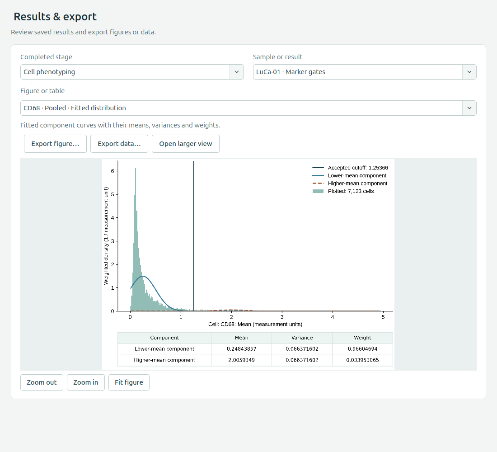
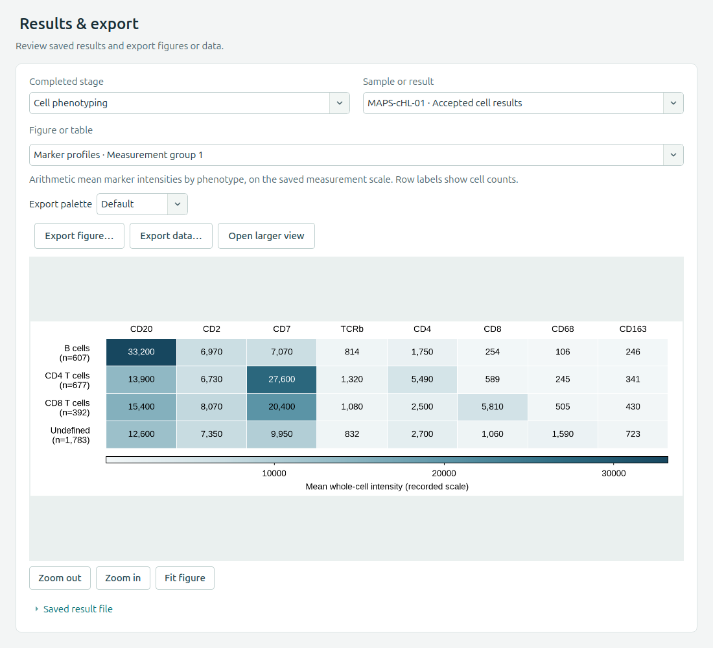
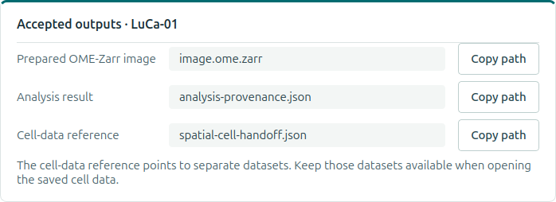

# Results and export

[Analysis stages](../../../README.md#analysis-stages) · [Result figures and tables](figures.md) · [Saved data formats](../../reference/data-formats.md) · [Cell-table structure](../../reference/cell-storage.md)

**On this page:** [Open a result](#confirm-completion-and-selection) · [Stage reviews](#reopen-a-stage-review) · [Cell and structure summaries](#additional-figures) · [Export figures and data](#open-and-export-figures) · [Complete files](#locate-the-final-outputs)

**Results & export** collects saved stage views, additional cell summaries and accepted output files. Results become available as stages finish. Complete pending decisions in **Run**; use Results to inspect or export their saved outputs.

## Open a saved result

Open the analysis from **Home → Open analysis…**, then select **Results & export**. From an open analysis, you can also select the completed **Results & export** node on the Run graph.

Choose the **Completed stage** that produced the result. Under **Sample or result**, select the sample or the type of saved result you want to inspect, such as **Marker gates**, **Classifiers** or **Cluster labels**. The **Figure or table** list then identifies the available views, including the categories or measurements on each page of a multipage figure.

*Cell phenotyping → Marker gates reopens the accepted LuCa CD68 gate and its fitted distribution. The Accepted cell results entry provides phenotype summaries and marker combinations.*

## Stage reviews

These views reopen the saved results in their stage viewers. The linked analysis guides explain how to interpret each result and inspect the tissue.

| Saved result | Choose in Results | Review guide |
|---|---|---|
| Unmixing | **Spectral unmixing → Accepted reference spectra**, **Acquired bands and components**, **Reconstruction images** or **Reconstruction mean spectra** | [Spectra](../unmixing/index.md#inspect-the-spectra), [matched fields](../unmixing/index.md#compare-acquired-bands-and-components) and [reconstruction](../unmixing/index.md#examine-the-reconstructed-signal) |
| Tissue and analysis regions | **Tissue detection → Tissue outlines** or **Analysis regions → Analysis-region outlines** | [Accepted region outlines](../tissue/index.md#select-the-analysis-regions) |
| Paired-image alignment | **Image alignment → Inspect aligned images** | [Inspect the accepted alignment](../alignment/index.md#use-the-accepted-alignment) |
| Tissue or secondary-structure classifier | **Tissue classification** or **Secondary structures**, **Classifiers** result → **Classifier review and data**, or a saved **… confusion** figure | [Classifier evaluation](../tissue-classification/index.md#inspecting-and-accepting-the-model) |
| Classified tissue objects | **Tissue classification**, **Regions** result → **Classified regions** | [Class areas and object sizes](../tissue-classification/index.md#saved-result-and-later-changes) |
| Cell and nuclear outlines | **Cell segmentation → Review cell and nucleus outlines**; saved shape distributions are also available in the figure selector. | [Segmentation review](../cells/index.md#review-cell-and-nucleus-outlines) |
| Cell measurements | **Cell measurements → Measurement distribution ·** the saved measurement | [Linked histogram and tissue review](../cell-measurements/index.md#inspect-the-saved-results) |
| Accepted marker gates | **Cell phenotyping**, **Marker gates** result → **Intensity**, **Nimbus scores** or **Fitted distribution** | [Gate review](../phenotyping/marker-rules.md#review-the-marker-decision), [Nimbus](../phenotyping/marker-rules.md#review-nimbus-scores-and-optional-intensity-distillation) and [fitted components](../phenotyping/marker-rules.md#inspect-the-fitted-distribution) |
| Supervised classifier | **Cell phenotyping**, **Classifiers** result → **Classifier review and data → Cell classifier evaluation** | [Validation and independent-test review](../phenotyping/supervised.md#review-validation-and-independent-test-results) |
| Supervised cell assignments | **Cell phenotyping**, **Supervised phenotypes** result → **Review cell assignments** | [Image and processing-group cutoff review](../phenotyping/supervised.md#review-cell-assignments) |
| Unsupervised fit | **Cell phenotyping**, **Unsupervised phenotyping** result → **UMAP · Current fit**, **FlowSOM learned profiles** when available, or **Cluster memberships and lineage** | [UMAP](../phenotyping/unsupervised.md#inspect-a-umap-view), [learned profiles](../phenotyping/unsupervised.md#inspect-the-learned-flowsom-map) and [reclustering](../phenotyping/unsupervised.md#split-groups) |

A prepared image without a saved unmixing basis has no reference-spectrum or reconstruction figure. To inspect final marker-rule assignments, accepted cluster labels or included secondary structures, choose the corresponding summary below. The [complete cell-data reference](../../reference/data-formats.md#input-files-for-spatial-analysis) provides the accepted per-cell assignments and memberships.

## Cell and structure summaries

Choose the relevant completed stage and the named figure. Final assignments and structures are under **Accepted cell results** in **Sample or result**. The [figure guide](figures.md) explains each quantity and denominator.

| Completed stage | Figure or table |
|---|---|
| Tissue classification | [Phenotype percentages within primary tissue compartments](figures.md#phenotype-composition-and-tissue-compartments) |
| Cell segmentation | [Cell gallery](figures.md#cell-gallery) from the accepted segmentation, with controls to [select cells and field size](figures.md#select-the-cells) and [choose channels and display](figures.md#choose-the-channels-and-display) |
| Cell measurements | Cell gallery from the measurement result; [measurement distributions of the final accepted cells](figures.md#measurement-distributions), with phenotype and region filters |
| Cell phenotyping | [Phenotype composition](figures.md#phenotype-composition-and-tissue-compartments), [marker profiles](figures.md#marker-profiles), [co-expression](figures.md#marker-combinations), [rule assignments](figures.md#phenotype-rule-assignments) and the final-cell gallery |
| Secondary structures | [Final outcomes, count decisions, memberships and outlines](figures.md#accepted-secondary-structures) |

For final measurement distributions, choose the **Accepted cell results** entry. The stage's earlier measurement-result entry retains its original saved cell population.

*Cell phenotyping → Accepted cell results → Marker profiles shows the accepted MAPS measurements. The same saved means and contributing counts supply the preview and its data export.*

## Open and export figures

**Export figure…** saves the complete figure as SVG, PDF or PNG. SVG and PDF keep text editable and retain sharp axes and labels when assembled into a manuscript. Cell-summary exports have a defined physical width, which determines their text size when placed in a manuscript. The larger preview and zoom controls help inspect dense figures before export.

**Export data…** saves the selected figure's data. Choose the required table or array archive in the save dialog. The [figure-data inventory](../../reference/data-formats.md#figure-data) lists each CSV and NPZ export, including classifier tables, cluster lineage, image fields and gallery arrays. Expand **Saved result file** beneath the view to locate or copy the source result's path.

For measurement distributions, phenotype composition, co-expression, marker profiles and phenotype-by-compartment figures, **Export palette** changes the exported colours while retaining the preview. **Outline palette** changes both preview and export for tissue and analysis-region maps. 

## Find the complete files

Under **Accepted outputs**, select the sample whose files you need. Its **Prepared OME-Zarr image**, **Analysis result** and **Cell-data reference** each have a **Copy path** action. To locate a file on disk, hover over its name for the full path or select **Show in folder**.

*The accepted LuCa output links its prepared image, region/provenance record and complete cell-data reference.*

### Open the accepted image

**Open QuPath** opens the accepted image, annotations and cell overlays. The [image-viewing guide](../run/interactive-viewing.md#export-an-image-with-cell-outlines) describes **mIF → Export image…**, including channel appearance, field bounds, scale bar and display metadata.

### Read complete cell and region data

Open the **Cell-data reference** with the [Python reader](../../reference/data-formats.md#input-files-for-spatial-analysis) to retrieve the selected cells, measurements, phenotype assignments and accepted edits. Request only the columns needed. [Cell-table structure](../../reference/cell-storage.md) explains identities, category codes, geometry and spatial queries; [saved data formats](../../reference/data-formats.md) describes the image, region and model files.

### Retain the files needed to reopen results

To reopen the analysis in the desktop, keep the complete analysis folder and its processing workspace, including the saved setup, computing and manifest files, plans, state, reviews and result records. Keep the prepared images, QuPath project and referenced source images, models and cell datasets accessible at their recorded locations. [Analysis-folder contents](../setup/analysis-folder.md#locations-of-saved-files) identifies these locations; [saving and recovery](../run/saving-and-recovery.md#retain-results-and-clean-up-temporary-files) explains retention across revisions.

To read an exported cell result independently, keep its cell-data reference together with the hidden generation directory and all referenced datasets. Copying the reference alone does not copy those data: the collection records absolute dataset locations. [Handoff files and selection checks](../../reference/data-formats.md#file-identifiers-and-selection-checks) describes the required files and the [Python reader](../../reference/data-formats.md#input-files-for-spatial-analysis).

---

**Continue:** [Result figures and tables](figures.md) or [read exported data](../../reference/data-formats.md).
