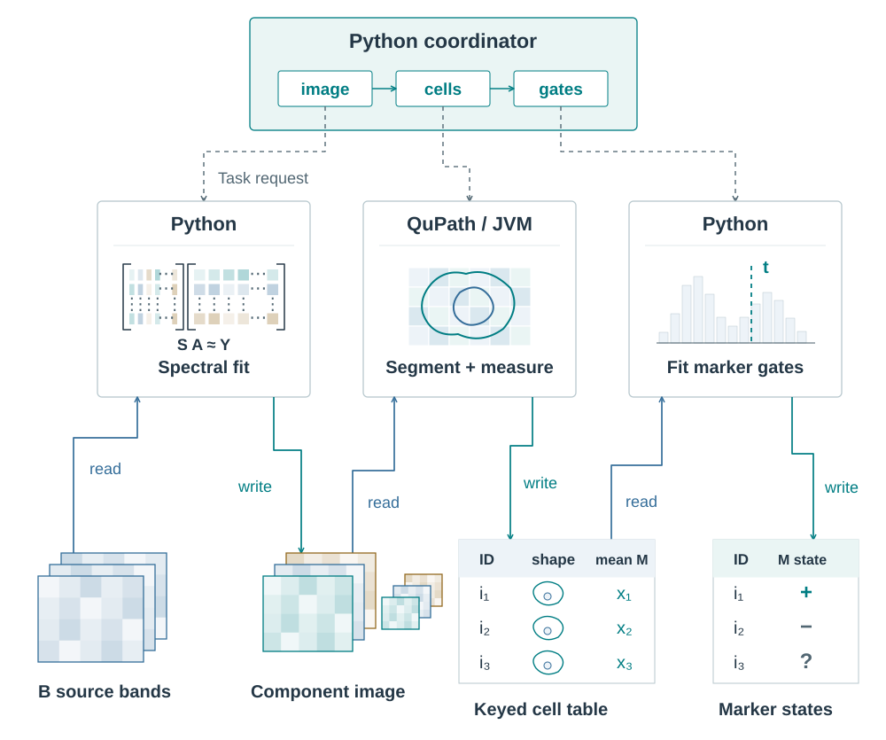
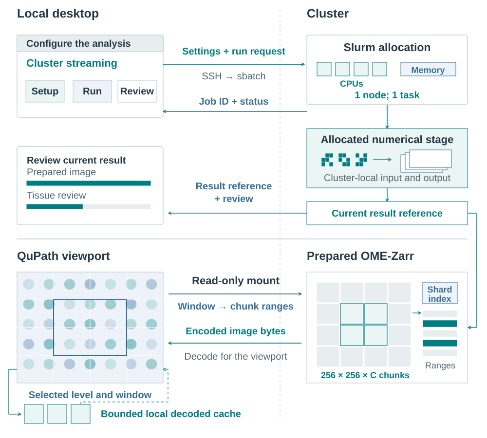

# Execution, scheduling and result reuse

[Run and review](index.md#user-guide-workflow) · [Saving and recovery](saving-and-recovery.md)

The plan records the operations each sample needs and which ones share inputs across images. During the run, the Python coordinator uses that plan to decide when to start a calculation, which files to give it and when its result can be used by the next stage.

## Build the plan from accepted inputs

The coordinator builds the plan from the [sample, subject and processing-group assignments](../setup/analysis.md) and computing settings. These identify which images each operation reads and which subjects can contribute to shared fitting. Image inspection and channel review establish the inputs for spectral preparation. Tissue detection and subsequent QuPath operations then read the prepared OME-Zarr image. [Image preparation](../images/processing.md#reference-image-processing) explains that data conversion.

Accepted tissue sections and [analysis regions](../tissue/index.md#selecting-analysis-regions) determine the region-specific operations. Their final count and identifiers become available after review, so the coordinator expands the plan at that point. The revised plan retains completed work and records which earlier plan it replaces. Run can display future stages while they wait for their image or region inputs.

## Schedule independent and shared work

An image can move to its next stage as soon as the required results and processing resources are available. If one sample is waiting for annotations, the scheduler can still start independent work on other samples. A fit shared across images must wait until every participating image has supplied its inputs.

For a shared tissue classifier, the inputs for fitting include the accepted reference annotations and subject assignments. The fitted model can then be evaluated on the subjects reserved for testing and applied to the remaining images as requested. [Training and evaluation](../tissue-classification/index.md#reference-training-and-evaluation) explains how subjects are allocated and scored. The [model execution guide](../tissue-classification/model-execution.md#v-subject-grouped-fitting) describes the data passed to each fit.

For pooled cell analysis, the coordinator waits for the accepted measurements from every participating image. It checks that each table contains the expected tissue sections, analysis regions and cells, then reads the requested feature columns in the order used for fitting. If you remove an image from the pool, the other images can keep their measurement tables. The shared fit may need repeating because the cell population used to estimate the scaling or fit the model has changed. [Cell construction and measurements](../cells/processing.md) · [Matching results to the same cells](../../reference/cell-storage.md#v-matching-new-results-to-the-same-cells)

When an analysis continues or reopens, we check the software needed for unfinished stages and later stages waiting for their inputs. For example, segmentation requires the libraries for the selected segmentation method even when image preparation is already complete. Reopening an earlier stage also checks the software needed to run it again.

## Limit simultaneous work

A ready task can start once enough CPU capacity and memory are available and it has access to the files it needs. Two tasks that write the same QuPath project or classifier must take turns. Independent tasks can run together within the available resources.

One operation can also start several calculations. During unmixing, each [regional fit](../images/processing.md#select-the-number-of-simultaneous-regions) needs memory for its image data and working arrays, and the matrix library may use several threads per fit. We limit concurrent fits using both the [memory allowance](../setup/memory-and-threads.md) and the available threads. Cluster processing initially permits one pipeline operation at a time and limits its memory to the allowance for the Slurm job.

## Prepare and record one processing attempt

Before launching a calculation, the coordinator saves a request identifying the task, this attempt and the result it expects back. For a QuPath calculation, the request names the project, image entry and script. For a Python calculation, it identifies the input datasets and method. In both cases the worker receives the settings, versions and locations of the inputs, its resource allowance and the destination for the result.

The inputs depend on the calculation. To measure a region, the worker needs its tissue section, analysis region and cell population. To evaluate a classifier, it also needs the fitted model and the subjects assigned to each role or fold. The worker opens the recorded inputs directly, writes the result and returns its location with the attempt ID and outcome.

_The dashed arrows carry settings and file locations. Each processing program reads its own inputs (blue) and writes its result to storage (teal). The marker fit, for example, reads the mean intensities saved during measurement._

We record the worker’s exit status and check the returned result. This record determines what happens after an interruption. If the worker reported a failure, a retry starts a new attempt and preserves the earlier log. If there is no recorded outcome, the coordinator inspects the pending request and its inputs to determine whether the existing attempt can continue. [Recovery after interruption](saving-and-recovery.md#offered-recovery-actions)

## Accept reviews and completed results

When a stage needs a decision, the coordinator saves a request for the affected image, model or region. Submitting the review checks that its inputs still match. If a different result has since been selected, reopen the current review. Submitting an already accepted response returns the recorded result.

After a program finishes successfully, the coordinator checks whether its output contains what the stage requested. For an unmixed image we check the component channels and physical calibration. For cell tables we check the cell identities and assigned regions, and for predictions we check the class labels against the saved model and the coverage against the requested cells or regions. Once the result passes these checks and any required review or project save is complete, subsequent tasks can use it. [Selecting a completed dataset](saving-and-recovery.md#iv-selecting-a-complete-dataset)

### Save progress against the current analysis

One coordinator writes progress at a time. Its update checks the saved version against the version read at the start, preventing a delayed form or process from replacing newer progress. QuPath changes are compared through their recorded image inputs and the annotations, geometry or models consumed by the affected step. [Project comparison](qupath-review.md#reference-qupath-integration--ii-saving-the-project-and-returning-annotations) explains why display-only saves can retain the same processing inputs; [native completion](saving-and-recovery.md#completing-a-native-project-stage) explains saved-state checks after interruption.

### Pause and reopen processing

Pausing stops new operations from starting while active work reaches its supported stopping point. Reopening inspects the saved attempt and results before continuing or offering a retry. Follow [Run's pause and reopen procedures](index.md#pause-processing) for the controls and [offered recovery actions](saving-and-recovery.md#offered-recovery-actions) for the conditions that permit each action.

## Dispatch cluster work

The cluster analysis folder holds the processing history, the main QuPath project and the accepted results. The desktop sends settings and review decisions over SSH. During annotation, QuPath saves a draft on the local computer. Returning that draft sends the permitted edits to the cluster project. [Cluster paths and resources](../setup/computing.md) · [Reading images and cells during review](interactive-viewing.md)

A review can send work to the cluster more than once. During manual alignment, for example, the first request sends the starting position for affine fitting. Once you have inspected the returned affine, the final request identifies that fit and any landmarks to use for local refinement. Both requests identify the review and image pair so the returned fit opens in the correct analysis. [Manual alignment on a cluster](../alignment/index.md#return-alignment-work-to-the-cluster)

Each Slurm submission records its job ID and submission result. If the connection ends before the response is clear, the application checks the scheduler before issuing another equivalent job. The selected activation script is sourced at the start of allocated jobs and before direct `mif-batch` commands that require that environment. Scheduler queries and ordinary file checks use the cluster's normal SSH environment.

Processing programs compare installed release and message-format identifiers before accepting requests. They require the selected script and records identifying the source image, model, references and output.

_Slurm allocates the requested CPUs and memory on a compute node. The processing programs read and write cluster storage. For local review of an OME-Zarr image, QuPath uses the mounted folder to read the compressed chunks for the field on screen. Vendor files are read through their own image readers._

## Implementation

Source modules for scheduling and saved progress

`orchestration/batch_service.py` provides analysis operations. `batch_scheduler.py` selects ready work and applies resource limits. `batch_state.py` reads and writes saved progress and the records connecting requests, attempts and accepted results.

`batch_training/` handles references, fitting, model review, independent evaluation and application to additional images. `batch_phenotyping/` handles accepted measured cells, marker rules, pooled clustering and selected phenotype results. The step-specific preparation functions construct the concrete Python and QuPath requests.

[Analysis-folder contents](../setup/analysis-folder.md#reference-analysis-folder) describes the saved files. [Source layout](../setup/source-layout.md) identifies the code modules used by each calculation.

---

**Continue:** [Run and review](index.md).
