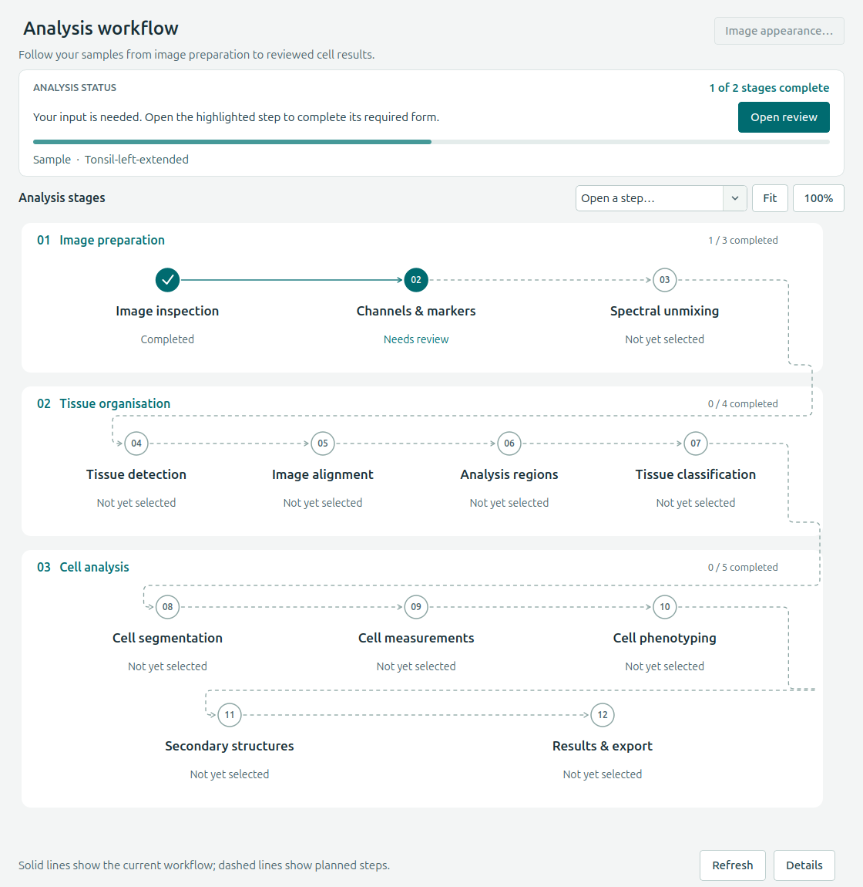
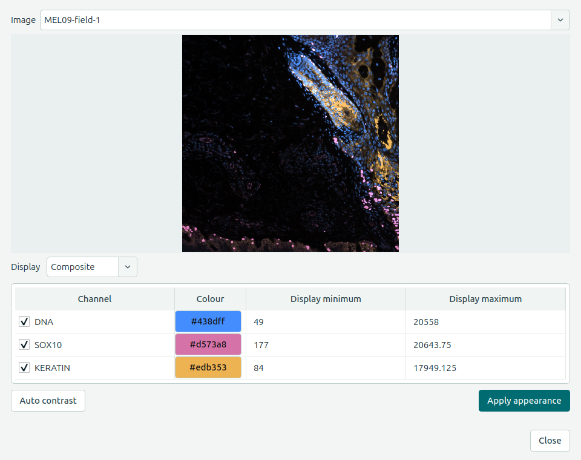
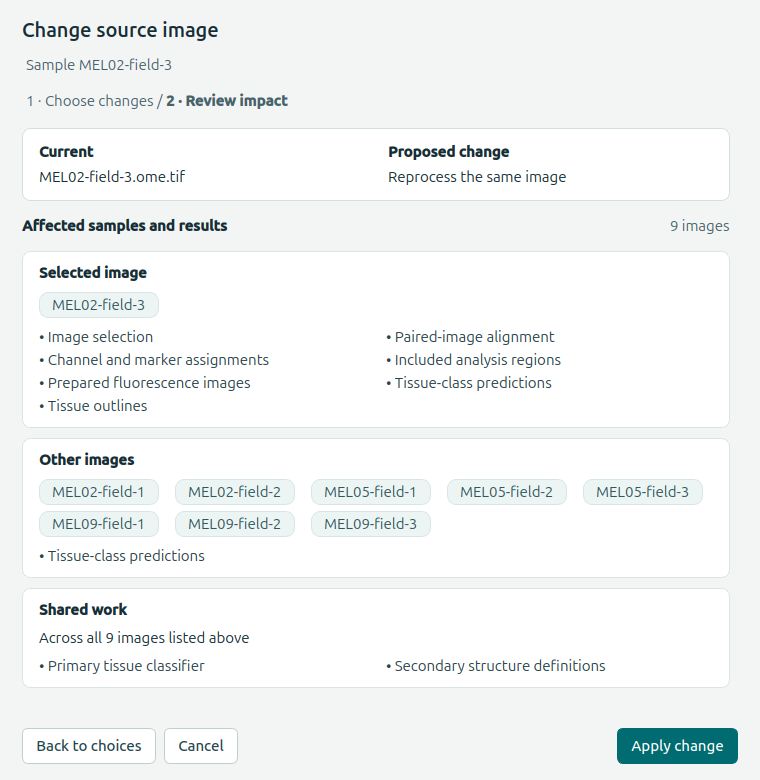
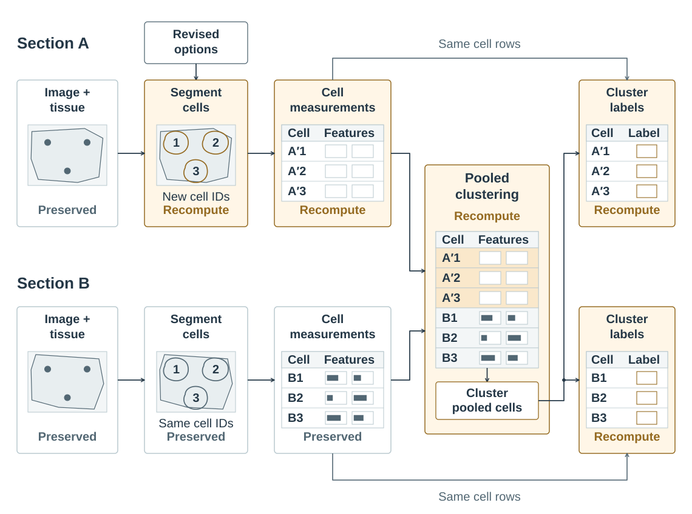

# Run, review and continue an analysis

[Analysis stages](../../../README.md#analysis-stages)

Use **Run** to follow the progress of an analysis, complete reviews and reopen saved results. Select a stage on the workflow graph to see which samples it is processing or which decision it needs.

## Work from the Run graph

After [checking software availability on Plan](../setup/analysis.md#save-and-inspect-plan), select **Start analysis** to open the workflow graph. A connection shows which earlier result a stage needs. A pooled phenotyping fit, for example, can start only when measurements are ready for every participating image. Images with measurements still pending continue through their preceding stages.

Select a stage marked **Needs review** to see which samples need a decision. **Open review** takes you to the form for the selected sample or group, and **← Workflow** returns you to the graph. A stage shows **Partly completed** when some samples have finished it and others still have work to do. To omit optional classification, use **Skip classification** or **Skip structures** on the stage’s initial page. When several groups are waiting, the button’s menu lets you choose which group to skip.

A **Ready** step has its required inputs. **Waiting for memory** means the scheduler cannot yet reserve the RAM requested for that step. The [scheduling guide](execution.md#limit-simultaneous-work) explains how CPU capacity and shared project files also determine which ready steps can run together.

_Image inspection is complete, and **Channels & markers** is waiting for review. Select **Open review** to assign the channels. Dashed connections show planned stages, with **Secondary structures** following **Cell phenotyping**._

### Complete a waiting form

Use **Next** and **Back** to work through the settings for the selected sample or group. On the last page, **Save and next** records the decision and continues processing. **Save and pause**, where offered, records it and leaves the analysis paused. Some stages name the action directly, such as **Start unmixing**.

To inspect another stage during [spectral reference review](../unmixing/index.md#reviewing-the-reference-and-output), select **Workflow**. Your current choices remain available if you reopen **Spectral unmixing → Open review** during that desktop session. Submit the review to save those choices with the analysis before closing the desktop.

### Return a QuPath annotation draft

Open QuPath from the current review and draw or edit the requested annotations. Save the QuPath project and close its window, then return to the review page to inspect and accept the changes. Saving preserves the drawings in the draft. Accepting the returned annotations makes them available to the next calculation.

In cluster streaming, the local draft must also return to the corresponding cluster review. If the connection is interrupted, keep the draft, restore the connection and reopen that review. Confirm the associated image and cells before completing the return, especially if the source image or segmentation has changed.

### Adjust image appearance

Once prepared images are available, select **Image appearance…** on Run and choose an image. Use **Grayscale** or **Colour** to inspect one channel, or **Composite** to combine the checked channels. Each channel has its own colour and display limits. Select **Apply appearance** to update the preview and save these choices for subsequent image review.

**Display minimum** sets the intensity shown as black; **Display maximum** sets the intensity shown at full brightness. **Auto contrast** sets these limits to the 1st and 99.5th percentiles of the selected channels in the whole-image overview. The saved limits are reused when you inspect other sections of the same image. They control the brightness of the displayed channels and image exports, including QuPath views opened through MIFflow.

*MEL09-field-1 displayed with DNA in blue, SOX10 in magenta and KERATIN in amber. The checked channels form the composite above the table. Each colour and pair of display limits applies to its channel.*

## Open the results

If the analysis includes [secondary structures](../secondary-structures/index.md), finish the subtype and count reviews for the detected regions. Open **Results & export** from the completed node on Run to [choose the measurements, assignments and figures to export](../results/index.md). To inspect the staining alongside the saved cell outlines and phenotype labels, select an image under **Open QuPath** as described in [Viewing images and cells](interactive-viewing.md).

## Pause processing

Select **Pause after current work**. Active operations finish their current calculation or reach a supported stopping point before progress is saved. Wait for **Progress saved** or the corresponding paused state before closing the workspace. [Saving and recovery](saving-and-recovery.md) explains how interrupted work is recovered.

## Reopen an analysis

To resume work, choose **Open analysis…** on **Home** and open the named analysis folder. Run restores the completed stages and any waiting reviews. Open the stage that needs a decision, or choose **Continue analysis** if the run is paused with work ready. After an interruption, **Continue saved work** checks what the unfinished attempt saved to determine which processing needs to be repeated.

## Diagnose an interruption

Open the stopped stage and expand **Details** for the error, processing log and input locations. After correcting a missing file, insufficient memory or another reported cause, choose **Retry step…** if it is offered. This schedules the calculation with the same inputs. Select **Continue analysis** if the run is paused.

If the inputs themselves need to change, use the stage’s revision action. For example, **Edit spectral references…** lets you correct the library after an unmixing failure. If marker fitting reports a missing measurement, open **Cell measurements → Change cell measurements…** and add the Mean or Median for the named marker.

Use **Copy details** to share the diagnostic. Remove private paths, credentials and patient identifiers before sending it outside the lab. [Troubleshoot a stopped step](../../troubleshooting.md#resume-a-stopped-step) · [How Run chooses a recovery action](saving-and-recovery.md#offered-recovery-actions)

## Change a completed or stopped step

When you change a completed step, Run identifies which results used the original setting. Review these results before applying the change. If the analysis is running, choose **Pause after current work** and wait for the active calculations to finish.

### Preview and apply the change

1. Open the stage and choose **Change…** or **Review settings…**. Select the sample, region or shared calculation if prompted.
2. Edit the saved settings under **Choose changes**, then select **Review affected results**. Some actions reopen an earlier review and go directly to the preview. Check the proposed change and the results it affects on this image and any other participating images.
3. Use **Back to choices** to amend the draft or **Apply change** to save it. If a pending operation blocks the change, resolve it first. If saving fails, the draft stays open and **Error details** gives the cause.
4. Select **Continue saved work** when offered.

*Reprocessing MEL02-field-3 affects its image preparation and the shared tissue classifier. The eight other images require new tissue-class predictions from that revised classifier. The preview groups the image-specific results and shared calculations separately.*

### Understand which results need recalculation

A model or threshold fitted across several images depends on the inputs from each participating image. For example, replacing one image's cell measurements can change pooled marker thresholds or clusters, requiring new phenotype assignments for every image included in that fit. The preview identifies which image-specific measurements remain reusable and which shared results need recalculation.

_Schematic of sections A and B sharing a pooled clustering fit. Changing A's segmentation creates population A′ and new measurement rows. Pooled fitting then assigns new groups to both sections. Amber marks the affected results; B retains its cell outlines and identities._

For unsupervised phenotyping, use **Cluster labels** to revise phenotype names or exclude fitted groups. Use **Clustering settings** to change the measurements or fitting method and calculate new groups. For marker rules, changing **Phenotype combinations** reapplies the ordered rules using the accepted marker thresholds. The [unsupervised](../phenotyping/unsupervised.md#name-merge-or-split-groups) and [marker-rule](../phenotyping/marker-rules.md#write-phenotype-combinations) guides explain these choices.

Change an image, alignment, spectral reference or phenotyping decision

### Replace a source image or select another series

Open the completed or stopped image-preparation stage and select **Change source image…**. Use **Choose image…** to replace the file, or retain the current file to select another image within it. Select **Inspect image**. If the file contains several eligible images, choose one under **Image / series**; a single eligible image is selected without showing that control.

### Add or replace a paired image

On **Run**, open the completed or stopped alignment stage and select **Change paired image or alignment…**. To use a new image, enable **Choose a paired image**, select **Choose image…**, set **Image type**, then select **Inspect image**. The editor checks the file before allowing the revision preview. In cluster streaming, choose the file through the mounted folder so its saved mapping supplies the cluster path.

To review the existing alignment, leave **Choose a paired image** unchecked. After applying the revision, continue saved work to fit and review the alignment. [Paired-image alignment](../alignment/index.md) describes the fitting and acceptance steps.

### Change saved unmixing settings

Open **Run → Spectral unmixing → Review unmixing settings…** and select the sample when prompted. The editor opens its saved choices. Revise the [unmixing settings](../unmixing/index.md#numerical-and-output-settings), then select **Review affected results**. For a raw spectral image, **Change spectral references…** requests another reference review and opens the same affected-results page.

### Restart a marker review

Open **Run → Cell phenotyping → Change phenotyping choices…**. If a task chooser appears, select **Shared marker review** to restart marker decisions, or **Cell phenotyping method** to reopen the method choice for an analysis region.

The reopened marker review uses the existing cells and measurements, with the saved **Pooled** or **Per slide** choice selected initially. Choose the required measurements and methods, then review and confirm each marker threshold again using the [marker-rule procedure](../phenotyping/marker-rules.md#select-markers-and-measurements).

---

**Continue:** [Results and export](../results/index.md).
