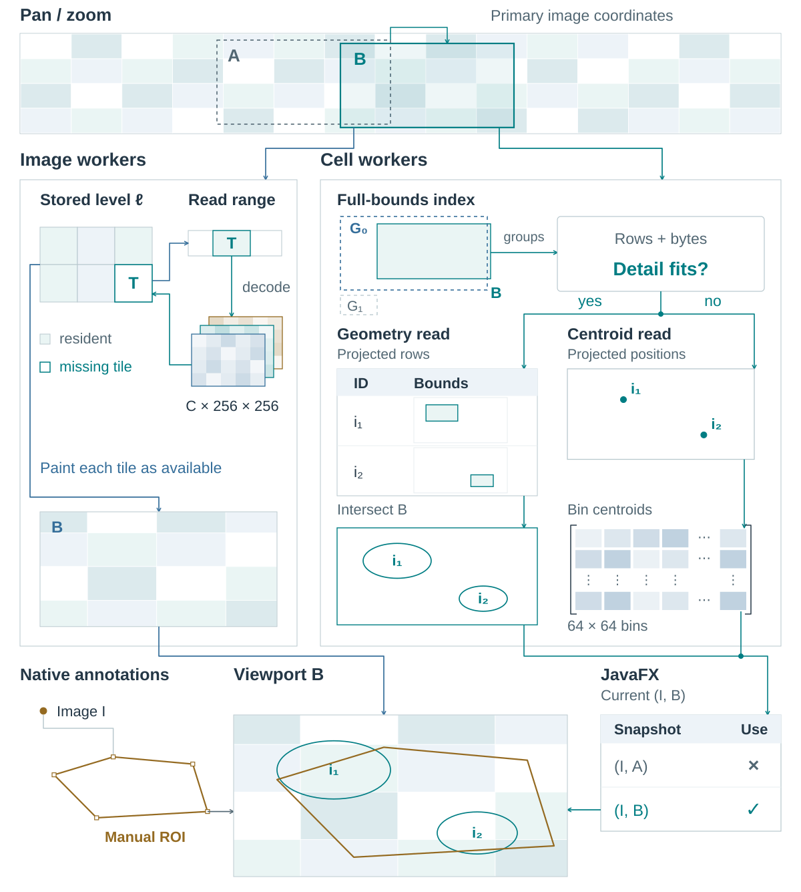

# Viewing images and cells in QuPath

[Run and review](index.md) · [QuPath annotations](qupath-review.md)

To inspect an accepted result, choose **Open QuPath** on **Run** or **Results** and select the image. QuPath reads the pixels, cell outlines and phenotype labels for the area in view as you pan and zoom. To change a drawing, open the editing action in the relevant stage review so the saved draft returns to that stage.

## Navigate the image

Zoom in on a tissue region to inspect its cells against the underlying staining. QuPath reads the image tiles and cell outlines separately. If the staining appears first, **Loading cell outlines** indicates that QuPath is still retrieving the cells for the visible field.

When the visible field contains too many cells to draw within the count or memory limit, **Cell density overview** shows how the cells are distributed across the tissue. Each grid square is shaded by the number of cell centres it contains. Zoom in to inspect individual outlines in a smaller field.

If **Cell data unavailable** appears, read the accompanying explanation. For a memory-related error, zoom into a smaller area. If a read failed while the storage connection was unavailable, restore that connection, then pan or zoom to request a new view.

## Choose grayscale or channel colours

QuPath opens each image with the channels, colours and brightness limits saved under [**Image appearance** on Run](index.md#adjust-image-appearance). Use QuPath’s **Brightness/Contrast** controls to adjust the display. When you close QuPath, the review uses the updated settings. Switching to grayscale preserves the assigned channel colours.

## Inspect a cell

Turn on QuPath’s **Show detections** and choose **Cell boundaries only**, **Nuclei only** or **Nuclei & cell boundaries**. Clear **Fill detections** to examine staining inside the outlines. Click a cell to load its saved measurements. Selecting another phenotyping result changes the class names and colours displayed on the cells.

When you hide detections, the viewer stops requesting cell outlines. You can continue to pan and zoom through the image.

## Save annotations and cell edits

Open tissue or analysis-region annotations for editing from their stage review. For cells, use segmentation review to [collect corrections](../cells/index.md#reshape-or-remove-a-selected-cell) before reshaping, splitting or merging outlines, drawing missing cells or nuclei, or deleting cells. Review the proposed changes before applying them. If the cells have already been measured, the affected results require recalculation.

For a stopped measurement in local or cluster-desktop mode, **Change cell measurements… → Remove cells in QuPath** opens a draft for explicit removals. Inspect and select the cell, delete it, save and close QuPath to return the removal. Keep other outlines, labels and annotations unchanged in this draft.

Review and apply the returned removal, then continue processing to recalculate measurements and phenotyping with that cell excluded. [Changing a completed or stopped step](index.md#change-a-completed-or-stopped-step) explains how to review the affected work and continue.

## Paired images and cluster streaming

### Inspect an aligned image pair

An aligned paired image, such as H&E, is displayed in the mIF coordinate frame. The saved alignment determines which H&E pixels correspond to the area being viewed. [Display the original paired image](../alignment/index.md#display-the-original-paired-image) explains how the Java reader evaluates that mapping and Warpy reads the pixels. The same transformation supplies the reverse mapping for annotation transfer.

### Review an image on the cluster

In a streaming review, QuPath runs on your computer. It uses the [mounted cluster folder](../setup/computing.md#getting-started-cluster-setup--5-map-the-image-locations-for-local-review) to find the image and cell tables for the selected sample. Save any annotation edits in the local draft, close QuPath and return the draft through the review page. If the connection closes before the return finishes, the drawings are still in the local draft and you can [return them after reconnecting](index.md#return-a-qupath-annotation-draft).

## Export an image with cell outlines

Choose **mIF → Export image…** in QuPath. Under **Region**, select the area to include.

- **Current view** exports the visible image rectangle. Reset viewer rotation
  before using this option.
- **Selected annotation bounds** exports the rectangle enclosing the selected
  annotation, including image pixels outside the annotation's shape. Select
  an annotation on the displayed image plane before exporting.
- **Whole image** exports the full image extent. For a large image, its initial
  resolution produces an overview of approximately four million pixels.

Set **Downsample** to choose the export resolution. A value of **1** uses the original image resolution. A value of **2** halves the output width and height. The dialog shows the resulting dimensions. If they exceed the PNG limit of **16 million pixels**, increase Downsample.

Keep **Show scale bar** selected to add a bar labelled in physical units using the image’s recorded pixel size. If physical calibration is unavailable, we label the bar in pixels. Confirm the settings and choose a PNG filename.

The export uses the current channel colours, brightness limits, cell or nucleus display, fill and overlay opacity. It reads the complete cell outlines intersecting the requested rectangle in the background, including outlines that cross its edge.

The PNG metadata records the exported rectangle, pixel size, channel colours, brightness, gamma and outline-display settings. These values identify the field and the display used to produce the figure.

## How the saved cells reach QuPath

QuPath keeps manual annotations in the open image’s object hierarchy. For a segmented slide, we save the complete cell population in Spatial Parquet. The viewer requests the outlines and labels for the area on screen as you navigate.

### Read the image and its cell outlines

QuPath requests image pixels and cell outlines for the same field. The Java image server reads the OME-Zarr pyramid level appropriate for the current zoom. Cell outlines are stored in full-resolution image coordinates, so the cell reader uses the field’s bounds at full resolution to find the outlines to draw over those pixels.

To find cells in the displayed field, we first select the table’s row groups whose bounding rectangles intersect it. Those rectangles enclose complete outlines, so the search includes a cell whose outline crosses the field edge even when its centre lies outside. At detailed zoom we read the IDs, bounds, outlines and selected phenotype labels from those groups and draw the cells that intersect the field. Clicking an outline then retrieves that cell’s measurements by ID.

To decide whether individual outlines will fit in memory, we add the row counts and estimated outline sizes of the intersecting groups. If their total exceeds **20,000 rows** or the outline-memory allowance, we read the centres and count them in a **64 × 64 grid** across the visible field. Zooming in can reduce the number of required groups enough to display their outlines again.

### Update the display during navigation

Reading files and decoding outlines run on background threads. The completed cell result is then passed to the JavaFX thread that updates QuPath's interface. Each navigation request has a sequence number, allowing the interface to check that the returned cells belong to the current view.

When you revisit a field, QuPath can reuse its recently read tiles and cells within the [memory allowance](../setup/memory-and-threads.md). If two requests need data that are still loading, both use the result of the same read.

_Moving from A to B requests a new set of image tiles and cells. If the geometry for A arrives after the move, QuPath keeps it off the current view. B can show individual outlines or a grid of cell counts, depending on how many rows its field would require._

### Select cells for QuPath tools

QuPath tools work with objects in the image’s hierarchy. When you select a segmented cell, we retrieve its record from Parquet and add it to that hierarchy. Selecting another cell removes the previous selection if it has not been edited. Manual annotations remain in the hierarchy, and the saved [cell tables](../../reference/cell-storage.md) continue to supply the outlines, measurements and classifications for the full population.

Pipeline calculations read the saved dataset directly, including cells outside the view. A QuPath script that reads only the object hierarchy will see the cells loaded there. For additional analysis of the full population, use the [exported cell tables](../results/index.md) or the extension's `NativeCellScope` interface.

---

**Continue:** [QuPath annotations and reviews](qupath-review.md).
