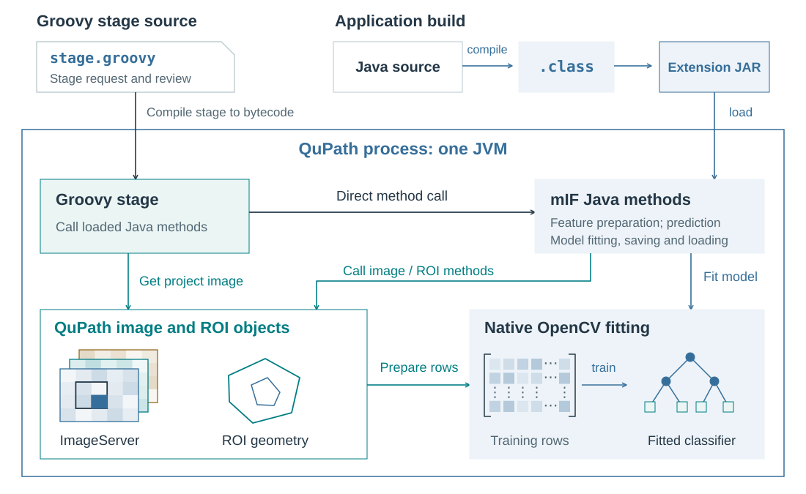
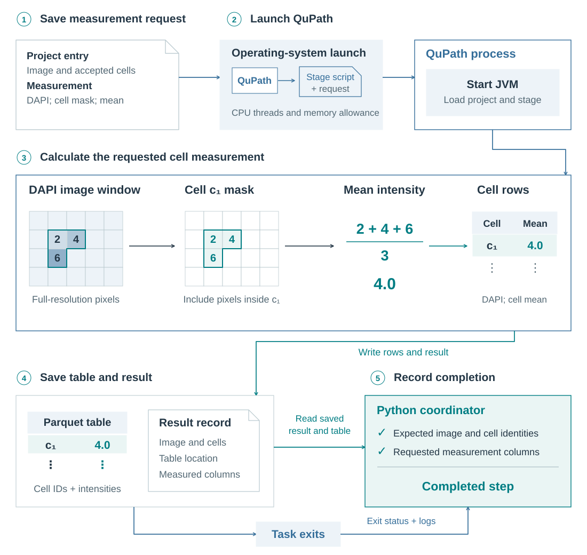

# Python, Groovy and Java during processing

[Run and review](index.md) → [Execution and scheduling](execution.md)

Python runs the desktop and schedules each stage of the analysis. It also performs calculations such as spectral unmixing on image bands and clustering on cell measurements. When a calculation uses QuPath’s image reader, annotations or classifier tools, Python starts QuPath with a Groovy script. The script opens the requested image and passes it to the Java code that performs the calculation.

## From a planned operation to a processing request

Before starting a task, Python records the calculation to perform, its settings and the locations of its inputs and output. The program that performs the calculation uses this request to open the image or cell table directly. Recording the request also lets us identify which inputs produced a result if the task needs to be repeated.

## Inside QuPath

When a calculation needs QuPath, Python launches it with the appropriate Groovy script and the saved request. The script opens the project image and passes it to our compiled Java extension. Groovy and Java share the same Java virtual machine, so the extension can use QuPath’s open image directly. It asks the image server for pixels and reads the annotations from the image’s object hierarchy. Whole-slide cell outlines are stored separately and read from the [cell tables](../../reference/cell-storage.md).

During a [classifier annotation review](qupath-review.md), Groovy opens the review panel in QuPath. Java fits the preview classifier on a background thread so the researcher can continue inspecting the image. The panel displays the fitted predictions over the staining.

_The Groovy script supplies the open image and annotation geometry to the Java calculation. In the classifier example, Java extracts features from labelled pixels and passes the training rows to OpenCV._

### From a cell outline to a saved measurement

To measure mean staining intensity, the request identifies the image channel, the accepted cells and the part of each cell to measure. Java reads the pixels inside the corresponding outlines and calculates a mean for each cell. We save these values with their cell IDs in a Parquet table so later stages can match each measurement to its cell.

_The three pixels inside the cell have intensities of 2, 4 and 6. The teal path follows their mean of 4.0 from the output table to the coordinator. The blue path carries the process exit status._

When QuPath exits, Python reads its exit status and the result returned for the measurement request. Before making the table available to phenotyping, it checks the image, cell population and measurements against that request and confirms that any required review is complete. These same checks allow an interrupted analysis to recognize a table that QuPath finished writing. [How results are saved and recovered](saving-and-recovery.md)

## Where model fitting and prediction run

**Tissue and cell classifiers.** Java prepares the training rows and uses OpenCV to fit random forests, support vector machines and logistic regression. We save the fitted feature transformation with the model so that predictions use the same preparation as training. For KRONOS, the annotation preview and final fit share the Java method that orders and normalizes the features. [Classifier fitting and prediction](../tissue-classification/model-execution.md)

**Image models.** InstanSeg and the fixed KRONOS encoder use PyTorch through the Deep Java Library. InstanSeg converts an image tile into cell and nuclear masks. KRONOS converts each image patch into a vector of features. For KRONOS tissue classification, Python prepares the encoder for the selected marker panel so Java can use it to calculate those features across the image. Java saves them in a NumPy matrix that the Python worker reads to train the graph model. [KRONOS inputs and feature reuse](../tissue-classification/model-execution.md#iii-kronos-input-preparation-and-feature-reuse)

## How other stages use these programs

**Unmixing and phenotyping.** The Python unmixing code estimates how much each reference spectrum contributes to the signal measured at each pixel. During phenotyping, Python reads the saved cell measurements to fit marker thresholds or cluster cells. For Nimbus, QuPath supplies the image fields and cell masks to a separate Python worker, which calculates one score per cell and marker. [Nimbus scoring](../phenotyping/nimbus.md)

**Cell segmentation.** Cellpose-SAM runs in a Python worker and returns masks that we convert to cell outlines. StarDist runs through its QuPath extension and OpenCV. [Segmentation processing](../cells/processing.md)

**Paired-image alignment.** The Qt editor displays fields supplied by the Java reader. Elastix fits the transformation between the two images, and Transformix supplies coordinates for checking a B-spline fit. During review the Java reader evaluates the saved transformation and Warpy reads the corresponding pixels from the original paired image. [Paired-image alignment](../alignment/index.md)

In [cluster processing](execution.md#dispatch-cluster-work), the coordinator and processing programs read and write the analysis files on the allocated node. With cluster streaming, MIFflow submits the job from the researcher’s computer and the local review opens the images through a mounted cluster folder.

## Source locations

Files for scheduling, QuPath processing and model fitting

| Operation | Source |
|---|---|
| Select and schedule processing steps | `src/python/mif_pipeline/orchestration/` |
| Construct QuPath commands and collect process results | [`runner.py`](../../../src/python/mif_pipeline/qupath_runtime/runner.py) |
| Read stage requests and connect QuPath review controls | `qupath/scripts/` |
| Perform compiled image, cell, geometry and model calculations | `src/java/org/mif/` |
| Fit OpenCV classifiers | [`OpenCvTraining.java`](../../../src/java/org/mif/classification/OpenCvTraining.java) |
| Compile and package the Java extension | [`build_native_extension.py`](../../../scripts/build_native_extension.py) |
| Register the image reader and viewer extension | `src/java-resources/META-INF/services/` |
| Start and communicate with the KRONOS Python worker | [`kronos_worker_client.groovy`](../../../qupath/scripts/compartment_analysis/kronos_worker_client.groovy) |

[Source organization](../setup/source-layout.md) describes the modules in more detail.

---

**Continue:** [Execution and scheduling](execution.md).
