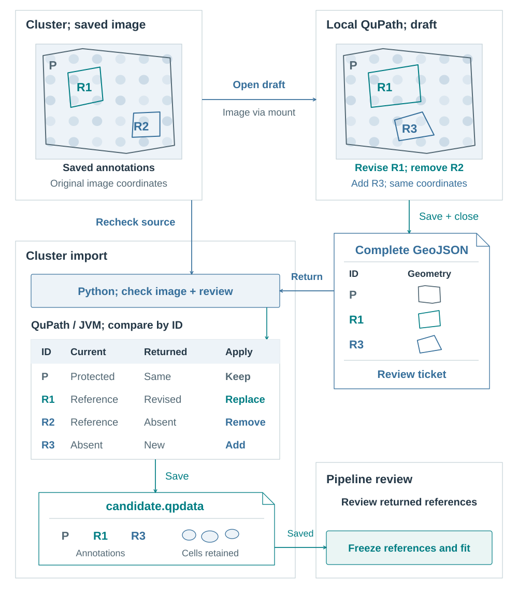

# Review annotations and predictions in QuPath

[Save and return native edits](index.md#user-guide-reviewing-and-resuming) · [Viewport loading](interactive-viewing.md)

Open QuPath from a stage review to draw the references or inspect the predictions for its selected image. The review determines which annotations can be returned to the analysis. When you save and return a draft, we check its image and coordinates before using the drawings for fitting or measurement. To inspect saved results from Run without editing them, see [Viewing images and cells](interactive-viewing.md).

## Open the image for review

Open the image from the stage’s reference annotation or prediction review. This gives QuPath the class labels for that review and the boundaries within which to display predictions. After accepting the result, use **Open QuPath** on Run or Results to [inspect the saved image and cells](interactive-viewing.md).

## Saving the project and returning annotations

Draw tissue references with QuPath’s brush, polygon, rectangle or ellipse tool. For a conventional [tissue classifier](../tissue-classification/index.md#reference-training-and-evaluation), the labelled pixels supply the training examples. KRONOS uses complete labelled patches. For [supervised cell phenotyping](../phenotyping/supervised.md#label-and-freeze-reference-cells-in-qupath), place point annotations on existing cells to identify their reference phenotypes.

Save the annotation draft in QuPath, then return it using the stage’s review controls. Before accepting the drawings, we check their source image, full-resolution coordinates and the changes permitted by the review. With cluster streaming, QuPath saves the draft on your computer before returning the annotations to the cluster. If the transfer is interrupted, you can therefore keep the saved draft and follow [Return a QuPath annotation draft](index.md#return-a-qupath-annotation-draft).

_R1 is reshaped, R2 is removed and R3 is added. The original IDs let the cluster apply those edits to the same annotations and preserve the protected annotation P. For classifier references, **Freeze references and fit** accepts the returned labels and starts fitting._

### Compare saved project inputs

QuPath can save a new project file after a change to a timestamp, channel colour or the order of the displayed images. To decide whether a saved calculation still applies, we match image entries by ID and compare their reader settings, dimensions, channel names, physical calibration and analysis assignments.

The file alongside the project ending in `.qpproj.mif-content.json` records a checksum for the project file and another for the image settings used in processing. A display change can produce a new project file with the same image settings. Comparing the settings lets the analysis reuse the calculation in that case and detect changes to its inputs when the project is reopened.

## Restricting predictions to the intended image regions

Tissue detection predicts across the usable image, including slide background, to produce candidate tissue boundaries. Primary classification predicts across the accepted analysis regions. Secondary classification predicts within the analysis regions or selected primary tissue classes defined for each structure. Reference annotations select the examples used to fit each of those classifiers.

The saved-model review filters requested tiles by those permitted regions and clips their displayed pixels at the actual region boundaries. Unannotated locations inside an eligible region receive predictions from the model fitted to its labelled reference pixels.

When you update the annotation preview, the current model may still be predicting pixels for tiles in view. We let those reads finish before releasing the model’s memory. For KRONOS, updating the graph changes the features supplied to RF or SVM, so we refit the classifier before drawing the new predictions. Closing the editor stops the preview and its background updates.

## Converting predicted class indices into displayed colours

A categorical pixel classifier returns a class index for each pixel. Its saved class list supplies the corresponding labels. For supported 8-bit output, a 256-entry array maps each predicted index to its display colour and opacity.

We build the colour mapping in three steps.

1. Read the class associated with each recorded index. An ignored or missing
   class receives a fully transparent entry. A tissue or phenotype class assigned
   index zero remains visible.
2. Read the class's red, green and blue values and let `m` be their maximum.
   If `0 < m < 220`, multiply all three by `220/m` and round to integers. This
   brightens a dark colour while preserving its channel proportions. A black
   colour becomes `(220, 220, 220)`. A missing class colour starts from the
   specified neutral grey.
3. Store the resulting RGB colour with full per-class opacity. The viewer blends
   these colours with the underlying image using the selected overlay opacity
   and clips the overlay to the regions permitted for prediction.

### Retaining QuPath's prediction and rendering work

The shared display creates a `PixelClassificationImageServer` with the selected palette. Its numerical prediction uses the saved classifier, and the native tile renderer applies the colour lookup to those categorical indices. A palette revision reuses that classifier and changes the resulting display colours.

When you switch images in a QuPath classifier window, the new image needs its own prediction server. We create that server with the same classifier and shared palette and place it in the window’s cache for that image. QuPath can then render predictions through its existing overlay and request queue, displaying the same class indices in the chosen colours.

The adapter targets QuPath 0.7.0 because access to this server cache uses that release's internal field. When the adapter attaches to a window, it checks that the field is available; each replacement checks that the classifier instance and image metadata match the preceding server.

Probability images and unsupported output types keep their existing display route. Closing the window removes listeners and lets the native window close its overlay. Navigation costs include source reading, feature calculation, prediction, palette lookup and cached-tile reuse.

[Software setup](../installation-and-build/software.md#open-software-setup) explains installing
InstanSeg, KRONOS and their required libraries. [Model execution](../tissue-classification/model-execution.md)
describes feature preparation, fitting and the data exchanged with Python.

## Registration image comparison and calculations

Review the pair in the Qt [alignment workspace](../alignment/index.md#prepare-the-image-pair). The Java image reader supplies the fields used for manual positioning, automatic fitting and landmark refinement. Once the alignment is accepted, QuPath can display the original paired image over the corresponding mIF field during annotation. Warpy reads the paired-image pixels at coordinates given by the saved transformation. [How the paired image is displayed](../alignment/index.md#reference-registration--vii-display-the-original-paired-image)

With [cluster streaming](../alignment/index.md#return-alignment-work-to-the-cluster), the desktop reads the mounted image pair. It returns the positioning and landmark choices to the cluster for fitting.

## Returning background results to the desktop forms

The Python/Qt interface uses `gui/qt/jobs.py` to run slow operations on background threads while the interface continues responding to mouse and keyboard input. Each operation places its returned value or formatted error on a thread-safe queue, which a Qt timer checks every 25 milliseconds while work remains active.

Before delivering a result, the controller waits for its processing thread to finish and removes that operation from the active-job list. The receiving page then updates on the Qt interface thread, and another operation can start after the preceding cleanup has completed. The delivery timer stops when no active operations or pending results remain.

Callers can share a pending read by giving it the same explicit request key, and independent read-only operations can run together. The job manager runs operations that change settings or start processing one at a time. It sends control requests to the active run separately so that a researcher can request a pause during a long calculation. The run pauses when active work reaches a safe stopping point.

Implementation: `qupath/scripts/general/prediction_display.groovy`, `native_prediction_display.groovy` and the classifier review scripts; project comparison is implemented in `qupath_runtime/project_content.py`.

---

**Continue:** [Run and review](index.md).
