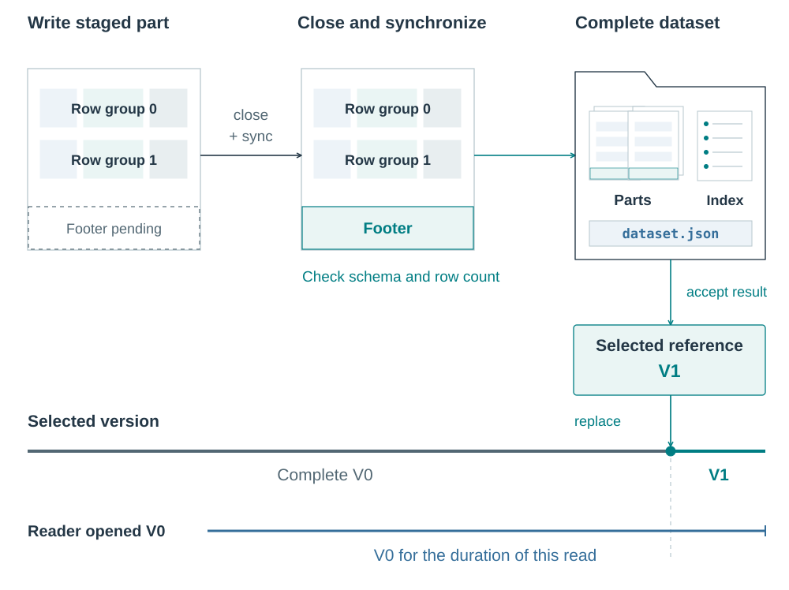
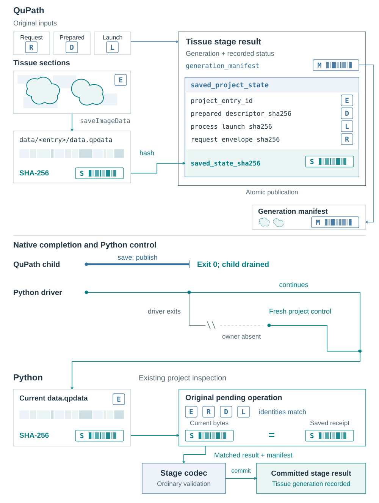

# Analysis files, version selection and recovery

[Run and review](index.md) · [Analysis-folder contents](../setup/analysis-folder.md)

When you revise a calculation, subsequent stages continue to use the previously accepted result until its replacement has been written and checked. Processing can stop after the replacement reaches disk but before it is selected. When you [reopen the analysis](index.md#reopen-an-analysis), we compare the saved files with the original request to determine whether the replacement is complete or part of the calculation must run again.

## Locate the saved inputs and results

[Analysis-folder contents](../setup/analysis-folder.md#locations-of-saved-files) identifies the setup files, processing workspace and records used to reopen an analysis. `state/head.json` selects the current plan, project state and results; `state/current-progress.json` contains the workflow summary displayed by the desktop. Image arrays, models and cell tables stay in the locations recorded by their completed results.

On reopening, we read the saved settings and the records identifying the selected results. This lets you inspect progress even if a source image or model is temporarily unavailable. To resume a calculation or open a project in QuPath, restore access to the external files that operation needs.

## Complete one table part

We divide large cell tables into Parquet files so they can be written and checked one part at a time. As each part is written to a temporary directory on the destination filesystem, we record its row count and column information. Closing the file adds a footer that identifies where each group of rows and its columns can be read. [1]

Before accepting the part, we ask the filesystem to flush it to storage and read its footer. We compare the row count and column definitions with those recorded during writing. For categorical columns, we also record the dictionaries that link stored codes to their labels. Where a checksum is required, we calculate it once and retain it with the file record.

The completed Parquet files remain in the temporary directory until the indexes and dataset description are also complete. The writer then moves the directory to its final location, making the dataset available for the coordinator to select.

For an image, an unwritten region can read back as the array’s fill value, which may also be a genuine pixel intensity. We therefore record each completed shard and pyramid level as it is written. On reopening, we use this inventory to find the regions that still need processing.

## Select a complete dataset

When the writer reports a complete dataset, the coordinator records its location and version in `state/head.json`. Only one coordinator may update this file at a time. A reader opening a query or calculation uses this record to select its inputs and keeps those versions until it finishes.

The selected-result record is replaced in one filesystem operation, called an atomic replacement. Another reader therefore sees either the complete old record or the complete new record. Saving also requests the filesystem's supported flush operations. Java reports when the filesystem cannot perform an atomic move; each processing mode uses the save procedure supported by its filesystem. [2]

_V0 remains selected until the new Parquet files, indexes and dataset description are complete. After the coordinator selects V1, new calculations read V1. A calculation already using V0 finishes with its original inputs._

Cluster processing programs finish writing their results on the cluster filesystem. The desktop receives their recorded locations and updated progress, then reads the image fields and objects requested during review through the mounted folder.

## Recover after interruption

On reopening the analysis, select the stopped step in Run. If the worker reported a failure, **Retry step…** can start a new attempt. If processing ended before the worker reported an outcome, some Python calculations can resume from the inputs and review decisions already saved. The files completed before the interruption determine which work can be reused.

- **Cell tables.** If writing stopped before the dataset and indexes were complete, the next attempt rebuilds that dataset. A closed Parquet part alone cannot be selected. An abrupt stop can leave temporary files on disk.
- **Image arrays.** Processing reads the record of completed shards and resumes the unfinished ones. The previous selected image remains available until the replacement is complete.
- **Completed datasets.** If the files reached their final location before the coordinator recorded them, the coordinator checks their inputs and required reviews before selecting them. If selection had already finished, the saved record identifies the new result.
- **Annotations.** Reopen the saved QuPath draft through the review that requested it. Re-enter any form choices that had not been submitted when the desktop closed.

If an external input changed, restore the expected file or select its replacement through the relevant revision action. For an uncertain cluster submission, reconnect first. We check the saved job record before submitting again. Run identifies the expected location of any remote input it cannot find.

### Completing a native project stage

When a stage changes a QuPath image, QuPath first saves its state in `data.qpdata`. The Groovy result writer reads this file once to calculate its SHA-256 checksum. It returns the checksum, image entry, request, prepared run and process-launch IDs in a record called `saved_project_state`. It then flushes the result file and replaces its destination atomically.

If processing was interrupted after QuPath saved the image, the coordinator uses these records to decide whether it can finish the original request. It first verifies that the process exited successfully, finished cleaning up and released the project for exclusive access. It then compares the saved image’s checksum with the one QuPath returned for the pending request and checks the corresponding project and workflow revisions. This also lets it recognize a change already saved during an earlier recovery attempt.

If the records agree, we reuse the saved image and perform the stage’s usual result and review checks. A different image state or later project revision needs review before another write.

_After saving the tissue annotations, QuPath records the image entry (E), request (R), prepared run (D) and launch (L) with the checksums of the saved image state (S) and tissue result manifest (M). Python uses the same records to check the saved result when QuPath finishes normally or when an interrupted analysis reopens._

### Offered recovery actions

For a task that writes to QuPath, a retry requires confirmation that the earlier process stopped and its saved output can be identified. Until then, a second write could overwrite the result of the first attempt.

If the first segmentation attempt on this computer is interrupted and its saved state permits recovery, Run offers **Restore accepted regions**. This restores the accepted tissue, analysis-area and primary-classification regions so you can revise the segmentation settings and run it again. Before restoring them, we verify that the recorded processes have stopped and the accepted region files are available and unchanged. The interrupted project files are retained with a separate record of the restoration.

Use [Run's continuation and revision procedures](index.md#change-a-completed-or-stopped-step) for the displayed controls. [Troubleshooting](../../troubleshooting.md#a-stopped-step-has-no-retry-action) matches recorded failures to their correction and retry actions. For a task waiting for RAM, follow [Computing](../setup/computing.md#memory-available-for-processing) to make enough memory available, then continue the saved analysis.

### Replacing results after a revised decision

The revision preview identifies which completed tasks depend on the changed decision. When you apply it, we check that the settings and analysis version still match the preview. Independent tasks keep their accepted results.

For each affected image, the project stops displaying superseded generated regions, cells and phenotypes as current results. Manual reference annotations, including drawings nested within a generated region, are preserved. A revised segmentation receives a new cell-population ID so measurements from the earlier segmentation remain linked to their original cells.

If you revise measurements using the existing segmentation, we read the accepted cells together with their saved edits. Deleted cells are excluded and measurements affected by revised outlines are recalculated. The new result identifies the segmentation and edits used.

A stopped measurement task in local or cluster-desktop mode can accept removals of existing cells through a separate QuPath draft. Follow [the measurement correction procedure](../cell-measurements/index.md#if-a-measurement-cannot-be-calculated) to inspect the reported cell and return its removal. Applying that revision changes the cells included in subsequent calculations.

Replacement processing starts once every affected image has saved its change. If one save fails, Run identifies the image and the changes already saved for the others. If the saved state is uncertain, inspect the reported files before allowing a further write.

[Changing a completed or stopped step](index.md#change-a-completed-or-stopped-step) describes the revision controls. [Execution and scheduling](execution.md#accept-reviews-and-completed-results) explains how we check a returned result against its request.

## Retain results and clean up temporary files

Completed datasets and historical results remain on disk when a revision changes the selected references. The current application does not provide general removal of unreferenced results or dataset compaction. Preserve those files and annotation drafts when diagnosing an interruption or revising settings.

An abrupt termination can leave temporary output that was never selected. Retain these files while resolving the interruption, since completed image shards may still be needed to continue. Display caches can release image and cell data from memory without changing saved annotations or cell edits.

Results may refer directly to the accepted datasets rather than duplicate their files. The [results guide](../results/index.md) explains which files must remain available to reopen a saved result and which exports create separate copies.

**References:** [1. Parquet file format](https://parquet.apache.org/docs/file-format/); [2. Java Files move semantics](https://docs.oracle.com/en/java/javase/21/docs/api/java.base/java/nio/file/Files.html).

---

**Continue:** [Run and review](index.md).
