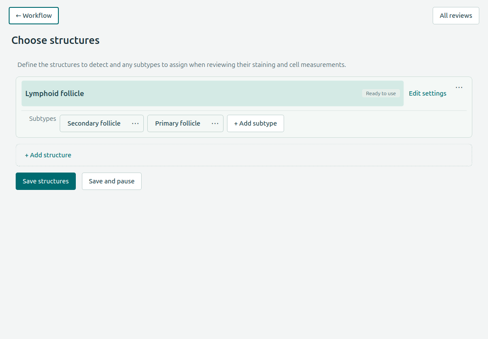
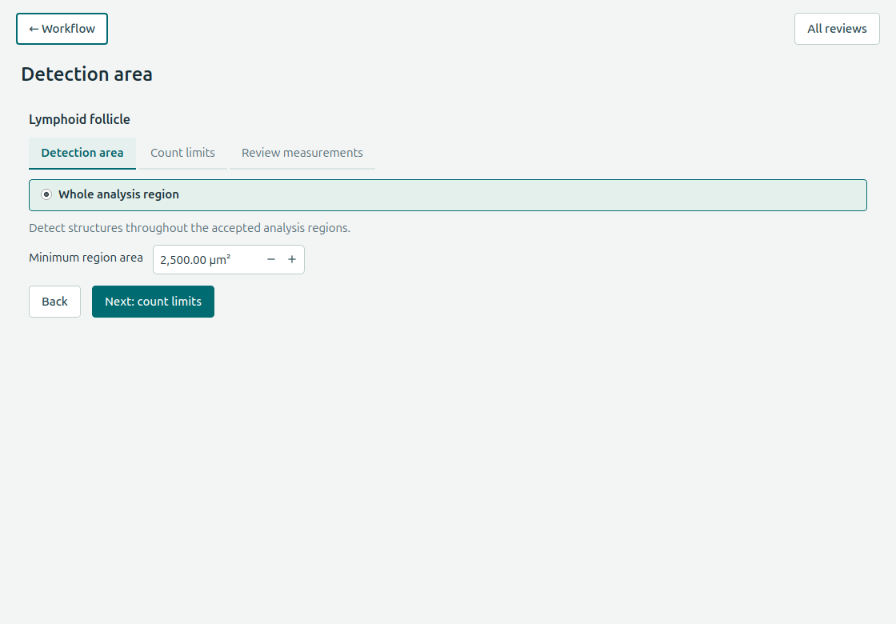
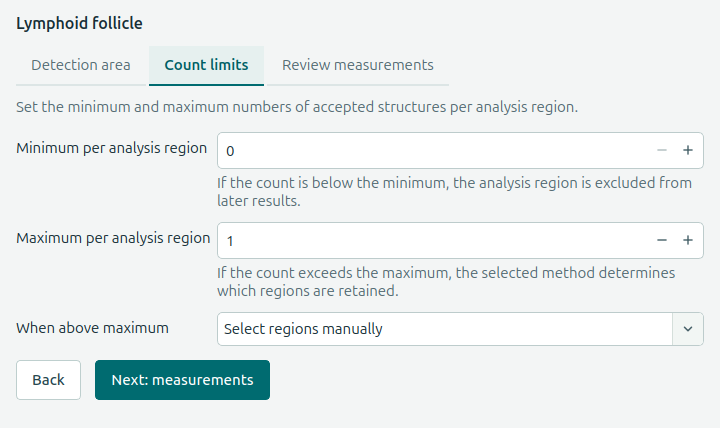
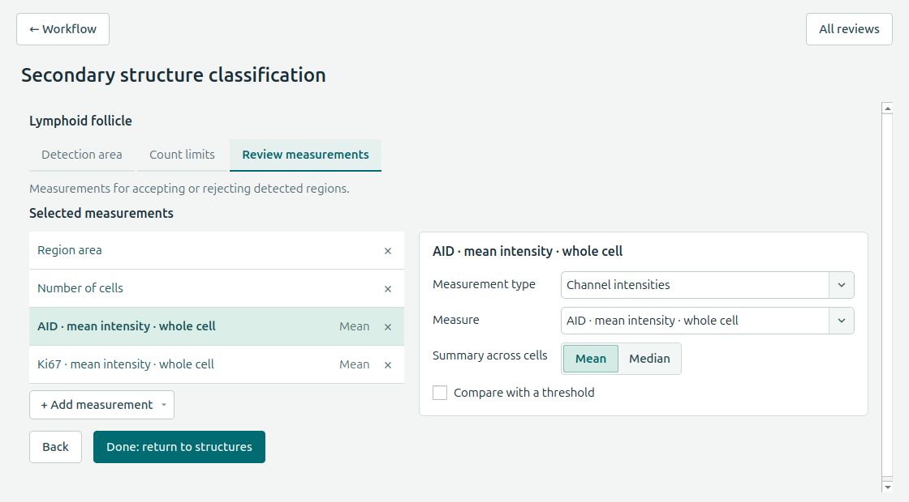
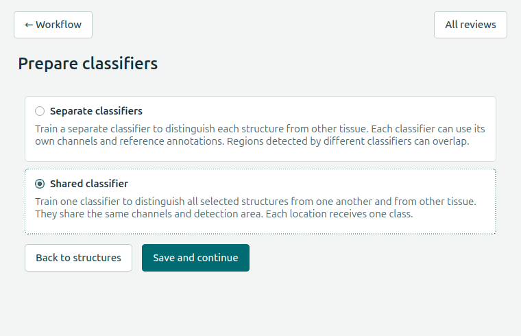
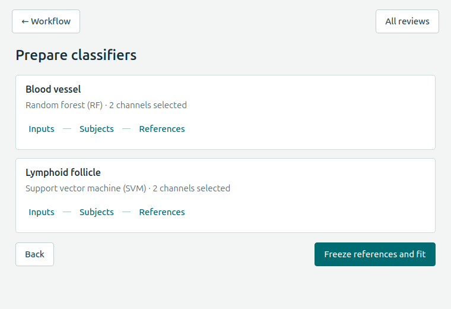
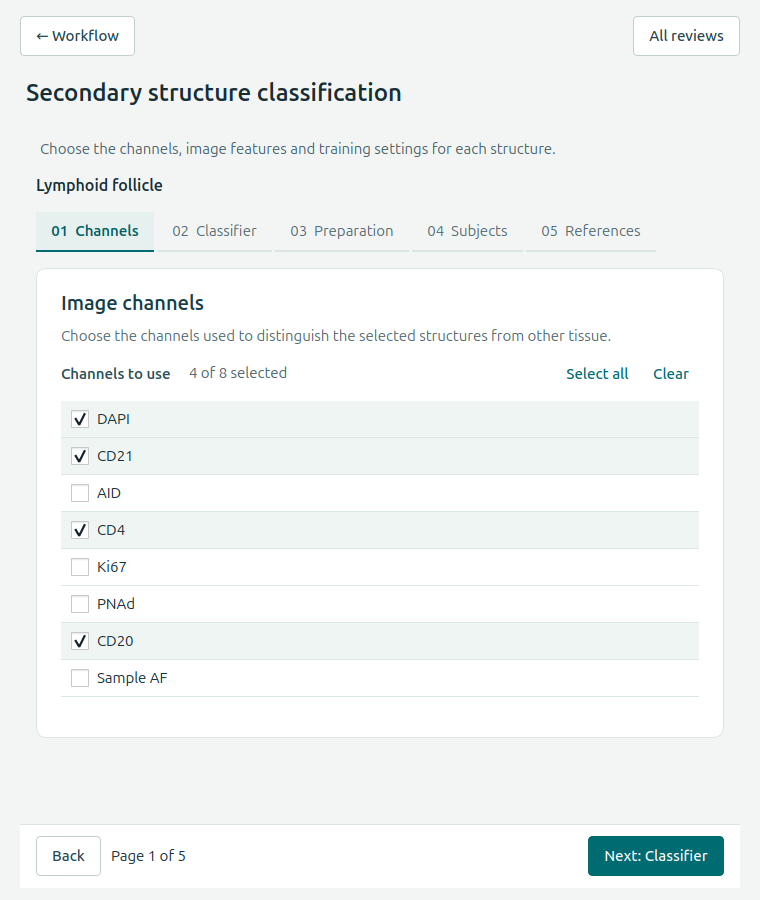
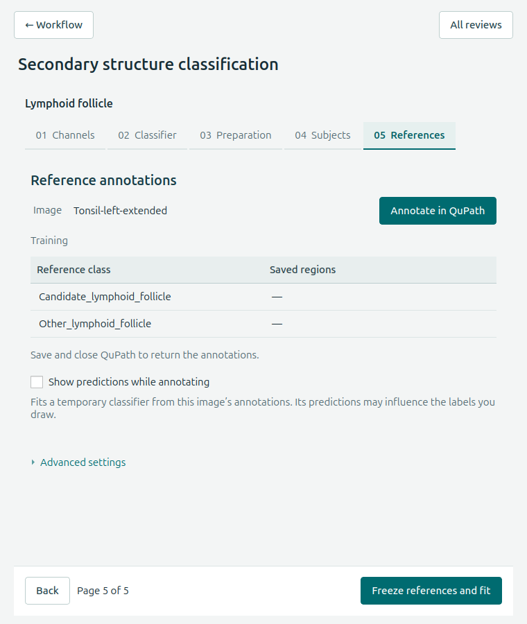
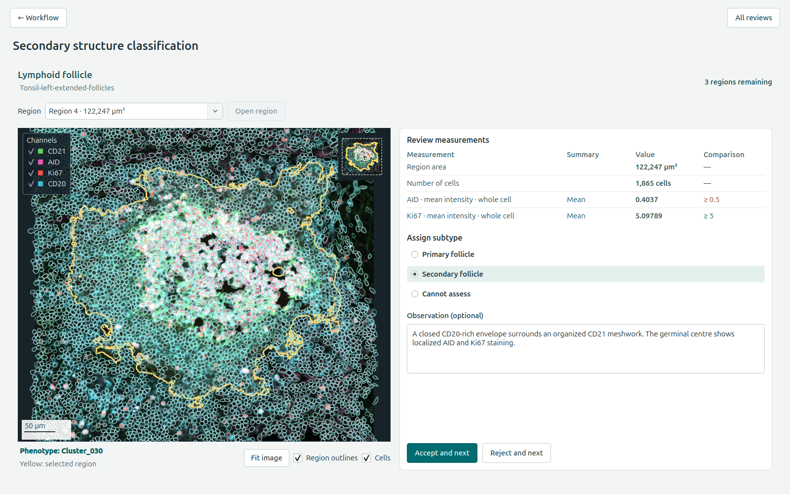
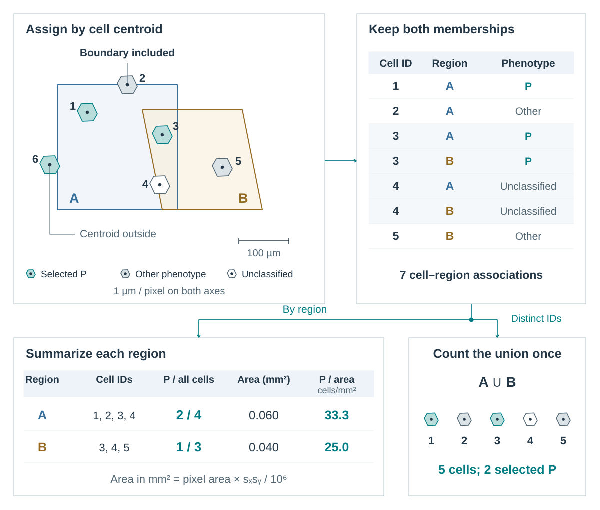

# Secondary structures

[Analysis stages](../../../README.md#analysis-stages)

**On this page:** [Define structures](#choose-the-structures-included-in-this-analysis) · [Detection area](#define-its-parent-area) · [Count limits](#structure-count-limits) · [Measurements for review](#define-biological-criteria-and-count-rules) · [Fit and review the detector](#fit-the-classifier) · [Review detected regions](#user-guide-structure-review) · [Saved results](#inspect-final-inclusion) · [Measurement calculations](#measurement-calculations)

**Open:** **Run → Secondary structures → Open review**.

Secondary classification learns to detect structures, such as lymphoid follicles, from labelled reference regions. We apply the fitted classifier within the analysis regions or selected primary tissue compartments. You can then compare each detected region with its staining, cell measurements and phenotype composition to decide whether to retain it and which subtype it represents. This stage follows phenotyping so the measured cells and their phenotype assignments are available for these comparisons.

## Choose the structures included in this analysis

On **Choose structures**, select **+ Add structure** and enter its name. To distinguish subtypes for each structure during review, use **+ Add subtype** and enter each name. 

Select **Edit settings** beside a structure to choose its **Detection area**, **Count limits** and **Review measurements**. Selecting a subtype opens its **Subtype measurements**, where you choose any additional measurements needed to distinguish it. **Done: return to structures** returns to the overview.

*Structure setup for the [tonsil example](../../data/public-image-sources.md#tonsil-lymphoid-follicles): one Lymphoid follicle detector with Primary follicle and Secondary follicle subtype choices for region review. The small menu within each structure or subtype provides Rename and Remove actions.*

## Select the detection area

On **Detection area**, choose **Whole analysis region** to search throughout the accepted analysis regions. When primary tissue classes are available, choose **Selected tissue classes** to restrict detection to the named compartments selected below.

**Minimum region area** sets the minimum area in µm² for a connected region to enter review. Regions smaller than this value are removed from the classifier output; **0 µm²** retains all sizes. Choose the limit according to the smallest structure relevant to your analysis.

*The tonsil setup searches throughout the accepted analysis region and retains detected regions of at least 2,500 µm². Primary tissue classification was skipped, so no tissue-compartment selector is shown.*

## Set structure-count limits

On **Structure count limits**, set how many accepted structures each analysis region must contain and how many to retain. **Minimum per analysis region** starts at **0**, allowing analysis regions without that structure; a higher minimum excludes analysis regions that do not meet the required count from the final analysis. **Maximum per analysis region** starts at **No limit**, retaining all accepted structures.

If the accepted count exceeds a maximum, **Select regions manually** lets you choose which regions to retain after completing region review. **Select regions randomly** chooses the permitted number using the **Random seed**, reproducing the selection for the same seed and regions. For example, a maximum of three retains three of five accepted structures; the other two are omitted from the final results.

*This tonsil setup permits analysis regions without follicles and retains at most one accepted follicle per analysis region. If several are accepted, manual selection determines which one enters the final results.*

## Select the measurements to show during review

On **Review measurements**, choose quantities that will help you assess the detected regions. Use **Add measurement** to choose a measurement type, then choose the quantity or saved measurement under **Measure**. Select an item in the chosen-measurement list to change its settings.

Measurements selected for the structure appear for every detected region. To add measurements for a particular subtype, select that subtype in the structure overview and open **Subtype measurements**. These additional measurements appear when you select the subtype during region review.

*The tonsil review uses region area, cell count and the regional means of saved cell-level AID and Ki67 intensities. The selected AID measurement uses Mean across cells without a threshold.*

### Region area, cell counts and phenotype fractions

Choose **Region area** to report the area enclosed by the detected outline. Cell counts, densities and fractions use the cells assigned to that region. For **Fraction of cells of a phenotype**, select the phenotype whose count will be divided by the region's total cell count; phenotype density instead divides that count by the region's area in mm². The [measurement calculations](#counts-fractions-densities-and-region-area) define the available counts and their denominators.

The phenotype names come from the completed phenotyping stage. Marker-positive and marker-negative counts are also available when marker-rule phenotyping supplied those decisions.

### Summarize cell intensities and shape

To summarize a saved measurement across a region, select the cell measurement first, then choose **Mean** or **Median** under **Summary across cells**. The first choice determines what value each cell contributes. For an intensity measurement, its name identifies the channel, the part of the cell measured and how its pixels were summarized. The second choice determines how to combine those cell values. Selecting whole-cell AID Mean and then **Mean**, for example, gives each cell’s mean AID intensity equal weight in the regional average. [Regional summaries and missing measurements](#mean-and-median-of-cell-measurements)

### Measure marker positivity within a population

For **Population-specific marker fraction**, select one or several phenotype groups and the saved marker intensity used to determine positivity. **Divide by** selects whether to express the marker-positive count as a fraction of the selected population or of all cells in the region. Both denominators exclude cells whose selected marker intensity is unavailable.

For example, select the B-cell groups and nuclear Ki67 Mean to count Ki67-positive B cells. Choose **Selected population** to calculate the fraction of B cells that are Ki67-positive, or **All cells in the region** to calculate the fraction of the region's cells that are Ki67-positive B cells.

If marker phenotyping used the same measurement and image scope, the field starts with that marker’s accepted threshold. Otherwise, select **Review threshold…** to inspect the intensity distribution and staining. Set the threshold manually or fit a Triangle, Gaussian mixture or Gamma mixture threshold. Select **Use threshold** to apply it to this regional measurement. Cells retain their existing phenotype labels. [Marker-threshold methods](../phenotyping/marker-rules.md#marker-thresholding-options)

### Compare a regional measurement with a threshold

Enable **Compare with a threshold** to compare the resulting regional measurement against a study-specific cutoff. For example, **At least 0.4** for a phenotype fraction checks whether at least 40% of the region's cells have that phenotype. The review displays the measured value and comparison result to inform your decision about the region.

## Fit the classifier

With one structure, select **Save structures** to open its classifier setup. With several structures, continue to **Prepare classifiers**, choose how they will be detected, then select **Save and continue**.

With **Separate classifiers**, annotate references for one structure at a time, labelling its regions with the structure's class and the remaining references as other tissue. Each classifier can use different channels and fitting settings, which is useful when structures require different staining features for detection. Their detected regions can overlap.

With **Shared classifier**, label examples of each selected structure and use a common class for other tissue. We fit one classifier to distinguish these structures using a common detection area, channels and fitting settings. This is useful when the same staining features distinguish the structures from one another and from other tissue. The resulting detections do not overlap.

*With **Shared classifier** selected, the structures share a set of image inputs and each structure has its own reference class.*

### Select inputs and annotate references

When fitting one classifier, setup opens on **Image channels**. From this page, **Back** returns to **Choose structures** for a single structure or to **Prepare classifiers** for a shared classifier covering several structures.

When fitting several classifiers separately, the overview shows the method and selected channel count for each. Choose **Inputs** to start with its channels, **Subjects** to open its subject allocation, or **References** to annotate for that classifier. **Back to classifiers** returns to the overview. From there, **Back** reopens **Prepare classifiers** to change the shared or separate choice.

*Separate classifiers for blood vessels and lymphoid follicles, with their inputs, subject allocation and references accessible from the overview.*

On **Image channels**, choose the stains that distinguish the structures. On **Classifier**, select **Random forest (RF)** or **Support vector machine (SVM)** under **Method** to classify individual pixels. For patch-based classification, select **KRONOS** and choose RF or SVM under **Final classifier**. Choose the training procedure for this classifier, then enter the [model parameters](../tissue-classification/index.md#classifier-methods-and-parameters).

*The follicle classifier uses DAPI, CD21, CD4 and CD20 from the prepared tonsil image.*

For a pixel classifier, set the sampling resolution and select the intensities and filters on [Image preparation](../tissue-classification/index.md#image-feature-routes). For KRONOS, set the patch size and sampling resolution, then [assign the channels to model markers](../tissue-classification/index.md#kronos-and-local-graph-features).

On **Subject allocation**, assign the subjects to fitting and any independent testing. For cross-validation, set the number of folds and inspect which subjects are held out in each fold. The [subject-allocation guide](../tissue-classification/index.md#allocate-reference-subjects) explains these roles and the validation procedure.

On **Reference annotations**, select an image and choose **Annotate in QuPath**. Draw references using the labels for this classifier, save them and check the counts returned from QuPath. For one classifier, select **Freeze references and fit** on this page. For several separate classifiers, use **Back to classifiers**, complete the references for each, then select **Freeze references and fit** on the overview to fit them all. Inspect the fitted predictions and any held-out results in [classifier review](../tissue-classification/index.md#inspect-and-accept-the-fitted-model).

*Reference annotation for the tonsil follicle classifier. Its two classes identify candidate follicles and other tissue.*

## Review the predicted outlines

On **Images and references**, select a fitting image and choose **Inspect selected image in QuPath**. Check whether each predicted outline encloses the intended structures (including those that were annotated). Inspect locations outside the reference annotations as well as the labelled examples. Where outlines need correction, revise the references or fitting settings and fit again.

Use the shared [validation](../tissue-classification/index.md#compare-validation-results-across-subjects-and-references) and [independent-test](../tissue-classification/index.md#review-independent-test-results) guidance to assess predictions on subjects held out from fitting. The available review pages depend on the training procedure selected during setup.

## Review the detected regions

The region-review page places the image beside its measurements and subtype choices. Pan or zoom to compare the outline with the staining; the inset shows where the displayed field lies within the region. **Region outlines** toggles the boundary overlay, and [Image appearance on Run](../run/index.md#adjust-image-appearance) sets channel colours and brightness.

Enable **Cells** to show the saved cell and nuclear outlines in the displayed field, then select a cell to read its phenotype. Zoom in if the field contains too many cells to display. The [cell-membership calculation](#assign-cells-to-each-structure) determines which cells contribute to the selected region's measurements.

### Choose a region to inspect

The **Region** selector lists undecided regions from largest to smallest, with their areas. Select a region and choose **Open region** to inspect it without deciding on the current region. **Accept and next** and **Reject and next** record a decision and advance through the remaining regions.

### Read the measurement results

The measurement table shows each quantity, its summary across cells where applicable, and its value for the region. Compare those values with the staining inside the outline. For example, a low regional marker mean could reflect weak staining throughout the region, a mixture of strongly and weakly stained cells, or adjacent tissue included by the detector. Inspecting the image helps distinguish these possibilities. When a threshold was specified, the table displays it beside the measured value and highlights comparisons that do not meet it.

For fractions and densities, inspect the contributing count and denominator in the details. A phenotype fraction uses all member cells as its denominator, while density uses the region's area in mm². The [measurement definitions](#counts-fractions-densities-and-region-area) explain how unphenotyped cells, empty regions and missing measurements affect the result.

An **Unavailable** result explains which input is missing. Add a missing intensity or shape measurement in **Cell measurements**, or process cells lacking phenotype assignments in **Cell phenotyping**, then recalculate the affected results. [Change a completed or stopped step](../run/index.md#change-a-completed-decision) explains how to revise those stages.

### Assign a subtype and accept or reject the region

Under **Assign subtype**, choose the subtype supported by the staining and measurements. **Cannot assess** lets you retain a region whose subtype cannot be determined. Use **Observation** to record a finding relevant to the decision.

**Accept and next** keeps the region with the selected subtype, or with an undetermined subtype if **Cannot assess** was selected. **Reject and next** excludes the region. After every region has been reviewed, we apply the [count limits](#structure-count-limits); when a maximum requires manual selection, the next page asks which accepted regions to retain.

*Secondary follicle in the public healthy-tonsil field, with cell outlines displayed and example review thresholds for AID and Ki67. Selecting a cell shows its saved phenotype below the image.*

## Inspect final inclusion

Open [Results & export](../results/index.md) for the saved region and cell results. The region table records acceptance or rejection, subtype assignment, any observation and whether the region was included after applying count limits. The detailed review result includes the selected measurements and their threshold results.

When combining results from overlapping structures, use cell identifiers to count each cell once across their combined area. [Cell membership](#reference-semantic-validation--candidate-membership) explains why a cell can appear in more than one structure's results.

## Update a structure definition

Open the completed **Secondary structures** step from Run and select the definition to change. The saved names, detection areas, measurements and count limits reopen for editing. Channels are selected in classifier fitting setup. Review the affected stages before confirming the revision.

Changing a detector's area, channels or fitting settings can alter its outlines and the cells assigned to each structure. Changing review measurements or thresholds updates the information used to assess its regions. The revision preview shows the processing and review steps that will be repeated. [Change a completed or stopped step](../run/index.md#change-a-completed-decision) describes those controls.

## How region measurements are calculated

We calculate the selected review measurements from saved region outlines, cell measurements and phenotyping results. The following definitions explain how we assign cells to regions, calculate each quantity and handle missing inputs.

### Assign cells to each structure

For each saved cell, we test its centroid—the area-weighted centre of its outline—against the structure's outline. A centroid inside the region or on its boundary includes the cell; a centroid within a hole is excluded. We assign the complete cell and its saved measurements to the structure, even when part of the cell extends across the boundary. Overlapping structures can therefore share cells, as illustrated below.

_Cell membership in overlapping regions A and B. Dots show cell centroids. A includes cell 2, whose centroid lies on its boundary, and excludes cell 6, whose outline intersects A but whose centroid lies outside. Cells 3 and 4 belong to both regions. Phenotype P occurs in 2 of A's 4 cells and 1 of B's 3; other phenotypes and Unclassified cell 4 remain in the denominators. With pixels measuring 1 µm × 1 µm, the drawn areas of 60,000 and 40,000 px² correspond to 0.060 and 0.040 mm², giving P densities of 33.3 and 25.0 cells/mm². The combined population contains five distinct cells, including two with P._

### Counts, fractions, densities and region area

Let `N` be the number of cells assigned to the region, `N_n` the number with a nucleus outline, `N_p` the number assigned to a selected phenotype, and `N_m` the number with the selected positive or negative marker decision.

The region area `A_px` is measured from its outline in full-resolution pixels², excluding holes. We convert it to physical area using the image pixel width `s_x` and height `s_y`, both in µm/pixel.

$$
 A_{\mu m^2}=A_{px}s_xs_y,\qquad
 A_{mm^2}=A_{\mu m^2}/10^6.
$$

Densities require a calibrated area greater than zero; otherwise, the density is unavailable.

**Number of cells** is `N`; **Number of nuclei** is `N_n`. Phenotype counts and marker-positive or marker-negative counts use `N_p` and `N_m`, respectively. Phenotype and marker fractions divide the corresponding count by `N`, including cells with other phenotypes and cells labelled Unclassified. For marker fractions, cells with an unknown marker decision remain in this denominator but contribute to neither the positive nor negative count. A region containing no cells has an unavailable fraction.

For a selected phenotype, its fraction and density are

$$
 f_p=\frac{N_p}{N},\qquad d_p=\frac{N_p}{A_{mm^2}}\quad\text{cells/mm}^2.
$$

**Cell, nucleus and phenotype densities** divide their counts by the region area in mm². If a region contains cells, all have been phenotyped and none has the selected phenotype, its count, fraction and density are zero. If some member cells have not been phenotyped, we cannot determine the complete phenotype or marker-decision counts. These measurements remain unavailable until those cells have been processed. Cell and nucleus counts still include the full member population.

**Region area** reports the calibrated area calculated above in µm². **Number of disconnected parts** counts separate pieces of the same region outline.

**Classifier confidence** uses the score saved by the classifier for that region. The [classifier-methods guide](../classifier-methods/index.md) explains the model scores. If no score was saved, this measurement is unavailable.

### Mean and median of cell measurements

For a saved cell measurement, **Summary across cells** calculates the mean or median of the values from cells assigned to the region. An intensity measurement already summarizes pixels within each cell's chosen compartment, while a shape measurement describes its outline. Each cell contributes that single saved value to the regional calculation.

For example, selecting whole-cell CK Mean and **Mean** averages the cells' individual CK means. Every cell has equal weight, regardless of its size or how many pixels contributed to its CK measurement. Selecting **Median** instead takes the middle cell value after sorting, averaging the two middle values when the cell count is even.

The result keeps the original measurement's unit. We calculate new regional summaries from the cells with finite values and report how many cells were excluded because the measurement was unavailable. A region with no usable values has an unavailable summary. Previously saved summaries that require a measurement for every cell retain that requirement.

### Marker fractions within a selected population

For **Population-specific marker fraction**, we apply the reviewed marker threshold for each image and tissue section to the saved intensity measurements, then count positive cells assigned to any of the chosen phenotype groups within the region.

We divide this count by the total number of positive and negative cells in the selected population or throughout the region, according to **Divide by**. Selecting **Negative** uses the negative count from the chosen phenotype groups instead. Cells with missing or nonfinite measurements are excluded from the calculation. An automatic Gamma threshold also excludes negative intensities because its model requires nonnegative values. The result reports the contributing counts and any exclusions; if no cells can contribute to the denominator, the fraction is unavailable.

### Distance and overlap with primary compartments

Select the primary tissue compartment to compare with the structure. We take the union of that class's outlines, counting overlapping areas once, and convert both the structure and compartment coordinates to micrometres. Let `R` be the structure's area and `P_c` the combined area of primary class `c`, with holes excluded from each. **Distance to a primary compartment** finds the closest pair of points, one anywhere in `R` and the other anywhere in `P_c`.

$$
 d(R,P_c)=\min_{r\in R,\,p\in P_c}\|r-p\|_2.
$$

The result is their separation in µm. It is zero when the areas touch, overlap or one contains the other, because they then share at least one point.

**Overlap with a primary compartment** measures their shared area. **Divide by** selects the denominator for expressing that overlap as a fraction of the structure or the primary compartment.

$$
 f_R=\frac{|R\cap P_c|}{|R|},\qquad
 f_P=\frac{|R\cap P_c|}{|P_c|}.
$$

Choose **Candidate region area** when you want to know how much of the structure lies inside the compartment. Choose **Primary compartment area** when you want to know how much of the compartment the structure occupies. A structure lying entirely inside stroma, for example, has $f_R=1$, but its $f_P$ depends on its size relative to the total stromal area. Without an outline for the selected primary class we cannot calculate either distance or overlap.

---

**Next:** [Results and export](../results/index.md).
