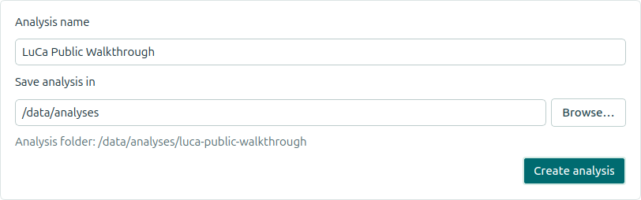
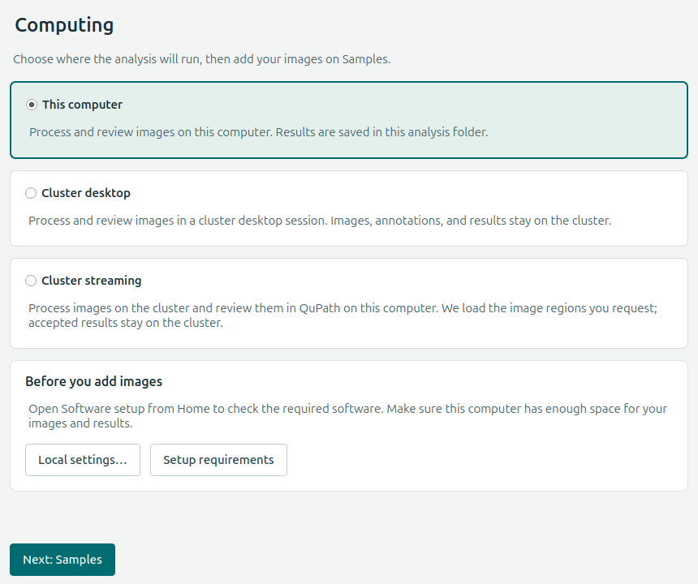
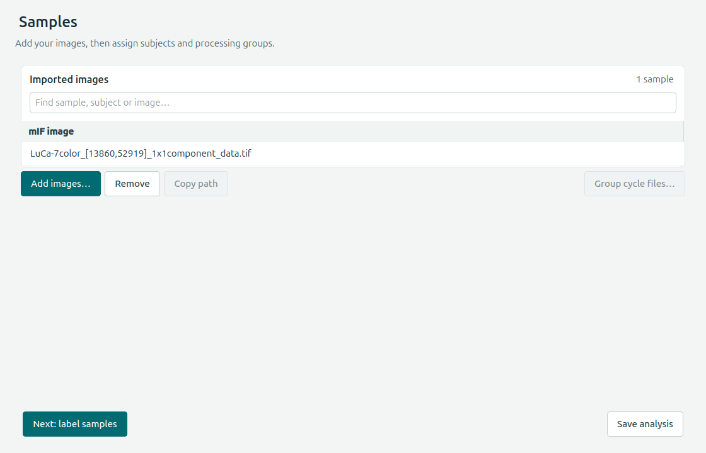
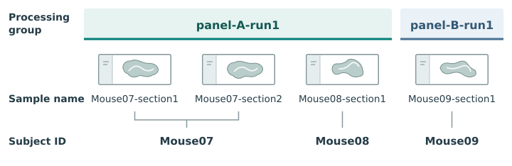
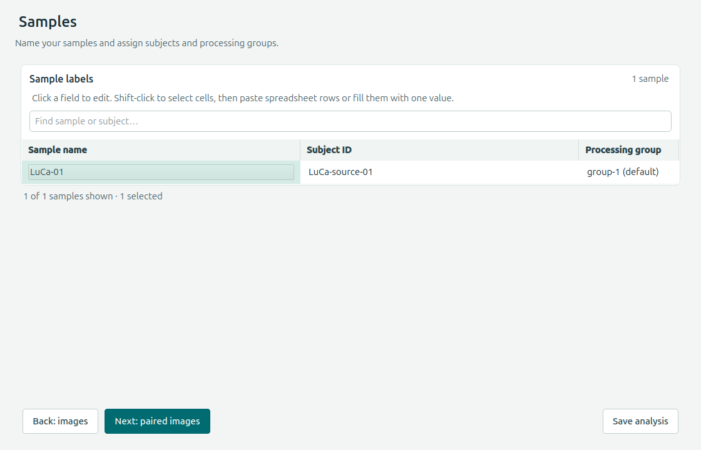
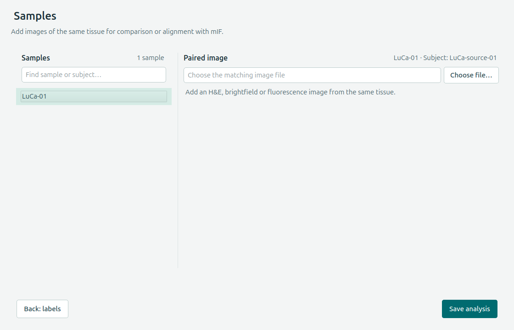
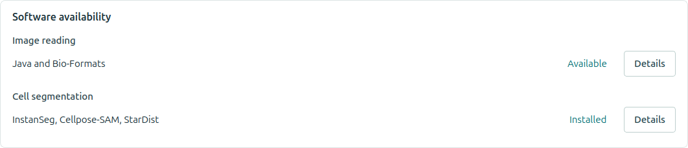

# Create an analysis and add samples

[Analysis stages](../../../README.md#analysis-stages) · [Analysis-folder contents](analysis-folder.md) · [Saved analysis settings](configuration.md)

**In this stage:** [Create the analysis folder](#create-the-analysis-folder) · [Select where processing runs](#select-where-processing-runs) · [Add the images](#add-the-analytical-images) · [Label samples and groups](#label-samples-and-groups) · [Add a paired image where required](#add-a-paired-image-where-required) · [Save and inspect Plan](#save-and-inspect-plan) · [Reopen a saved analysis](#what-is-saved)

An analysis can include several images from the same subject and several subjects imaged with the same marker panel. On **Home**, create the folder for the analysis. On **Computing**, choose where the images will be processed. Then use **Samples** to identify the images, their subjects and which images can share preparation settings and fitted models.

## Create the analysis folder

On **Home**, select **New analysis**. Enter the **Analysis name** and choose the parent directory under **Save analysis in**. Check the path shown under **Analysis folder**, then select **Create analysis**.

_For the LuCa walkthrough, choosing `/data/analyses` as the parent directory creates the study folder `/data/analyses/luca-public-walkthrough`._

## Select where processing runs

To run the analysis on your computer, select **This computer**. Under **Local settings…**, choose the processor and check the available memory and disk space. Select **Save and return**, then **Next: Samples**.

To run the analysis on a cluster, choose **Cluster desktop** or **Cluster streaming**. The images and results are stored on the cluster and an allocated compute node runs the analysis. There are two ways to review its progress and inspect the images.

- **Cluster desktop.** Open MIFflow in a [graphical session on the compute node](computing.md#cluster-desktop). Select **This computer** inside that session to run the analysis and review the images in QuPath on the node.
- **Cluster streaming.** Open MIFflow on your own computer and [set up the streaming connection](computing.md#cluster-streaming). MIFflow submits processing jobs to Slurm. QuPath opens the images through a mounted cluster folder so you can review them locally.

## Add the images

Select **Add images…** and choose one or more source files. Each imported image initially uses its filename as the sample name. Hover over a filename to see its complete location, or select the images and use **Copy path** or **Ctrl+C** to copy their locations.

A source file can contain several images, such as separate tissue sections and a slide thumbnail. We select the fluorescence image automatically when only one is suitable for processing. If several qualify, **Choose images** shows their names, dimensions and channel counts. Select the sections to analyse and choose **Use selected images**. Each selected image becomes a separate sample.

If a cyclic immunofluorescence sample has one file per cycle, select those rows and choose **Group cycle files…**. During image inspection, you can [align the cycles using a shared stain](../cyclic-if-methods/index.md#import-the-cycle-images). If the cycles are already assembled in one image, add it as a single sample.

*The public LuCa file contains one suitable fluorescence image and a thumbnail. Adding it selects the fluorescence image automatically.*

## Label samples and groups

To edit an entry, select the cell and type its new value, or press **F2** to edit the existing text. 

Give each image a unique **Sample name** and enter the person or animal it came from under **Subject ID**. We use the subject ID to keep images from one subject together when allocating training, validation and test sets in later stages.

Assign the same **Processing group** to images recorded with the same marker panel and image detector settings. Images in a group can share a [tissue classifier](../tissue-classification/index.md) or a [pooled phenotyping model](../phenotyping/index.md).

*The two sections from Mouse07 have distinct sample names and share a subject ID. The section from Mouse08 joins them in the same processing group because all three were imaged with the same panel and detector settings. Mouse09 was imaged with a different panel.*

### Edit several sample labels

To paste labels from a spreadsheet, select the first destination cell and press **Ctrl+V**. For a block with headers, use the column names **Sample name**, **Subject ID** and **Processing group** for the fields you include.

To copy labels out of the table, use **Shift-click** to select a block or **Ctrl+A** to select the visible samples, then press **Ctrl+C**. The same copy and paste actions are available by right-clicking the table. Use **Ctrl+Z** to undo a label edit.

To assign one subject or processing group to several samples, select their cells. Choose the field below the table, enter its value and select **Apply to … samples**. If you filter the table, the assignment applies only to selected samples that remain visible. 

*The saved LuCa sample has one subject and one processing group. Its labels can be edited directly in the table; bulk assignment becomes available when several samples are selected.*

Once finished, select **Next** - we will automatically check the sample list for problems such as duplicate sample names and select the entry to correct.

## Add a paired image where required

A paired image provides a reference for identifying tissue structures during mIF review and annotation. 

Select **Next: paired images**, choose the mIF sample and use **Choose file…** to attach its reference. If the file contains one usable image, we select it automatically. If it contains several, use their names and dimensions to identify the corresponding section and select **Use selected image**. Set **Image type** to the staining or imaging method and check the **Paired image name**.

Under **Use with mIF**, choose **Compare images side by side** to inspect the two images without registration. Choose **Align with mIF and use an overlay** to register the paired image to the mIF image. Once you [review and accept the alignment](../alignment/index.md#user-guide-paired-image-registration), you can overlay the two images in QuPath to compare corresponding tissue structures. If the analysis uses mIF images alone, continue to **Save analysis**.

*LuCa-01 is selected in the sample list, with no paired image assigned.*

## Save and inspect Plan

Select **Save analysis**, then open **Plan** to review the included samples, subject and processing-group assignments, computing location and processor choice. **Show image locations** displays the source paths if you need to check which files were selected.

**Software availability** shows which processing tools are ready. At this stage we check that at least one supported segmentation model is available. When you choose a method during segmentation setup, we check the model for that method. If you requested paired-image registration, we also check Elastix, Transformix and the Warpy extension used to apply the transformation in QuPath.

If a check fails, open **Details** for the reported problem and installation location. Correct the named component in [Software setup](../installation-and-build/software.md), follow any restart instruction, and return to Plan to refresh the checks.

*Plan shows which image reader and segmentation models are available for the LuCa analysis.*

Select **Start analysis** when the plan is ready. You can return to **Plan** to check the samples and processing groups for the running analysis. On **Run**, open **Channels & markers** when image inspection finishes.

The [workflow guide](../run/index.md#user-guide-workflow) explains how to complete the processing stages and revisit their settings. [Results](../results/index.md#user-guide-results-and-exports) describes the saved reviews and exports.

## Reopen a saved analysis

On **Home**, choose **Open analysis…** and select the named analysis folder. Before processing starts, you can return to the sample list and its subject and group assignments. These are saved in `analysis.setup.json`. The processing location, processor choice and any cluster connection settings are stored in `analysis.computing.json`.

When you prepare the run, we write the selected images and initial processing settings to `analysis.manifest.json`. Reopening a prepared analysis restores the run and its waiting reviews. To replace an image at this point, use [Change source image…](../run/index.md#replace-a-source-image-or-select-another-series) so the plan identifies which results (from later stages) need recalculation.

---

**Next:** [Images and channel assignments](../images/index.md).
