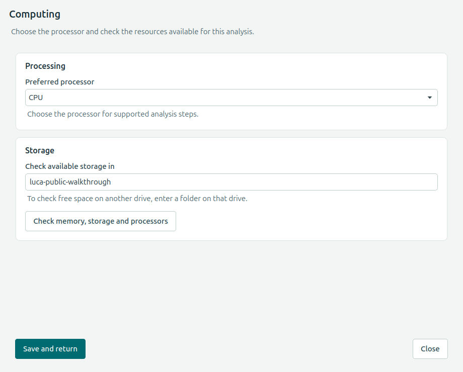

# Local and cluster computing

On **Computing**, choose the computer that will process the images. If the analysis runs on a cluster, you can also choose whether to open MIFflow and QuPath on the allocated node or on your own computer.

| Where to process the images | Where to review them | Computing choice |
|---|---|---|
| On this computer | On this computer | [This computer](#this-computer) |
| On a cluster compute node | In a graphical desktop on that node | [Cluster desktop](#cluster-desktop) |
| On a cluster compute node | On your own computer, with access to the cluster image folders | [Cluster streaming](#cluster-streaming) |

## This computer

Open **Local settings…**. Under **Preferred processor**, leave **Automatic** to let each method select a supported processor with enough memory, or choose a processor for this analysis. Unmixing, InstanSeg, Cellpose-SAM, KRONOS encoding, spatial graph fitting and Nimbus support GPU processing. Random forest, SVM and logistic regression run on the CPU.

To use **NVIDIA GPU**, the computer needs a compatible driver. The portable NVIDIA edition includes the processing libraries. For a wheel or source installation, follow [Add NVIDIA processing libraries](../installation-and-build/software.md#add-nvidia-processing-libraries). Select the precision for spectral fitting and image storage later under [Unmixing](../unmixing/index.md#user-guide-spectral-unmixing--numerical-and-output-settings).

Select **Check memory, storage and processors** to see the available RAM, processing devices and free space on the drive containing the analysis folder. To measure free space on another drive, enter a folder on that drive under **Check available storage in** and run the check again.

*The free-space check uses the drive containing the LuCa analysis folder. CPU is selected for processing.*

Select **Save and return**, then **Next: Samples**. The prepared analysis keeps its processing location and processor preference when you reopen it. To change either after preparation, create a new analysis.

### Memory available for processing

Before starting a calculation, we check the RAM currently available, allow 20% for other activity and account for memory already reserved by running tasks. On a cluster, the Slurm job’s memory allocation also limits the RAM available for processing. A step marked **Waiting for memory** may start when another task finishes. If the step cannot fit even on its own, free memory on the processing computer or request a larger allocation. [How we estimate memory for each task](memory-and-threads.md)

## Cluster desktop

Use a cluster desktop when the institution provides a graphical session on an allocated compute node. MIFflow, QuPath and the analysis files are all on the cluster.

1. Request a desktop session through the institution’s service. Choose the cores, memory, time and GPU needed for the analysis.
2. Open MIFflow **inside that session**. A wheel or source installation needs the `desktop` extra. Complete [Software setup](../installation-and-build/software.md#open-software-setup) there so that the compute node can open QuPath, read the images and load the models.
3. Create the analysis in a writable cluster folder. Under **Computing**, select **This computer**. In this session, that is the allocated node. Open **Local settings…** to choose its processor.
4. Add the [samples](analysis.md#add-the-analytical-images) using their cluster paths. Save the analysis, check **Software availability** on Plan and select **Start analysis**. Complete the forms and QuPath reviews in the same desktop.

Before ending the allocation, select **Pause after current work** and wait for progress to be saved. In a later desktop session, choose **Open analysis…** and select the same cluster folder. [Pause and reopen an analysis](../run/index.md#pause-processing)

## Cluster streaming

With **Cluster streaming**, MIFflow runs on your computer and submits processing jobs to Slurm. Each job reads its inputs and saves its results on the cluster. To review the images in QuPath, mount the cluster folder on your computer. QuPath reads the image through that mount and saves any annotation edits in a local draft. Returning the draft sends the edits back to the analysis on the cluster.

### Prepare the computing environment

Install the same MIFflow release on the processing host as on your computer. The compute nodes need access to the image readers, the models used by the analysis and a writable results folder. Check these paths from an allocated node under the account that will run the jobs.

Activate the cluster Python environment and run `command -v mif-batch` to find the executable the desktop will use to submit work. Enter its full path when setting up the connection below. If this is the first analysis under the cluster account, follow the [command-line setup instructions](command-line.md#software-setup), beginning with `mif-batch setup-workspace`.

### Connect the desktop to the cluster

On your computer, select **Cluster streaming → Streaming connection…**. Enter the SSH connection name or `user@host` and the full path to `mif-batch` on the cluster. Set up SSH key or agent access for this connection.

If your cluster requires an activation script to make Python or the image-processing software available, enter its full cluster path under **Environment script (optional)**. Enter any required module names under **Additional software modules**, separated by spaces. Before running a processing command or starting a job, we load the script followed by the modules. Slurm status queries use the environment provided at SSH login. Select **Check connection** to test these settings.

### Select the analysis folder

Under **Analysis storage**, choose **Create a new cluster analysis** and enter a writable **Cluster parent folder**. The **Analysis folder** shown below it is where we save the run definition and results for this analysis. **Details** shows the paths to the run definition and job messages.

To reopen an analysis already on the cluster, choose **Open an existing cluster analysis** and select its saved folder. This opens its samples and progress on your computer.

### Map the image locations for local review

The analysis records each image’s path on the cluster. To display it locally, QuPath needs a path to the same file on your computer. Choose a cluster folder containing the source images, any paired images and the analysis folder where the prepared images will be written. A read-only mount is sufficient because QuPath writes its annotation drafts locally.

Under **Image access**, enter the cluster path as **Image folder on the cluster** and its local counterpart as **Mount folder on this computer**. If your institution already mounts the folder, use that location. Otherwise, on Ubuntu select **Prepare connection command** and run the displayed SSHFS command locally. On Windows, mount the drive with your SSHFS/WinFsp client.

For example, if `/project/study` on the cluster is available at `/mnt/study` on your computer, enter those two folders. A review of `/project/study/images/sample01.ome.tiff` can then open `/mnt/study/images/sample01.ome.tiff` in QuPath. The same mapping locates prepared images saved beneath the study folder.

### Request resources and submit

Enter the cores, memory, time limit and GPU count for each job. Supply the Slurm account and partition if your institution requires them. **Check processors** in **Cluster analysis** runs a small calculation in an allocation with the requested resources.

After **Save and return**, [add and label the images](analysis.md#add-the-analytical-images) for the new analysis. Save the samples, open Plan and select **Start analysis on cluster** to submit the job to Slurm. Processing starts when Slurm can allocate the requested resources.

If the connection closes before you receive a job number, select **Check submission** on Run. We look up the original submission and reconnect to the job if we find it. A new job can take time to appear in Slurm. Choose **Keep waiting** if its status is uncertain. Choose **Allow another submission** only after checking the displayed job name in the cluster history and confirming that the submission failed.

### Complete reviews and continue

When processing reaches a review, choose **Run → Open current review** on your computer. Move between its pages with **Next** and **Back** until the settings are ready to submit. Choosing **Save and next** or the stage’s own continue action sends the decision back to the cluster. Once it has been saved there, we submit the next Slurm job with the reviewed settings.

For classifier references, select the image on **Reference annotations** and choose **Annotate in QuPath**. QuPath reads the mounted image and saves the drawings to a draft on your computer. If you want to preview predictions locally, install the model and its libraries on this computer as well.

Save the draft and close QuPath to return the annotations. Reviews with a separate **Image to annotate** selector offer automatic return. If you turn it off, select **Return saved annotations** when you finish. An interrupted transfer leaves the draft on your computer for return after you reconnect. [Returning a QuPath annotation draft](../run/index.md#return-a-qupath-annotation-draft)

### Pause and reopen a cluster analysis

Where offered, **Save and pause** sends the decision and leaves processing paused. Choose **Resume analysis** on Run when ready to submit the next job. To return in a later session, use **Open analysis…** and select your local analysis folder. [Troubleshoot cluster submission and review](../../troubleshooting.md)
