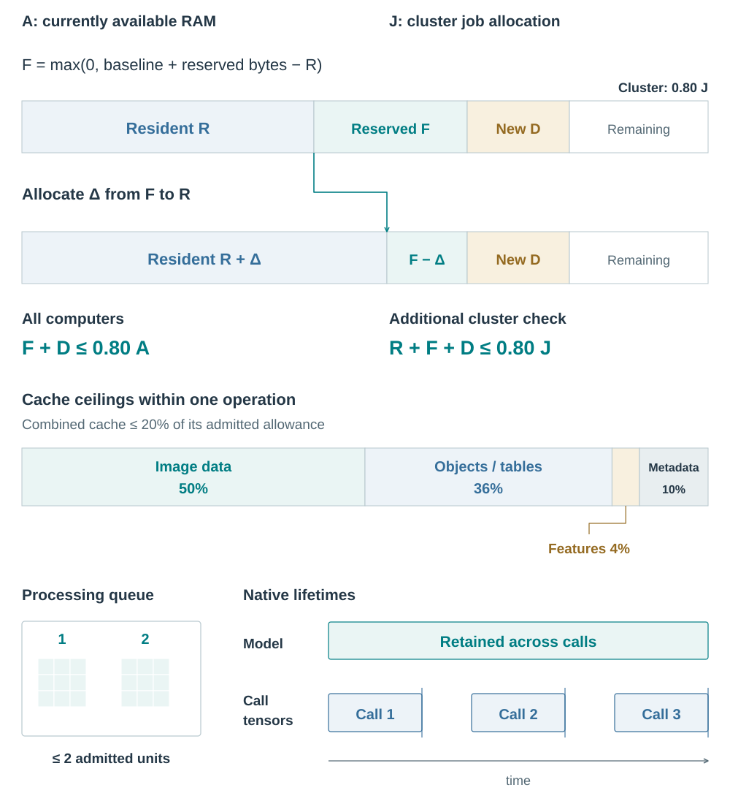

# Memory during processing

[Computing settings](computing.md) · [Image-processing allocation](../images/processing.md#select-the-number-of-simultaneous-regions)

Before starting a task, we estimate how much RAM its calculation will need. We check the available memory and the reservations held by other running tasks. On a cluster, we also check how much RAM the scheduler assigned to the job. We reserve the task’s allowance before loading its inputs and release it when the task ends.

For a QuPath task, we use this allowance to set the Java heap and cache limits. The task also needs memory for native arrays and any models it loads.

## i) Host and device allowances

For local processing, we use 80% of the RAM currently available to the operating system. The remaining 20% leaves room for other processes on the computer. A cluster job also limits the coordinator and its processing tasks together to 80% of the actual job-memory allocation. These allowances are recalculated before starting work.

Available RAM can include memory that another task has reserved but has yet to use. Before starting a new task, we subtract the unused part of the active reservations. This allows a running task to load a model or allocate a larger array later in its calculation.

Let `R` be the RAM currently occupied by the coordinator and its child processes, `B` the amount they occupied when we started tracking reservations, and `L` the sum of the active reservations. The amount reserved but not yet resident is

\[
F=\max(0,B+L-R).
\]

A task with estimated memory requirement `D` can start only when

\[
F+D\leq0.8A_{\mathrm{OS}},
\]

where `A_OS` is the RAM currently available to the operating system. As a running task loads data, its occupied RAM increases and the outstanding part of its reservation decreases.

For a cluster job with allocated memory `J`, we also require

\[
R+F+D\leq0.8J.
\]

This second check includes the memory already used by the coordinator and its child processes, because they share the job allocation. Worker, CPU, queue and device capacities must also permit the task.

A GPU task uses host RAM to read the image, load the model and transfer the inputs. It also needs memory on the GPU for model weights and the tiles being processed. The scheduler permits one GPU model task at a time. Before segmentation, we check that the selected device can run a calculation. The model and tile size determine how much device memory the full prediction requires.

_Schematic of memory reservations, cache shares and native resource lifetimes. The figure labels currently available host RAM as `A` (`A_OS` in the equations above). Moving `Δ` bytes from a reservation into resident memory increases `R` and decreases `F` together. The lower bands show model parameters retained across predictions and temporary arrays released after each call. [Cache allocation](#iii-cache-allocation-and-keys) explains the shares of an operation’s memory allowance._

## ii) Per-operation memory estimates

For image processing, we estimate the memory needed to hold the inputs, outputs and temporary arrays used for fitting or prediction. The estimate also includes compressed data and the buffers used to encode or decode it. For cell tables, the estimate depends on which Parquet columns the calculation reads. It includes the outlines needed to test region membership, the arrays used to match cells by ID and the feature matrices needed for fitting.

For a block of `P` pixels with `B` measured bands, unmixing holds `B × P` corrected intensities and estimates `C × P` output intensities for `C` components. To estimate the memory for these arrays, multiply each value count by the number of bytes per value and add the arrays needed at the same time. The table lists the additional buffers used during fitting and the main allocations for other operations.

| Operation | Main allocation terms |
|---|---|
| Unmixing | Corrected `B × P` spectra, `C × P` outputs, solver microbatch workspace and the array holding the completed shard |
| Chunk decoding | Encoded ranges, decoded `C × 256 × 256` values and codec workspace |
| Model inference | Loaded parameters, prepared batch, device activations and required outputs |
| Nimbus | The Python model and tile arrays together with the separate QuPath image and cell-mask reader; both processes share one host-memory allowance |
| Cell query | Selected row-group columns, decoded candidate geometry and returned batch |
| Measurement | Required intensity blocks, raster masks and accumulators for the selected intensity measures |
| Unsupervised phenotyping | Selected feature matrix and the chosen method’s neighbour, graph or map-fitting workspaces |

*For a float64 fitting matrix, two million cells with 32 selected features require approximately 488 MiB before the method's other allocations.*

The [unmixing reference](../images/processing.md#reference-image-processing--v-select-the-number-of-simultaneous-regions) explains the solver, output-shard and encoding buffers included in its estimate.

Unsupervised phenotyping uses one float64 fitting matrix, with cells in rows and selected features in columns. The operation reserves space for that matrix, cell identities, the selected method’s fitting workspace and output. [PhenoGraph](../phenotyping/unsupervised.md#phenograph) constructs neighbour arrays and a graph over the cells; [FlowSOM](../phenotyping/unsupervised.md#flowsom) fits map profiles and assigns cells using distances to those profiles. Batched selected-column reads limit the temporary preparation buffers. The complete fitting matrix remains in memory during either method’s fit.

## iii) Cache allocation and keys

Within a native operation, we reserve at most 20% of its memory allowance for reusable caches. We divide that cache cap into 50% for decoded image blocks, 36% for saved object/table data, 4% for frozen features and 10% for metadata/indexes. Caches grow as requested data are retained, within these limits; their memory remains part of the operation's total allowance.

Each cached entry is associated with the inputs and request that produced it. For example, an image-block key identifies the image version, resolution level and chunk coordinates, so returning to that block can reuse its decoded pixels. Model features additionally depend on the encoder and input preparation used to calculate them.

| Cached data | Key elements | Release condition |
|---|---|---|
| Decoded image chunk | Image version, level and spatial chunk coordinates | Least-recently-used cache references are removed at the process or image limit |
| Shard metadata/index | Image version and shard location | Unused metadata exceeds its allowance or the image closes |
| Cell row-group data | Accepted cell set, row-group layout, measurement or label version, and group number | Saved group data exceed the object/table allowance |
| Prepared model input | Image selection, patch, scale, panel and normalization | The session needs space and no active calculation uses the input |
| Frozen embedding | Encoder/preparation identity and patch key | In-memory allowance exceeded; a saved feature dataset remains readable |
| Display classes | Dictionary version and category code | Release after its dictionary or view closes |

*An operation with a 4 GiB allowance has a combined cache cap of approximately 819 MiB. Its image share is approximately 410 MiB. Each decoded 8-channel, 256 × 256, float32 chunk contains 2 MiB of pixel values, so that share holds about 204 chunks before bookkeeping.*

`DecodedImageCache` removes its least-recently-used references when space is needed. A calculation already using a returned image keeps that object alive until it releases its own reference; cache eviction alone does not free those actively used bytes.

Annotation drafts and unsaved edits have separate storage and memory accounting. Clearing reusable image or cell-display data preserves those edits.

## iv) Queue and thread allocation

The saved execution settings control the batch worker count and queued work. New analyses start with one worker and one in-flight task. An in-flight task has been submitted and is either waiting to execute or still running. The coordinator caps this count at two even if a larger value is supplied. Each task must also pass the memory and processor checks above. Image preparation has a separate default of two workers and two in-flight regions, with their arrays included in the numerical budget.

When you open segmentation settings, the coordinator reserves the resources needed for setup. Once you submit the settings, it requests the resources for the model. InstanSeg can process tiles with one or two workers sharing a single predictor. This allows other tile work to overlap even though only one prediction runs at a time. We limit each underlying calculation to one CPU thread.

To bound the number of tiles held in memory, we admit at most two more tiles than there are workers. That count includes tiles waiting to start and results waiting to be collected. As each result is collected, another tile can enter.

Interactive cell reads use a separate background worker and an eight-entry queue. A full queue reports a read failure in the overlay; changing the view requests another rectangle. [Viewport loading](../run/interactive-viewing.md#ii-background-request-registry) explains pending requests, cached results and displayed errors.

For `W` simultaneous tasks with `T` native threads each, approximately `W × T` numerical threads can run. The coordinator assigns processor capacity before starting a task, and image preparation also checks active numerical-library thread counts when choosing concurrency. Native model and codec pools receive their thread limits before initialization. Each chunk decode uses one native codec thread; QuPath schedules image-region reads through its image store.

The coordinator starts a dependent stage after its required inputs have completed. Within image preparation, the coordinating thread writes returned shards and releases their arrays before submitting replacement work. [Regional scheduling](../images/processing.md#scheduling-the-image-calculation) describes that sequence and the separate source-reader limit.

## v) Native array and model lifetimes

A runtime may retain released memory for subsequent calls. The following lifetimes describe when each resource stops being needed by its calculation.

| Resource | Managed by | Lifetime |
|---|---|---|
| Loaded model parameters | Model session | Across predictions or fitting calls in that session |
| Predictor | One processing task or limited predictor pool | Reused within that model session |
| Temporary DJL tensors | Prediction context or short-lived submanager | One numerical invocation/batch |
| Borrowed input buffer | Decoder/cache entry or bounded buffer pool | Until all native consumers using its bytes have completed |
| OpenCV matrices | Numerical batch | Released after prediction/fitting consumes the batch |
| Arrow buffers | Reader and consumers of the returned batch | Retained while the reader or a consumer holds a reference to the batch or its buffers |

DJL's predictor context manages temporary translator arrays. Direct NDArray calculations use a short-lived scope under the selected engine/device. An output needed by later calls must be copied or transferred to a model-session allocation before the temporary prediction allocation is released. [1]

A direct `ByteBuffer` can supply the memory for a native CPU tensor when its dtype, byte order, shape and strides match the supported API. The buffer must stay allocated until the tensor finishes using it. A GPU tensor requires a device transfer, so the host buffer remains reserved until that transfer completes. Allocating page-locked host memory also requires explicit support from the runtime API. [2]

Normalization of a borrowed read-only image chunk creates or borrows a separate writable preparation buffer when the operation changes values. This preserves the cached intensities for concurrent consumers.

## vi) Releasing work and responding to pressure

On cancellation, the processing task stops starting new calculations, cancels unneeded read requests and waits for active native calls to return. It then releases temporary arrays and reservations. Shared reads continue while another active consumer still needs them.

A task that cannot start waits until enough memory becomes available. Its message identifies the estimated requirement and the limiting available RAM or cluster allocation. Finishing another task releases its reservation and lets the scheduler reconsider waiting work. If more memory is still needed, follow [Computing's memory guidance](computing.md#memory-available-for-processing), then continue the saved analysis.

With WSL 2, the pipeline sees the memory available to the Linux virtual machine. Windows may have more physical RAM than WSL is allowed to use. The `memory` setting under `[wsl2]` in `%UserProfile%\.wslconfig` controls this limit; leave enough RAM for Windows and its other applications. Save work and close running Linux applications before restarting WSL to apply a changed limit. After the restart, reopen the analysis and continue saved work. Increasing swap provides space for inactive memory pages, but does not increase the physical RAM used by the scheduler's memory check. [Microsoft's WSL configuration guide](https://learn.microsoft.com/en-us/windows/wsl/wsl-config) describes these settings and the required restart.

## vii) Performance accounting

To find out why a stage has slowed down, measure the time spent reading and decoding the image, preparing the inputs, transferring them to the device, calculating the result and writing it. A longer read calls for a different investigation from a longer fit.

When comparing memory use, record the JVM heap, native host allocations, Python arrays, memory reserved for pending work and device memory separately where available. The scheduler’s host measurement sums the resident memory reported by the coordinator and its child processes. If several processes map the same memory, that sum can count the same pages more than once.

Useful performance measurements include the time to display the first usable view, the delay after later navigation, the rate of processing all selected cells or image regions, bytes read and written, and peak combined memory. Numerical agreement is checked against the selected method before interpreting a faster runtime as an improvement.

**References:** [1. DJL memory management](https://docs.djl.ai/master/docs/development/memory_management.html); [2. Java ByteBuffer](https://docs.oracle.com/en/java/javase/21/docs/api/java.base/java/nio/ByteBuffer.html) and [DJL PyTorch buffer handling](https://raw.githubusercontent.com/deepjavalibrary/djl/master/engines/pytorch/pytorch-engine/src/main/java/ai/djl/pytorch/jni/JniUtils.java).

---

**Continue:** [Computing settings](computing.md).
