# Tissue classification

[Analysis stages](../../../README.md#analysis-stages)

Tissue classification uses the staining in your selected channels to distinguish compartments within the analysis regions. To train a classifier, you draw reference regions in QuPath and label each with the tissue class it represents. Once you have reviewed and accepted the model, we apply it to the selected tissue and save the outline and class of each compartment it identifies.

[Choose the classifier](#choose-the-classifier) · [Prepare the image features](#image-feature-routes) · [Allocate subjects](#allocate-reference-subjects) · [Draw references](#reference-annotation) · [Inspect the fitted model](#inspect-and-accept-the-fitted-model) · [Apply the classifier](#apply-the-accepted-classifier)

## Choose the classifier source

On **Run → Tissue classification**, select **Open review**. Choose **Train a classifier** to define the tissue classes and label reference regions for a new model.

If you have already trained a classifier for these compartments, choose **Use a saved classifier** and select the `export.json` file from its exported package. This loads the class definitions, required channels and fitted model. We check the channels against the current images before applying it.

If you want to analyse the tissue without subdividing it into compartments, choose **Skip classification** on the Run card. Subsequent stages can use the analysis regions selected after tissue detection.

## Choose tissue classes and image channels

On **Class labels**, choose how many tissue compartments the classifier should distinguish (up to four), then name each compartment.

To train on those compartments alone, choose **Selected class labels only** under **Classes to fit**. If you also want the model to recognize tissue to exclude, choose **Learn Ignore from annotated regions** and label examples of that tissue as **Ignore** in QuPath. If you define only one tissue class, we use **Ignore** as the second training class.

<a href="../../assets/screenshots/luca-classifier-classes-current.png">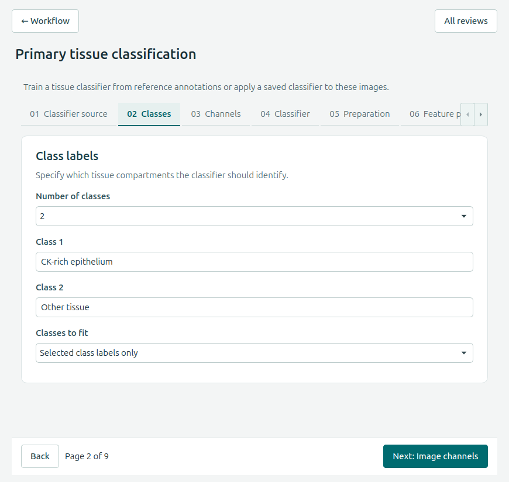</a>

*Reference regions in the LuCa image are labelled CK-rich epithelium or Other tissue.*

On **Image channels**, select the stains that help distinguish the tissue classes. We use these channels to calculate pixel features or prepare image patches, depending on the classifier you choose. Images classified with the fitted model must provide the same channels.

<a href="../../assets/screenshots/luca-classifier-channels-current.png">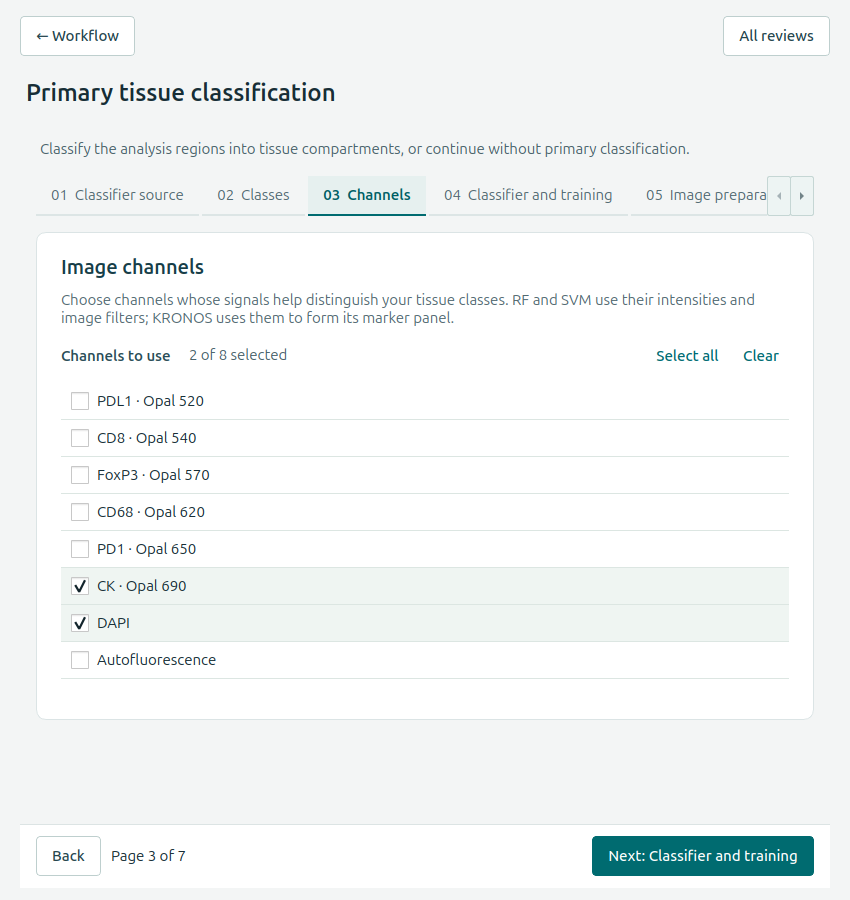</a>

*The LuCa classifier uses CK staining and the DAPI nuclear signal to distinguish the two tissue classes.*

## Choose the classifier

On **Classifier**, open **Method** to choose how the model will learn from your reference annotations. **Random forest (RF)**, the initial selection, trains decision trees on the selected channel intensities and image filters. The trees vote on the class of each pixel. **Support vector machine (SVM)** uses those same pixel measurements to learn boundaries between classes.

Choose **KRONOS** to classify image patches. A pretrained encoder describes each patch of the selected marker channels, and a graph neural network (**GNN**) learns to combine that description with those of neighbouring patches. Under **Final classifier**, choose the random forest or SVM that will predict each patch’s class from those features. The [secondary-structure guide](../secondary-structures/index.md) describes how these methods are used to detect structures within a selected tissue area.

## Choose the training procedure

On **Classifier**, choose how to train and evaluate the model. Cross-validation compares parameter settings by holding out different subjects in turn. Independent testing reserves subjects for a final evaluation after training and parameter selection are complete.

The initial choice is **Training only** for one subject and **Training and validation (cross-validation)** for two or more. On [Subject allocation](#allocate-reference-subjects), assign the subjects to training or testing and choose the number of validation folds.

| Training procedure | How the references are used |
|---|---|
| **Training only** | Fit one model with the settings you enter. |
| **Training and validation (cross-validation)** | Compare settings across subject folds. Refit the selected settings using all training and validation subjects. |
| **Training and independent testing** | Fit one model on the training subjects, then evaluate it on the reserved test subjects. |
| **Training, validation and independent testing** | Select settings by cross-validation, refit on all training and validation subjects, then evaluate that model on the reserved test subjects. |

## Set the classifier parameters

Enter one value per parameter to fit a single model. If you chose cross-validation, enter the values you want to compare in each search field, separated by commas. The [classifier methods guide](../classifier-methods/index.md) explains how the parameters affect fitting.

### Random forest

**Maximum tree depth** limits the number of successive splits along a tree path. **Minimum samples per node** stops further splitting when a node contains that many training observations or fewer. The initial values are **16** and **10**, respectively. A deeper tree or a smaller minimum lets the forest distinguish smaller groups of labelled pixels or patches.

**Maximum trees**, initially **50**, limits the number of trees voting on the prediction. Under **Advanced settings**, **Features considered per split** sets how many randomly chosen features compete at each split. The default is the square root of the number of classifier inputs, rounded to the nearest integer. With PCA, that count comes from the retained components. [How a tree chooses a split](../classifier-methods/index.md#choose-a-feature-threshold)

Leave **Out-of-bag error threshold** at **0** to use the tree limit. A positive threshold permits earlier stopping based on predictions for training observations omitted from each tree’s bootstrap sample. Enable **Calculate variable importance** to estimate how much those predictions change when the values of each feature are shuffled. [Out-of-bag predictions and importance](../classifier-methods/index.md#combine-tree-predictions)

<a href="../../assets/screenshots/luca-classifier-fitting-current.png">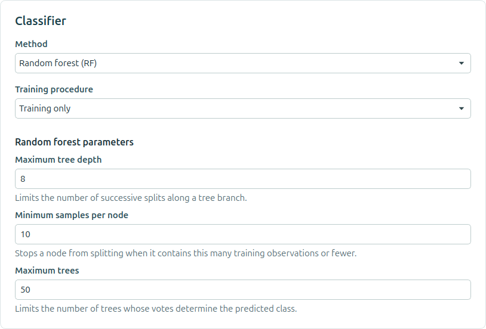</a>

*The LuCa procedure fits one random forest: depth 8, minimum 10 samples per node, automatic feature count and 50 trees.*

### Support vector machine

**SVM kernel** determines how the classifier separates a pair of classes. The initial **Linear** kernel fits a boundary using a weighted sum of the input features. The **RBF** kernel can fit a curved boundary. It uses distances between feature vectors to measure similarity. A larger **RBF gamma** makes similarity fall more quickly with distance.

**SVM C**, initially **1**, sets the penalty for training observations that fall inside the class margin or on the wrong side of the boundary. [SVM margins and kernels](../classifier-methods/index.md#support-vector-machine)

For cross-validation, enter the kernels and C values to compare. The initial search uses **LINEAR** with C values of `0.1, 1, 10`. If you include **RBF**, enter the gamma values for those fits, initially `0.01, 0.1, 1`. Gamma applies only to the RBF kernel.

Under **Advanced settings**, **Maximum SVM iterations**, initially **1,000**, limits the updates for each pair of classes. **SVM termination tolerance**, initially **10⁻⁶**, sets how closely the solution must satisfy the stopping condition. A smaller tolerance can require more iterations. [SVM stopping criteria](../classifier-methods/index.md#fit-coefficients-and-stop-the-optimizer)

<a href="../../assets/screenshots/classifier-svm-fitting-current.png">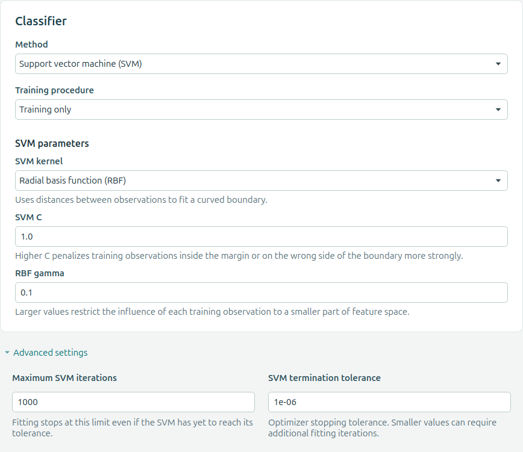</a>

*The SVM form with Advanced settings expanded. RBF and gamma 0.1 are example choices; C 1, 1,000 iterations and tolerance 10⁻⁶ retain their initial values.*

### KRONOS graph settings

With **KRONOS** selected, open **Advanced settings** to choose **GNN feature dimension**, the number of learned features that describe each patch for RF or SVM. It starts at **64** and accepts **1–768**. For cross-validation, enter alternatives in **GNN feature dimensions to compare** or leave it blank to use that one dimension. Comparing two dimensions with the four initial RF combinations gives eight fits per fold.

**Training passes** sets how many times the graph model visits the labelled patches, initially **100** (range **1–1,000**). **Labelled patches per update** sets how many contribute to each weight update, initially **32** (range **1–4,096**). More passes repeat the fitting work, and more patches per update increase its memory requirements.

**Learning rate** sets the size of each update, initially **0.001**, and must be above zero and at most one. **Weight regularization** sets how strongly fitting draws the weights towards zero, on a scale from **0** (the default) to **1**. During cross-validation the graph learns from the training subjects in each fold. Use the held-out RF or SVM results to compare graph dimensions. [Graph fitting and training loss](kronos.md#learn-spatial-features-from-the-labelled-patches)

<a href="../../assets/screenshots/classifier-kronos-graph-page.png">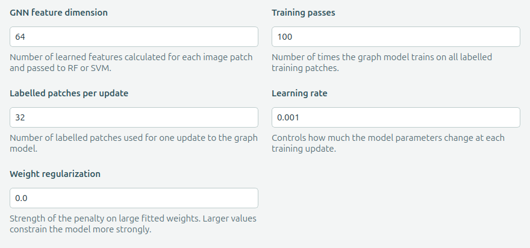</a>

*Graph settings under **Classifier → Advanced settings**, with their initial values: 64 features per patch, 100 training passes, 32 labelled patches per update, learning rate 0.001 and zero weight regularization. Open the image to see the complete page.*

### Compare settings before fitting

Expand **Compare parameter combinations** to see which settings will be tested in each validation fold. The table appears when you have at least two combinations. Each row shows one combination, with columns for the parameters that change between fits. To change the values tested, edit the parameter fields above the table.

You can compare up to twelve combinations. For KRONOS, the twelve-combination limit includes alternative graph dimensions. We evaluate them on the same held-out subjects, then fit the selected combination once more using all training and validation subjects. The [validation review](#review-the-validation-folds) explains how subject-weighted macro-F1 determines the selection.

## Choose the image sampling resolution

On **Image preparation**, set **Training pixel size (µm)** to choose the resolution used to calculate image features and predict tissue classes. The value gives the physical width and height of each sampled pixel. Select a preset or choose **Custom…** to enter another value. QuPath resamples the image to this resolution, including when it falls between the image's stored resolutions.

Finer sampling retains more detail at tissue boundaries and increases the number of pixels to classify. At a training pixel size of `r` µm, a structure `w` µm wide spans approximately `w/r` pixels. For RF and SVM, each sampled pixel receives a prediction. With KRONOS, the prediction covers an entire [image patch](kronos.md#image-patch-size).

<a href="../../assets/screenshots/luca-classifier-features-current.png">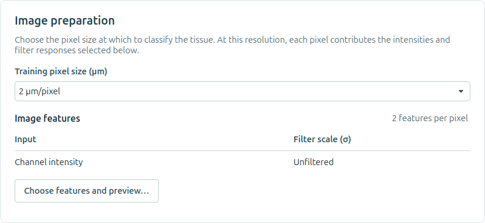</a>

*LuCa Image preparation with 2.0 µm sampling and channel intensity enabled. CK and DAPI contribute one value each at every sampled pixel.*

## Select image features for RF or SVM

RF and SVM learn from labelled pixels within the reference annotations. For each pixel, we use the intensity in each selected channel, image filters that describe the surrounding staining, or both. The pixel’s position within a labelled region supplies its tissue class. We extract training pixels only from the analysis region or parent compartment selected for classification.

<a href="../../assets/figures/tissue-training.svg">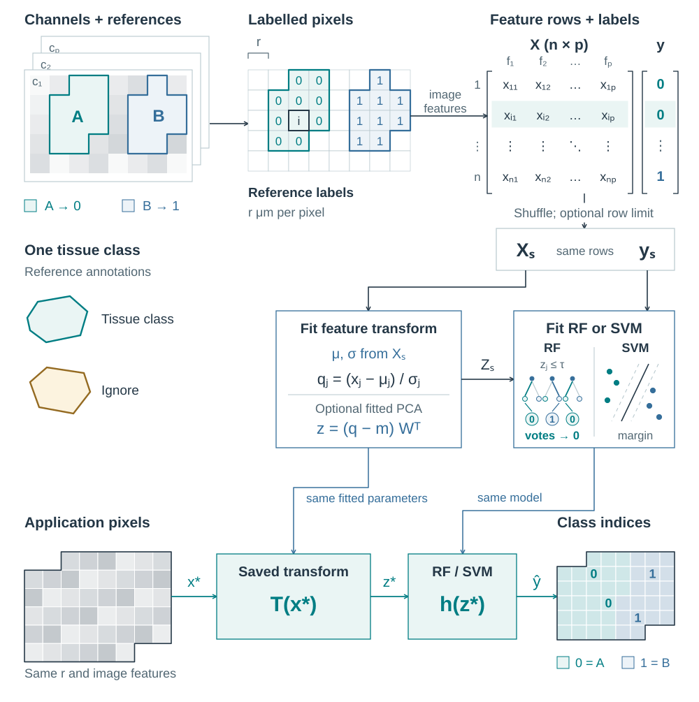</a>

*Each reference pixel contributes one row of features to `X` and its tissue class to `y`. The model applies the same feature preparation to pixels elsewhere in the image before predicting their classes. The inset illustrates the two kinds of reference annotation used when training a single tissue class.*

### Choose filters and scales

**Image preparation** starts with the unfiltered channel intensities. To add filters, select **Choose features and preview…** and choose an image if prompted. In QuPath, select a row under **Scales** and choose the filters to calculate at that scale. Keep **Include channel intensity** selected to use the original intensities alongside the filtered values.

Choose a scale according to the size of the structures you want the classifier to distinguish. The scale is the Gaussian standard deviation (σ) in micrometres. A small value emphasizes staining close to the current pixel. A larger value includes staining from farther away. To compare features at different scales, select **Add scale** to duplicate a row and change the scale or filters in the new row. Use **Remove** to discard that row.

Each selected filter contributes one value per channel at its scale. With two channels, for example, retaining the original intensities gives two values per pixel. Adding gradient magnitude at 1.5 µm and Gaussian smoothing at 4 µm contributes two values each, giving six features in all.

### Preview a filter on the tissue

Choose a channel and a filter to see the original and filtered images side by side. **Use selected region** centres both views on an area annotation you have selected in QuPath. To examine a different field, pan to it in QuPath and select **Use current view**. Adjust σ with the slider or enter its value to see how the filter responds at a tissue boundary or within a compartment.

Select **Apply image features** to return to **Image preparation**. The summary lists the filters at each scale, the equivalent scale in training pixels (σ divided by the training pixel size), and the total number of features per pixel. When processing remotely, edit the filter choices directly on **Image preparation**. Continue to [Feature preparation](#feature-preparation) to choose how these values are prepared for fitting.

<a href="../../assets/screenshots/luca-classifier-feature-inspection.png">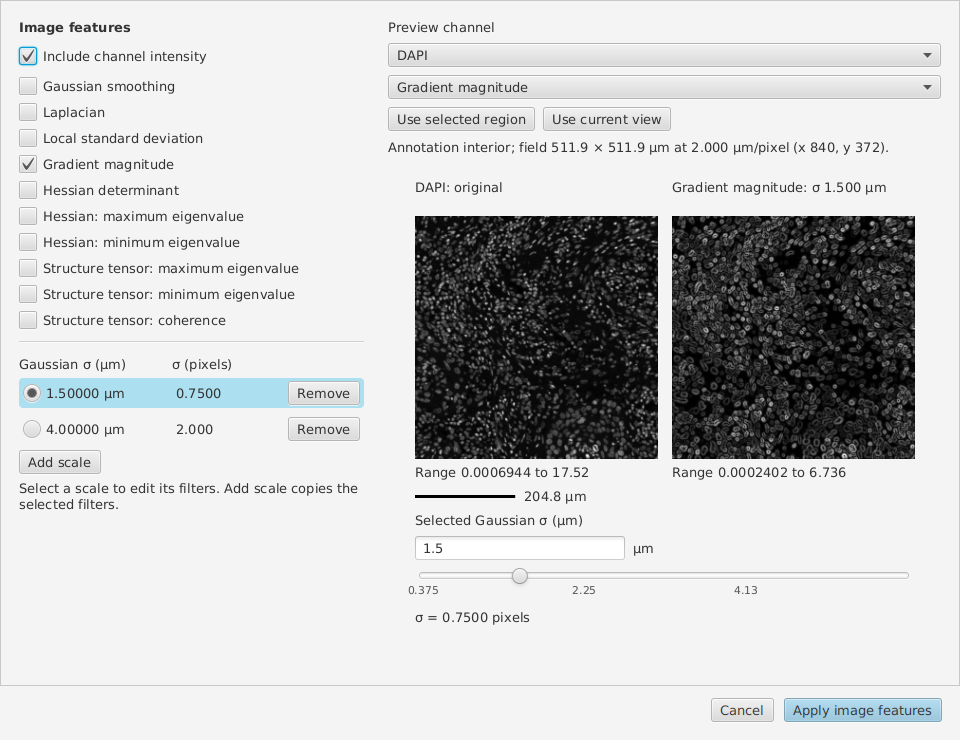</a>

*Example feature choices on LuCa at 2.0 µm/pixel. The selected 1.5 µm scale uses gradient magnitude, emphasizing local DAPI edges. Both panels show an approximately 512 × 512 µm field; the printed ranges describe their different quantities. Scale bar: 204.8 µm.*

### Types of image filters

Image filters describe local intensity, variation, edges or patterns in the staining. We calculate each chosen filter from the original channel and supply its values as a separate measurement to RF/SVM. The comparisons below show how these measurements describe the same image field.

#### Local intensity, variation and edges

These filters describe the amount of staining around a pixel, its local variation and the strength of nearby edges. 

**Gaussian smoothing** convolves the channel image with a normalized Gaussian kernel whose standard deviation σ is the selected filter scale. The kernel's weights sum to one and decrease with distance from the pixel, so the output is a Gaussian-weighted local mean intensity. Increasing σ averages staining over a wider neighbourhood and smooths finer intensity variations.

**Local standard deviation** measures how much intensities vary around that local mean, using the same Gaussian weights. We calculate the weighted mean of squared intensities, subtract the squared local mean, then take the square root. This is the square root of the Gaussian-weighted variance. It is therefore larger where bright and dark staining occur together than in a uniformly stained area.

**Gradient magnitude** measures how rapidly intensity changes across the image by combining its horizontal and vertical rates of change. High values emphasize edges at the selected scale, such as transitions between strongly and weakly stained tissue.

<a href="../../assets/figures/pixel-image-features.svg">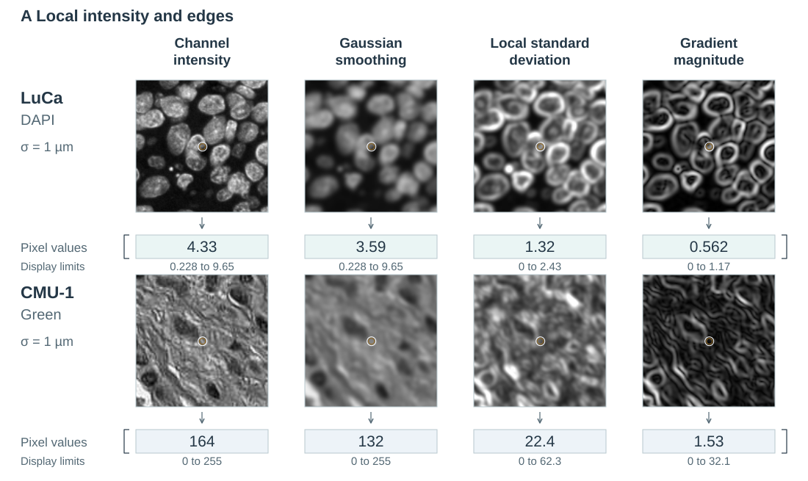</a>

*Native QuPath features from 128 × 128-pixel LuCa DAPI and CMU-1 green-channel crops at σ = 1 µm. Circles mark the same pixel across the planes. LuCa appears in the upper row and CMU-1 in the lower row. The original and Gaussian images use black-to-white limits of 0.228–9.645 for LuCa and 0–255 for CMU-1. Standard deviation and gradient magnitude use their individually printed limits. Pixel values below the images retain the calculated feature units. [Image sources](../../data/public-image-sources.md).*

#### Curvature: spots and ridges

**Laplacian** and the **Hessian** features describe the curvature of intensity patterns, helping distinguish bright spots, ridges and flatter areas. Curvature measures how the rate of intensity change varies across the image: intensity curves downwards on both sides of a bright peak, whereas along a bright ridge this curvature is stronger across the ridge than along it.

We calculate second derivatives at the selected Gaussian scale and arrange them in a two-by-two Hessian matrix. Its diagonal entries describe curvature along X and Y, and its off-diagonal entries describe the combined X–Y derivative. **Laplacian** is the sum of the diagonal entries. **Hessian: largest eigenvalue** and **Hessian: smallest eigenvalue** give the greatest and least signed curvature along perpendicular directions determined by the local intensity pattern, so they describe a ridge regardless of its orientation in the image. **Hessian determinant** is the product of these eigenvalues.

<a href="../../assets/figures/pixel-image-features.svg">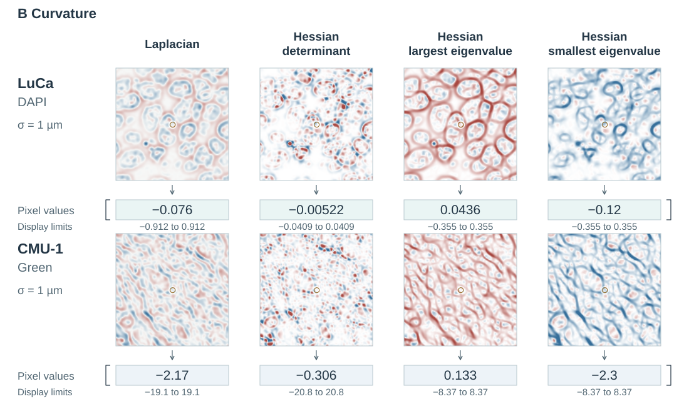</a>

*Curvature features from LuCa (upper row) and CMU-1 (lower row), at the same marked pixels and σ = 1 µm. Negative values appear blue, zero white and positive values red. The printed limits give each plane’s blue/red endpoints; the two Hessian eigenvalue planes use matching limits within each specimen.*

#### Directional structure

The **structure tensor** describes whether nearby intensity changes follow a consistent direction, as along aligned tissue edges, or vary similarly in several directions. QuPath estimates horizontal and vertical gradients using Sobel filters, then averages their squared values and products with Gaussian weights. The resulting two-by-two matrix has two eigenvalues: **Structure tensor: largest eigenvalue** measures variation along the direction of greatest intensity change, and **Structure tensor: smallest eigenvalue** measures variation perpendicular to it.

**Structure tensor coherence** measures how strongly those changes favour one direction. It approaches one along a consistent edge, where one eigenvalue dominates, and is low where intensity changes are similar in both directions. We calculate it as $[(\lambda_1-\lambda_2)/(\lambda_1+\lambda_2)]^2$, where $\lambda_1$ and $\lambda_2$ are the largest and smallest eigenvalues; when both are zero, coherence is zero. The eigenvalues also indicate the strength of variation, helping distinguish a uniform area from strongly textured tissue with low coherence. The [QuPath feature implementation](https://github.com/qupath/qupath/blob/v0.7.0/qupath-core-processing/src/main/java/qupath/opencv/tools/MultiscaleFeatures.java) provides the filter calculations.

<a href="../../assets/figures/pixel-image-features.svg">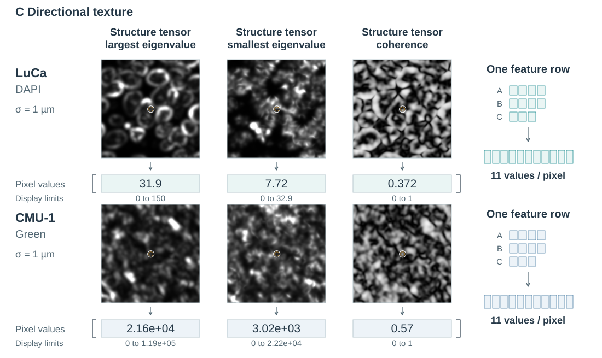</a>

*Structure-tensor features from LuCa (upper row) and CMU-1 (lower row), at the same marked pixels and σ = 1 µm. Each eigenvalue plane uses its printed black-to-white limits; coherence uses 0–1. Groups A, B and C together supply eleven values for each pixel in this one-channel, one-scale illustration. Open any panel for the [complete comparison](../../assets/figures/pixel-image-features.svg).*

How we calculate image features and build the training matrix

The Java feature builder converts the selected physical scales into QuPath image operations. A Gaussian standard deviation σ µm becomes σ/rₓ pixels horizontally and σ/rᵧ pixels vertically at physical pixel sizes rₓ and rᵧ. This keeps the filter's intended physical neighbourhood on both image axes. Filters selected at the same scale are calculated together so they can share derivative calculations. Each tile read includes the surrounding pixels required by those filters; the returned feature values cover the requested tile interior.

[PixelFeatureOps](../../../src/java/org/mif/classification/PixelFeatureOps.java) combines the unfiltered channels and filter outputs into the feature columns. We extract these values at the reference pixels, fit their normalization and optional principal-component analysis (PCA), then fit RF or SVM. The saved model contains the image operations and fitted transformations, allowing us to calculate the same measurements in the same order when classifying tiles from another image.

### Construct the training matrix

We extract the complete selected feature vectors and reference labels, retaining the row range contributed by each image. This produces a feature matrix with one row per labelled pixel and one column per selected channel-derived feature.

A positive maximum-training-sample value limits the selected rows after the configured shuffle; zero retains every extracted row. Sampling selects distinct rows. OpenCV `TrainData` records their indices, which the pipeline reads back to calculate the image/class counts for the actual fitted population.

Feature extraction occurs before this row limit is applied. A smaller training-sample limit can reduce model-fitting work while the extraction step still needs memory for the collected reference pixels. The current preparation limits estimated feature-extraction allocation to 1 GiB and image-tile enumeration to 250,000 requests. These checks occur separately from model fitting.

## Select training contributions

On **Image preparation → Advanced settings**, **Maximum training observations** starts at **0** for conventional RF/SVM, using all eligible labelled pixels. A positive number limits the fit to a reproducible random subset of up to that size, selected without replacement from the combined reference pixels. We extract features from all eligible reference pixels before selecting this subset, so the limit reduces model-fitting work but does not reduce the memory needed for feature extraction. The [training-matrix calculation](#construct-the-training-matrix) describes that preparation.

**Balance class contributions** starts at **no**. Enable it to give classes with fewer labelled pixels more weight per pixel during fitting. This makes each class contribute equal total weight, even when their reference regions contain different numbers of pixels. The class-weight calculation below defines the weights and how RF and SVM use them.

Class-weight calculation

#### Apply class weighting when selected

For a selected training population of `n` rows, with `n_k` rows in class `k`, the balancing weight is

$$
w_k=n/n_k.
$$

Each training row receives its class's weight. Multiplying the number of rows in a class by its per-row weight gives $n_k(n/n_k)=n$, so every class has the same total fitting weight. The rows and their labels remain the selected observations; the weights change how strongly they contribute to the classifier objective. We calculate them after sample selection so they match the actual fitted class counts.

For the random forest, the selected sample weights contribute to node-class totals and split calculations. For SVM's native `C_SVC` model, the class weights give an effective class-specific margin penalty `C_k=Cw_k`.

## Set feature normalization and PCA

On **Feature preparation**, choose how to transform the channel intensities and filter responses used to fit a conventional RF or SVM. Image calibration gives the intensities their units. Scaling uses the variation among labelled training pixels, including variation in derived features such as gradients. For KRONOS, **Feature scaling** on **Classifier** applies to the learned graph features before the final RF or SVM fit.

### Standardize or scale the features

**Feature scaling** starts at **Standardize each feature (z-scoring)**. We subtract the mean calculated from the training pixels or patches and divide by their standard deviation. **Scale each feature to 0–1 (min–max)** subtracts the smallest training value and divides by the difference between the largest and smallest training values, mapping them to zero and one. Select **Keep feature values unchanged** to omit this transformation.

### Retain principal components

Principal component analysis (**PCA**) forms new features from weighted combinations of the prepared inputs, ordered by how much variation they capture among the training pixels. Under **Classifier inputs**, **Individual features** uses the prepared features directly. Choose **Principal components (PCA)** to enter the **Target fraction of training variance**. For example, 0.95 requests components accounting for 95% of training variation. The [component-selection calculation](../classifier-methods/index.md#feature-normalization-and-pca) explains how the library selects the retained components.

Under **Principal components (PCA)**, choose **Keep component variances** to retain the spread of the training scores along each component. **Whiten to unit variance** divides the scores by their training standard deviations, giving a one-standard-deviation difference the same weight along each retained component in a distance calculation.

We calculate normalization and PCA from the training subjects and reuse the fitted transformations for validation, independent testing and later images. Each cross-validation fold uses only its own training subjects for these calculations. The [normalization and PCA calculations](../classifier-methods/index.md#feature-normalization-and-pca) describe the fitted transformations.

<a href="../../assets/screenshots/luca-classifier-preparation-current.png">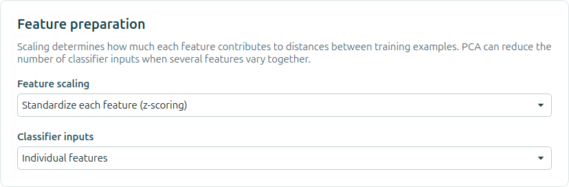</a>

*The LuCa tissue classifier uses standardized pixel features with PCA disabled.*

## Prepare KRONOS image inputs

After choosing **KRONOS**, set the physical dimensions of the patches and match the selected channels to their markers. The encoder represents each multichannel patch with 768 values, which the graph layer uses to learn the spatial features supplied to the final classifier. [KRONOS encoder and graph calculations](kronos.md)

On **KRONOS image inputs**, choose a **Patch size (pixels)** of **32**, **64**, **128** or **256**, initially **256**, and set **Sampling resolution (µm/pixel)**. When the images share one original pixel size, sampling starts at that value. The recorded image resolution appears beneath the control.

For patch side `P` pixels and sampling resolution `r` µm/pixel, one prediction covers a square of side `P × r` µm. For example, 64 pixels at 0.5 µm/pixel cover 32 × 32 µm; 256 pixels cover 128 × 128 µm. Smaller patches give finer prediction spacing and require more patches to cover the same tissue.

Open **Advanced settings** on KRONOS image inputs for **Processor threads**, initially **1** with **1–8** allowed, and **Memory for image features (MiB)**, initially **512**. The memory setting limits the estimated arrays needed to encode image patches. Larger patches and more marker channels increase this allocation. The [encoder-memory calculation](kronos.md#encoder-memory-check) explains how patch dimensions and channel count determine the estimate.

<a href="../../assets/screenshots/classifier-kronos-image-inputs-current.png">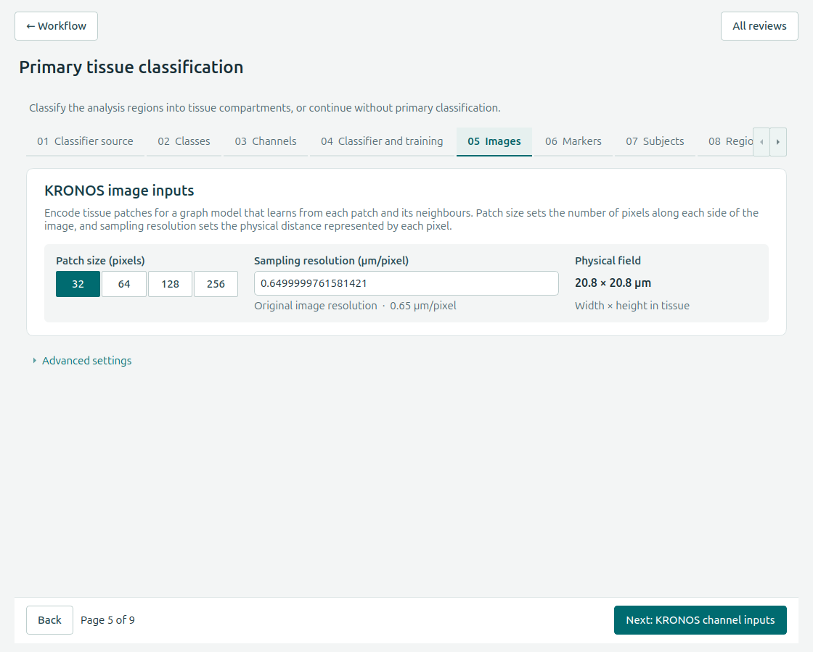</a>

_The KRONOS image-input page with a 32 × 32-pixel patch sampled at approximately 0.65 µm/pixel, covering a 20.8 × 20.8 µm field._

### Assign channels to model markers

On **KRONOS channel inputs**, select a channel under **Channel assignments**, find its matching marker in **Model markers**, then choose **Use marker**. The list can be searched by name. The assignment identifies the marker and its reference intensity statistics. The [nuclear stain saved in Channels and markers](../images/index.md#choose-the-nuclear-stain) uses KRONOS’s DAPI identity automatically.

If the marker is absent, choose **Add a marker not listed…** to enter its name and description. The [new-marker procedure](kronos.md#add-a-marker-absent-from-the-model-table) explains the required information.

<a href="../../assets/screenshots/classifier-kronos-channel-inputs-current.png">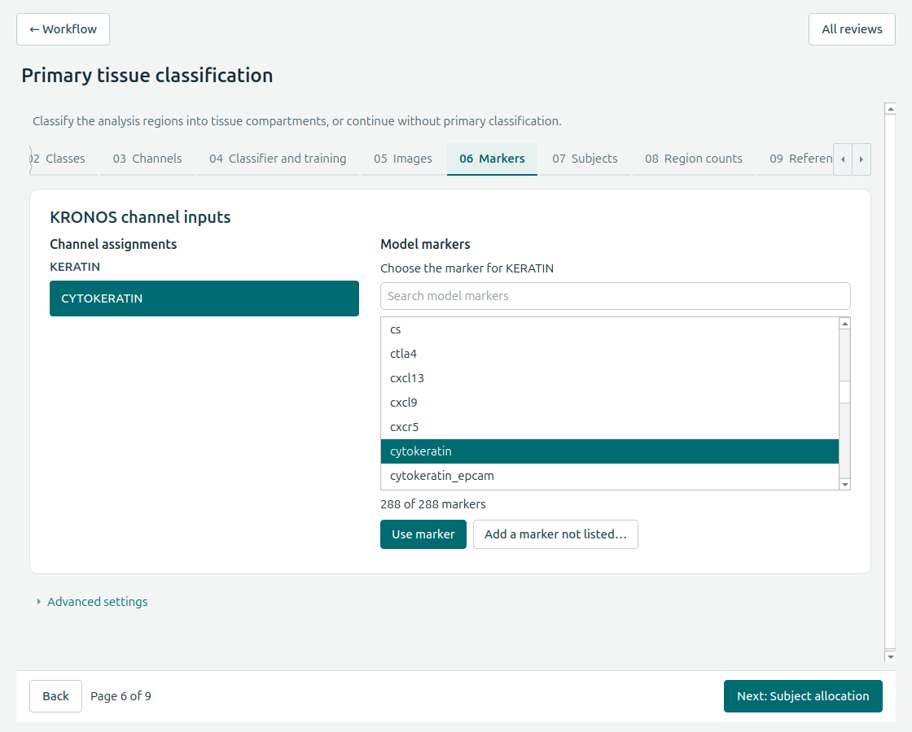</a>

*KERATIN is assigned to **cytokeratin**, highlighted in the model’s marker list. The selected channel and its assignment remain visible beside the list.*

## Allocate reference subjects

On **Subject allocation**, use the subject board to choose which subjects supply fitting references and, when requested, which are reserved for independent testing. All images from one person or animal must share a subject identifier so their sections stay together during allocation and validation. A single subject supplies all the training images.

The selected procedure determines which groups appear on the board.

- **Training** supplies the references for a fixed-parameter fit.
- **Training and validation** supplies the references for grouped cross-validation. Each subject is held out in one fold to compare the parameter combinations; the selected combination is then fitted using all subjects in this group.
- **Independent testing** reserves subjects for evaluation after the model has been selected and fitted.
- **Leave out** excludes a subject from the reference set.

Select a subject to expand its image list and any returned reference-region counts. To change the assignment for all its images, drag the subject into another group, or open the **⋯** menu on the subject row and choose its destination. Pressing Space on a focused subject opens the same menu. Search by subject or image name when working with a larger batch.

Under **Independent testing**, enter the number of **Subjects to reserve** and select **Assign automatically**. The subjects assigned to testing appear directly below. **Random seed**, under **Advanced settings**, starts at **0** and reproduces the allocation for the same subject IDs. The suggested test count is **1** for at least three subjects and **0** otherwise; an independent-test procedure requires at least one test subject, with enough remaining subjects for the selected training procedure. Resolve any allocation conflict and assign any **Unassigned** subjects before fitting.

<a href="../../assets/screenshots/subject-allocation-batch-example.png">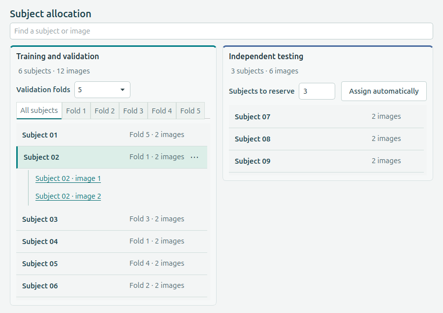</a>

*Example allocation of nine subjects with eighteen images. Six subjects contribute to training and subject-grouped validation; three are kept separate for independent testing. Subject 02 is expanded to show its two images.*

### Review the validation folds

Grouped cross-validation requires at least two subjects in **Training and validation**. **Folds**, beside **Training and validation**, starts at five. With two to four training subjects, it starts at the number of subjects available. You can instead select two through ten folds, up to the available subject count. Select a fold on the allocation board to see which subjects train its model and which are held out for validation.

Every fold's training subjects must collectively contain references for every class. Spread rare-class references across subjects so that holding out a fold does not remove that class from training. Within each fold, we fit feature normalization, optional PCA and the classifier using only the training subjects, then apply the fitted transformations and model to the held-out subjects. KRONOS also learns its graph features from that fold's training subjects.

We compare parameter combinations using the held-out predictions. Each subject's confusion counts are first divided by its number of labelled observations, giving subjects equal influence despite differences in their reference areas. We combine those normalized counts and calculate macro-F1, which gives each class equal weight. The combination with the highest score is then fitted using all training and validation subjects; independent-test subjects remain separate until this final fit is complete. The [selection-score calculation](#calculate-the-subject-weighted-selection-score) gives the formula and tie rule.

<a href="../../assets/figures/subject-model-selection.svg">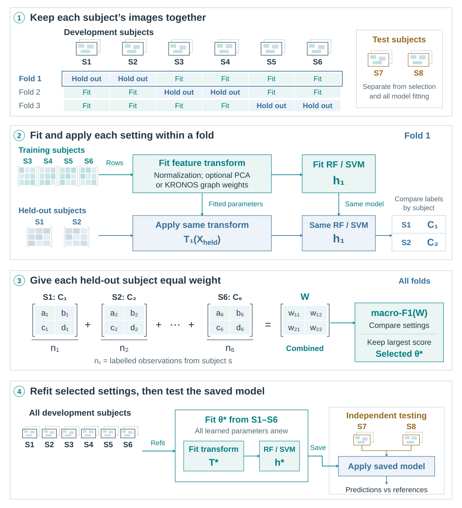</a>

*All images from a subject stay together. Each validation fold fits its feature transformation and classifier on the training subjects and predicts the held-out subjects. Rows of the confusion matrices give the reference classes and columns give the predictions. Independent test subjects enter only the final evaluation.*

The summary on **Classifier** shows how many fits the selected procedure and parameter combinations require. Comparing `C` parameter combinations across `F` folds requires `C × F` comparison fits and one final fit. This count includes a separate graph fit for every KRONOS comparison, so increasing either the number of folds or parameter combinations increases the training work.

Subject allocation and evaluation definitions

### Select the procedure and reference population

For each comparison fit, we take references from the subjects assigned to its training folds. Conventional classifiers use labelled pixels inside the selected training area; KRONOS uses complete patches covered by one reference class. The held-out fold supplies the observations used to evaluate that fit.

### Construct the parameter combinations

For a fixed-parameter procedure, we enter one value per model parameter. For validation, we enter comma-separated values to compare; each parameter combination takes one value for each applicable parameter. RF combinations vary maximum depth, minimum samples per node, active feature count and tree count. SVM combinations vary kernel and C, with gamma included for RBF.

For example, C values `0.1, 1, 10` and gamma values `0.01, 0.1, 1`, with both LINEAR and RBF selected, produce three linear and nine RBF parameter combinations. LINEAR combinations vary C; each RBF combination also specifies gamma. The entered order determines the comparison order and the tie rule described below.

The KRONOS GNN feature dimension also varies across parameter combinations. Comparing two dimensions with four RF parameter combinations produces eight complete combinations. Each dimension determines the size of the graph layer's learned output and therefore the input supplied to RF/SVM.

The search accepts up to twelve distinct combinations, including any alternative KRONOS graph dimensions. For `C` combinations and `F` folds, the fitting sequence contains

$$
N_{fits}=CF+1.
$$

The first `CF` fits provide held-out predictions for comparison. The additional fit uses the selected parameter combination and all training and validation subjects. For KRONOS, each complete fit includes a graph-layer fit followed by RF/SVM fitting.

### Allocate subjects to folds

The grouped calculation supports 2–512 training and validation subjects and uses the fold count selected above.

We combine the saved seed and each subject ID to calculate a reproducible hash, sort subjects by that value and use the subject ID to break any hash tie. The sorted subjects are assigned successively to folds in round-robin order. This produces the same allocation for the same IDs and seed, independent of the input image-list order.

<a href="../../assets/screenshots/subject-validation-folds-current.png">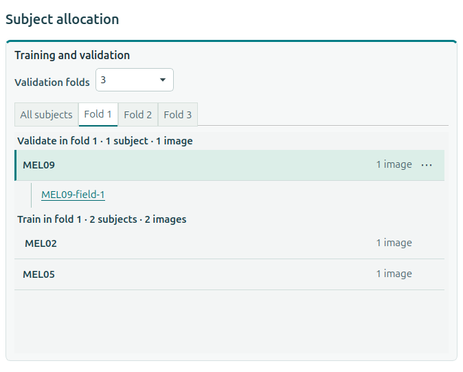</a>

*This three-subject MEL02/MEL05/MEL09 example uses three validation folds. Fold 1 validates MEL09 while MEL02 and MEL05 train; MEL09 is expanded to show its image.*

Before fitting, every declared class must be represented among the training subjects. The seeded subject allocation determines folds independently of class prevalence. Provide rare-class references across enough training and validation subjects to satisfy that requirement, or revise the allocation through the training workflow.

### Fit and evaluate each parameter combination

For each parameter combination and held-out fold:

1. We extract the labelled pixels or patches from the subjects assigned to the training folds.
2. For conventional classifiers, we fit normalization and optional PCA to those feature values. For KRONOS, we calculate the fixed encoder features, fit the graph layer using the training references, then fit normalization to its output. Graph connections remain within the permitted image, tissue and analysis-region boundaries.
3. We fit RF or SVM using the prepared features and reference labels.
4. We apply the fitted feature transformations and classifier to the held-out subjects, recording a confusion matrix for each subject.

Each parameter combination receives a separate fit in every fold, including a separate graph fit for KRONOS even when two combinations share the same graph settings.

### Calculate the subject-weighted selection score

For subject `s`, we sum its evaluated images into confusion matrix `C^(s)`, with reference classes in rows and predicted classes in columns. Let `n_s` be the sum of that matrix. Each evaluated subject must contribute at least one observation.

We divide each subject's confusion counts by its total before combining subjects:

$$
W_{ab}=\sum_s\frac{C^{(s)}_{ab}}{n_s}.
$$

Each subject contributes a total weight of one, irrespective of how many labelled pixels or patches it supplies. This weighting applies to model selection. The training matrix can still contain different numbers of observations from different subjects.

In this combined matrix, $W_{kk}$ is the weighted number of correct predictions for class `k`. The row sum $\sum_jW_{kj}$ contains all observations whose reference class is `k`, including those predicted as another class. The column sum $\sum_jW_{jk}$ contains all predictions of `k`, including observations from other reference classes. Their sum is twice the correct weight plus the missed and extra predictions of `k`. For the `K` declared classes, we calculate

$$
F1_k=\frac{2W_{kk}}{\sum_jW_{kj}+\sum_jW_{jk}},
\qquad
\mathrm{macroF1}=\frac{1}{K}\sum_{k=1}^{K}F1_k.
$$

Each class F1 therefore rewards correct predictions while accounting for both missed class members and incorrect assignments into that class. The arithmetic mean gives every declared class equal influence on macro-F1; a zero class denominator contributes F1 zero. We calculate each parameter combination’s score from the combined held-out subject matrices across all folds. Separate fold scores are retained for inspection.

For example, suppose one subject supplies 100 observations and another supplies 1000. Adding raw counts would give the larger subject ten times the influence. Dividing each matrix by its own observation count first gives the subjects equal weight. We calculate class F1 from this combined matrix. Averaging two separately calculated subject F1 scores would generally give a different result because F1 is a ratio.

Every parameter combination must be evaluated on the same reference observations. We check that each subject contributes the same count for every reference class across combinations. This prevents a change in feature dimensions or preprocessing from changing the labelled population used to compare models.

### Select parameters and refit the model

We select the parameter combination with the largest combined subject-weighted macro-F1. An exact score tie retains the first entered combination. The review retains each combination's parameter values, per-subject confusion counts, fold scores and combined score.

We then fit the selected parameter combination using all training and validation subjects. Conventional fits re-estimate normalization, optional PCA and the classifier. KRONOS fits re-estimate the graph, graph-feature normalization and final classifier while retaining the fixed encoder. We save the resulting model with the selected parameter values and reference set.

Because cross-validation is used to select the parameters, its score can overestimate performance on new subjects. Independent testing evaluates the final model on subjects excluded from both fitting and parameter selection. The saved training record identifies the reference subjects and settings used for each evaluation.

## Set the region-count rules

On **Region count limits**, set how many classified regions each analysis region should contain. Use **Total regions** for limits across all tissue classes, and **Regions by tissue class** for limits on individual classes.

<a href="../../assets/screenshots/luca-classifier-region-counts-current.png">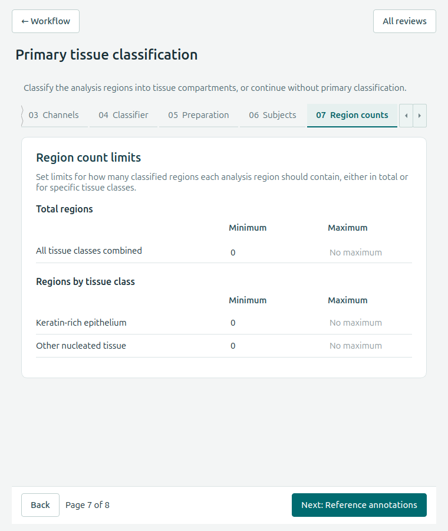</a>

*The LuCa example has no required minimum or maximum for the total count or for either individual class.*

A count below a required minimum excludes the analysis region from further processing. If a count exceeds its maximum, **Review region counts** lists the affected analysis regions. The columns show the total and the counts for each tissue class, with the configured maximum beside the count where a limit applies. Select a class count and choose **Inspect outlines in QuPath** to see that class in the selected analysis region. Select the total to see all tissue classes there.

In **Decision**, choose **Keep region** to retain its classified tissue or **Exclude region** to omit the whole analysis region from further processing. To apply the same decision to several regions, select their rows and choose **Keep selected** or **Exclude selected**.

<a href="../../assets/screenshots/primary-excess-count-review.png">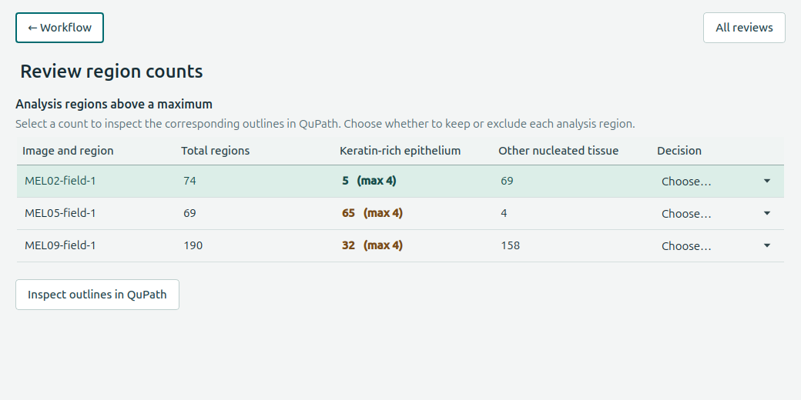</a>

*The saved MEL02, MEL05 and MEL09 fields contain 5, 65 and 32 keratin-rich epithelial regions, respectively. Here we applied a maximum of four to illustrate the review. MEL02 is selected for inspection.*

## Draw reference annotations

On **Reference annotations**, select an image and choose **Annotate in QuPath**. Use the brush, polygon, rectangle or ellipse to draw regions containing only the intended class, then assign that label. Include different staining strengths and tissue arrangements, particularly where neighbouring classes are difficult to distinguish.

If you revise tissue detection, reopen the saved reference annotations and check them against the revised tissue boundaries before refitting. The revision preserves manual annotations. It changes which generated regions and classifier results are current. The [recovery guide](../run/saving-and-recovery.md) explains how earlier results are retained.

For **KRONOS**, draw reference regions large enough to fully cover patches of one class on the image's fixed patch grid. When one region covers several complete patches, each patch supplies one training observation; when several regions of the same class jointly cover one patch, that patch counts once. A patch cannot supply a training label if a competing class covers any positive area within it. [Patch geometry and labels](kronos.md#patch-geometry) explains the grid, complete-patch counts and surrounding image context.

After annotations are saved and returned from QuPath, **Saved regions** shows the number of saved area annotations for each required class. Select an image to inspect its counts. A dash means annotations have not yet been returned for that image; **0** means no saved regions were returned for that class. The number of training observations depends on annotation area and sampling resolution: one region can supply many pixels or patches, while a narrow KRONOS reference may cover no complete patch. Before fitting, we calculate the eligible observations inside the selected detection area.

<a href="../../assets/screenshots/primary-reference-workspace-current.png">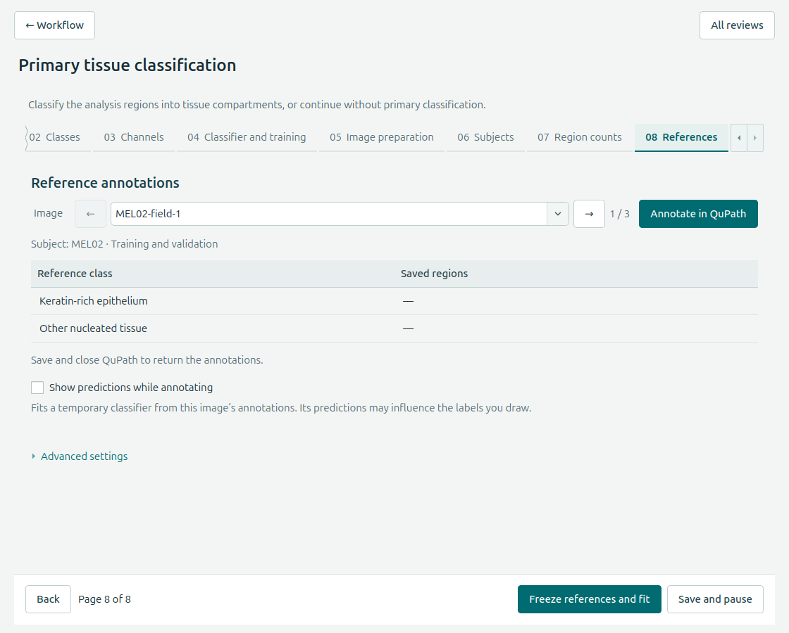</a>

*Reference annotation for **MEL02-field-1** in the melanoma example. MEL02 and MEL05 supply training and validation references; MEL09 is reserved for independent testing. The dashes indicate that annotation counts have not yet returned from QuPath.*

When a paired H&E image is available, use **QuPath view** to select **Side-by-side reference** or, after accepting alignment, **Registered overlay**. Draw and save the training annotations on the primary mIF image while using H&E to identify tissue structures. [Existing H&E annotations](../alignment/index.md#use-the-accepted-alignment) follow the alignment-and-transfer review before use in mIF analysis.

### Prediction feedback during annotation

Select **Show predictions while annotating** to open the prediction controls alongside the reference image when QuPath launches. This option starts unchecked. If you close the controls, **mIF → Open annotation preview…** opens them again.

If prompted, choose the tissue or analysis region to preview. After drawing or changing reference annotations within that region, select **Update preview** to fit the model and display its predictions there. Editing the references clears the previous predictions until you update again. For RF and SVM, the preview uses the entered classifier settings. If the training procedure compares several parameter combinations, the preview uses the first combination.

For KRONOS, **Update preview** fits the graph layer from the references, then fits RF or SVM to its output. When only annotations change, we reuse the image-patch embeddings and refit the learned graph and classifier. The status message shows which part is being fitted before displaying the predictions.

<a href="../../assets/screenshots/native-classifier-preview.png">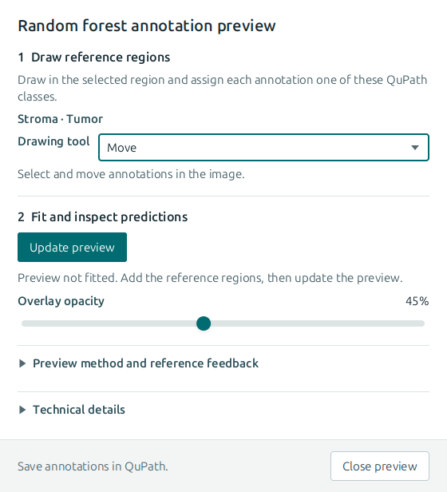</a>

_After drawing reference regions, update the preview and compare the predicted tissue boundaries with the staining in the same field._

Viewing predictions can influence which regions you annotate and how you label them. Once you open an annotation session with prediction feedback enabled, use that subject for training and grouped cross-validation, or exclude it. We prevent its later assignment to a separate validation or test set, even if you clear the preview option. Annotate independent-test subjects without prediction feedback so their labels remain independent of the model being evaluated.

## Fit the classifier

Save the annotations in QuPath and close each session. On **Reference annotations**, inspect the returned region counts, then select **Freeze references and fit**. We fit the selected model using those annotations, their image and subject assignments, and the chosen feature and classifier settings. When fitting finishes, **Review fitted classifier** opens for image inspection and any available evaluation.

## Inspect and accept the fitted model

On **Review fitted classifier**, inspect how the predictions follow the tissue and, when validation was selected, how they agree with references from held-out subjects. The review opens **Images and references** for a training-only fit or **Cross-validation** for grouped validation. Independent testing follows model acceptance when it was included in the training procedure.

### Inspect fitted predictions in the image

On **Images and references**, **Class balance** shows how many labelled pixels or KRONOS patches each class contributes to fitting, while **Subjects and images** lists the contribution from each image and its assigned role. Together, these show whether a class has few reference observations or whether most training examples come from a small number of images. Select a fitting image and choose **Inspect selected image in QuPath** to compare its predictions with the staining and annotations.

<a href="../../assets/screenshots/classifier-images-references-current.png">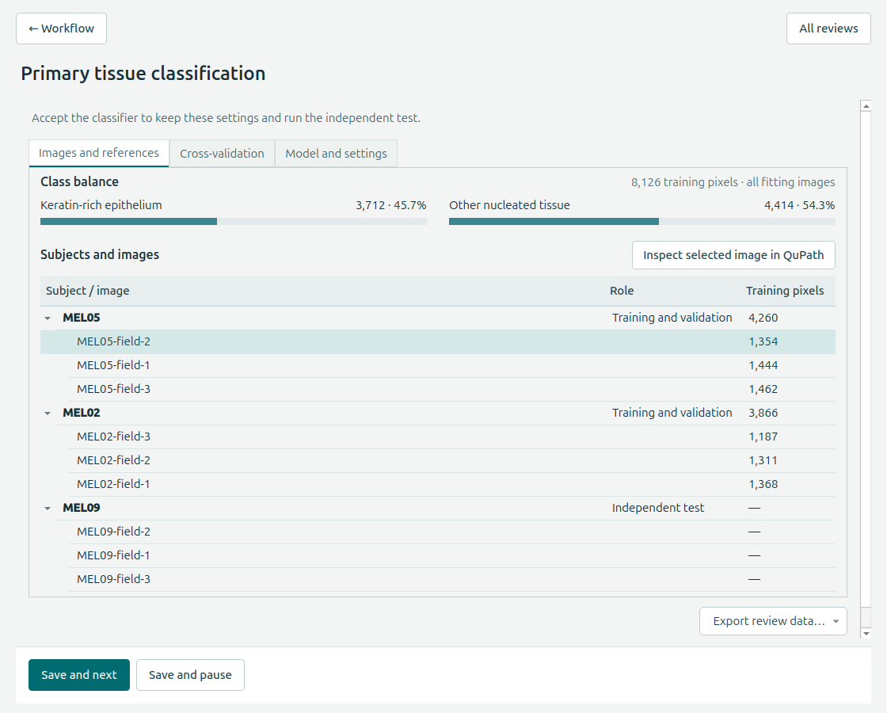</a>

*The melanoma RF fit uses 8,126 labelled pixels from six MEL02 and MEL05 fields. Three MEL09 fields are reserved for independent testing.*

In QuPath, **Fitted classifier predictions** colours each sampled pixel or KRONOS patch by its predicted class. Adjust the overlay opacity to examine how the predicted boundaries follow the staining, including in small structures, weakly stained areas and tissue outside the reference annotations. If a boundary cuts through a compartment or includes neighbouring tissue, examine whether the references distinguish those appearances and whether the selected image features capture their differences. An Ignore class included during fitting also appears in the predictions.

<a href="../../assets/figures/melanoma-fitting-field-predictions.png">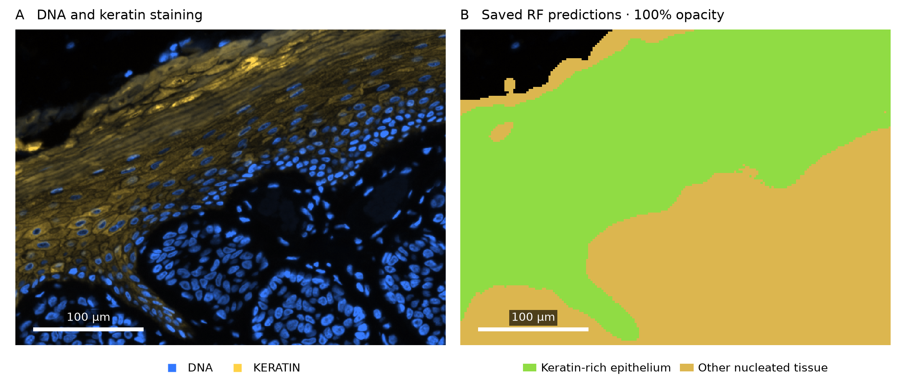</a>

*MEL02-field-1, one of the model's fitting images: DNA and keratin staining beside RF tissue predictions, calculated at **2 µm/pixel** and displayed at **100% opacity**. Scale bars: 100 µm.*

### Compare validation results across subjects and references

**Cross-validation** compares the reference labels with predictions made while each subject was held out from fitting. Its confusion matrix counts evaluated pixels for conventional RF/SVM or complete patches for KRONOS. Rows identify reference classes and columns identify predicted classes; percentages divide each entry by the total for its reference-class row. The selected parameter values and [subject-weighted score](#calculate-the-subject-weighted-selection-score) appear above the matrix. Expand the parameter-combination and fold count at the upper right to compare the tested settings, fold scores and subject assignments.

Select a subject to examine its matrix, or select a matrix entry to see how its observations are distributed across subjects and reference annotations. This helps determine whether a class confusion recurs across subjects or is concentrated in particular images. In the reference table, **Reference agreement** gives the percentage of evaluated pixels or patches predicted as the annotation's class, exposing disagreement even when most of the annotation is classified correctly.

Select a reference row and choose **Inspect reference in QuPath** to view its annotation beside predictions from the model fitted without that subject. Disagreement along a compartment boundary may indicate an annotation extending into neighbouring tissue; disagreement throughout consistently labelled tissue may indicate that the training references or image features do not adequately describe that appearance. Use the staining to assess which explanation applies before changing the references or fit.

The reference table assigns each evaluated pixel or patch to annotations containing its centre. Overlapping annotations can therefore list the same observation, making their summed counts larger than the confusion-matrix count. For KRONOS, same-class annotations can jointly cover a complete patch even when no individual annotation covers it; that patch appears under each annotation containing its centre.

<table>
<tr>
<td valign="top"><a href="../../assets/screenshots/melanoma-cross-validation-panel.png">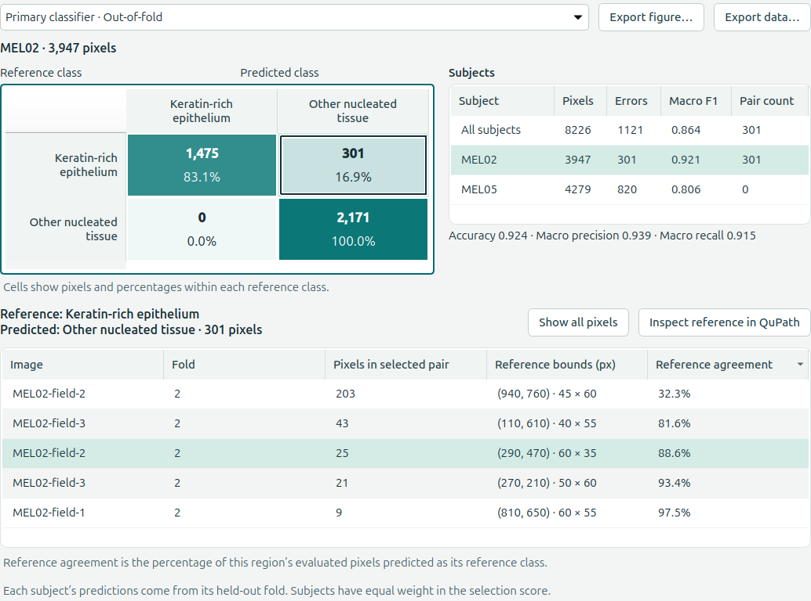</a></td>
<td valign="top"><a href="../../assets/screenshots/melanoma-held-out-reference.png">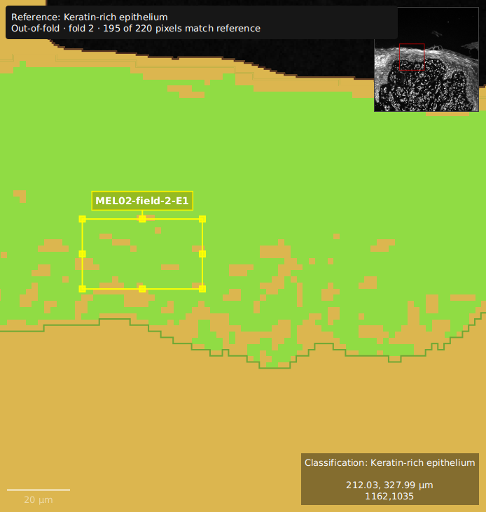</a></td>
</tr>
</table>

*Cross-validation review and inspection of the selected reference. Left: selecting the 301 keratin-rich pixels predicted as Other nucleated tissue lists five contributing references. The selected MEL02-field-2 reference has 25 errors among 220 evaluated pixels, giving 88.6% agreement. Right: the same annotation appears as a yellow rectangle in QuPath. At 100% opacity, green marks Keratin-rich epithelium and amber marks Other nucleated tissue in the held-out fold's predictions; the scale bar is 20 µm. This example uses two-fold cross-validation on three fields each from MEL02 and MEL05, with MEL09 kept separate for independent testing. [Public images and reference annotations](../../data/public-image-sources.md#melanoma-classifier-batch).*

### Check the fitted settings and accept or revise the model

**Model and settings** lists the image inputs, feature preparation and parameter values used to fit the displayed model, including the winning parameter combination when cross-validation was used. If the image inspection or validation indicates that the fit needs revision, return to the relevant setup or reference-annotation page; **Adjust fit parameters** also opens the parameter controls directly for a fixed-parameter fit.

Choose **Save and next** after grouped cross-validation, or **Accept fitted classifier** after a fixed-parameter fit, to accept the model. When independent testing was selected, this starts evaluation on the reserved test subjects.

### Review independent-test results

On **Review classifier test results**, **Evaluation** compares the accepted model's predictions with annotations from the reserved test subjects. We use the feature transformations and classifier fitted during training, including the learned graph parameters for KRONOS.

Independent testing assigns one prediction to each **reference region**. We count the predicted classes within that region, exclude ignored observations and use the class with the most observations as its prediction. Conventional classifiers count pixels whose centres lie inside the annotation; KRONOS counts complete patches covered by that individual annotation. If classes tie, the first tied class in the saved class order is used.

The confusion matrix counts these reference regions, with reference classes in rows and predicted classes in columns. Each percentage divides an entry by the total for its reference-class row. Select an entry to list the corresponding regions and compare their counts across subjects; **Show all reference regions** clears the selection.

For each reference region, **Reference agreement** gives the percentage of its evaluated pixels or patches that the classifier assigned to the reference class. Ignored observations are excluded from the denominator. Sort this column to find regions with substantial internal disagreement even when their majority prediction is correct. Hover over a value to see the evaluated and ignored counts, or select a region and choose **Inspect reference in QuPath** to examine the disagreement alongside the staining and annotation boundary.

<a href="../../assets/screenshots/melanoma-independent-test-panel.png">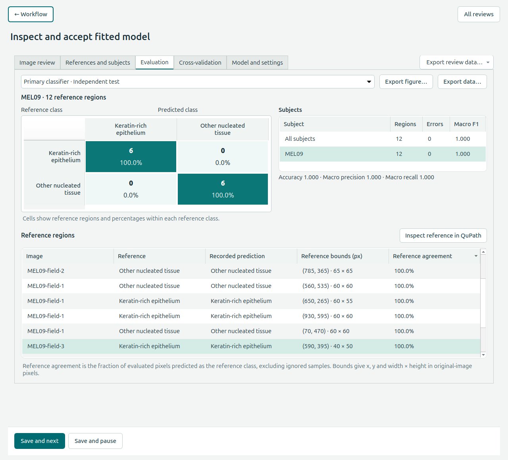</a>

*Independent testing on the three MEL09 fields. All 12 walkthrough reference regions received the matching majority prediction. The table below lists the references with their recorded bounds and pixel-level reference agreement; selecting a matrix cell filters this list.*

Review and accept the independent-test results to complete this procedure. Changing the model after examining these results turns that comparison into part of model development.

**Export figure…** saves the selected subject’s matrix as PNG, PDF or SVG; **Export data…** saves its counts and scores as CSV. **Export review data…** saves individual tables or all recorded tables together, including reference locations and their evaluated class counts. **Out-of-fold reference locations** retains each reference’s fold, bounds, agreement and predicted-class counts.

## Apply the accepted classifier

After model acceptance and any independent-test review, we apply the classifier across the analysis region or selected parent compartments. We calculate the saved features and transformations at each pixel or KRONOS patch, predict its class, then convert the classified areas into compartment annotations.

The [region table](../../reference/data-formats.md#classified-region-tables) links each resulting annotation to its class and saved QuPath object. The region-count rules use these objects when deciding whether an analysis region meets its limits. Later stages use their geometry to restrict secondary detection or segmentation and to assign cells to primary tissue classes.

## Saved result and later changes

The saved classifier contains the class labels, channel assignments, image resolution and feature calculation needed to reproduce its predictions. It also stores the fitted normalization, optional PCA and RF trees or SVM support vectors. KRONOS models additionally identify the encoder and marker preparation and store the learned graph parameters.

The accompanying training record identifies the reference annotations, subject assignments, selected parameters and numbers of observations used for fitting, together with validation or independent-test results.

### Inspect classified regions

Open **Results & export → Primary tissue classification**, select the image and analysis region, then choose **Classified regions → View recorded tables**. **Class areas and sizes** shows each class’s object count, area in µm² with interior holes excluded, percentage of the accepted analysis region and median object area. The percentage divides the summed class area by the entire accepted analysis-region area, including parts without a classified object.

Choose **Individual region sizes (largest first)** to compare the sizes alongside the image overlay. One classified object can contain disconnected parts; its area describes the classifier output at its processing resolution. **Export data…** saves the class summary, including the first and third area quartiles, or individual object areas with their class, image coordinates and identifiers.

### Reopen classifier evaluation

On **Results & export**, select **Accepted classifiers** and choose a saved validation or test confusion figure for **All subjects** or an individual **Subject**. Compare the percentages for each reference class across subjects, then select an off-diagonal entry to locate the misclassified references.

For the underlying tables and image inspection, open **Classifier review and data → View recorded tables**. Choose **Selected candidate out-of-fold counts** for grouped cross-validation or **Classifier evaluation** for validation and independent-test review. Both retain subject selection and the saved scores and matrices. **Out-of-fold reference locations** and **Evaluated reference locations** open the corresponding reference tables and QuPath inspection actions. **Classifier review and data** also provides the saved subject allocation, model settings and retained fitting data.

These views retain the counts, reference agreement and export options described under [Inspect and accept the fitted model](#inspecting-and-accepting-the-model). A class with no evaluated reference regions has zero counts and unavailable percentages. Training-only fits provide image inspection without a held-out evaluation matrix.

### Revise the classification

Use [Change classifier setup…](../run/index.md#change-a-completed-or-stopped-step) to revise a completed classification. Changes to classes, references or image features require refitting; changes to analysis boundaries affect where the model is applied. The change review identifies which later results need recalculation.

Native classifier implementation and sources

### Saved calculation and resource use

The saved classifier reconstructs the image-feature operation, fitted transformation and native decision function described under [Saved result and later changes](#saved-result-and-later-changes). Fit details include the counts of selected training observations for each image and class.

During fitting, the Java classifier code allocates the feature matrix and the arrays needed for optional PCA and the native classifier. During image review, QuPath reads the requested image regions and calculates their features, reusing its bounded tile cache. The Java classifier code applies the saved transformation and model to predict their classes. RF tree traversal and SVM support-vector evaluation return a class index for each pixel; colour changes reuse those indices.

### Sources and implementation

QuPath [FeaturePreprocessor](https://github.com/qupath/qupath/blob/v0.7.0/qupath-core-processing/src/main/java/qupath/opencv/ml/FeaturePreprocessor.java) and [Preprocessing](https://github.com/qupath/qupath/blob/v0.7.0/qupath-core-processing/src/main/java/qupath/opencv/ml/objects/features/Preprocessing.java).

OpenCV [RTrees](https://docs.opencv.org/4.11.0/d0/d65/classcv_1_1ml_1_1RTrees.html) and its [implementation](https://github.com/opencv/opencv/blob/4.11.0/modules/ml/src/rtrees.cpp).

OpenCV [SVM](https://docs.opencv.org/4.11.0/d1/d2d/classcv_1_1ml_1_1SVM.html) and [SVM implementation](https://github.com/opencv/opencv/blob/4.11.0/modules/ml/src/svm.cpp).

The compiled Java classes perform the classifier calculations: [PixelFeatureOps](../../../src/java/org/mif/classification/PixelFeatureOps.java) assembles QuPath's image operations, [PixelTrainingRows](../../../src/java/org/mif/classification/PixelTrainingRows.java) extracts reference rows and selects the fitted population, [FeaturePreparation](../../../src/java/org/mif/classification/FeaturePreparation.java) fits normalization and PCA, and [OpenCvTraining](../../../src/java/org/mif/classification/OpenCvTraining.java) fits RF or SVM through OpenCV.

The [native fitting script](../../../qupath/scripts/general/02_train_native_classifier.groovy) connects those calculations to the selected QuPath images, references and saved classifier. Python's [fit-request module](../../../src/python/mif_pipeline/qupath_runtime/native_classifier_fit.py) and batch-training modules prepare the requests and validate the returned model records. [classifier.json](../../../src/python/mif_pipeline/config/defaults/classifier.json) sets the initial classifier parameters and search values.

Training and evaluation implementation

### Training implementation

`gui/training_procedure.py` and `gui/cv_authoring.py` create the procedure and parameter fields. `orchestration/batch_training/search_grid.py`, `split_policy.py`, `plan_selection.py` and `cross_validation.py` record the parameter combinations and subject allocation.

Java's [GroupedCrossValidation](../../../src/java/org/mif/classification/GroupedCrossValidation.java) assigns subject folds, invokes a separate fit for each fold and aggregates the held-out confusion counts. The [Groovy adapter](../../../qupath/scripts/compartment_analysis/grouped_cross_validation.groovy) supplies the selected classifier's fitting and prediction operations. The classifier-review scripts open the fixed fitted model on its permitted training and validation images. For cell classifiers, [supervised.py](../../../src/python/mif_pipeline/cell_analysis/supervised.py) matches returned cell predictions and applies confidence decisions; [supervised_qc.py](../../../src/python/mif_pipeline/cell_analysis/supervised_qc.py) calculates the held-out cell metrics.

---

**Next:** [Cell segmentation](../cells/index.md).
