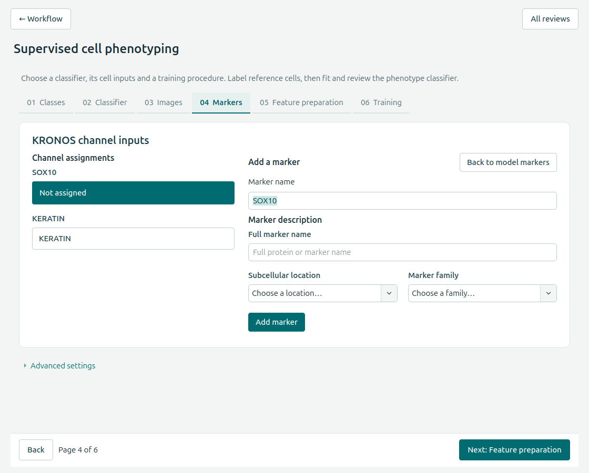
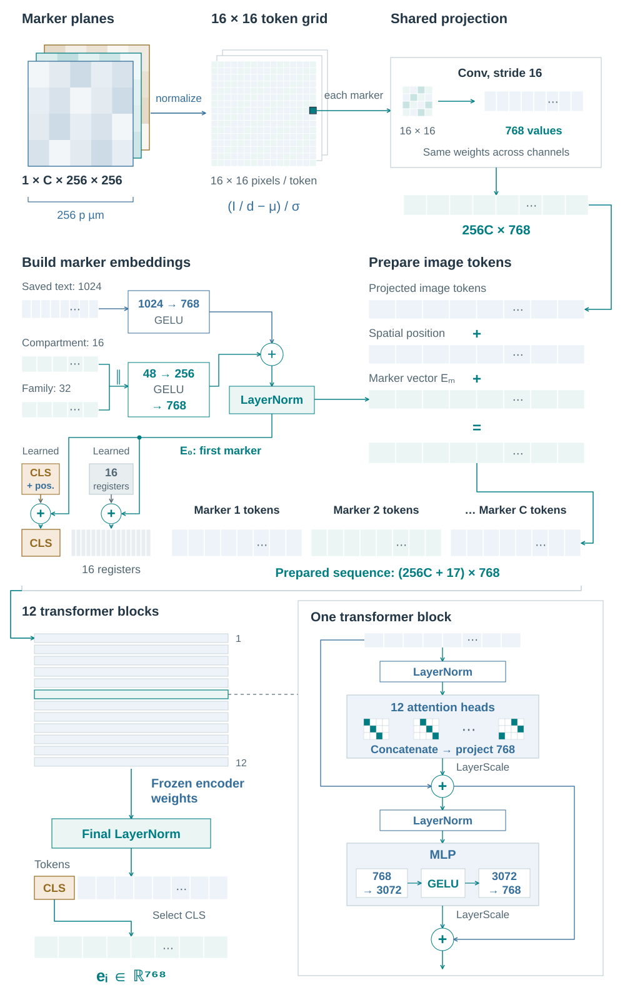
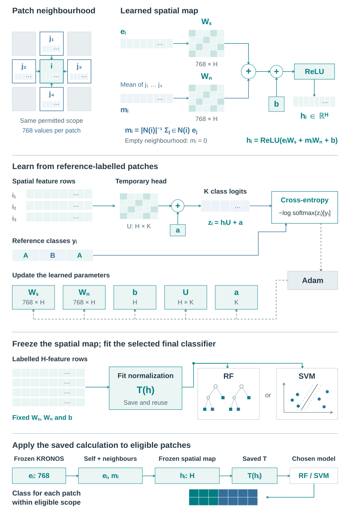

# KRONOS tissue classification

[Analysis stages](../../../README.md#analysis-stages)

**On this page** [Prepare marker channels](#prepare-marker-channels) · [Form image patches](#form-image-patches) · [Calculate the fixed KRONOS representation](#calculate-the-fixed-kronos-representation) · [Construct the patch graph](#construct-the-patch-graph) · [Learn spatial features from the labelled patches](#learn-spatial-features-from-the-labelled-patches) · [Fit RF or SVM on the frozen graph features](#fit-rf-or-svm-on-the-frozen-graph-features) · [Select parameters across subjects](#select-parameters-across-subjects) · [Predict and display tissue classes](#predict-and-display-tissue-classes) · [Prediction feedback during annotation](#prediction-feedback-during-annotation) · [Memory and calculation limits](#memory-and-calculation-limits)

We predict one tissue class for each square patch of a multichannel image. The pretrained KRONOS2 encoder describes the staining in that patch with a vector of 768 values, called a **patch embedding**. We keep the encoder weights fixed. Using the reference labels, we train a graph neural network (**GNN**) layer to combine each patch embedding with those of its immediate neighbours. A random forest (**RF**) or support vector machine (**SVM**) learns to assign the tissue class from the resulting features. [KRONOS paper](https://arxiv.org/abs/2506.03373)

Open **Run → Tissue classification → Open review**. On **Classifier**, select **KRONOS** under **Method**, then choose RF or SVM under **Final classifier**. The tissue-classification guide describes the [graph settings](index.md#kronos-graph-settings) and [KRONOS image and channel inputs](index.md#user-guide-classifier-training--kronos-and-local-graph-features).

## Prepare marker channels

On **Image channels**, select the stains that distinguish the tissue classes. We read these channels for each image patch and normalize their intensities before passing them to KRONOS. On **KRONOS channel inputs**, identify the marker in each channel so that we can use its description and normalization values from the model.

### Assign the markers

Under **Channel assignments**, select a channel, search **Model markers** and choose **Use marker**. The selected model marker supplies its description and the mean and standard deviation used to normalize that channel. We prefill assignments from the image's recorded biomarker names. Matching ignores letter case and common separators, such as the hyphen in `PD-L1`, and treats α as `a`. Check the assignment when more than one model marker matches.

For the [nuclear stain selected in Channels and markers](../images/index.md#choose-the-nuclear-stain), we use the model's DAPI marker. The [channel-assignment guide](index.md#kronos-channel-inputs) shows these controls.

### Normalize the marker intensities

To normalize a channel, we divide its pixel intensities by the **intensity divisor**, subtract the marker's mean and divide by its standard deviation. The divisor depends on [how the image intensities were prepared](#relate-intensity-scaling-to-image-preparation). The mean and standard deviation come from the pretrained model's marker table. For a new marker, we [calculate them from the training tissue](#calculate-the-new-markers-normalization-values).

For channel `c`, let `I_cxy` be the intensity at patch position `(x, y)`, `d_c` the divisor, and `μ_c` and `s_c` the marker's mean and standard deviation after division. The normalized intensity is

$$
u_{cxy}=\frac{(I_{cxy}/d_c)-\mu_c}{s_c},
$$

We use the same divisor, mean and standard deviation for a channel during fitting and prediction.

### Choose the intensity divisor

The initial **intensity divisor** depends on the [intensity correction applied during image preparation](../unmixing/index.md#correct-intensities-for-acquisition-settings). With **full intensity correction**, we have already divided by the detector maximum and use a divisor of **1**. With **exposure-only correction**, we use the detector maximum recorded during image preparation or calculate it from the recorded bit depth. For images copied without correction whose values have not already been normalized, unsigned 8-bit storage gives an initial divisor of **255**, and unsigned 16-bit storage gives **65,535**.

Review the divisor under **Advanced settings → Intensity scaling** on **KRONOS channel inputs**. We prefill it when the participating images give the same value for that channel. If the value cannot be determined, enter the divisor needed to express the image intensities on the scale used for the marker's mean and standard deviation. This normalization can still leave differences in staining strength between the analysed tissue and the images used to pretrain KRONOS.

### Add a marker absent from the model table

For a channel whose marker is absent from the table, select **Add a marker not listed…**. Enter the marker name and full name, choose its subcellular location and family from the model's categories, then choose **Add marker**. Select the channel again to edit its saved description.

During encoder preparation, BioLinkBERT converts a description constructed from those fields into a vector of 1,024 values. KRONOS combines that text vector with its learned representations of the selected location and family to interpret the staining in the channel assigned to that marker. [Select the description model in Software setup](../installation-and-build/software.md#prepare-the-description-model-for-new-markers)

_SOX10 is absent from the selected model's marker table. **Add a marker not listed…** opens the fields needed to describe it._

### Calculate the new marker's normalization values

To estimate a new marker's mean and standard deviation, we first identify the training tissue that supplies its pixels.

- **Tissue classifier.** Use the parent region of each reference, restricted to the selected analysis region and accepted tissue section.
- **Cell classifier.** Use the selected analysis regions within the accepted tissue section.

We combine overlapping regions on the same image plane. Each full-resolution pixel contributes once if its centre falls inside the combined area. We divide its intensity by the channel divisor, then calculate the mean and sample standard deviation across the pooled training pixels.

In cross-validation, we calculate these values from the training subjects in each fold and apply them to both the training and held-out images for that fit. We repeat the calculation on all subjects used for the final fit and use those values for subsequent predictions. Fitting identifies the affected channel if an image plane contributes no pixels to this calculation or the pooled intensities have no variation.

## Form image patches

On **KRONOS image inputs**, **Patch size (pixels)** sets the number of pixels along each side of the image supplied to the encoder. It starts at **256** and can be **32**, **64**, **128** or **256**. **Sampling resolution (µm/pixel)** sets the tissue width represented by each pixel. Multiplying the patch size by this resolution gives the physical side length of the patch.

We read this square area from every selected channel at the requested resolution and combine the channel images into one multichannel patch. Each patch receives one tissue class. For example, at **0.5 µm/pixel**, a 256-pixel patch covers **128 × 128 µm**, and a 64-pixel patch covers **32 × 32 µm**. Sixteen of the smaller patches cover the same tissue area as one larger patch, allowing separate predictions within that area.

### Patch geometry

We arrange the patches on a grid starting at the image's top-left corner and use this grid for both training and prediction. Let `P` be the selected patch size in pixels. Dividing the sampling resolution by the original image's pixel size gives the **downsample factor** `d`. Multiplying `P` by `d` gives the patch side `S` in original-image pixels. We require the same downsample factor in X and Y, a factor of at least one and a whole-number value of `S` so that each patch can be read using exact image bounds.

Counting rows and columns from zero, the patch in row `r` and column `c` begins at `(Sc, Sr)`. Its full-resolution rectangle extends one patch side in each direction,

$$
[Sc,S(c+1)]\times[Sr,S(r+1)].
$$

We include a patch when its full rectangle fits within the image and overlaps the selected analysis region over a nonzero area. The encoder reads the complete rectangle, including any pixels outside the analysis-region outline. We display its prediction only inside that outline. Patches cut off by the right or bottom image edge are omitted because the encoder requires a complete square input.

### Reference labels

We first restrict reference annotations to the selected parent tissue region. A patch contributes a training label only when annotations of one class cover its entire rectangle and no competing class covers any of its area. Several annotations of the same class can jointly cover that rectangle.

**Saved regions** reports the number of annotations drawn in QuPath. Training instead counts the complete labelled patches. One large annotation can therefore provide several training observations; an annotation that covers no complete patch provides none on its own. Final fitting requires at least one complete labelled patch from every training image and at least one for every declared class across those images.

To count the patches covered by a rectangular reference on its own, take its original-image bounds `[x₀,x₁] × [y₀,y₁]` and the patch side `S = Pd` in the same units. For a rectangle wholly inside eligible tissue and containing no competing class, multiply the number of complete grid columns by the number of complete grid rows,

$$
\begin{aligned}
N_x&=\max\!\left(0,\left\lfloor\frac{x_1}{S}\right\rfloor-\left\lceil\frac{x_0}{S}\right\rceil\right),\\
N_y&=\max\!\left(0,\left\lfloor\frac{y_1}{S}\right\rfloor-\left\lceil\frac{y_0}{S}\right\rceil\right),\\
N_{\mathrm{patches}}&=N_xN_y.
\end{aligned}
$$

The ceiling at the near edge and floor at the far edge exclude partly covered patches. Moving an edge across a grid line can add or remove a whole observation. For curved references, holes or several same-class annotations, we test each patch against the union of the annotations for that class.

A neighbouring patch with incomplete or conflicting labels can still contribute staining information to a labelled patch. Only the fully labelled patches receive a target class in the training loss.

## Calculate the fixed KRONOS representation

For each tissue patch, KRONOS returns one vector of **768 features** describing the staining across its marker channels. We use the pretrained encoder with its weights fixed. The tissue labels enter the subsequent graph and classifier fit.

_In the illustrated 256 × 256-pixel patch, each marker contributes 256 image tokens. The transformer combines the marker and position information into a single patch representation._

**From pixels to tokens.** We supply a batch of patches with dimensions `(patches, channels, P, P)`, retaining the selected order of the 1–32 marker channels. For each marker, the encoder divides the patch into tiles of **16 × 16 pixels** and projects the 256 intensities in each tile into a vector of 768 values. This vector is an image token. The patch size determines how many tiles fit. The sampling resolution determines their physical extent. At 0.5 µm/pixel, for example, each tile spans 8 × 8 µm.

**Marker and position.** The encoder adds a position vector and a marker vector to each image token. It forms the marker vector by projecting the marker description, subcellular location and family separately, summing the projections and applying layer normalization. It also adds one learned class token to collect information from the whole patch, and sixteen register tokens that participate in the attention calculation. The class token receives a positional vector. The class and register tokens also receive the first marker’s vector. With `C` channels, the sequence contains `C(P/16)² + 17` tokens.

**From tokens to a patch representation.** To learn which staining patterns occur together, the encoder relates tokens from different markers and positions through twelve transformer blocks. Each block performs this comparison in twelve attention heads. Within a head, each token supplies a query, a key and a value, each with 64 entries. Comparing one token’s query with every key gives a scaled dot product for each possible match. Softmax turns these scores into weights, which determine how much each token’s value contributes to the update.

The block joins the twelve heads’ outputs, projects them back to 768 values and adds the scaled update to its input. A feed-forward network then supplies a second scaled update before the next block processes the tokens. [KRONOS2 model description](https://huggingface.co/MahmoodLab/KRONOS2/blob/main/README.md)

We save the normalized class token from the last block (`x_norm_clstoken`) as the patch’s embedding. A change to the annotations alone permits reuse of these embeddings. Changing the sampled pixels, markers, channel order, normalization or encoder weights requires recalculating them. [Encoder preparation and feature reuse](model-execution.md#iii-kronos-input-preparation-and-feature-reuse)

## Construct the patch graph

Each patch becomes one node in the graph. We connect it to the patches immediately to its left, right, above and below so that the classifier can use the surrounding staining when predicting its tissue class. We only connect patches within the same continuous tissue component, parent compartment and analysis region of an image. Both patches must also have the same subject, validation fold and training or evaluation role.

An interior patch can receive information from all four neighbours. At a tissue or image boundary, the graph layer uses the neighbours available within these restrictions. The distance between neighbouring patch centres equals the physical side length of a patch.

When predicting a displayed rectangle, we read the target patch and its neighbours even if a neighbour lies just beyond the edge of the view. Panning the image therefore preserves each patch's neighbourhood.

## Learn spatial features from the labelled patches

We train the graph layer to extract features that distinguish the reference classes using both the staining in a labelled patch and the staining around it. A temporary classifier turns the graph features into a prediction for each labelled patch. Its error tells us how to adjust the graph weights. After fitting, we pass the learned features to the final RF or SVM.

_The two branches entering the spatial layer carry the target patch's staining and the mean staining features of its neighbours. The reference label enters at the temporary classifier._

Let `e_i` be the row vector of 768 encoder features for patch `i`, and let `N(i)` contain its permitted edge-adjacent neighbours. The mean of their embeddings, `m_i`, has one value for each of the same 768 features. Counting only the available neighbours gives

$$
m_i=\begin{cases}
|N(i)|^{-1}\sum_{j\in N(i)}e_j,&|N(i)|>0,\\
0,&|N(i)|=0.
\end{cases}
$$

To combine the local staining with its surroundings, we apply separate weights to the patch embedding and the neighbour mean. The **GNN feature dimension** sets the number `H` of output features in the resulting patch vector

$$
h_i=\operatorname{ReLU}\left(e_iW_{\mathrm{self}}+m_iW_{\mathrm{neighbour}}+b\right).
$$

Each weight matrix has 768 rows (input features) and `H` columns (output features). Each column can give different weights to staining in the patch and staining in its surroundings. We add the two products and a bias `b` with one value per output feature. The rectified linear unit (**ReLU**) sets each negative result to zero.

Averaging over the available neighbours gives equal weight to each direction and keeps the mean on the same scale at an edge as in the interior. The layer uses this mean for all directions together. An isolated patch uses a zero neighbour vector, so only its own embedding and the bias contribute.

### Temporary training head and loss

For `K` reference classes, the temporary linear classifier, or training head, converts each graph vector to `K` scores, one per class. Its weight matrix `U` has shape `H × K`, and its bias `a` has one value per class. Softmax converts the scores `z_i` to probabilities `p_ik` that sum to one over the declared classes,

$$
z_i=h_iU+a,\qquad
p_{ik}=\frac{\exp(z_{ik})}{\sum_{l=1}^{K}\exp(z_{il})}.
$$

At the start of each **epoch**, we shuffle the labelled patches using the recorded random seed and divide them into batches. One epoch visits every labelled patch once. The [graph settings](index.md#kronos-graph-settings) determine the batch size and number of epochs.

For one batch, let `L` contain its patches and let `y_i` identify the reference class of patch `i`. We calculate the **cross-entropy loss** as the mean negative log probability assigned to these reference classes,

$$
\mathcal L=-\frac1{|L|}\sum_{i\in L}\log p_{i,y_i}.
$$

A patch contributes a large loss when its reference class receives a low probability. After each batch, PyTorch's Adam optimizer uses this loss to update the two graph matrices, the graph bias and the temporary classifier. It uses running averages of the gradients and their squared magnitudes to scale the updates. **Learning rate** sets the size of the step. **Weight regularization** sets Adam's weight decay, which pulls the fitted weights and biases towards zero. The encoder embeddings and neighbour connections stay fixed, so we calculate the neighbour means once and reuse them in each batch.

We record the mean cross-entropy for each epoch, weighting each batch loss by its number of labelled patches. This measures the temporary head's agreement with the training labels and excludes the weight-decay penalty. We use held-out predictions from the full graph and RF or SVM to judge how well the trained model generalizes.

How the class error updates the graph weights

For one labelled batch of size `n`, let `P` contain the temporary head's class probabilities and `Y` the one-hot reference labels. The derivative with respect to its class scores is

$$
\frac{\partial\mathcal L}{\partial Z}=\frac{P-Y}{n}.
$$

Each row of `Y` contains one at the reference class and zero elsewhere. For the reference class, the derivative is `(p−1)/n`, so a low probability produces a large negative derivative. For each other class, the derivative is `p/n`. A step down this gradient favours the reference class. The division by `n` comes from averaging the loss over the batch.

We multiply the score derivatives by the transpose of the temporary head's weight matrix to obtain the derivatives for the graph features. ReLU passes these derivatives through entries whose values before ReLU were positive and sets them to zero elsewhere. For each entry of `W_self`, we sum the input embedding value times the propagated derivative for its output feature over the batch. We use the same derivatives with the neighbour means for `W_neighbour`. Their sum for each output feature gives the gradient of its bias.

The implementation places the graph bias in the self layer, so we add it once when combining the two matrix products. PyTorch stores the matrices with one output feature per row. We transpose them when saving the fitted graph for the row-vector calculation above.

The self layer learns `DH` weights and `H` biases. The neighbour layer learns `DH` weights, and the temporary head learns `HK` weights and `K` biases. Together they contain

$$
(DH+H)+DH+(HK+K)=H(2D+1+K)+K.
$$

For `D=768`, `H=64` and three classes, this gives 98,563 parameters. Increasing `H` increases this count and the width of the later RF/SVM training matrix.

## Fit RF or SVM on the frozen graph features

We fix the trained graph weights and bias and calculate the vector `h_i` for each eligible labelled training patch. The matrix for fitting RF or SVM has one row per unique labelled patch, `H` feature columns and a separate reference class index for each row. We use all these rows with class balancing and principal-component analysis (PCA) disabled.

The **Feature scaling** setting determines how we scale each column. We can keep the original values, subtract the training mean and divide by the training standard deviation, or map the training minimum and maximum to zero and one. We save the fitted scaling parameters and apply them to subsequent patches. [Feature preparation](index.md#feature-preparation)

For RF, the trees split on the learned graph features and vote on the patch class. For SVM, the linear or radial basis function (RBF) kernel compares patches using those same features after the selected scaling. We save the encoder settings, fitted graph, feature normalization, classifier and class labels together so that a new image follows the same calculation. See the method guides for RF tree settings and voting, or SVM cost (C), gamma and stopping criteria. [Random forest](../classifier-methods/index.md#random-forest) · [Support vector machine](../classifier-methods/index.md#support-vector-machine)

## Select parameters across subjects

Within each validation fold, we train the graph on that fold's training subjects, fit the selected scaling to their graph features, and train RF or SVM on those scaled features. We repeat these steps for each parameter combination. We can reuse the frozen encoder embeddings when the sampled patches and marker inputs, including their intensity normalization, are identical. For a new marker, we estimate its normalization from the fold's training tissue.

We evaluate each combination using predictions for subjects held out from its training folds. To calculate the selection score, we divide each subject's confusion-matrix counts by its number of evaluated patches and pool the resulting matrices, then calculate F1 for each class and average across classes. We select the combination with the highest subject-weighted macro-F1 and refit it on all training and validation subjects. Subjects reserved for independent testing enter evaluation after this final fit. [Subject allocation, scoring and tie rule](index.md#reference-training-and-evaluation)

In cross-validation, each eligible held-out patch contributes one observation to the confusion matrix. In independent testing, we compare predictions with the label of each reference region. To obtain one prediction for the region, we collect the predicted classes of the patches it completely covers, exclude ignored observations and choose the most frequent class. The saved class order resolves ties. **Reference agreement** gives the percentage of those evaluated patches that match the region’s label. Check the evaluated counts when comparing patch sizes. A narrow region can contain several complete patches at one size and none at another. [Cross-validation results](index.md#compare-validation-results-across-subjects-and-references) · [Independent-test results](index.md#review-independent-test-results)

## Predict and display tissue classes

For each patch in the requested region, we read or calculate the encoder embeddings for the patch and its permitted neighbours. We apply the saved graph weights, scale its output features using the fitted normalization, and pass them to RF or SVM. We fill the patch with the colour for the predicted class, clipping the displayed block at the analysis-region outline.

During image review, compare the blocks with small structures and compartment interfaces at the scale needed for the analysis. A patch spanning two tissue types receives one class for both. Revised references can change which class wins. To place a boundary within that block, use a finer patch grid or choose another feature method, then refit and repeat the selected evaluation procedure.

## Prediction feedback during annotation

Select **Show predictions while annotating** on a training image to inspect how well your current references distinguish the tissue classes. Choose the parent region if prompted. Draw references inside it and assign their classes in QuPath. Each class needs at least one completely labelled patch in this region before the preview can fit.

If your panel includes a new marker whose mean and standard deviation will be calculated during fitting, collect the references with **Show predictions while annotating** off. The preview needs these values to encode the image.

Select **Update preview** to fit the graph and classifier to the current annotations. We identify patches fully covered by a reference class and read their embeddings and those of their neighbours. The graph learns from the reference labels. The RF or SVM then uses the learned features to predict a class for each patch.

If you are comparing parameter combinations, the preview uses the first combination. The status identifies the fitting step in progress. When predictions appear, use **Overlay opacity** to compare the predicted classes with the staining.

Editing a reference clears the previous overlay. Select **Update preview** again to fit both stages to the revised labels. We can reuse the encoder embeddings because a label edit leaves the marker images unchanged. Viewing predictions can influence subsequent annotations, so annotate subjects reserved for independent validation or testing without prediction feedback. [Prediction controls and subject assignment](index.md#prediction-feedback-during-annotation)

## Memory and calculation limits

### Encoder memory check

On **KRONOS image inputs → Advanced settings**, **Memory for image features (MiB)** sets the allowance for temporary calculations on one patch. During preparation, we compare the estimated memory for the selected patch side and marker count with this allowance, initially 512 MiB. We process the patches one at a time. The Python reference encoder can accept 1–16 patches per request and iterates over them. QuPath sends one multichannel patch per call, with input dimensions `(1, C, P, P)`.

A token represents one 16 × 16 tile from one marker channel. A patch with side $P$ pixels supplies $(P/16)^2$ image tokens per marker. With $C$ markers, one class token and sixteen register tokens, the encoder processes $T=C(P/16)^2+17$ tokens per patch.

- **Comparisons between tokens.** For one attention head, each of the `T` tokens scores all `T` tokens, including itself. A table of those scores has one row per querying token and one column per token it compares with, giving `T²` values. Each of the twelve heads makes its own comparisons, giving `12T²` values across the heads. We allow space equivalent to three sets of these tables for intermediate attention calculations, or `3 × 12T²` values.
- **Features for individual tokens.** Each token has `D = 768` feature values. An array that holds one feature vector for every token therefore has `T` rows and 768 columns, or `768T` values. For operations such as projecting the tokens into queries, keys and values and combining the heads' outputs, we allow space equivalent to twelve arrays of this size, or `12 × 768T` values.

We add the two allowances and multiply by four bytes per 32-bit floating-point value,

$$
M_{\mathrm{encoder}}=4\bigl[3(12T^2)+12(768T)\bigr]\quad\text{bytes per patch}.
$$

For example, a 64 × 64-pixel patch with four marker channels has 64 image tokens and 17 extra tokens, giving `T = 81`. A single head compares 81 × 81 token pairs. A single array of token features holds 81 × 768 values. With the allowances above, the estimate is 3,930,768 bytes, or about 3.75 MiB (1 MiB = 1,048,576 bytes). The encoder ultimately saves just the class token's 768 values for this patch.

A larger panel increases both terms. Doubling the patch side at fixed marker count gives four times as many image tokens, and the pairwise comparisons grow with the square of the total token count. If the estimate exceeds the selected allowance, reduce the patch side or marker count, or raise the allowance if the device has sufficient memory. Actual peak memory depends on how the runtime handles the intermediate arrays, and the loaded model and application also require memory. [Python encoder estimate](../../../src/python/mif_pipeline/compartment_analysis/kronos_encoder.py)

### Graph fitting arrays and calculation limits

Once we have encoded the images, fitting the graph uses its own allowance for numerical arrays, initially 128 MiB (`classifier.kronos.max_working_bytes`). Let `L` be the number of labelled patches, `D = 768` the encoder width, `H` the selected graph feature dimension, `K` the number of classes and `B` the selected batch size. We estimate the bytes needed for the graph calculation as

$$
M_{\mathrm{graph}}=4\left[2LD+12(2DH+HK)+B(2D+4H+2K)\right].
$$

The first term counts two `L × D` input matrices, one holding each labelled patch's own embedding and one holding its neighbour mean. We reuse them in every epoch. The second term allows space for the two `D × H` graph weight matrices and the temporary `H × K` classifier weights, together with their gradients and optimizer calculations. The factor of twelve is the storage allowance used for these calculations. The last term estimates the temporary values for one batch, allowing for two input vectors of width `D`, four vectors of width `H` and two of width `K` per patch. The factor of four converts the total from float32 values to bytes. Stored encoder vectors, integer labels, Python objects and the framework use additional memory. [Graph training calculation](../../../src/python/mif_pipeline/compartment_analysis/graph_training.py) · [Default allowance](../../../src/python/mif_pipeline/config/defaults/classifier.json)

The number and extent of the references also limit fitting. Within a selected region, we enumerate the grid positions in the bounding rectangles of the clipped annotations before testing which patches are fully labelled. At most 4,096 candidate positions may occur in any one of those rectangles or in their union. Across the final fit, we allow at most 4,096 labelled patches and 64 MiB of 768-value encoder vectors for all selected nodes, including their unlabelled neighbours.

Reusing a saved embedding avoids repeating the token comparisons every time a patch is displayed. With that vector available, the graph averages at most four neighbouring vectors and evaluates two matrix products and ReLU. RF prediction then traverses each tree, so its work depends on the number of trees and their path lengths. Kernel-SVM prediction depends on the number of support vectors and the graph feature dimension.

Sources and implementation

We export the encoder in TorchScript, a saved PyTorch calculation that includes the selected markers and their normalization. We check that its output on a reference input agrees with the Python encoder. QuPath runs the exported model through the Deep Java Library (DJL) and the native PyTorch runtime, LibTorch. [Encoder export](../../../src/python/mif_pipeline/compartment_analysis/kronos_native.py) · [QuPath encoder](../../../src/java/org/mif/inference/FrozenEncoder.java)

We use QuPath patch geometry and the Groovy patch backend to choose the image rectangles, assign labels and reuse saved embeddings. Python builds the patch graph and fits the self and neighbour weights. QuPath applies those weights to the patch embeddings and fits the final classifier with OpenCV. [Patch geometry](../../../src/java/org/mif/inference/MifKronosPatchGeometry.java) · [Patch backend](../../../qupath/scripts/compartment_analysis/kronos_patch_backend.groovy) · [Patch graph](../../../src/python/mif_pipeline/compartment_analysis/patch_graph.py) · [Graph feature calculation](../../../src/java/org/mif/inference/GraphHeadKernel.java) · [RF and SVM fitting](../../../src/java/org/mif/classification/OpenCvTraining.java) · [OpenCV SVM documentation](https://docs.opencv.org/4.11.0/d1/d2d/classcv_1_1ml_1_1SVM.html)

Grouped validation and final training select the subjects and reference labels for each fit. The saved QuPath classifier reopens the model and its input settings to generate patch predictions on subsequent images. [Grouped validation](../../../qupath/scripts/compartment_analysis/grouped_cross_validation.groovy) · [Final training](../../../qupath/scripts/compartment_analysis/kronos_final_training.groovy) · [Saved classifier](../../../src/java/org/mif/inference/MifKronosResourceOp.java) · [Patch predictions](../../../src/java/org/mif/inference/MifKronosPatchOp.java)

---

Return to [Tissue classification](index.md).
