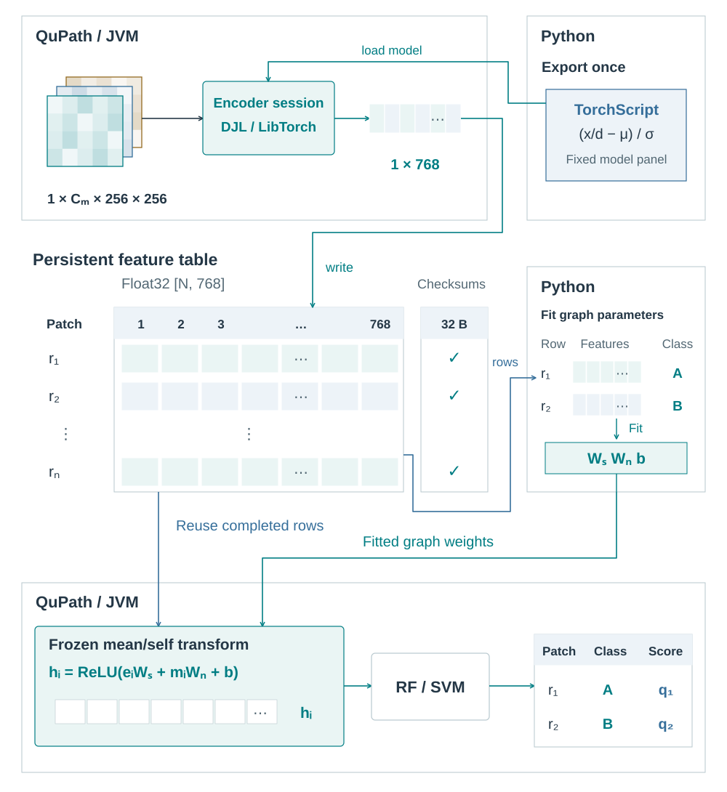
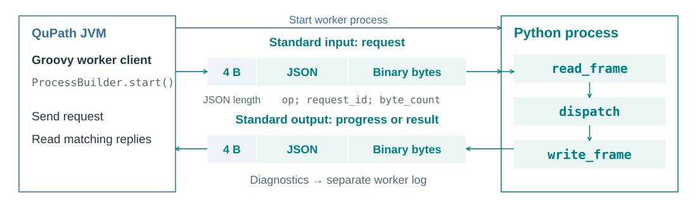

# Model execution and Java–Python interfaces

[Tissue classification](index.md) · [KRONOS calculations](kronos.md)

To classify a new image, we read the selected channels at the pixel size used for training. The saved classifier applies its feature calculations and fitted normalization, then predicts a tissue class at each sampled pixel or KRONOS patch.

This guide follows the training observations through Python, Groovy and Java to the fitted model and its saved predictions. See the [stage guide](index.md) for the controls and [KRONOS calculations](kronos.md) for the encoder and graph.

**On this page:** [Programs and data exchange](#i-which-program-performs-each-calculation) · [Pixel features](#ii-conventional-pixel-classifiers) · [KRONOS preparation and reuse](#iii-kronos-input-preparation-and-feature-reuse) · [Graph prediction](#iv-graph-fitting-and-frozen-inference) · [Grouped fitting](#v-subject-grouped-fitting) · [Cell prediction](#vi-cell-references-prediction-and-acceptance) · [Worker communication](#vii-process-exchange-and-device-transfer) · [What changes require recalculation](#viii-dependencies-used-for-reuse)

## i) Which program performs each calculation

Python builds the training request from the saved images, reference labels, subject roles, feature choices and parameter combinations. It starts QuPath for calculations that use its image servers and saved annotations. Inside QuPath's Java virtual machine (**JVM**), Groovy connects the requested images and annotations to compiled Java methods. For a conventional pixel classifier, those methods construct feature rows and their reference labels, fit the selected normalization and optional principal-component analysis (**PCA**), call OpenCV to fit RF or SVM, and save the resulting classifier.

KRONOS adds two Python calculations. Python/PyTorch prepares an encoder with fixed weights for the selected marker panel, then learns the graph matrices from the encoder's patch embeddings: vectors of 768 values describing each image patch. QuPath performs repeated image encoding through the Deep Java Library (**DJL**) and native PyTorch runtime, LibTorch, then applies the fitted graph and final RF/SVM in Java. This division keeps repeated image reads and prediction beside the QuPath image server, while Python fits the graph's learned parameters.

QuPath’s JavaFX panels start those calculations outside the interface thread and display the returned preview only while its image and model still match the request. [Program execution](../run/program-execution.md) explains the process and JVM boundaries; [process exchange](#vii-process-exchange-and-device-transfer) below describes the separate Python worker connection.

## ii) Conventional pixel classifiers

### Extract the selected reference rows

For a conventional pixel fit, the native training script constructs a QuPath image operation from the ordered channels and the filters assigned to each physical scale. `PixelClassifierTraining` reads those features within the eligible reference regions at the requested training pixel size. For a filtered feature, QuPath reads the neighbouring pixels needed to calculate the requested tile and discards that extra border from the returned feature tile. A labelled pixel near a tile edge therefore receives its surrounding image context, just as a pixel inside the tile does.

[PixelTrainingRows](../../../src/java/org/mif/classification/PixelTrainingRows.java) extracts each image’s labelled rows and records its interval in the combined matrix. If there are `N` labelled pixels and `F` features, the result is `X ∈ ℝ^(N×F)` and an aligned vector of `N` integer reference labels. With `C` channels, `S` scales, `B_s` selected scalar filters at scale `s`, and intensity inclusion `I` equal to zero or one,

$$
F=C\left(I+\sum_{s=1}^{S} B_s\right).
$$

Each separately selected Hessian or structure-tensor quantity counts as one filter output. Intensity-only features have no scales and give `F = C`.

Before allocating the reference matrices, the native preparation checks the estimated extraction memory and number of requested image tiles. It then extracts the eligible reference pixels, shuffles their feature rows and applies the selected observation limit. The saved counts identify the training pixels contributed by each image and class. Because selection happens after extraction, memory for the initial matrix still depends on the complete reference area and its sampling resolution.

### Fit and save the complete calculation

[FeaturePreparation](../../../src/java/org/mif/classification/FeaturePreparation.java) calculates the selected normalization and optional PCA from the training rows. It saves the offset and scale for each input feature and, when PCA is enabled, the directions used to calculate the retained components. The classifier receives the transformed rows, with class labels and any balancing weights kept in the same row order. [OpenCvTraining](../../../src/java/org/mif/classification/OpenCvTraining.java) applies the random seed and RF or SVM settings and returns the trained native model. The saved pixel classifier contains the image operation, fitted transformation, physical pixel size and ordered class names alongside that model. Predictions on later images reuse these saved values.

Each fold and parameter combination repeats feature extraction and preparation for its training references. QuPath's cache can reuse decoded image tiles during these reads. The resulting conventional feature matrix belongs to that fit and is released afterward.

### Predict image tiles

During image review or application, QuPath requests feature tiles from the saved operation. Java applies the retained transformation and OpenCV model using bounded batches and reusable native input/output matrices. Primary predictions are restricted to the accepted analysis regions. Secondary predictions use the eligible parent regions selected for each structure, which can include the analysis region itself. Converting connected same-class pixels to annotations produces the classified regions consumed by later stages.

[Pixel classification](index.md#reference-pixel-classification) gives the filter definitions, normalization, PCA and decision-function equations. The producing operations are `preparePixelFit` and the model-saving path in the [native fitting script](../../../qupath/scripts/general/02_train_native_classifier.groovy); the [primary application script](../../../qupath/scripts/compartment_analysis/02_apply_primary_compartment_classifier.groovy) reads the accepted model to create regions.

## iii) KRONOS input preparation and feature reuse

### Prepare the encoder and image patches

Python exports the encoder as **TorchScript**, a saved PyTorch calculation that the native runtime can execute without running its Python model definition. The export includes the selected marker order, intensity normalization and patch side length `P`; Python checks its output against the supplied model. The [KRONOS input calculation](kronos.md#prepare-marker-channels-and-image-patches) defines the per-channel divisors, marker statistics and supported patch sizes. Images with the same encoder inputs reuse that exported file.

The native image tensor is a multidimensional numerical array with shape `(N, C_m, P, P)`, where `C_m` is the selected marker-channel count and `N` the number of patches. The deployed predictor uses `N = 1`.

For a patch that has not already been encoded, Java's `MifKronosPatchProvider` reads the required image chunks through QuPath's shared cache, samples the pixels at the chosen physical size and arranges the selected channel planes into the input tensor. Java/DJL passes that tensor to the exported encoder and receives 768 values. Successive calls fill the saved feature table described below.

For successive patches, the native session copies the sampled intensities into the same input buffer and reuses the predictor. CUDA execution transfers this input to the GPU. After prediction, the temporary tensors can be released. Each 768-value output vector occupies its own allocation in CPU memory.

*Schematic of panel preparation, saved patch features, graph fitting and application across Python and QuPath. The illustrated encoder call reads one 256-pixel patch and returns one 768-value vector; labels identify the same stored patch rows through fitting and prediction.*

### Save and reuse patch embeddings

Java writes each completed embedding into a **float32 NumPy matrix with 768 columns**, one row per patch-grid position. Float32 stores each numerical value in four bytes, so each 768-value vector occupies 3,072 bytes. A separate description records which image, source channels, source pixel size, sampling size, patch dimensions, marker order, normalization and encoder produced the table. These settings identify the table to reuse for a later request.

Before reading a patch's pixels, QuPath looks for its completed row. If every requested row is available, it reads those embeddings without loading the encoder weights. Editing reference labels, analysis regions or training folds can reuse the existing embeddings. The current region and fold restrictions still determine which patches and neighbours enter each calculation. Changing the image or encoder inputs requires new embeddings.

A separate file stores a 32-byte checksum for each completed vector. If two processes calculate the same row, the table keeps the first completed vector. QuPath recalculates incomplete rows; the graph fitter checks that its required rows are complete and their checksums match before fitting.

The encoder writes its feature vectors to an uncompressed matrix on disk. We memory-map this file so a calculation can retrieve the rows it needs and keep frequently used batches in memory up to the selected allowance. Positions that have never been visited occupy sparse file storage where the filesystem supports it. Each native session keeps at most sixteen patch tables open. When it closes the least recently used table to open another, the saved vectors remain available for later fits.

### Read embeddings for graph fitting

The fitting request identifies the tables and rows to read, each patch's permitted neighbours, reference classes and graph optimization settings. Python opens the tables as read-only memory maps and builds two arrays: one containing each labelled patch's embedding, the other containing its neighbours' mean embedding. It reads only the rows needed for those arrays. The [graph allocation check](kronos.md#graph-fitting-arrays-and-calculation-limits) covers the constructed training arrays and estimated optimizer workspace; mapped feature pages and framework memory also contribute to total process memory.

Python checks one checksum file at a time and keeps the matrix mappings open until fitting finishes. It returns the learned self and neighbour matrices and bias through the process connection, then closes the mappings. The graph calculation and subsequent RF/SVM application are described below.

## iv) Graph fitting and frozen inference

Python fits the self-patch and neighbour matrices using the selected reference classes. The encoder remains fixed. The [KRONOS calculation](kronos.md#reference-kronos-classification--iv-learn-spatial-features-from-the-labelled-patches) defines the neighbour mean, learned representation, temporary training head and final RF/SVM fit.

For application, Java reads the saved embeddings and graph parameters. `GraphHeadKernel` computes `h_i = ReLU(e_i W_self + m_i W_neighbour + b)` for up to 64 patch rows per batch, where `e_i` describes the target patch and `m_i` is its permitted neighbours' mean embedding. After adding the two matrix products and bias, ReLU sets each negative entry of the resulting vector to zero. Java applies the fitted normalization and uses OpenCV's RF/SVM to assign one class to each resulting feature row. The raster writer fills each patch with its predicted label and clips the result to the selected tissue mask. Neighbours can extend beyond the visible rectangle, subject to the image, region and training-split restrictions.

### Keep the model available during image review

The compiled `MifKronosPatchOp` supplies patch predictions through QuPath's image-operation interface. `MifKronosResourceOp` opens a saved model and its feature tables for the current image. Both use the same Java prediction methods, so a saved classifier and an interactive preview apply the same patch geometry, graph calculation and RF/SVM model.

The image session keeps the native classifier and its fitted normalization available across tile requests. Conventional models also retain PCA when selected; the tissue KRONOS route leaves PCA disabled. Temporary tile arrays are released after each request; the retained model is released when its session closes. Reference edits remove the previous prediction preview. After an explicit update, the review panel displays the newly fitted result only if it still matches the current request. Moving the viewport or changing overlay opacity reuses the fitted model.

## v) Subject-grouped fitting

Python passes the subjects assigned to training and evaluation, the saved reference annotations and the parameter combinations to Java. [GroupedCrossValidation](../../../src/java/org/mif/classification/GroupedCrossValidation.java) calls the fitting procedure separately for each parameter combination and held-out fold. Groovy connects that procedure to the methods that extract reference rows, fit normalization and train the OpenCV model; the KRONOS procedure also fits its graph. Conventional fits extract their own feature matrices. KRONOS fits reuse saved embeddings when the image patches, channels and encoder settings match.

For each held-out subject, we compare the predicted class with the reference class. Each eligible reference pixel or complete KRONOS patch contributes one observation to the corresponding cell of the confusion matrix. Java checks that parameter combinations use the same held-out observation counts for each subject and reference class, calculates their subject-weighted scores and selects the parameters for the final fit. The [training and evaluation calculation](index.md#reference-training-and-evaluation) defines the fold assignment, score and tie rule. Model review reads those saved assignments, counts and selected parameters.

During that same held-out evaluation, Java also associates observations with reference annotations containing each evaluated pixel or patch centre. These per-reference counts locate contributions to the confusion matrix. Overlapping annotations can share an observation, and a KRONOS patch covered by several same-class references can be associated with an individual reference that contains its centre. The selected parameter combination's report retains the counts with the fold, subject, image, annotation identity and bounds. Opening a contributing reference in QuPath shows its staining and that fold's predictions at the recorded position. The [review guide](index.md#inspecting-and-accepting-the-model) explains the resulting reference-agreement values.

Independent testing applies the saved final model to subjects kept separate from training and parameter selection. For each reference annotation, we count predictions at its contained pixel centres or completely covered KRONOS patches, omit ignored observations, and choose the class with the greatest count. The test confusion matrix then counts those reference regions. It retains the underlying observation counts separately so agreement within a region can be inspected even when its majority class is correct.

## vi) Cell references, prediction and acceptance

The same Java fitting classes serve supervised cell phenotyping. Each training row describes one labelled cell, using either its selected measurements or its nucleus-centred, cell-masked KRONOS embedding. RF, SVM or logistic regression (**LR**) learns directly from those rows. The [supervised-cell guide](../phenotyping/supervised.md) explains the feature choices and reference annotation.

When a researcher places a reference point, QuPath associates it with a segmented cell and saves its `cell_id`, image, segmentation result and reference class. Subject allocation determines whether that labelled cell contributes to training, validation or independent testing. Later fitting reads the saved cell association, so loading or displaying cells in a different order preserves the labels.

The cell classifier reads its selected measurement or embedding columns, applies the saved feature preparation and returns a raw predicted class and score for each cell. The importer matches these rows to cell IDs or to a previously verified row order, then saves the predictions for review.

Confidence review selects a cutoff for those saved scores. Predictions below it become Unclassified, with a separate rejection flag; their original classes and scores remain saved. The model records whether the score is an RF tree-vote fraction, SVM pairwise-vote agreement or normalized logistic score. [Confidence handling](../phenotyping/supervised.md#review-confidence-handling) explains the controls, comparison rule and interpretation for each classifier.

On acceptance, we check the population, measurement and model versions, then write the selected classifications from the matching reviewed predictions without running the classifier again.

## vii) Process exchange and device transfer

Groovy starts the KRONOS Python worker as a separate process and exchanges requests and replies through its standard-input and standard-output pipes. Each message carries a request identifier, JSON metadata and any declared binary arrays. This connection sends graph-fitting instructions to Python and returns the fitted parameters to QuPath; image embeddings remain in the shared files described above.

*Schematic of a KRONOS request and matching reply on the Python worker's process pipes. Each message contains a four-byte JSON-length field, JSON metadata and any declared binary data. Block widths identify the message parts without representing their relative byte sizes.*

The client uses Java's `ProcessBuilder` to launch the worker. A four-byte length field tells the receiver how many bytes of JSON metadata to read; that metadata declares the size of any following binary body. Graph fitting can send progress messages before its final result, all with the same request ID. A failed operation returns an error for that request. Diagnostic output goes to `worker.log`, keeping it separate from the encoded model results. The connection stays open for subsequent requests until the client closes the worker session.

Encoder preparation saves a TorchScript model that QuPath subsequently loads. Graph fitting reads the saved embedding rows and returns the learned matrices and bias through the same worker connection. The figure in section iii shows where these files and returned parameters enter the model calculation.

On one computer, Java and Python open the same saved datasets. The request identifies their paths and versions, the columns and cells or regions to read, and the calculation settings. Small parameter arrays and bounded results pass through the existing binary connection without a separate dataset file.

On a cluster, the processing programs read cluster-local paths. The desktop reads the image and object data needed for review through the configured mount. Image calculations run on the processing computer with its local data and model software.

### Local and cluster memory

Each submitted analysis requests one compute node and one scheduler task, with the selected CPU cores and memory. The coordinator launches Java and Python children inside that allocation, so local mapped datasets retain the same sharing benefit as on a workstation. Independent analysis jobs can occupy different nodes.

PhenoGraph constructs its complete neighbour graph and runs Leiden within one process; its graph and numerical workspace must fit the job allowance. FlowSOM fits its self-organizing map and groups the learned profiles within one process, using the selected cells’ scaled measurements. Dividing a joint clustering population among nodes and merging labels is not an equivalent operation.

The [memory and threads guide](../setup/memory-and-threads.md) explains when model weights, input buffers and temporary prediction arrays are allocated and released.

## viii) Which changes require recalculation

| Retained quantity | Depends on |
|---|---|
| Decoded image chunk | Image version, level and spatial chunk coordinates |
| Conventional feature calculation | Image, channels, physical sampling, filters and scales; each native fit extracts its own reference matrix |
| Frozen KRONOS embedding | Image patch, ordered panel, normalization, scale and encoder |
| Neighbour mean | Stored embeddings and neighbours permitted by the current image, subject role, fold, analysis region, tissue component and parent |
| Learned graph representation | Self-patch embedding, permitted-neighbour mean and the fitted self/neighbour matrices and bias |
| Raw predictions | Prepared feature rows, fitted RF/SVM or cell LR, and the included pixels, patches or cells |
| Accepted cell classifications | Saved predictions, marker calls or cluster assignments; reviewed cutoff and class names |

After a reference class is edited, the next fit reads the saved KRONOS embeddings and trains a new graph and classifier using the revised labels. Changing a patch's intensity divisor also changes its encoder input, so its embedding must be recalculated. Changing a cell-score cutoff reuses the saved predictions and updates which assignments meet that cutoff.

When a memory cache fills, it releases older arrays. A later request can reload a saved embedding from its table or decode the required image chunk again. Releasing those arrays changes the cost of the next read; the saved embeddings and fitted model remain available.

---

**Continue:** [Tissue classification](index.md).
