# Tissue detection and analysis regions

[Analysis stages](../../../README.md#analysis-stages)

**Open:** **Run → Tissue detection**, then **Run → Analysis regions**.

**On this page:** [Detector](#detector-selection) · [Create and preview](#native-editing-and-preview) · [Minimum tissue area](#minimum-retained-tissue-area) · [Review tissue sections](#reviewing-and-accepting-tissue-sections) · [Analysis regions](#selecting-analysis-regions) · [Saved results](#saved-information)

Tissue detection identifies the sections to carry forward for analysis. A threshold detector separates tissue from background by comparing the smoothed intensities in a selected channel with a cutoff. A trained detector learns this distinction from regions labelled **Tissue** and **Background**.

We outline connected tissue predictions and remove candidates smaller than the minimum area. After reviewing the remaining outlines, you can carry forward whole sections or draw smaller analysis regions for classification, segmentation and reporting. We use the image’s physical pixel sizes to calculate their areas.

<a href="../../assets/figures/tissue-threshold.svg">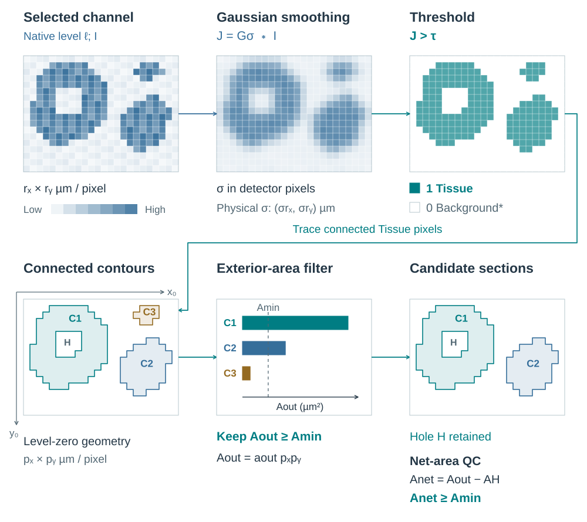</a>

_Schematic of tissue detection. Gaussian smoothing precedes pixel thresholding or tissue classification, and an area filter removes small connected regions. Here, the minimum-area filter removes C3 while preserving hole H; the remaining regions are checked using their net tissue area before review and acceptance._

## Choose a detector

On **Choose detector**, use **Detector source** to select **Pixel threshold — QuPath** when one channel's smoothed intensity can distinguish the tissue from background. This choice opens the threshold editor directly, where you compare the predicted boundary with the staining while adjusting the threshold and smoothing.

Choose **Random forest — annotated examples** (RF) or **Support vector machine — annotated examples** (SVM) to learn the distinction from labelled regions. Continue to **Image detail** to choose the channel, resolution and image features, then annotate representative regions in QuPath. An image feature is a numerical measurement at a pixel, such as its channel intensity or the intensity averaged over nearby pixels. RF and SVM learn how combinations of the selected features distinguish the two classes.

To reuse a detector, select **Saved detector** and choose one from the project, or **Browse detector…** to import a file and name it in this project. On **Image detail**, select the channel and image level that match the saved detector. If a resolution review is needed, it offers the compatible image levels; a single compatible level appears as **Saved detector resolution**. To use a different detection scale or set of image features, create a detector with those inputs.

After selecting the saved detector's inputs, set the minimum area on **Tissue regions**. **Save and next** applies the detector and opens the detected-section review.

## Create and preview the detector

### Set a pixel threshold

Choose the channel whose staining delineates the intended tissue and select its **Image resolution** in the threshold editor.

Each resolution corresponds to a stored image level and shows the physical width and height represented by one pixel. The initial choice is the reduced level closest to **8 µm/pixel**, considering proportional differences on both dimensions. The [starting-level calculation](../images/processing.md#reference-image-metadata-and-coordinates--target-interval-for-tissue-detection) describes this comparison. Finer sampling preserves narrow gaps and small fragments but requires more memory and processing time. 

We smooth the selected channel with a Gaussian filter before comparing its intensities with the threshold. Smoothing combines neighbouring intensities, reducing local variation before the tissue boundary is calculated. The Gaussian's standard deviation, **sigma**, sets the neighbourhood scale. A larger sigma averages over a wider neighbourhood; it can join nearby stained structures while softening narrow gaps and small features.

For intensity image `I` at the detector resolution, Gaussian filter `Gσ` and threshold `t`, we calculate

$$
J=G_{\sigma}*I,\qquad
L(x,y)=\begin{cases}
1 & J(x,y)>t\quad\text{(Tissue)},\\
0 & J(x,y)\le t\quad\text{(Background)}.
\end{cases}
$$

We calculate the smoothed intensity `J = Gσ * I` as a weighted average of nearby pixels. The Gaussian weights sum to one and decrease with distance from the centre at a rate set by sigma. Pixels with smoothed intensity strictly above `t` become Tissue. The remaining pixels become Background. Sigma zero uses the channel values without smoothing. QuPath marks Background as an ignored class, so connected Tissue predictions supply the section outlines.

Enter the threshold in the channel's stored intensity units and sigma in pixels at the detector's resolution. The [initial settings](../../../src/python/mif_pipeline/config/defaults/tissue_detection.json) are threshold **0** and sigma **1 pixel**. Multiplying sigma by the detector's physical pixel size gives the Gaussian's standard deviation in micrometres; sigma 1 at 8 µm/pixel therefore smooths at an 8 µm scale. Reusing both image sampling and sigma preserves that physical scale. While adjusting the preview, compare weak staining, narrow gaps and isolated bright objects to see which tissue remains above the threshold after smoothing.

<a href="../../assets/screenshots/luca-native-tissue-detector.png">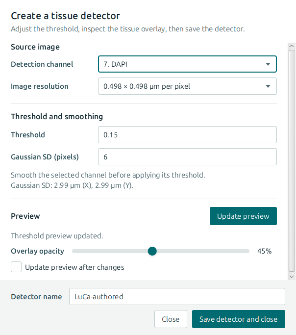</a>

*The threshold editor on the public [LuCa fluorescence field](../../data/luca.md), after updating the preview: DAPI, threshold **0.15**, and Gaussian sigma **6 pixels** at approximately **0.498 µm/pixel**, giving a physical sigma of **2.99 µm**. The detector is named `LuCa-authored`.*

### Train RF or SVM from reference regions

RF and SVM use **Tissue** and **Background** regions drawn in QuPath to learn how to classify the rest of the image. We calculate the selected image features for pixels inside the labelled regions and use those values, together with the region labels, to fit the detector. We then calculate the same features across the image and apply the fitted detector to predict Tissue or Background at each pixel. Connected Tissue pixels form the candidate sections.

#### Prepare the detector inputs

On **Image detail**, choose the channel and [stored image resolution](#physical-detection-scale) used for detection. Under **Image features**, select **Choose features and preview…** to compare filters and their scales with the staining. A new detector starts with channel intensity and Gaussian smoothing at scales of one and three pixels at the initial resolution. We store these scales in µm so that changing the image resolution preserves the physical size of each filter.

The [image-features section in Tissue classification](../tissue-classification/index.md#conventional-features) explains the filters, scale selection and preview controls. Select **Apply image features** to return to detector setup, then **Annotate and fit in QuPath**. The annotation panel shows the chosen channel and resolution as a summary; return to **Image detail** to change those inputs.

<a href="../../assets/screenshots/tissue-rf-image-detail.png">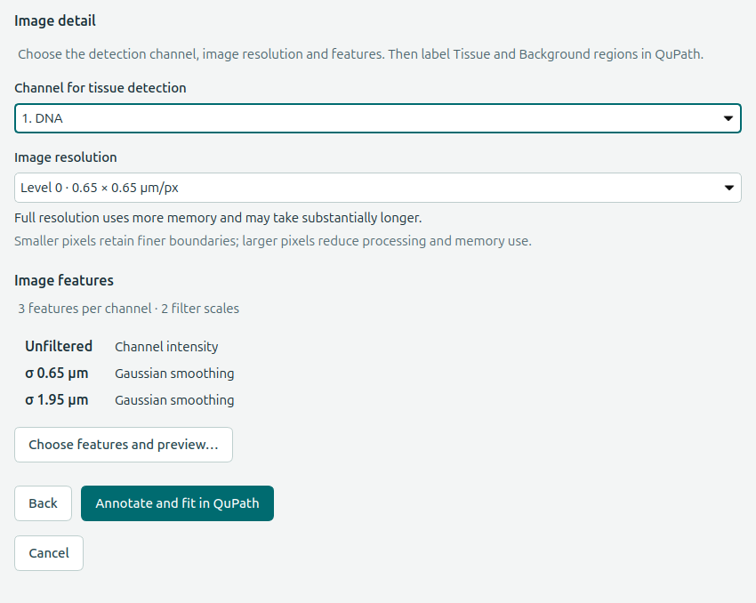</a>

*Detector inputs for a MEL02 field: DNA at 0.65 µm/pixel, with channel intensity and two Gaussian scales. **Choose features and preview…** opens the filter comparison; **Annotate and fit in QuPath** opens the detector panel.*

#### Label Tissue and Background

Draw reference regions that cover the tissue and background appearances the detector should recognize. Include weak and dense tissue in **Tissue**, and empty slide or unwanted bright debris in **Background**. In QuPath’s **Annotations** tab, select **Tissue** or **Background\*** from the class list and choose **Set selected** to label the selected regions. Each class must contribute at least two pixels at the detector resolution before fitting.

#### Fit the detector

Under **Fit and inspect predictions**, choose RF or SVM from **Classifier**. Open **Classifier settings** to adjust its parameters; the [RF](../classifier-methods/index.md#random-forest) and [SVM](../classifier-methods/index.md#support-vector-machine) sections explain their effects and the fitting calculations.

Select **Update preview** to fit the detector and display its Tissue predictions. RF uses all labelled pixels for fitting. For SVM, we select equal numbers of Tissue and Background pixels, with a default limit of **10,000 per class**, then standardize their image features before fitting with an **RBF kernel**. The [training-pixel selection and standardization](../classifier-methods/index.md#tissue-detector-training-rows) section explains these steps.

To limit memory use during feature extraction, the editor caps the total area of the references' enclosing rectangles at **200,000 pixels**, measured at the detector resolution.

<a href="../../assets/screenshots/tissue-rf-fit-preview.png">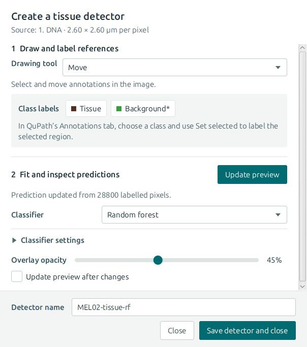</a>

*RF controls after fitting **100 trees** to **28,800 labelled pixels** from MEL02 DNA at **2.60 µm/pixel**.*

### Inspect the preview and save

Compare the Tissue prediction with the staining across weak tissue, dense areas and bright debris. For RF and SVM, include areas beyond the labelled examples, then add or correct references where the predictions are unsuitable. Adjust image brightness and **Overlay opacity** to inspect the boundary. The overlay starts at **45%** opacity and can be adjusted from **0%** to **100%**, blending the cyan prediction with the source image.

<a href="../../assets/results/mel02-tissue-rf-prediction-comparison.png">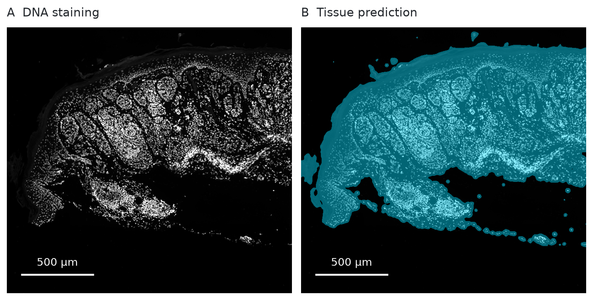</a>

*The same [MEL02-1-1](../../data/public-image-sources.md) field as DNA staining (left) and the saved RF detector's Tissue prediction (right), shown in cyan at **45% opacity**. The **100-tree** detector uses DNA intensity and Gaussian features at **1 and 3 pixels**, sampled at **2.60 µm/pixel**. Both panels use identical coordinates and display limits of **0–26,000** counts. Small detached predictions remain visible before minimum-area filtering. Scale bars: **500 µm**.*

**Update preview after changes** starts enabled and waits 500 ms after a change before updating. For RF and SVM, editing reference annotations or classifier settings starts a new fit. If automatic updates are disabled, select **Update preview** after making changes.

Check that the chosen image resolution matches the detector preview before saving. Replace the initial name, `tissue-detector`, with a descriptive name and select **Save detector and close**. Close QuPath to return to **Tissue regions**. 

## Set the minimum tissue area

On **Tissue regions**, **Smallest tissue region to retain** starts at **10,000 µm²** (0.01 mm²). This filter acts after the detector has assigned pixels to Tissue or Background and connected Tissue pixels have become section contours. QuPath discards a region when the area enclosed by its outer contour is below the minimum. For each retained contour, we also calculate the net tissue area by subtracting holes: enclosed areas that the detector assigned to Background. A region whose holes reduce its net area below the minimum is presented for review.

Contours are stored in the original image's level-zero coordinates. Let `a_outer` be the area inside a contour's outer boundary in pixels² and `a_h` the area of each hole in those coordinates. Multiplying by the original pixel width `pₓ` and height `pᵧ` converts both area calculations to µm²:

$$
A_{\mathrm{outer}}=a_{\mathrm{outer}}p_xp_y,\qquad
A_{\mathrm{net}}=\left(a_{\mathrm{outer}}-\sum_h a_h\right)p_xp_y.
$$

The first calculation determines whether QuPath retains the connected region; the second supplies its tissue area for section review and later area-based calculations. A retained outer contour enclosing 12,000 µm² with 3,000 µm² of holes therefore has a net tissue area of 9,000 µm² and requires review against the initial minimum. Holes of every size are preserved because the minimum-hole-area setting is zero.

Choose the minimum from the smallest fragment included by the study's sampling rule. Raising it removes more small regions; lowering it retains more fragments and possible background predictions. Inspect the resulting sections before accepting the area used for subsequent analysis.

<a href="../../assets/screenshots/tissue-minimum-area-current.png">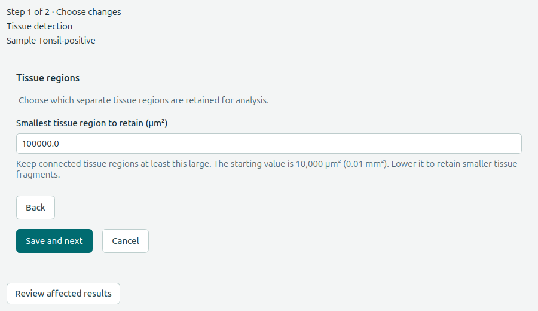</a>

*The saved [Marlin tonsil field](../../data/public-image-sources.md) settings retain connected tissue regions of at least 100,000 µm² (0.1 mm²). This reviewed example uses a larger minimum than the initial 10,000 µm² setting.*

## Review and accept tissue sections

The detected-section review links a table of candidate sections to their outlines over the source image. Use it to check which parts of the stained tissue will contribute to analysis. **Area (mm²)** measures tissue area with holes subtracted; width and height describe the enclosing rectangle. Sort by area to locate small fragments, or use Ctrl or Shift to select several rows and inspect their combined area. The selected section's percentage of total detected tissue is its area divided by the summed detected-section area, multiplied by 100.

Select a table row to focus its contour and staining in the image below, then toggle **Show outlines** to compare the boundary with the staining. The smaller **Location in image** view retains the whole slide and marks the field displayed in the larger view. After panning, double-click the row to return to that section; selecting a contour in either view locates its table row.

Use the whole-image view to check whether the detector covers the intended tissue. Zoom in at weakly stained margins, isolated fragments, debris and the image edge. If holes bring a candidate below the minimum net area, compare its outline with the staining before retaining it or editing its boundary. Changed outlines are marked in the **Edited** column.

If continuous tissue has been split into disconnected sections, inspect the smoothing scale and cutoff for a threshold detector. For RF or SVM, compare the Tissue predictions with the labelled reference regions.

Use **Exclude selected sections** to omit debris or unwanted sections from subsequent analysis. **Use in analysis** records each section's current choice, and the summary updates the included count and area. **Restore selected sections** reverses an exclusion before accepting the review. The outline and data exports below include these review choices.

<a href="../../assets/screenshots/mel02-tissue-image-review.png">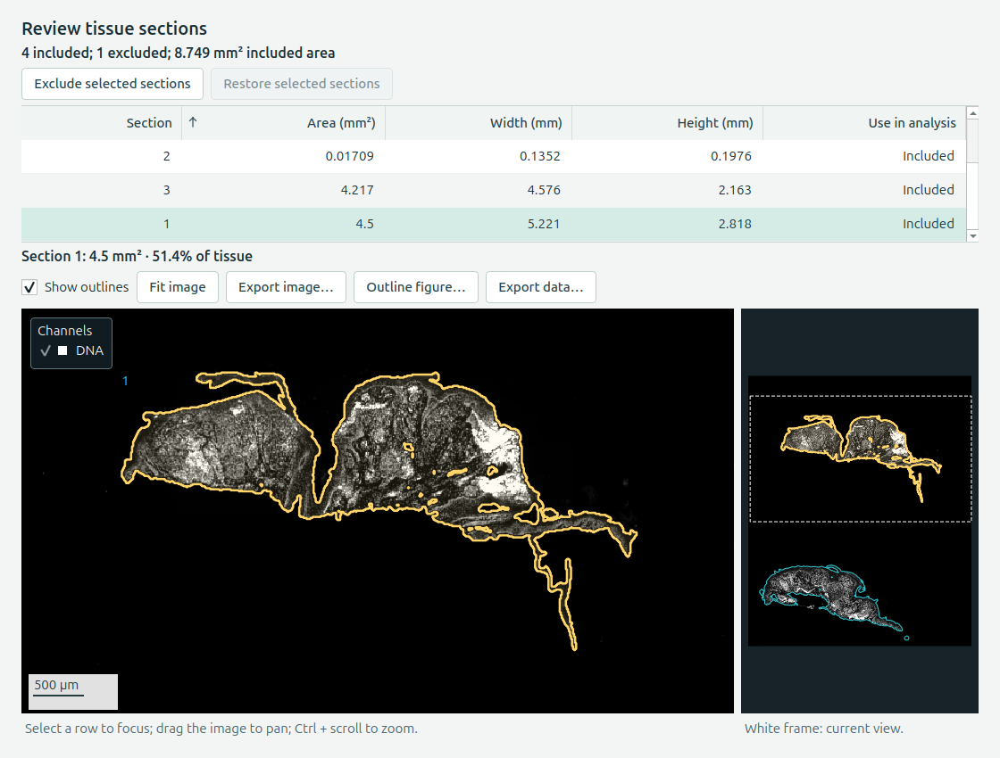</a>

*The [MEL02-1-1](../../data/public-image-sources.md) detection preview contains five regions after applying a 10,000 µm² minimum area. The table is sorted by area, with the smallest fragment excluded in this review. Selecting section 1 displays its 4.50 mm² contour in amber over the DNA image; the whole-image view locates it above the second large section. The white frame follows the displayed area. Scale bar: 500 µm.*

After reviewing the sections, choose the appropriate action:

- **Accept sections** saves the included outlines and continues available work. Excluded sections are omitted from the tissue regions passed to later stages.

- **Edit outlines in QuPath** opens the staining and boundaries for editing. Save and close QuPath, then choose **Load saved edits** to refresh the outlines and measured areas. Inspect the refreshed map before accepting the sections.
    
- **Run detection again** creates new candidate outlines using the saved detector settings. To change those settings, select **Back: tissue settings** and return to the detector, image-detail or minimum-area page. Saving a changed detector, resolution or minimum area opens **Review affected results**, which shows the stages and samples that would be recalculated. Select **Apply change** to create the revised result, or **Back to choices** to keep editing. For an accepted or stopped stage, use [Change a completed or stopped step](../run/index.md#change-a-completed-decision).

### Example walkthrough

The sequence below follows the same whole-slide field through smoothing, thresholding and minimum-area filtering. Compare successive images to identify the cause of each boundary change: smoothing can join nearby stained regions, thresholding can omit weak staining, and the area filter can remove disconnected fragments. 

<a href="../../assets/results/mel02-tissue-wsi-sequence.png">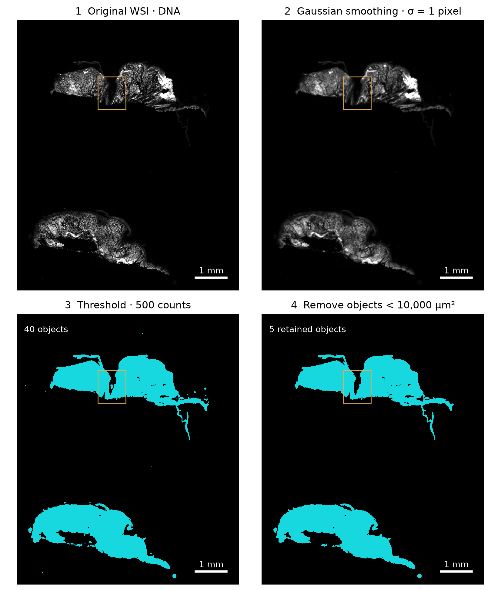</a>

_Tissue detection on the DNA channel of [HTAN MEL02-1-1](../../data/public-image-sources.md). QuPath reads the whole slide at 16× downsample, approximately 10.4 µm per detector pixel. Gaussian sigma is 1 detector pixel and the intensity threshold is 500 counts. Cyan marks detected tissue; removing disconnected objects smaller than 10,000 µm² reduces 40 candidates to five retained regions. Internal holes are preserved. Amber boxes locate the detail below. Scale bars: 1 mm._

<a href="../../assets/results/mel02-tissue-sequence-detail.png">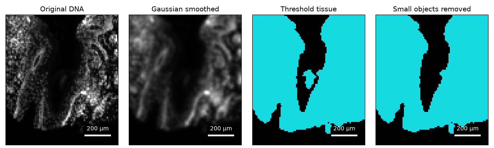</a>

_The same gap between tissue regions through all four steps. Thresholding detects a small isolated island, which is removed because its area falls below 10,000 µm². The neighbouring tissue remains. Scale bars: 200 µm._

## Select the analysis regions

An **analysis region** is an area of tissue selected for classification and cell segmentation. At **Analysis regions**, choose **Use whole sections** to make each accepted tissue section an analysis region, or **Choose drawn regions** to select smaller areas within those boundaries.

<a href="../../assets/screenshots/analysis-region-choice-current.png">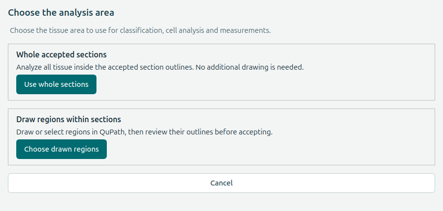</a>

If only part of a section is relevant, select **Choose drawn regions → Edit analysis regions in QuPath**. Draw and name the areas you want to carry forward within the accepted tissue. You can leave other sections without a region. In the image or annotation list, select the outlines that should enter analysis and choose **Save selected regions**. Close QuPath and select **Review saved regions** to inspect that selection.

<table><tr>
<td valign="top"><a href="../../assets/screenshots/analysis-region-selection-controls.png">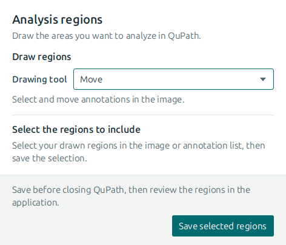</a></td>
<td valign="top"><a href="../../assets/screenshots/mel02-analysis-region-field.png">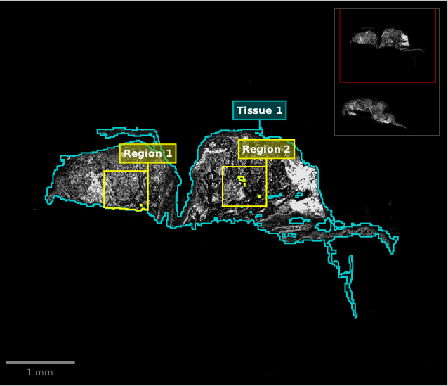</a></td>
</tr></table>

*The analysis-region editor (left) and two selected regions within the upper tissue section of [MEL02-1-1](../../data/public-image-sources.md) (right). Cyan outlines mark tissue and yellow outlines mark the selected regions, which follow the tissue boundary and exclude its holes. Scale bar: 1 mm.*

A tissue section can contain several analysis regions, but their areas must not overlap. Segmentation works within their combined area, with any further restriction to selected tissue compartments, and assigns each cell to one region using the cell's centroid. Overlapping regions would make that assignment ambiguous and could count the same cell in more than one region. We check for overlapping areas before accepting the selection. If areas overlap, we identify the annotation pairs and their intersection areas in µm². Edit or deselect those annotations in QuPath, save the selection again, and return to its review.

Choose **Accept analysis regions** to continue with the reviewed boundaries, or **Change analysis regions** to return to editing in QuPath.

## Inspect the saved results

The saved detector contains its name, file, selected image features and classifier or threshold settings. The tissue result records the reference channel, physical sampling, minimum retained area and reviewed section outlines. Later measurements remain associated with the reviewed outline used to calculate them.

The analysis-region result retains each accepted boundary and its containing tissue section. Those boundaries determine the physical areas used for density calculations and the cells assigned to each reported region. A valid region containing no cells still has its measured area and a count of zero.

During review, **Export image…** saves the displayed field with its current channel colours, display limits and outline visibility. **Outline figure…** opens a calibrated contour figure with an optional publication palette; **Export figure…** saves it as PNG, PDF or SVG. If sections have been excluded, choose **Included sections only** or **Included and excluded sections** for the image and outline figures. **Export data…** saves every section's identifiers, area, dimensions and inclusion choice as CSV.

<a href="../../assets/results/mel02-native-selected-outlines.pdf">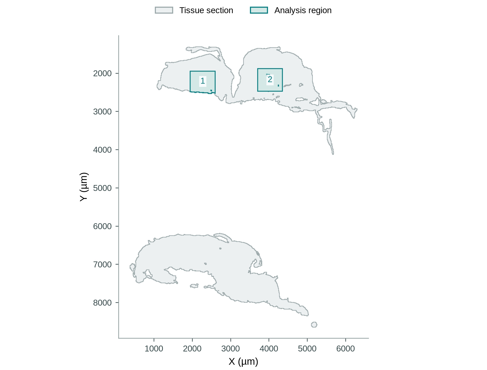</a>

*The [MEL02-1-1](../../data/public-image-sources.md) regions saved in QuPath, plotted at their image coordinates. Grey outlines show the five detected tissue sections; teal outlines show two selected subregions, measuring **0.364 mm²** and **0.375 mm²**. Internal holes are preserved in the contours and excluded from the reported areas.*

After acceptance, open **Results & export** and select the sample’s **Tissue outlines** figure to inspect the retained sections. For an accepted analysis-region result, choose **Analysis-region outlines** to show its boundaries within the containing tissue. **Export figure…** saves the selected outline map; **Export data…** saves the matching region identifiers, labels, areas and dimensions. The [Results guide](../results/index.md#open-and-export-figures) explains the preview and export controls.

## Related calculations

- [Image metadata and coordinates](../images/processing.md#reference-image-metadata-and-coordinates): reading physical pixel sizes and converting image positions and areas into micrometres and square micrometres.
- [QuPath integration](../run/qupath-review.md#reference-qupath-integration): opening images, calculating predictions and returning annotations to the application.
- [Cell segmentation](../cells/index.md#choose-the-area-to-segment): limiting segmentation to the selected regions and assigning each cell to a region.

---

**Next:** [Paired-image alignment](../alignment/index.md) when a paired image is included; otherwise continue to [Tissue classification](../tissue-classification/index.md).
