# Spectral unmixing and component preparation

[Analysis stages](../../../README.md#analysis-stages) · [Regional calculation and writing](../images/processing.md)

**Open:** **Run → Spectral unmixing → Open review**.

**On this page:** [Image state](#image-state) · [Solver methods](#solver-methods) · [Correct intensities for imaging settings](#correct-intensities-for-acquisition-settings) · [Processing settings](#numerical-and-output-settings) · [Spectral references](#spectral-reference-sources) · [Create a library from images](#creating-a-library-from-images) · [Reference review](#review-the-reference-spectra) · [Run unmixing](#run-unmixing) · [Review the unmixed image](#inspect-the-prepared-channels) · [Saved results and revisions](#saved-result-and-revisions) · [Implementation details](#solver-implementation)

Unmixing separates overlapping fluorescence signals into one image channel per component. We first check how the intensities were recorded and correct for exposure time and other imaging settings where needed. We then fit the spectrum at every pixel to the reference spectra to estimate each component's contribution. The resulting component channels are used for tissue and cell measurements. Images whose channels are ready for analysis are copied with their intensities preserved.

## Image state

On **Confirm image status**, choose whether the fluorophore signals need separation. We display the image metadata and the **Channel content** choice saved in **Channels & markers** to support this decision. Raw measurement bands may contain mixed signals or isolate individual fluorophores; the metadata alone does not establish that isolation. Check how the channels were recorded and whether the supplied processing information reports spectral unmixing.

Select **Yes — separate the fluorophore signals (mixed image)** when the recorded bands contain overlapping fluorescence signals. Continue to **Choose the unmixing method** to select how their contributions will be fitted and complete any missing imaging settings. After saving these settings, select and review the reference spectra before starting the unmixing.

Select **No — fluorophore signals are already separated (previously unmixed)** when the scanner or another program has already unmixed the image.

Select **No — fluorophore signals are already separated (isolated by measurement bands)** when the emission filters isolate the intended fluorophore signal in each measurement band, making spectral unmixing unnecessary. Complete the **Match measurement bands to components** table shown below by assigning each acquired band to its fluorophore and associated marker from **Channels & markers**, using every band and listed component exactly once. When a measurement band's OME `Channel Fluor` field names a fluorophore, we use that name to propose its assignment. Review the proposed assignments and manually complete bands without a unique match.

Both **No** options copy the selected image to OME-Zarr with the pixel values, channel order and pixel size supplied by that source, recording the component and marker identities reviewed in **Channels & markers**. For separately registered cycle files, registration first samples the original images with linear interpolation onto the [common image area](../cyclic-if-methods/index.md#retain-the-common-image-area), and we copy the resulting aligned values. When preparation finishes, continue to [Tissue detection](../tissue/index.md).

<a href="../../assets/screenshots/unmixing-image-state-current.png">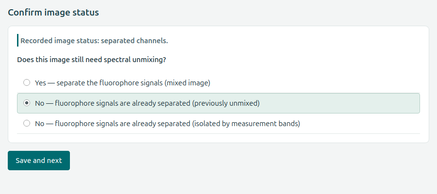</a>

_The [LuCa component image](../../data/luca.md) is already unmixed. Its recorded image status selects the corresponding **No** option._

## Solver methods

On **Choose the unmixing method**, select **Non-negative least squares (NNLS)**, the default, or **Clipped least squares**. Both methods use reference spectra to estimate how much of each fluorescence component contributes to the measured signal at every pixel. 

### How the reference spectra separate a pixel's signal

A spectral measurement band records overlapping contributions from the fluorophores and autofluorescence. The reference spectrum for each component describes how its signal is distributed across those bands. We place these spectra in a matrix `S`, with one row per measurement band and one column per component. For `B` bands and `C` components, `S` has shape `B × C`.

The image provides one measured spectrum per pixel. After the selected intensity correction, we arrange these spectra as columns of `Y`. For a block containing `P` pixels, `Y` has shape `B × P`. We calculate a `C × P` matrix `A`, with one coefficient for each component at each pixel. Multiplying each reference spectrum by its coefficient and adding the contributions gives the reconstructed spectrum

$$
\widehat Y_{bp}=\sum_{j=1}^{C}S_{bj}A_{jp},\qquad \widehat Y=SA.
$$

Both methods use a least-squares model. Ordinary least squares minimizes the sum of squared differences between reconstructed and measured band intensities, with equal weight for every corrected band. Its unconstrained solution can contain negative coefficients. **Clipped LS** replaces each negative coefficient with zero and leaves the other coefficients unchanged. **NNLS** fits the coefficients under the nonnegative constraint, allowing the other contributions to change as well. The figure follows the same pixel through these two calculations.

<a href="../../assets/figures/spectral-unmixing-mechanism.svg">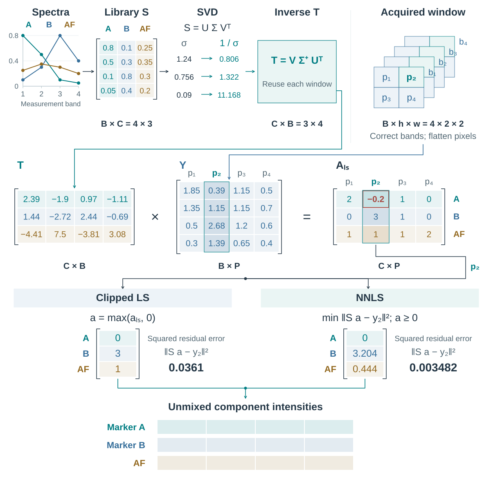</a>

_Schematic of reference inversion, clipped LS and NNLS for four measurement bands, three components and a 2 × 2 image window. For the highlighted top-right pixel, the corrected spectrum `(0.39, 1.15, 2.68, 1.39)` gives ordinary least-squares coefficients `(-0.2, 3, 1)` for marker A, marker B and AF. Clipping gives `(0, 3, 1)`. NNLS instead finds approximately `(0, 3.204, 0.444)`, adjusting the nonnegative contributions and reducing the squared residual error across the four bands from `0.0361` to approximately `0.00348222`. The other pixels already have nonnegative least-squares coefficients, so their solutions remain unchanged._

For cyclic images, we fit NNLS or clipped least squares separately within each cycle. See [Cyclic fluorescence images](../cyclic-if-methods/index.md#fit-each-cycle-and-prepare-marker-channels).

### Nonnegative least squares

For one corrected pixel spectrum `y`, NNLS finds a coefficient vector `a` satisfying

$$
\hat a=\underset{a\ge0}{\operatorname{argmin}}\frac12\lVert Sa-y\rVert_2^2.
$$

Here, `Sa−y` contains the reconstruction error in each measurement band. Requiring `a ≥ 0` restricts every component contribution to zero or a positive value. When the reference matrix has full column rank, this objective has a unique exact minimum. The solver approaches that minimum until it meets the selected stopping tolerance.

Set the stopping tolerance and iteration limit under [NNLS convergence](#nnls-convergence). The [stopping-condition derivation](#nnls-convergence-calculation) explains how we check whether the coefficients have reached the required accuracy.

### Clipped least squares

Ordinary least squares finds the best reconstruction without restricting the sign of the component coefficients. We calculate its solution using the pseudoinverse `S⁺`. Singular-value decomposition expresses `S` as three matrix factors. We replace the retained singular values by their reciprocals to calculate the inverse transform

$$
S=U\Sigma V^T,\qquad T=S^+=V\Sigma^+U^T,\qquad A_{\mathrm{LS}}=TY.
$$

We prepare `T` once for the reference matrix and reuse it for every block of image spectra. Clipped LS then replaces each negative coefficient with zero

$$
A_{\mathrm{clip},jp}=\max(0,A_{\mathrm{LS},jp}).
$$

The method performs no further fit after clipping. Consequently, the retained positive coefficients can give a larger reconstruction error than NNLS when the original solution contains negative contributions. Both methods convert their fitted coefficients to [component intensities](#normalization-and-reported-intensity) using the same reference-dependent calculation.

## Read imaging settings and correct intensities

### Read imaging settings

Exposure time, detector gain, binning and detector offset affect the measured intensity. Before unmixing, we account for these settings in both the image measurements and the reference spectra using the correction described below. We read the required values from standard OME fields first, then supported vendor fields in OME `OriginalMetadata` when a required value is missing.

<a href="../../assets/figures/acquisition-calibration.svg">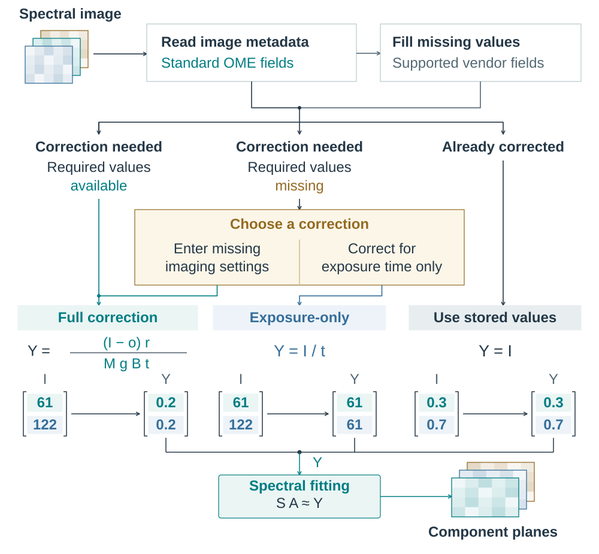</a>

_Schematic of intensity correction before spectral fitting. For the two-band example, measured counts `I = (61, 122)`, offsets `o = (10, 20)` and exposure times `t = (1, 2)` seconds give `Y = (0.2, 0.2)` with full correction (`M = 255`; `g = B = r = 1`), or `(61, 61)` counts per second with exposure-only correction. The right branch shows a separate image whose recorded corrections already include exposure normalization, so we use its stored values directly._

### Correct intensities for imaging settings

For images requiring full intensity correction, we subtract the detector offset and divide by the digital range, gain, binning area and exposure time. For measurement band `b` and pixel `p`,

$$
Y_{bp}=\frac{Y_{\mathrm{raw},bp}-o_b}{M_b g_b B_b t_b}\,r_b.
$$

| Value | Meaning | Role in the calculation |
|---|---|---|
| Detector offset `o_b` | Additive baseline, in stored-image counts | Removes the baseline from each pixel before scaling. If metadata records prior offset subtraction, this term is zero. |
| Digital maximum `M_b` | Maximum of the recorded signal range | Expresses the intensity relative to that digital range. |
| Detector gain `g_b` | Gain recorded for that band | Divides out the detector's recorded amplification. |
| Binning area `B_b` | Number of detector pixels combined into one stored pixel | Divides by the combined pixel count; for 2 × 2 binning, `B_b = 4`. |
| Exposure time `t_b` | Exposure duration in seconds | Expresses the signal per second of exposure. |
| Response multiplier `r_b` | Per-band multiplier accepted with the reference | Applies the same band-response correction used to prepare the reference spectra. |

The digital maximum depends on the number of meaningful signal bits. For an unsigned signal with `n` meaningful bits, `M = 2^n − 1`. A 12-bit signal therefore has a maximum of 4,095, including when it is saved in a 16-bit image.

For images stored as unsigned integers, we read the meaningful bit count from the source image's OME `SignificantBits`. If this field is absent, we use the actual stored bit depth recorded by the TIFF `BitsPerSample` tag or supplied as verified storage information by the source reader. We save the selected range and its source with the unmixing result.

### Complete missing imaging settings

If required values are missing from the image metadata, **Intensity correction** on the **Choose the unmixing method** page offers two choices.

- **Enter missing imaging settings.** Complete the displayed fields using your imaging or calibration records. We then apply the full correction above.
- **Correct for exposure time only.** Reference images and batch slides must have identical gain, binning and illumination settings, and the same detector settings, including detector offset. Enter any missing exposure times. For this route,

$$
Y_{bp}=\frac{Y_{\mathrm{raw},bp}}{t_b}.
$$

Exposure-only correction leaves the other intensity corrections, including any remaining detector offset, unapplied. Reference spectra must be prepared with the same exposure-only calculation. If a library was prepared using full correction, rebuild it from the reference images with exposure-only correction or provide a library already prepared that way. Having complete imaging settings for a reference image does not change the correction selected for the batch.

### Use recorded calibrated intensities

When metadata records previous calibration that includes exposure normalization, we use the stored intensities directly, so `Y = Y_stored`. Reference spectra and batch images must use the same imaging settings and correction procedure, including identical exposure times for each channel. We check the recorded corrections separately for each reference image.

The [image-metadata guide](../images/processing.md#complete-acquisition-information) identifies the OME fields and explains manual entry.

### Reference normalization and saved component intensities

We save each component's total fitted intensity across the measurement bands. At pixel `p`, multiplying the fitted coefficient `A_{jp}` by the reference spectrum `S_{bj}` gives component `j`'s contribution to each band `b`. We sum those contributions to obtain its saved intensity

$$
X_{jp}=\sum_b\left(S_{bj}\hat A_{jp}\right)
       =\hat A_{jp}\sum_b S_{bj}.
$$

Changing a reference's normalization changes the fitted coefficient needed to reproduce the same band intensities. Multiplying by the reference's sum converts that coefficient to the same total-intensity scale for either normalization.

- With **L1 normalization**, the reference values sum to one, so the fitted coefficient already equals the total intensity. References [created from images](library-from-images.md#combine-the-reviewed-regional-spectra) use this normalization.
- With **L2 normalization**, the squared reference values sum to one, so we multiply the fitted coefficient by the sum of the reference values. For example, a reference `(0.6, 0.8)` fitted with coefficient `10` contributes `(6, 8)` across two bands, giving a saved intensity of `14`. The same reference shape with L1 normalization is `(3/7, 4/7)` and has a fitted coefficient of `14`, producing the same band contributions.

Both NNLS and clipped LS use this conversion after fitting. If the library specifies an additional abundance-rescaling factor `c_j`, we also multiply the total by that factor; its default is `1`.

## Processing and output settings

Expand **Advanced settings** below the unmixing method. 

<a href="../../assets/screenshots/unmixing-settings-current.png">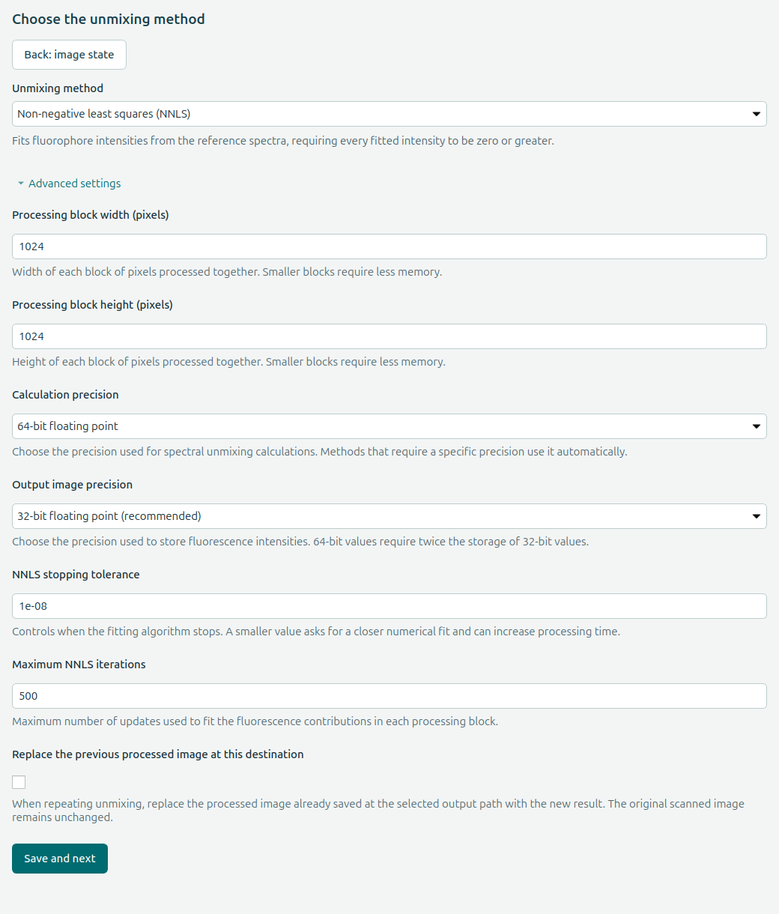</a>

_The CPU NNLS settings select 64-bit fitting, 32-bit output, stopping tolerance `1e-8` and a maximum of 500 iterations. The requested processing blocks are 1024 × 1024 pixels; source-read and memory limits determine the smaller regions actually fitted._

### Memory use and image precision

**Processing block width (pixels)** and **Processing block height (pixels)** start at **1024 × 1024** and set the requested upper limit for the image area fitted together. Actual blocks are capped at **512 × 512 pixels** and reduced further when needed to fit memory. Within that limit, larger blocks reduce the number of reads and solver calls but require more memory for the measurements, coefficients and intermediate calculations. [Image preparation](../images/processing.md#select-the-number-of-simultaneous-regions) explains how these blocks are combined and written to OME-Zarr.

**Calculation precision** selects 64-bit or 32-bit floating-point arithmetic for unmixing and starts at **64-bit** (or **32-bit for Apple Metal**). **Output image precision** selects the values saved in OME-Zarr and starts at **32-bit** (since 64-bit output requires twice the uncompressed storage). Calculating in 64-bit and saving in 32-bit performs the fit in 64-bit arithmetic, then rounds its output to 32-bit values.

### NNLS accuracy and iteration limit

**NNLS stopping tolerance** starts at **`1e-8`** and determines how closely each pixel's fitted coefficients must satisfy the NNLS optimality conditions before iteration stops. These conditions require the gradient of the least-squares loss to be zero for every positive coefficient and nonnegative for every coefficient equal to zero. We scale the permitted gradient error for each pixel using the [stopping-condition calculation](#nnls-convergence-calculation). A smaller tolerance requires the coefficients to satisfy these conditions more closely and can increase processing time.

**Maximum NNLS iterations** starts at **500**. On the float64 CPU route, this limit is shared between grouped fitting rounds and passes that update individual coefficients. A grouped round fits pixels with the same proposed positive components together; an update pass adjusts every component coefficient for pixels that have not yet converged. Each round or complete pass counts once toward the limit. The [float64 CPU calculation](#v-float64-cpu-solution-sequence) explains their order and the final checks; the [float32 and GPU calculations](#precision-and-processor-specific-calculations) describe the corresponding processor-specific procedures.

A stopping tolerance below `1e-5` requires 64-bit calculation. With Apple Metal selected, that tighter tolerance uses CPU processing because Metal does not support 64-bit calculations.

## Spectral reference sources

On **Choose spectral references**, select an existing library, enter measured spectra, or create a library from single-stained reference images.

- Select **Import or enter a spectral library** to use a `.miflib.zip` package, supported library JSON or CSV file, or enter reference values in the application. Packages and library JSON retain their recorded normalization and imaging settings. For CSV or manually entered values, supply these details in the form.
- Select **PhenoImager MOTiF library** to use the built-in spectra for images recorded with compatible optical and detector settings. Check the component names and their association with the measured bands. Selecting **Use the PhenoImager MOTiF library** opens the spectral review.
- Select **Create a library from reference images** to provide the single-stain images and corresponding controls. Select the regions used to estimate each spectrum, as described in [Creating a library from images](library-from-images.md).

<a href="../../assets/screenshots/unmixing-spectral-source-choices-current.png">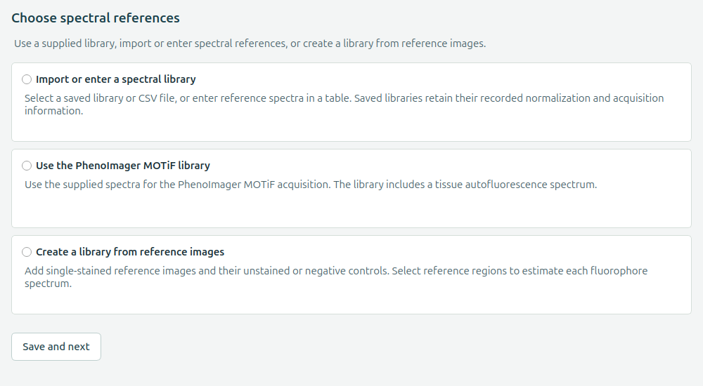</a>

*The spectral-reference page offers library import or entry, the built-in PhenoImager MOTiF library, and library creation from single-stained images.*

For cyclic images, we reuse each fluorophore's reference spectrum across cycles acquired with the same measurement bands and optical settings. See [Cyclic fluorescence images](../cyclic-if-methods/index.md#reuse-fluorophore-reference-spectra).

## Import or enter a spectral library

Selecting **Import or enter a spectral library** opens two choices. **Import library file…** opens a `.miflib.zip` package, library JSON or CSV file and fills the reference table with its values. **Enter spectra** opens the same table for typing or pasting values.

For CSV file imports, the first header cell must be exactly `measurement`, followed by the component names. Each subsequent row starts with a band name and contains that band’s value for each component. We match these names to the image bands and component assignments, then arrange the imported values in the corresponding order.

<a href="../../assets/screenshots/unmixing-library-method-current.png">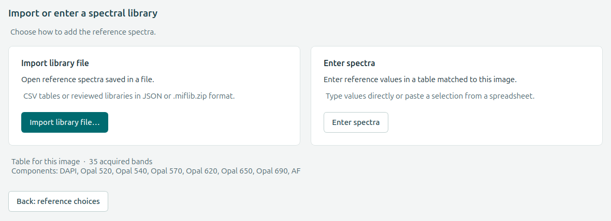</a>

_The two choices open the same reference-table page. File import fills the table automatically; manual entry begins with the acquired-band and component names already in place._

### Enter and review reference spectra

The table lists acquired bands in its first column and the reference values for each component in the remaining columns, using the names assigned in **Channels & markers** as headings. When autofluorescence is required, it appears as the last component in the displayed table; images with recorded prior AF subtraction use only the fluorophore columns. Together, these columns form the reference matrix `S` described under [the spectral model](#organize-the-measured-and-reference-spectra). 

For a CSV import or manually entered table, select the L1 or L2 normalization used under **Normalization of supplied spectra**, then select **Corrections already applied**. Choose **Raw intensities** if L1 or L2 normalization was applied to measurements that had not been corrected for the imaging settings. If the measurements were corrected before normalization, select the correction that was applied. Packages and library JSON supply these settings automatically. **Save and next** submits the library for spectral review.

<a href="../../assets/screenshots/unmixing-library-entry-current.png">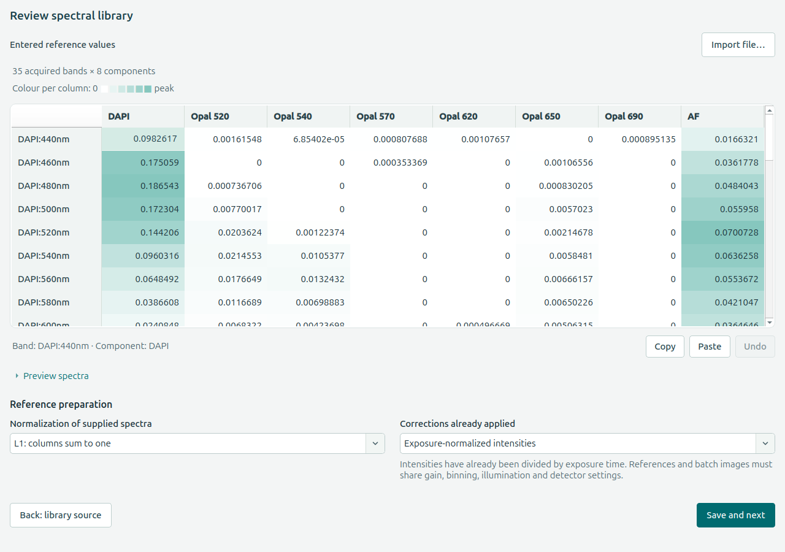</a>

_The FL6 reference values displayed in the shared table. Its 35 acquired bands form the rows; DAPI, six Opal fluorophores and AF form the columns. **Reference preparation** records L1 normalization and exposure-normalized intensities. Displayed numbers are shortened for readability; editing and unmixing retain their full precision. **Preview spectra** expands the curve comparison._

Use **Import file…** to choose another library, or **Back: library source** to return to the entry choices. Returning to the table preserves its values and preparation settings.

Correct supplied spectra prepared from raw intensities

When **Raw intensities** is selected, the reference spectra must have been measured using the same imaging settings as the images in the processing group. We apply the image's [multiplicative correction](#acquisition-correction) to each reference band, then restore the reference's declared normalization. The original normalization factor cancels, giving the same spectral shape as applying those multiplicative corrections to the measurements before normalization.

Detector-offset subtraction requires the original intensity values and must precede normalization, so it cannot be applied to these normalized spectra. For the other selected correction options, we use the supplied reference spectra directly; see [correction routes](#acquisition-correction).

## Creating a library from images

Each single-stain image supplies one fluorophore reference. We subtract image background and tissue autofluorescence from the selected stained regions, then combine their spectra into one column of the library. The unstained controls also supply the AF references used when fitting the mixed image. [Create a library from images](library-from-images.md)

<a href="../../assets/figures/reference-spectrum-preparation.svg">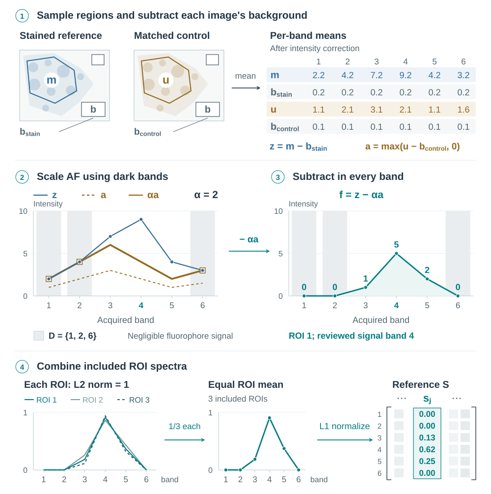</a>

*Three stained regions contribute equally to the fluorophore reference. The numbers on the right give its relative intensity in each of the six bands.*

## Review the reference spectra

Reference review calculates the condition number, pairwise cosine similarities and matrix rank from the selected reference spectra. Together, these checks assess whether the library can distinguish all components and how sensitive the estimated intensities are to errors in the spectra.

### Condition number

The **condition number** is the ratio of the reference matrix's largest to smallest singular value (`σ_max / σ_min`). The [pseudoinverse calculation](#ordinary-and-clipped-least-squares) divides by these singular values. Small singular values can therefore amplify small errors in the measured signal or reference spectra, producing large changes in the estimated component intensities. A high condition number identifies this sensitivity even when no single pair of spectra appears nearly identical. A condition number of **30 or higher** requires review; **100 or higher** prevents unmixing.

### Cosine similarity

**Cosine similarity** compares two components' spectra across the acquired bands. For reference columns `s_i` and `s_j`, we calculate

$$
\operatorname{cosine}(s_i,s_j)=\frac{\sum_b s_{bi}s_{bj}}{\lVert s_i\rVert_2\lVert s_j\rVert_2}.
$$

We multiply the two reference intensities in each band and sum the products across bands. Dividing by both spectrum lengths gives the same similarity even if one reference is multiplied by a positive constant. A value near 1 means the components have nearly proportional band intensities, making their individual contributions difficult to distinguish. We display the highest similarity across all component pairs. A cosine similarity of **0.99 or higher** flags the pair for review; **0.999 or higher** prevents unmixing.

### Matrix rank

The **matrix rank** counts the linearly independent reference spectra. It must equal the number of components, so the library must also contain at least as many acquired bands as components. If one reference can be reproduced by a combination of the others, different component contributions can reconstruct the same measured spectrum. The library cannot uniquely separate all components, and unmixing cannot proceed.

### Inspect the spectra

Inspect any flagged spectra and confirm that the library matches the markers and imaging settings.

Start with the matrix rank and condition number above the reference curves to see how well the library can distinguish the components together. If the highest cosine similarity is elevated, expand **Pairwise cosine similarities** to identify the two components concerned. Click a legend label to hide or show its curve and use **Pan**, **Zoom** or **Reset view** to compare their shapes across bands.

For this comparison, we display each band as a fraction of that component’s spectral total. This is the L1 scale used by image-derived references. An imported library uses its declared L1 or L2 normalization for the actual fit.

Choose **Export figure…** to save the visible curves as SVG, PDF or a 300 dpi PNG. The figure retains the current zoom limits, component colours, legend and axis labels. When wavelengths are recorded, the horizontal axis shows detection wavelength. Measurements from different optical settings form separate line segments, with their wavelength ranges labelled beneath the plot. Images without recorded wavelengths use acquired-band numbers.

<a href="../../assets/screenshots/motif-library-review.png">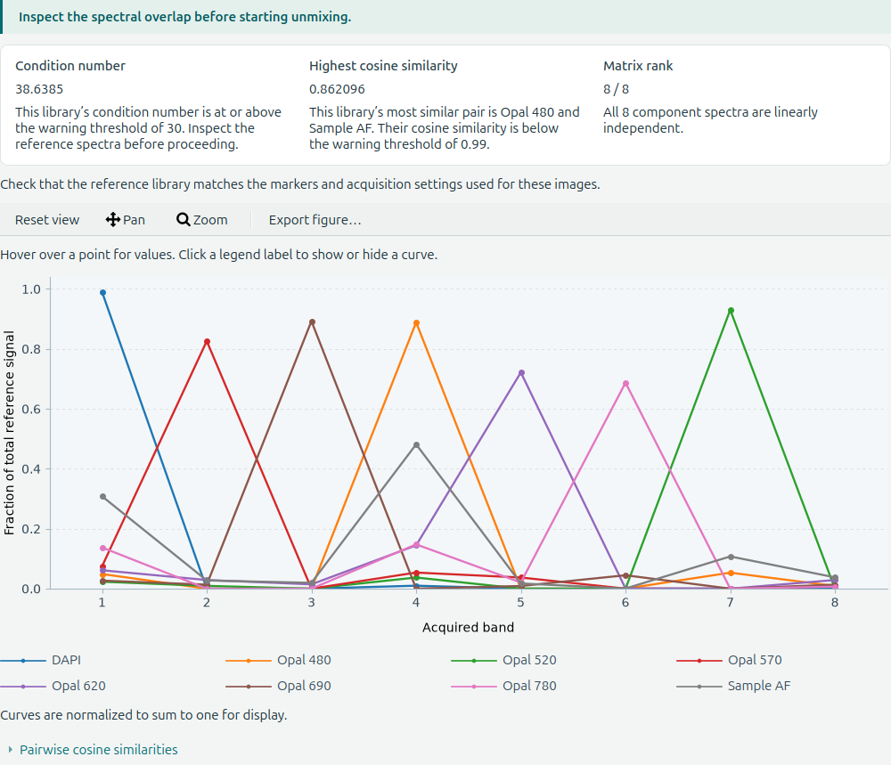</a>

_The packaged PhenoImager MOTiF library in the reference-review panel. Its condition number exceeds the warning threshold of 30 even though every pairwise cosine similarity is below 0.99. Inspecting the complete matrix therefore identifies sensitivity that a pairwise check alone would not flag._

When **Back: spectral references** is offered in the final review, it returns to the reference-source choice before unmixing. If a spectral review was stopped, use **Edit spectral references…** to reopen it and revise the saved choices.

## Run unmixing

Select **Start unmixing** to accept the reviewed spectra and begin calculating the component image. We read the image in regions, apply the selected intensity correction, fit each pixel spectrum and write its component intensities to OME-Zarr. Follow processing progress on **Workflow**.

To leave before starting, select **Workflow**. Accepted decisions remain saved, and reopening **Spectral unmixing → Open review** returns to the saved checkpoint. Unsubmitted form entries remain available during the current desktop session. Use **Back: image state** from the method page or **Back: spectral references** from the final reference review to revise those choices.

## Review the unmixed image

After unmixing, inspect individual component channels in strongly stained, weakly stained and overlapping structures. Compare their staining patterns with the corresponding single-stain controls and the markers' expected locations. Shared staining across components may reflect biological co-expression or incomplete signal separation; the controls and reference spectra help distinguish these explanations. When an AF component was fitted, use the unstained control to assess whether the fitted AF follows its tissue pattern and whether similar signal remains in the marker channels. The [image-viewing controls](../run/interactive-viewing.md#choose-grayscale-or-channel-colours) provide channel selection and display adjustments when needed.

### Select a field for comparison

In **Results & export**, select **Spectral unmixing**, the processed image and **Acquired bands and components**, **Reconstruction images** or **Reconstruction mean spectra**. All three figures use the same field selection.

Use **Choose region in QuPath…** to open the image with any saved channel selection, colours and brightness limits. Move or resize the export rectangle and choose **Selected annotation bounds**; alternatively, choose **Current view** to use the visible field. **Use field and return** fills **Left (X)**, **Top (Y)**, **Width** and **Height** in source-image pixels. The field must fit inside the image and contain no more than **512 × 512 pixels**. Select **Open figure** to display it.

<a href="../../assets/screenshots/export-field-selection-current.png">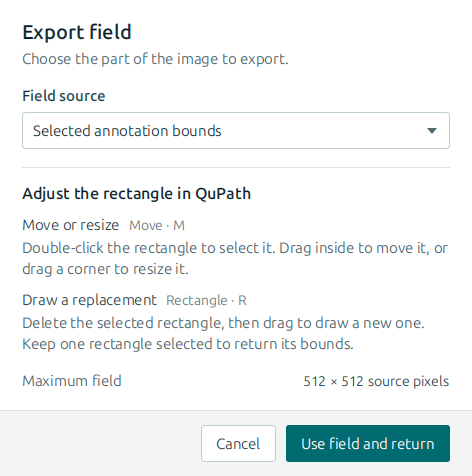</a>

*Choose the field source, adjust the rectangle in QuPath and use **Use field and return** to apply the selection.*

### Compare acquired bands and components

For **Acquired bands and components**, choose one to three acquired bands and one to three unmixed components to display in separate rows over the selected field. The band panels show intensities after the correction selected for unmixing, and the component panels show the resulting unmixed intensities. We scale each panel independently so that staining patterns remain visible across their different intensity ranges. By default, the colour scale runs from zero, or the lowest value if negative, to that panel's 99.5th intensity percentile.

**Export figure…** saves PNG, SVG or PDF. **Export data…** provides a CSV with panel labels, intensity summaries and display limits, or a NumPy archive containing the selected band and component intensities without display scaling, together with the field coordinates and calibration.

<a href="../../assets/figures/fl6-mixed-unmixed-matched.png">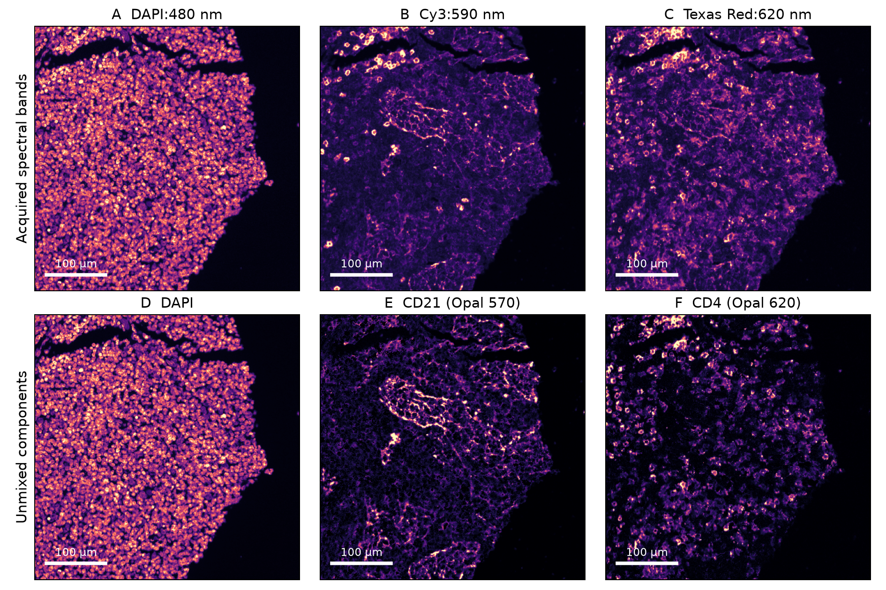</a>

*The same region of the FL6 tissue core before and after unmixing. A–C show three of the 35 acquired bands, labelled by filter set and wavelength. D–F show the DAPI, CD21 and CD4 components fitted with NNLS. Each panel maps zero to its own 99.5th intensity percentile using the same purple-to-yellow colour scale; scale bars are 100 µm. The [complete eight-component view](../../assets/figures/fl6-unmixed-components.png) includes the other markers and AF. Images and references from [Tsakiroglou and colleagues, follicular-lymphoma dataset (2021)](https://doi.org/10.17632/274xbhc5rx.3), [CC BY 4.0](https://creativecommons.org/licenses/by/4.0/).*

### Examine the reconstructed signal

Reconstruction shows how much of the measured spectral signal is explained by the fitted components. We recover the fitted coefficients `A` by dividing each saved component by the multiplier used in the [component-intensity calculation](#reference-normalization-and-saved-component-intensities). Multiplying these coefficients by the accepted reference matrix gives the predicted band intensities, `Ŷ = SA`. The observed intensities `Y` receive the same intensity correction that was applied during unmixing.

For each pixel, the relative spectral residual is `‖y − ŷ‖₂ / ‖y‖₂`, calculated across all acquired bands. Mapping this value over the image locates areas where the reference spectra explain the measurements less well. A large ratio can also occur in a dim background region because the observed signal in the denominator is small; inspect the signal image alongside the residual map. Pixels with no observed signal have an undefined ratio.

Select **Reconstruction images** and the acquired band, then choose **Open figure**. The first two panels show its observed and reconstructed intensities on a shared display scale; the third maps the relative spectral residual across all acquired bands in the selected field.

<a href="../../assets/figures/fl6-reconstruction-diagnostic.png">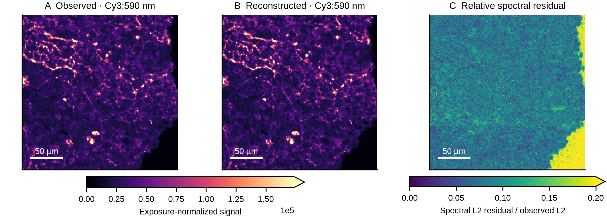</a>

*Reconstruction review of a 512 × 512-pixel FL6 field. A shows the exposure-corrected Cy3:590 nm band; B reconstructs it from all eight fitted components, including AF, on the same intensity scale. C shows the relative spectral residual across all 35 bands, with a median of 0.0813; values above 0.20 use the upper colour. Scale bars show 50 µm. Images and references from [Tsakiroglou and colleagues, follicular-lymphoma dataset (2021)](https://doi.org/10.17632/274xbhc5rx.3), [CC BY 4.0](https://creativecommons.org/licenses/by/4.0/).*

Select **Reconstruction mean spectra** in Results to compare the observed and reconstructed intensities across the acquired bands. For each band, we average the corrected pixel intensities over the selected field and calculate the corresponding average from the reconstructed image. Differences between the two curves identify bands where the reconstruction overestimates or underestimates the average signal. Local differences can cancel when averaged, so examine these curves together with the spatial residual map. Switching between the image and spectra views retains the selected field. The overview follows the acquired-band order. When the band labels also record optical settings and detection wavelengths, additional panels show the same values against wavelength within each setting. 

<a href="../../assets/figures/fl6-reconstruction-spectra.svg">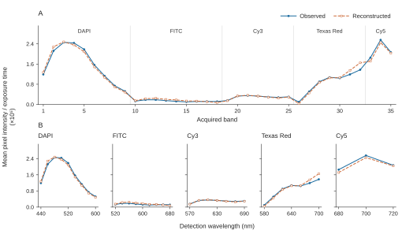</a>

*Observed and reconstructed spectra from the 512 × 512-pixel FL6 field shown above. Each blue point is the average intensity across all pixels in that field for one acquired band, after dividing the pixel intensities by the band’s exposure time in seconds. Orange points show the corresponding averages from the reconstructed image. A displays all 35 bands in their recorded order; B shows the same values against detection wavelength, separately for DAPI, FITC, Cy3, Texas Red and Cy5 optical settings. Both rows share the same intensity scale. At the longer wavelengths in the Texas Red panel, the reconstructed average exceeds the observed average.*

Use **Export figure…** for either view to save PNG, SVG or PDF. **Export data…** offers a CSV table of field-mean spectra and a NumPy archive containing the displayed band images, residual arrays, mean spectra and field coordinates.

When the reconstruction leaves substantial signal unexplained, review the [background regions](library-from-images.md#select-stained-control-and-background-regions), the [imaging settings](#correct-intensities-for-acquisition-settings) for the sample and controls, and the [regions used to estimate autofluorescence](library-from-images.md#estimate-and-remove-tissue-autofluorescence). To revise these choices after unmixing, open **Run → Spectral unmixing → Review unmixing settings…** and follow [Change saved unmixing settings](../run/index.md#change-saved-unmixing-settings). 

## Saved result and revisions

The saved result identifies the source image and series, the assigned components and markers, and how the image was prepared. For an unmixed result, it also records the reference library, intensity correction, solver settings, processor, calculation and output precision, and convergence summaries. For either **No** option, it records the reason for copying and the reviewed channel assignments, including the measurement-band mapping when used.

The prepared `.ome.zarr` image retains the component names, pixel sizes and intensity pyramid used for subsequent tissue and cell analysis. [Image storage](../images/storage.md) describes its layout and compression; [Image preparation](../images/processing.md) explains how regions and pyramid levels are calculated and saved.

Revising the reference spectra or intensity correction requires a new component image and recalculation of results using the changed intensities. For an existing analysis, use an offered correction form or follow [the available revision and recovery actions](../run/index.md#change-a-completed-decision). See [saved files](../setup/analysis-folder.md#reference-analysis-folder) and [coordinate and channel definitions](../images/processing.md#reference-image-metadata-and-coordinates).

## Calculation details

The calculations below explain the NNLS stopping condition and the fitting procedures used for each precision and processor. 

NNLS convergence calculation

For a pixel with corrected band intensities `y` and fitted component coefficients `a`, the spectral matrix `S` contains one reference spectrum per column. The least-squares loss measures the reconstruction error, and its gradient describes how that loss changes as each coefficient changes

$$
L(a)=\frac12\lVert Sa-y\rVert_2^2,\qquad \nabla L=S^T(Sa-y).
$$

For a block of pixels, the columns of `Y` contain their measured spectra and the columns of `A` contain their fitted coefficients. We prepare `G = SᵀS` once and calculate `H = SᵀY` for each block, giving

$$
\nabla L=GA-H.
$$

At the minimum, a positive coefficient has zero gradient because neither increasing nor decreasing it should reduce the loss. A coefficient already equal to zero can only increase; a nonnegative gradient means that increasing it would not reduce the loss. We collect the remaining violations of these conditions in `Q`

$$
Q_{jp}=\begin{cases}
(GA-H)_{jp},&A_{jp}>0\ \text{or}\ (GA-H)_{jp}<0,\\
0,&\text{otherwise}.
\end{cases}
$$

The float64 CPU solver stops iterating for pixel `p` when every component's violation is within the scaled tolerance

$$
\max_j|Q_{jp}|\le\epsilon\left(1+\max_j|H_{jp}|\right),
$$

where `ε` is **NNLS stopping tolerance**, initially `10⁻⁸`. The factor on the right scales the permitted gradient error using that pixel's values in `H = SᵀY`. A smaller tolerance therefore requires the coefficients to be closer to satisfying the optimality conditions. The [reconstructed-signal review](#examine-the-reconstructed-signal) separately shows how closely the fitted spectra reproduce the measured intensities.

Precision-specific calculations

### Precision and processor-specific calculations

The following routes calculate coefficients at the selected precision before conversion to the output storage type.

For full intensity correction, we calculate `M_b g_b B_b t_b` in float64, convert each image region to float32 and subtract the per-band offsets before scaling. Offset-corrected measurements may be negative. Exposure-only correction divides a float32 copy by each band's exposure time. The stored-calibrated route reads the existing intensities without further intensity correction. The selected solver receives these corrected measurements.

#### Float32 clipped LS

The float32 clipped-LS implementation prepares its pseudoinverse and singular values in float64, then converts the matrix to float32. The conversion must remain finite and preserve nonzero entries. A preparation check combines transform-conversion error, input rounding and dot-product roundoff on the spectral matrix's norm scale, with a fixed preparation limit of `10⁻⁴`.

We multiply pixel spectra in float32 on CPU, CUDA or Metal and clip negative coefficients. Autocast is disabled, and the CUDA preparation checks the reduced-mantissa settings used for matrix multiplication. Input blocks and calculated coefficients must remain finite.

#### Float32 NNLS

The float32 NNLS route requires a requested tolerance of at least `10⁻⁵`. It starts from clipped LS and maintains the spectral residual `R=SA-Y`. A change `δ_j` in component `j` updates the residual as

$$
R\leftarrow R+S_j\delta_j.
$$

We calculate each component update from its projection onto the current residual, divided by the squared norm of its reference column. After every sweep, we recalculate the full residual and gradient to limit accumulated update error.

The final per-pixel gradient cutoff in this implementation is `ε max|Sᵀy_p|`. Its internal convergence target is half that cutoff. For up to eight components, we also prepare subset transforms, perform at most 16 coordinate sweeps before subset checks and count those subset attempts within the remaining iteration limit.

A requested NNLS tolerance tighter than the supported float32 limit selects an available float64 route. The saved result records the processor and precision actually used for that calculation.

#### Float64 PyTorch fitting

The float64 tensor solver applies the estimator using PyTorch tensors. For NNLS, it checks the calculated coefficients against the original float64 spectral matrix and residual. Any rejected or nonfinite columns are fitted with the corresponding float64 CPU solver and inserted into their original positions. The result records how many pixels were checked and refitted.

A float64 fit runs on a processor that supports 64-bit arithmetic. Metal supports the float32 calculation; a request for float64 uses the CPU or another selected processor that supports it.

Grouped NNLS fitting, memory and saved diagnostics

### Float64 CPU solution sequence

We prepare the spectral matrix calculations in float64. The pseudoinverse uses `numpy.linalg.pinv` with a relative cutoff of `1e-15` for retaining singular values, as described in [NumPy's pseudoinverse documentation](https://numpy.org/doc/2.0/reference/generated/numpy.linalg.pinv.html). Grouped fitting also uses `G = SᵀS`; in exact arithmetic, its condition number is the square of that of `S`, so poorly separated reference spectra can amplify numerical errors in this calculation.

We use four successive calculations, accepting a pixel as soon as its nonnegative coefficients satisfy the final gradient criterion.

i) **Check the unconstrained solution.** We calculate `S⁺Y`, clip negative coefficients and check the resulting gradient. Pixels whose original coefficients are at least `−ε` and whose clipped solution meets that gradient condition are accepted immediately. Constrained iterations then process the remaining pixels.

ii) **Fit groups with the same positive components.** For panels with at most 12 components, we prepare inverses for the nonempty component subsets. If `J` contains the components proposed to be positive, we calculate

$$
A_{J,p}=G_{JJ}^{-1}H_{J,p},\qquad A_{\bar J,p}=0.
$$

We encode each subset as a bit mask and group pixels requiring the same subset. One small matrix multiplication then fits all columns in that group. There are `2^C-1` nonempty subsets, giving 255 for eight components and 4095 for twelve. We check coefficient signs and the projected gradient, then update the proposed subsets of unresolved pixels. This stage performs at most `min(8, max_iterations)` grouped rounds and is enabled when the selected iteration limit is at least `2C`.

iii) **Update unresolved coefficients one component at a time.** Holding the remaining coefficients fixed, we minimize the least-squares loss with respect to that coefficient and enforce nonnegativity

$$
A_j\leftarrow\max\left(0,\frac{H_j-G_jA+G_{jj}A_j}{G_{jj}}\right).
$$

We apply each component update across all unresolved pixels. A complete pass through the components is one sweep; later updates use the values already changed earlier in that sweep. After each sweep, we recalculate the gradient, store converged columns and remove them from further iteration. The available sweep count is the iteration limit minus completed grouped rounds. When subset inverses are available, we use at most `max(32,4C)` sweeps before the final subset search.

iv) **Check remaining subsets.** For eligible small panels, we first check the all-zero solution and then test the cached nonempty subsets in descending subset-size order. We require feasible selected coefficients and acceptable gradients for omitted components. The complete assembled result receives the final projected-gradient check.

The diagnostic iteration count includes grouped rounds and coordinate sweeps. It excludes the final enumeration of cached subsets. An unresolved pixel makes the block's convergence flag false, and the image-processing workflow requires every region to converge before accepting the final NNLS output.

The internal CPU block contains at most 65,536 pixels. This limits iterative arrays while the enclosing image region can contain more pixels. The spectral matrix, pseudoinverse and subset calculations are reused across these blocks.

### Memory, computation and saved results

After preparing the small spectral matrix calculations, the initial LS multiplication costs approximately `O(BCP)`. Constructing `G` costs `O(BC²)`. A coordinate sweep over unresolved pixels costs approximately `O(C²P_unresolved)`. Grouping shares subset calculations, while removing converged columns concentrates later iterations on pixels that still need refinement.

The saved diagnostics include total pixels, pixels accepted from the initial LS solution, pixels requiring constrained fitting, iteration count, maximum projected-gradient violation and convergence status. Across blocks and regions, we sum the pixel counts and report the highest iteration count and largest gradient violation.

The corrected spectra, component coefficients and iterative arrays contribute to the regional memory estimate. The defaults permit two simultaneous shard tasks and two in-flight regions within a 2 GiB working-array allowance; memory availability can reduce these allocations. The local executor reduces numerical block dimensions when necessary, writes the fitted components directly to sharded OME-Zarr, and constructs the intensity pyramid from completed output. The [image-processing reference](../images/processing.md#reference-image-processing) provides the allocation formulas, temporary-storage estimate and output sequence.

### Sources and implementation

Intensity correction is implemented in `preprocessing/unmixing/normalization.py`. The coefficient calculations are implemented in `solvers.py`, `grouped_nnls.py`, `float32_clipped.py`, `float32_nnls.py` and `tensor_solver.py`. The accepted reference determines the band-response and component-reporting vectors. Initial method settings are stored in `config/defaults/unmixing.json`.

---

**Next:** [Tissue detection](../tissue/index.md).
