# Creating a library from images

[Spectral unmixing and component preparation](index.md) · [Spectral reference sources](index.md#spectral-reference-sources)

**On this page:** [Reference controls](#choose-the-reference-controls) · [Preparation overview](#preparation-overview) · [Reference images](#add-reference-images) · [Control regions](#select-control-and-background-regions) · [AF sets](#review-and-combine-af-spectra) · [Single-stain regions](#select-single-stain-regions-and-assign-af-sets) · [Fluorophore extraction](#estimate-and-remove-tissue-autofluorescence) · [Extraction review](#review-fluorophore-extraction) · [Combine spectra](#combine-the-reviewed-regional-spectra) · [Final AF reference](#prepare-the-af-reference-for-unmixing)

The library contains a spectrum for each fluorophore and, when needed, one or more spectra for tissue autofluorescence (AF). To isolate a fluorophore, we measure stained regions in its single-stain image, subtract image background and the estimated AF contribution, and combine the regional spectra. The control tissue also supplies the AF spectra fitted during unmixing.

<a href="../../assets/figures/reference-spectrum-preparation.svg">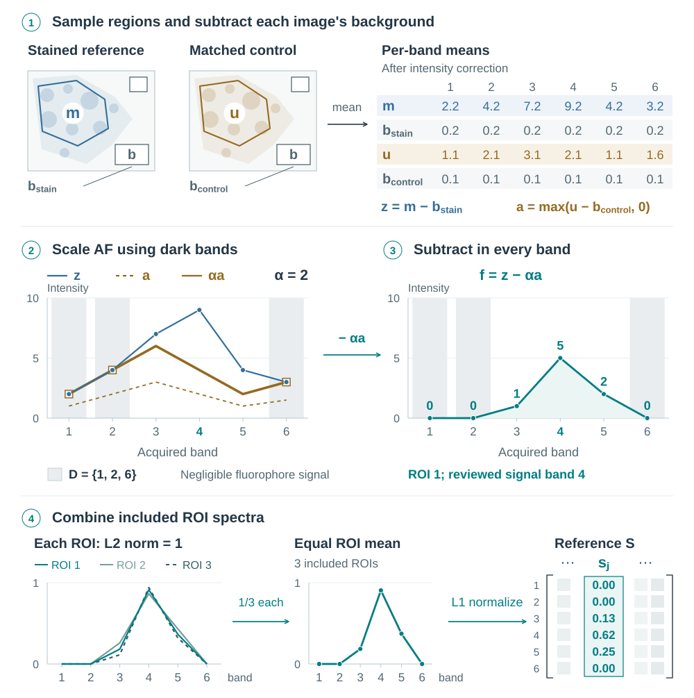</a>

*Schematic of preparing one fluorophore reference across six acquired bands. Background regions are combined within each image to calculate its mean background intensity in each band. Dark bands 1, 2 and 6 estimate the tissue-autofluorescence multiplier, here α = 2. Subtracting the scaled control isolates the fluorophore spectrum. Each of the three included regional profiles is L2-normalized before equal-weight averaging. The final arrow applies L1 normalization to the average, producing the stored reference column shown on the right.*

## Choose the reference controls

Select **Create a library from reference images**, then choose **One shared unstained control** to use one compatible unstained image for the references, or **Separate controls for each stain** to provide a matched control for each stain. The control image should represent the autofluorescence likely to accompany the fluorophore signal in the single-stain reference images.

<a href="../../assets/screenshots/unmixing-reference-controls-current.png">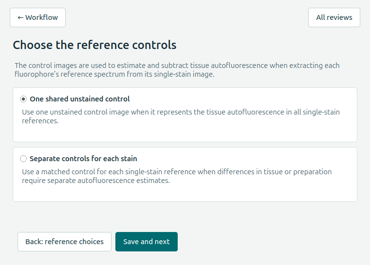</a>

_Reference-control choices before adding the single-stain images. **One shared unstained control** is selected._

## Preparation overview

The preparation overview lists the required control and single-stain images and the steps for preparing their spectra. With **One shared unstained control**, its preparation appears above the fluorophore preparations. With **Separate controls for each stain**, each control preparation appears with its corresponding single-stain preparation.

Prepare each control through **Regions** and **Review and combine**. For each single-stain, select its stained and background regions, assign AF sets, choose the bands used for extraction, review the extracted spectra, and combine the included regional spectra. The overview shows the current step and which preparations are complete.

Once all fluorophore spectra are accepted, choose the control regions for the final AF references when needed, then review the complete library before unmixing.

<a href="../../assets/screenshots/unmixing-reference-files-current.png">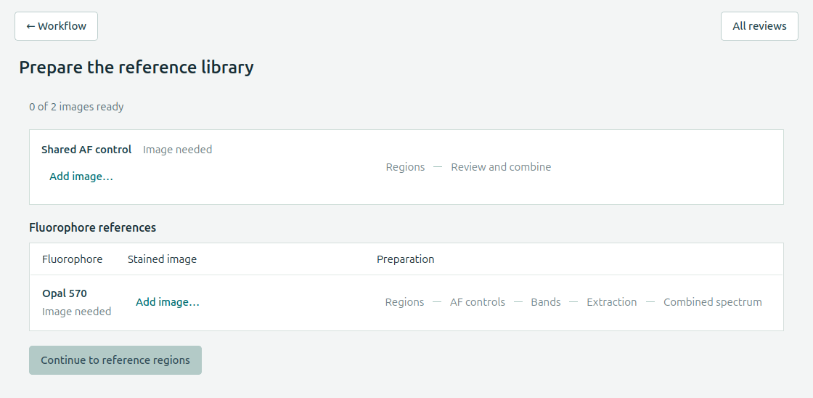</a>

*The preparation overview before adding the shared unstained control and Opal 570 single-stain image. **Add image…** opens file selection for the corresponding reference.*

## Add reference images

Choose **Add image…** for the single-stain image or control on the overview, then choose **Add file…**. Select the file and review its band names and recorded imaging settings. If several files have been reviewed for the same reference, select the one to use. Before calculating regional spectra, we correct the reference-pixel intensities using the [imaging settings and correction procedure](index.md#correct-intensities-for-acquisition-settings) reviewed for unmixing.

<a href="../../assets/screenshots/unmixing-reference-file-selection-current.png">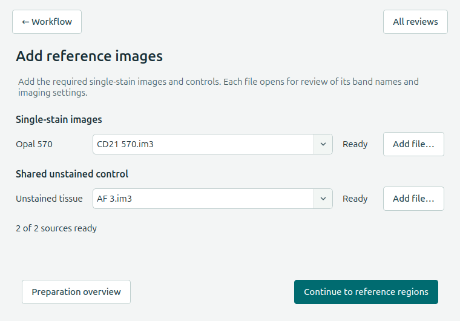</a>

*The file-selection form with CD21 570.im3 assigned to Opal 570 and AF 3.im3 selected as the shared unstained control. Reference images from [Tsakiroglou and colleagues, follicular-lymphoma dataset (2021)](https://data.mendeley.com/datasets/2fz5gndzzf/1), [CC BY 4.0](https://creativecommons.org/licenses/by/4.0/).*

## Select control and background regions

Prepare the unstained control first. Choose **Annotate in QuPath**, outline representative areas of unstained tissue and assign the **Autofluorescence control** class. Outline tissue-free areas with negligible fluorophore signal and assign **Image background**.

Save and return from QuPath, then choose **Use saved regions**. To omit a region from the preparation, use **×** beside its area. Continue with **Review AF spectra**.

With **One shared unstained control**, prepare its AF sets once and use them across the single-stain preparations. With **Separate controls for each stain**, prepare the corresponding control and its sets before each single-stain image. In both cases, background is measured in the image from which it will be subtracted.

<a href="../../assets/screenshots/unmixing-reference-region-selection-current.png">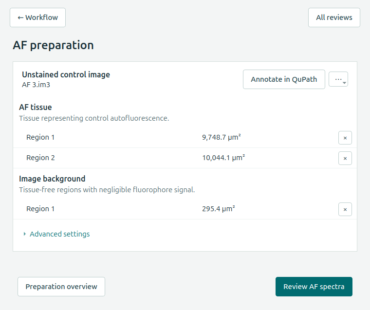</a>

*Two tissue regions and one tissue-free background region selected from AF 3.im3. The tissue regions are combined on the following spectrum-review page. Reference image from [Tsakiroglou and colleagues, follicular-lymphoma dataset (2021)](https://data.mendeley.com/datasets/2fz5gndzzf/1), [CC BY 4.0](https://creativecommons.org/licenses/by/4.0/).*

Select reference pixels and calculate regional means

Under **Advanced settings**, the **Stained tissue pixels**, **Control pixels** and **Background pixels** sections set the pixel-selection limits for each region type. **Saturation cutoff** and **Minimum spectral signal** determine which pixels contribute to the regional spectra. We also exclude marked artifacts and pixels with missing or infinite values in any band; excluding a pixel removes its complete spectrum from the regional average.

For images stored as detector counts, we exclude a pixel if any band reaches the saturation cutoff multiplied by that band’s detector maximum, or lies outside the detector range. **Saturation cutoff** starts at **1.0**, which excludes pixels reaching the recorded maximum. If a detector offset was subtracted beforehand, we add the recorded offset back before checking these limits. If that offset is unavailable, the original count image is required. For calibrated intensities used as stored, the original detector counts are unavailable and this saturation check cannot be performed.

**Minimum spectral signal** starts at **0** and applies after the selected intensity correction. We calculate each pixel’s spectrum length as the square root of the sum of squared intensities across bands, and exclude pixels at or below the selected minimum. This check applies to both detector-count and calibrated images.

For each stained, control and background region, we average the retained pixel intensities separately in every band. These band means form the region’s spectrum. When several background regions contribute to one background estimate, their means are weighted by their retained pixel counts, giving the mean across all included background pixels.

<a href="../../assets/figures/reference-pixel-selection.svg">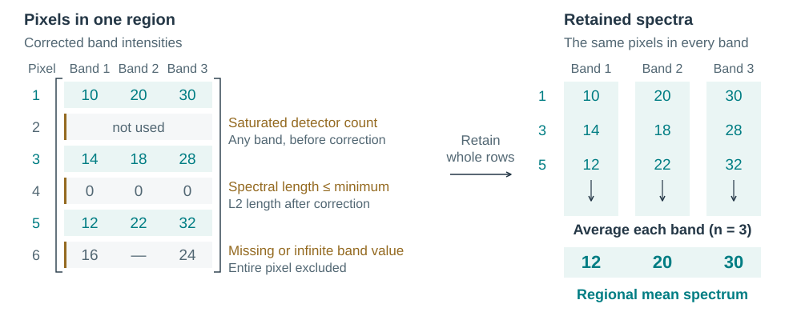</a>

*Schematic of pixel selection within one reference region. Saturation, insufficient signal or a missing band value excludes the pixel’s complete spectrum. The same three retained pixels contribute to every band mean.*

## Review and combine AF spectra

After selecting tissue and background regions in an unstained control, **Review and combine AF spectra** shows the tissue spectra after background subtraction and the combined AF estimate. An **AF set** contains the tissue regions whose spectra we average to estimate autofluorescence for a stained region. Initially, all selected tissue regions belong to one set.

If different stained regions need different AF estimates, choose **+ Set** and assign its regions in **Region membership**. Select a set above the plot to inspect its contributing regions, or **All sets** to compare the combined spectra. To combine sets, select the set whose regions you want to move, then choose the destination under **Merge into**.

The plot compares each set's combined spectrum with its contributing regions. Selecting a table row emphasizes that region's curve. The table also reports each region's weight, included pixel count, signal strength after background subtraction and clipping, and number of bands below zero. Excluding a region removes it from the estimate while leaving its measurements available for inspection.

For each region in a set, we subtract its image’s background spectrum from its regional mean spectrum. We average these differences with equal weight across regions, then set negative values in the average to zero. Each region therefore contributes one mean spectrum, regardless of its area.

For `K` control regions and band `b`, let `u_kb` be region `k`’s mean intensity and `B_kb` its image-background intensity. The combined control spectrum is

$$
a_b=\max\left(0,\frac{1}{K}\sum_{k=1}^{K}(u_{kb}-B_{kb})\right).
$$

Clipping after averaging allows regional values below background to contribute to the set estimate.

By default, the plot scales each spectrum to unit L2 length. **Band values and calculation details** shows the signed differences, clipped values and normalized values. Choose **Apply set changes** after changing membership, then **Use AF sets** to continue to the single-stain preparation. Each stained region is assigned one of these sets before selecting the bands used to estimate its AF contribution.

<a href="../../assets/screenshots/unmixing-af-control-spectra-current.png">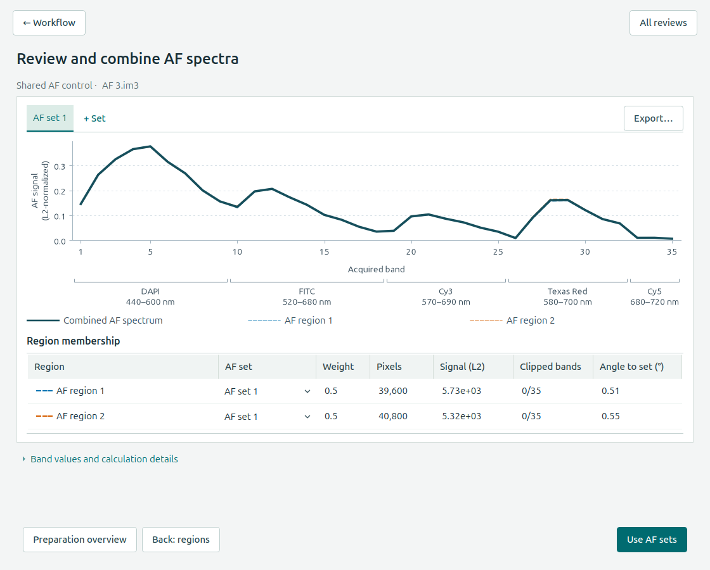</a>

*The combined spectrum from two regions in AF 3.im3. The regions contain **39,600** and **40,800** retained pixels and contribute equal weights of **0.5**; their angles to the combined spectrum are **0.51°** and **0.55°**. Reference image from [Tsakiroglou and colleagues, follicular-lymphoma dataset (2021)](https://data.mendeley.com/datasets/2fz5gndzzf/1), [CC BY 4.0](https://creativecommons.org/licenses/by/4.0/).*

## Select single-stain regions and assign AF sets

After reviewing the control's AF spectra, open **Regions** for its single-stain image. Choose **Annotate in QuPath**, outline tissue containing the fluorophore signal and assign **Positive reference**. Outline tissue-free areas and assign **Image background**. Save and return from QuPath, choose **Use saved regions**, then continue with **Assign AF controls**.

<a href="../../assets/screenshots/unmixing-single-stain-regions-current.png">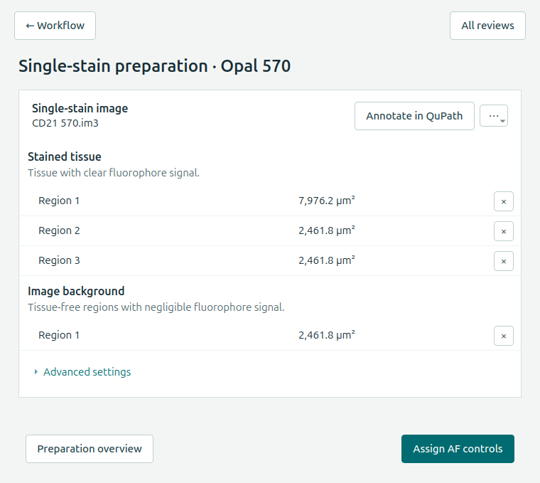</a>

*Three stained regions and one tissue-free background region selected from CD21 570.im3 for the Opal 570 reference.*

On **Assign AF controls**, assign an AF set to each stained region. The set supplies the control spectrum used to estimate and subtract that region's autofluorescence. When the control has only one set, it is selected automatically; with several sets, choose the one that represents the tissue in that stained region. Continue to band selection after completing these assignments.

<a href="../../assets/screenshots/unmixing-stained-af-assignment-current.png">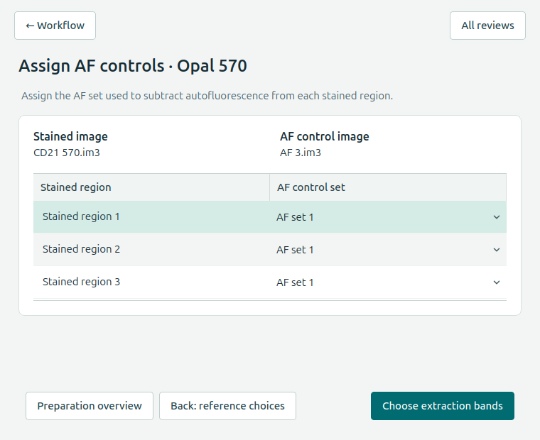</a>

*All three Opal 570 stained regions use AF set 1, prepared from the two tissue regions in AF 3.im3.*

## Estimate and remove tissue autofluorescence

On **Choose bands for fluorophore extraction**, select a stained region above the plot. The curves show its mean spectrum after background correction and the control spectrum from its assigned AF set.

Use **Band role** below the plot to select one **Signal** band containing the fluorophore signal. Choose **Estimate AF** for the dark bands, where tissue autofluorescence is measurable and the fluorophore contributes negligible signal (dark bands are explained below). These choices apply to all stained regions for this fluorophore.

Select **Extract reference spectra**. To calculate the reference spectra for each stained region, we [fit the control spectrum to the measured dark-band intensities](#calculate-the-af-contribution), then subtract the scaled control across all bands.

<a href="../../assets/screenshots/unmixing-signal-background-bands.png">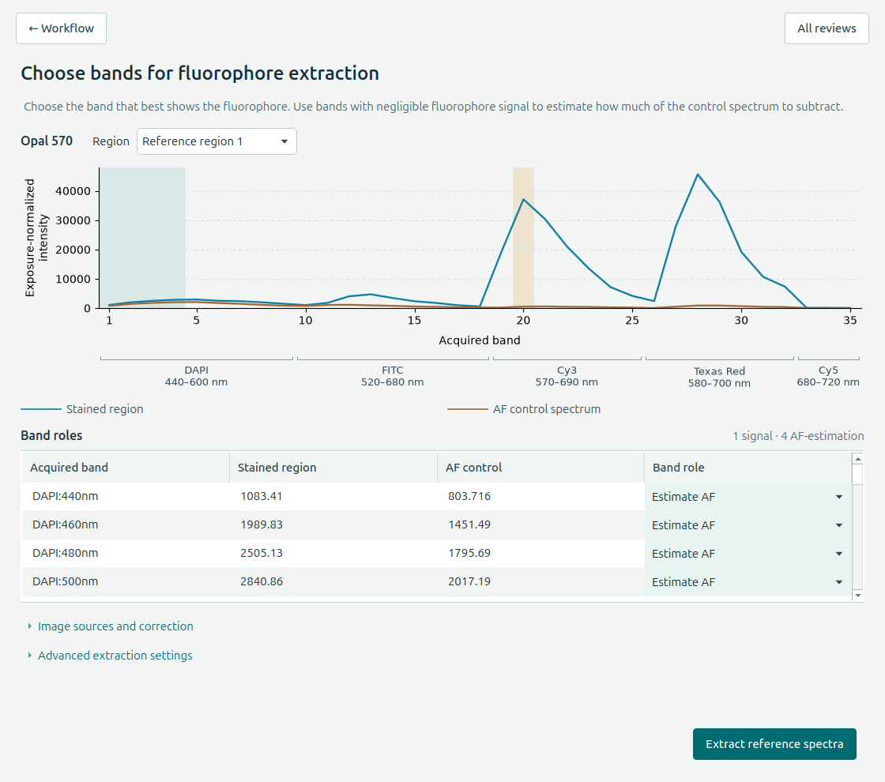</a>

*Band choices for the Opal 570 reference across 35 acquired bands. Cy3:590nm supplies the signal band, and DAPI:440nm, DAPI:460nm, DAPI:480nm and DAPI:500nm estimate AF. The brackets show each optical setting’s recorded wavelength span. Reference images from [Tsakiroglou and colleagues, follicular-lymphoma dataset (2021)](https://data.mendeley.com/datasets/2fz5gndzzf/1), [CC BY 4.0](https://creativecommons.org/licenses/by/4.0/).*

### Calculate the AF contribution

To estimate the AF contribution, we first subtract the stained image’s background spectrum from the selected stained region’s mean spectrum and set negative values to zero. Call this corrected spectrum `z`, and the assigned set's [combined control spectrum](#estimate-and-subtract-autofluorescence) `a`. Using the selected AF-estimation bands (the dark bands `D`), we find the nonnegative multiplier `α` that gives the least-squares match between `αa` and `z`

$$
\alpha=\max\left(0,\frac{\sum_{b\in D}a_bz_b}{\sum_{b\in D}a_b^2}\right),
\qquad r_b=z_b-\alpha a_b.
$$

We multiply the control spectrum by this factor across all bands, then subtract it from the corrected stained-region spectrum `z` to obtain the remaining signal `r`. The factor is fitted separately for each stained region.

This calculation assumes that the region's autofluorescence has the control's spectral shape and differs only in magnitude. Including appreciable fluorophore signal in the dark bands can overestimate the AF contribution and subtract part of that signal. If the control has too little signal in those bands to estimate the multiplier, extraction cannot proceed with that selection.

**Advanced extraction settings** contains two minimum-signal limits. **Minimum autofluorescence signal** applies to each control region and the combined control spectrum after background subtraction and clipping. **Minimum extracted fluorophore signal** applies after AF subtraction and clipping. Both use the L2 magnitude across all bands before normalization and start at **0**. Each spectrum must exceed its corresponding limit to proceed.

## Review fluorophore extraction

On **Review fluorophore extraction**, select a stained reference region above the plot or in the table. The initial **Autofluorescence subtraction** view compares its mean spectrum after background subtraction and clipping (**Stained region**) with the estimated AF contribution (**Estimated AF**). We obtain that contribution by multiplying the assigned control spectrum by the factor [calculated from the selected dark bands](#calculate-the-af-contribution). The **Remaining signal (signed)** curve shows the difference between these two spectra, including any negative band values.

Switch to **Extracted signal** to compare this signed remaining signal with the fluorophore estimate after negative band values are set to zero. The summary reports the number of clipped bands and the **Relative correction (L2)**. Expand **Correction details and band values** to inspect the fitted multiplier and the bands used to estimate it. The table gives the values of the curves in the selected view.

**Relative correction (L2)** compares the L2 magnitude of the negative values removed with the L2 magnitude of the positive values retained, as `100 × removed magnitude / retained magnitude`. For example, clipping a three-band spectrum of `[-2, −3, 4]` to `[0, 0, 4]` removes values with an L2 magnitude of `√(2² + 3²) = √13` and retains a magnitude of `4`, giving `100 × √13 / 4 ≈ 90.1%`.

Open **Preparation overview**, then choose **Bands** to revise the band selection or **Regions** to edit the reference regions. Choose **Include** or **Exclude** in **Use in reference**, then **Compare included regions** to compare the extracted spectra. A region with insufficient remaining fluorophore signal cannot be included.

<table>
<tr>
<td width="50%" valign="top"><a href="../../assets/screenshots/unmixing-af-subtraction-components.png">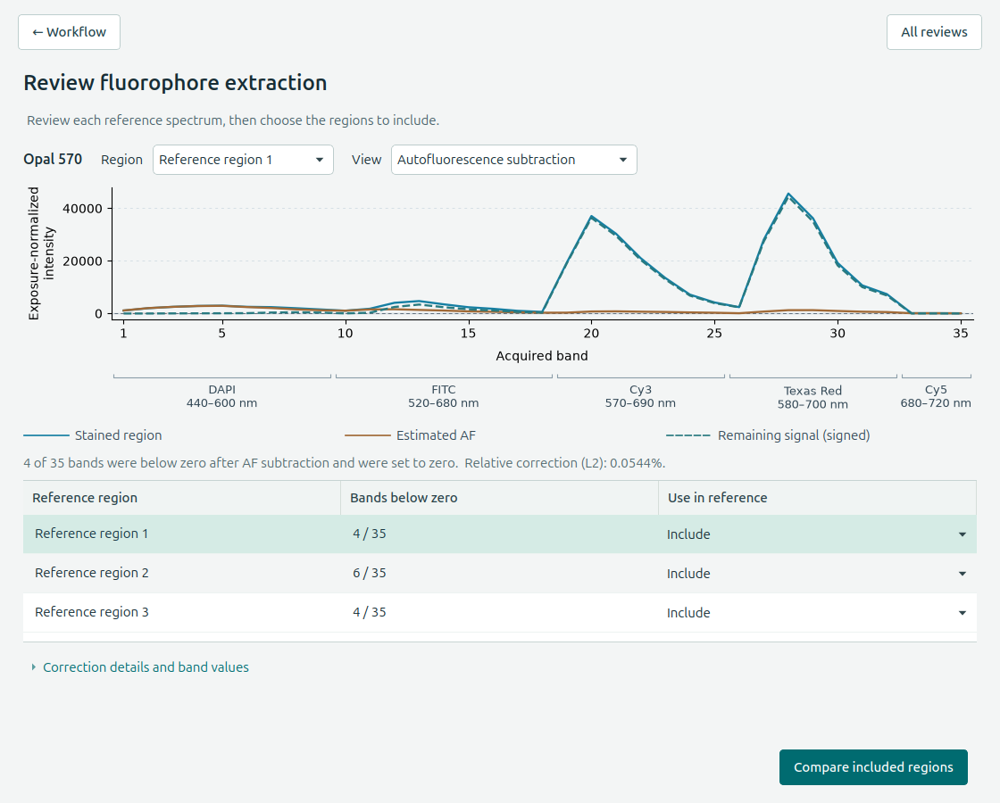</a></td>
<td width="50%" valign="top"><a href="../../assets/screenshots/unmixing-af-subtraction-review.png">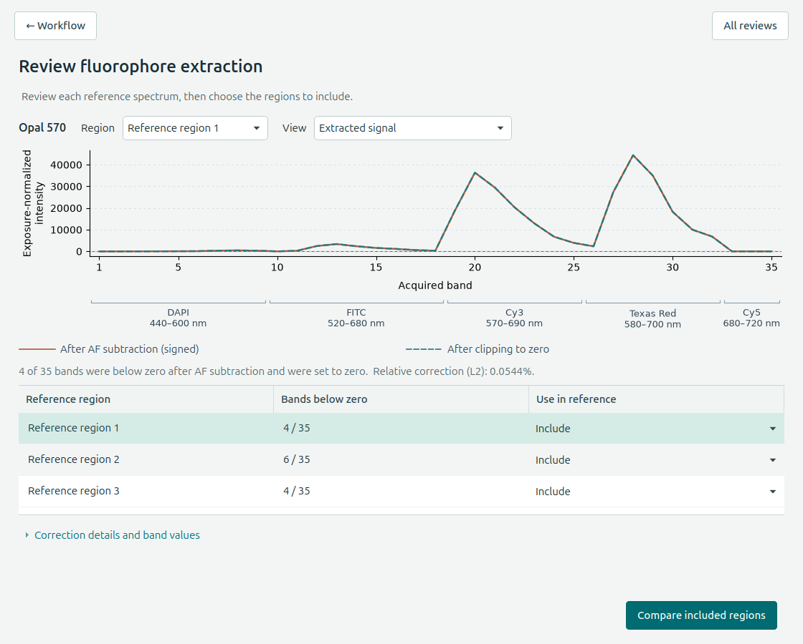</a></td>
</tr>
</table>

*The first Opal 570 reference region across 35 acquired bands. On the left, the AF 3 control spectrum is multiplied by **1.39234** before subtraction from the stained-region spectrum. On the right, **four of 35** remaining band values are negative and are set to zero. The removed values have an L2 magnitude equal to **0.0544%** of the retained positive signal. Reference images from [Tsakiroglou and colleagues, follicular-lymphoma dataset (2021)](https://data.mendeley.com/datasets/2fz5gndzzf/1), [CC BY 4.0](https://creativecommons.org/licenses/by/4.0/).*

## Combine the reviewed regional spectra

For each sampled region, we divide the extracted fluorophore spectrum by its L2 length. This removes differences in overall brightness so that we can compare how the signal is distributed across acquired bands. We average the included regions' normalized spectra with equal weight to obtain the combined spectrum.

We divide the combined spectrum by its sum across bands and save this L1-normalized spectrum as the fluorophore's reference column in the spectral mixing matrix `S`. Together, these steps give

$$
q_r=\frac{f_r}{\lVert f_r\rVert_2},
\qquad \bar q=\frac1R\sum_{r=1}^{R}q_r,
\qquad s_j=\frac{\bar q}{\sum_b\bar q_b}.
$$

Here, `f_r` is the extracted spectrum from region `r`, and `R` is the number of included regions. The stored column `s_j` sums to one and is used directly for unmixing. [Reference normalization and saved component intensities](index.md#reference-normalization-and-saved-component-intensities) explains how this scaling affects the reported intensity.

### Review regional differences

We compare each regional spectrum with the combined spectrum using their spectral angle. We calculate this angle as the inverse cosine of their dot product after scaling both profiles to unit L2 length. Identical spectral shapes give an angle of 0°.

On **Review the fluorophore spectrum**, compare each regional curve with the combined reference. A spectral angle above **5°** flags a region whose curve differs in shape. After inspecting it, choose **Retain difference** to keep its contribution or **Exclude** to omit it.

If the discrepancy warrants revisiting the extraction, open **Preparation overview**. Choose **Regions** to edit the reference outlines, or **Bands** to change the band choices and repeat AF subtraction with the existing regional mean spectra. Select **Use fluorophore spectrum** when you have reviewed the included regions and resolved the flagged differences.

Use **Pan** and **Zoom** to inspect overlapping curves, then **Reset view** to restore the full plot. Clicking a legend label changes whether that curve is displayed; use the table's **Decision** column to change which regions contribute to the combined reference.

<a href="../../assets/screenshots/unmixing-regional-comparison-current.png">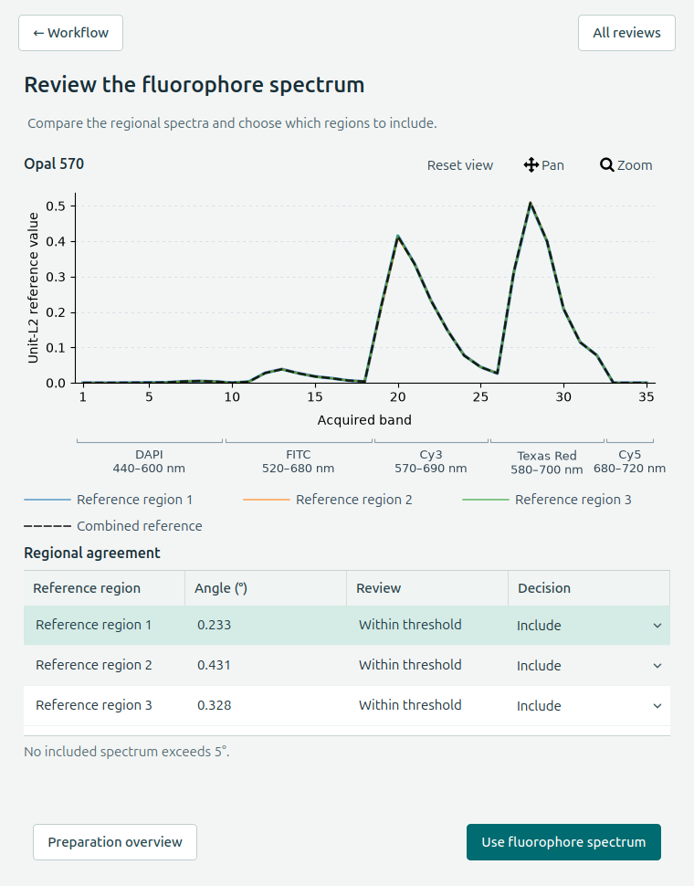</a>

*Three Opal 570 regional spectra from CD21 570.im3 nearly overlap the dashed combined curve across 35 acquired bands. Their angles to the combined reference are 0.233°, 0.431° and 0.328°, all below the 5° review threshold. Reference image from [Tsakiroglou, spectral-library dataset (2021)](https://doi.org/10.17632/2fz5gndzzf.1), [CC BY 4.0](https://creativecommons.org/licenses/by/4.0/).*

Repeat this process for the other fluorophores. Choose **Export reference library…** to save the accepted fluorophore library as a `.miflib.zip` package. It contains `library.json` with the spectra, acquired-band identities, imaging settings and reference-region records, plus CSV tables with L1- and L2-normalized values. Import the package or its `library.json` to reuse the fluorophore references.

## Prepare the AF reference for unmixing

After accepting the fluorophore spectra, **Final autofluorescence reference** brings together the regions from the shared unstained control or the separate controls used for each stain. Choose the regions that represent autofluorescence in the image being unmixed and assign them to AF references in the table. This step is skipped when that image has already had its autofluorescence subtracted.

Each AF reference supplies one spectrum to the unmixing library, where it is fitted as a separate component. Combine regions with similar spectral shapes, or retain separate references when the mixed image contains distinct types of autofluorescence. A reference can combine regions from different controls, with each included region assigned to one final AF reference.

Select a reference above the plot to compare its combined spectrum with the contributing regions. To change its name, choose **Rename…**, enter the name and choose **Apply name**. Use **+ Reference** to create another, then assign regions in **Region membership**; select **Excluded** for a region that should not contribute.

Choose **All spectra** to compare the combined references. To combine references, select the reference whose regions you want to move, then choose the destination under **Merge into**.

Each AF reference in the library represents the regions you assigned to it. We [subtract their backgrounds and average the regional spectra with equal weight](#estimate-and-subtract-autofluorescence), then divide each band of the combined, clipped spectrum by the sum across its bands. This gives one L1-normalized library column per AF reference. Choose **Update spectral preview** to [compare these columns with the fluorophore references](index.md#review-the-reference-spectra) before fitting the mixed image.

<a href="../../assets/screenshots/unmixing-final-af-reference-current.png">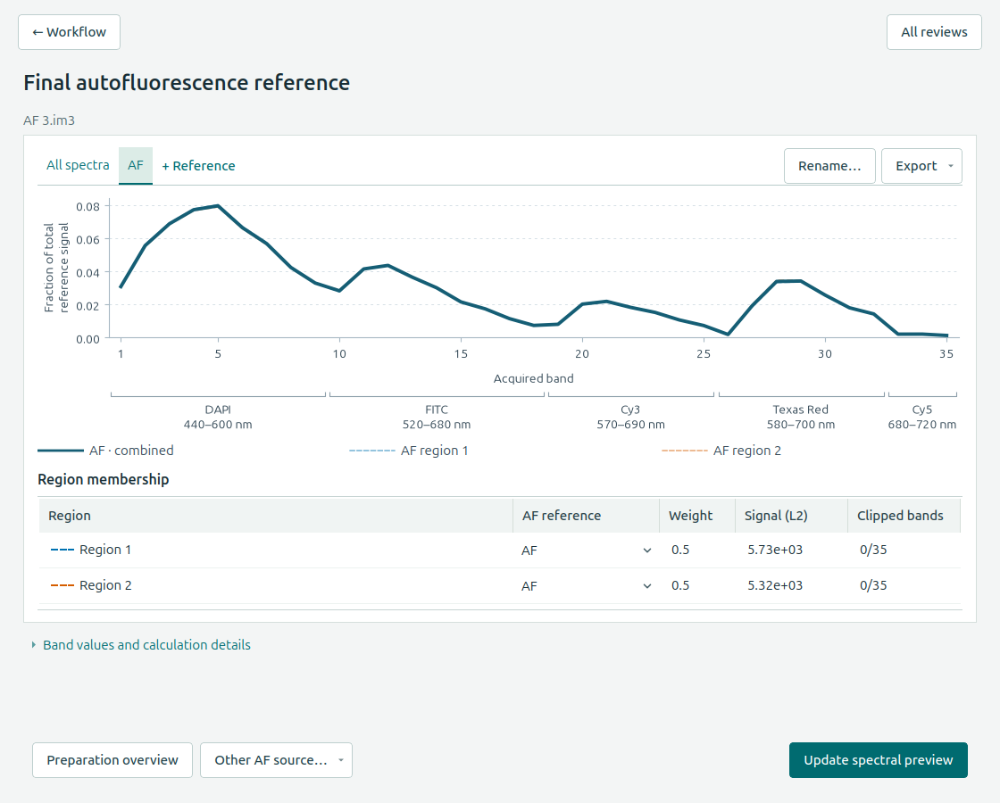</a>

*The two AF 3 regions contribute equally to one final AF reference. The solid curve shows their combined, L1-normalized spectrum; dashed curves show the contributing regional spectra. The table assigns both regions to **AF**.*

---

**Next:** [Review the reference spectra and run unmixing](index.md#review-the-reference-spectra).
